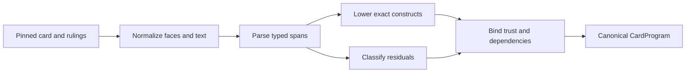

# Oracle compiler architecture

Face lowering classifies printed types and attachment source roles before
dispatching effect grammar. Public trigger parsers construct a common event
binding and pass normalized subscriptions to the CardProgram runtime
requirements pass. Trigger discovery delegates aggregate event identity and
arrival facts to the aggregation owner before APNAP placement.

The mana contribution draw production binds both printed instructions in one
Oracle span. The second instruction draws for every player using the sum of
those payments. The ability word itself carries no rules authority. A payment
without this draw result, a different contributor or recipient scope, or a
different quantity expression remains material.

Paired power and toughness clauses that cover both combat states lower to
one layer-7a definition. Both branches use the same effective basic land
subtype. The count reads the source's controller or owner before attack
commitment and switches to the committed defending player while the source
attacks. The attack owner resolves player, planeswalker, and battle
destinations.

Additive current-target trait riders preserve the target domain established by
the first instruction. Canonical subtype alternatives and the existing public
creature, artifact-creature, token, legendary, counter, and enchantment predicates
feed the existing target-condition model. A broad permanent target requires an
explicit creature-only proof before a creature result is lowered. Conditions
read current information when reached; a resulting temporary grant remains
bound to that incarnation until its normal duration ends. The earlier subtype
stat production keeps its payload and identity. `Instead`, paired-creature
references, additional targets, and unowned predicates remain separate.

A creature target qualified by an activated ability with the tap symbol reads
the current typed ability catalog. Printed, intrinsic, and granted abilities
qualify while present. The query ignores whether the target could activate the
ability and is shared by offers, submitted commands, and resolution. Verbal
tap costs and the untap symbol do not qualify.

A source Equipment attachment can be followed by fixed temporary characteristics
or tap state for the same chosen creature. The attachment owner first validates
its existing scalar target codec; an equivalent typed creature predicate then
proves each following component. The stored target and effect payloads retain
their existing forms. Attachment failure leaves an otherwise legal followup
intact, and source reentry cannot redirect the older attachment instruction.
Optional or independent targets, reflexive results, and unowned conditional
bodies remain separate composition boundaries.

Private hand collections use a versioned selection for up to two or any number
of creature, land, permanent, or non-Saga permanent cards. The ability controller
chooses a private set of current hand incarnations, including zero. One sealed
instruction revalidates that set and delegates simultaneous entry, replacement
choices, and pre-entry Aura attachment choices to the existing zone owner.
Newcomers see the complete entering group; an Aura cannot attach to a member
of that same group. Scalar private hand-entry payloads retain their existing
codec. A separate creature slot and land slot permit at most one card for
each type. Dual-type cards fit either slot, and each selected card enters once.
A fixed resolving creature sacrifice can gate a private draw followed by the
paired entry choice. The choice reads the hand after the draw. The sacrifice,
draw, and simultaneous entries use their existing owners. Other origins,
exact mandatory entry counts, variable maxima, and face-down or attacking
collection entries remain material.

Count-only search replacements and shared library-procedure tails lower to
two complete literal procedures before their existing condition owner selects
a branch. Reveal, placement, selected-card count, remainder order and shuffle
remain part of each validated procedure. The original search count must match
an explicit `instead of` reference. Public conditions read current state;
Kicker and Bargain retain their sealed casting declarations, including copies.
Unknown tails or independently requested slots remain material.

Conditional preparation of a creature target lowers separately from its
following fight or one-way power damage. The version-sixteen wrapper binds
the first target and a current controller, target-characteristic, or night
condition. It selects fixed stats, keywords, or counters through the existing
effect cursor; a false predicate still permits the following damage instruction.
Both instructions retain the ordinary target revalidation and mutation owners.
An illegal opposing target does not suppress an applicable bonus to a legal
first target. Cast-time conditions and nested modal programs remain separate
composition boundaries.

Modal programs bind their choice envelope before resolving capability ownership
for individual modes. A condition inside a mode is evaluated when that mode
resolves. The mode's target requirements remain part of stack placement and
resolution revalidation.

Reciprocal source and target power damage lowers to two ordered damage
instructions. Each instruction reads its own source's power when reached;
the first instruction retains the original ability source's last known
information after departure. Damage, prevention, replacement and continuation
use their ordinary owners. The version-four return instruction binds its
recipient to the original source incarnation supplied by the interpreter;
a blink cannot redirect that damage to the returned permanent.
This production preserves the difference from
Fight's simultaneous damage and source-presence requirement. Optional pairs,
intervening source-presence conditions and unconsumed siblings remain material.

The fixed token-and-fight result retains the current opponents' creature
incarnations before one grouped creation. Replacement additions enter without
becoming extra fighters. The resolving caster pairs the original token
results with distinct retained opponents. All reciprocal powers are read
before the damage owner commits one simultaneous batch. Entry triggers wait
for the spell to finish.

An explicit source characteristic clause can be followed by `Tap it` or
`Untap it`. The compiler binds that pronoun to the same source incarnation,
then delegates both complete clauses to their existing characteristic and
tap-state owners. Tap remains a resolution instruction; already-tapped sources
retain any otherwise legal activation. The ordinary ordered-clause capability
and both leaf capabilities govern admission.
New source characteristic/tap programs carry a dedicated production identity
whose runtime binding checks the complete ordered pair and its keyword
consumers. Historical source instructions retain their existing admission and
replay contract.

Fixed targeted damage with an additional fixed amount to its controller lowers
to one damage-set instruction. The existing single-target grammar owns target
legality; the resolving controller is an untargeted recipient. The compiler
retains both amounts, and resolution combines them when the controller is also
the target. Replacement choices and damage commit use the ordinary batch owner.
An illegal sole target prevents the complete spell or ability from resolving.

Fixed predefined-token alternatives lower to the existing resolution option
choice. Each branch carries the ordinary canonical token definition and its
capability dependencies. The resolving controller chooses exactly one branch;
token creation and replacements use their existing owners. Unsupported kinds,
quantities, recipients and sibling instructions remain material.

A creature-token batch with an intrinsic quoted ability can use the power or
toughness of the creature sacrificed as its mandatory casting cost. The
compiler closes the paid quantity in the token result and binds the token's
ability as its own source-spanned child. The casting cost records the
sacrificed object's battlefield stats. Spell copies carry those same stats
into their own token creation.

Own-graveyard return targets can mix unqualified card types, subtypes and
supertypes through the existing typed target-form disjunction. Graveyard, owner,
cardinality and any mana-value maximum remain common constraints around those
alternatives. Homogeneous target schemas retain their existing representation.

Next-eligible-spell reductions lower the complete printed spell qualifier to
the existing public spell predicate. Their amount is fixed or comes from an
independently closed public quantity or source-stat producer. Resolution locks
the amount in the duration journal; later casting uses that literal value.
Unknown qualifiers, causal amounts and other next-spell grants remain material.

A next-spell mana alternative can apply to the next red or green creature
spell its controller casts this turn. The price keeps the ordinary permission
and timing checks and preserves additional costs. Any accepted qualifying cast
consumes the window. A separate targeted result can double each current stat
and grant trample through the existing temporary characteristic owner.

Fixed named-token productions recognize grammatical verb casing independently
from captured name data. `Create` and `create` yield the same definition while
proper-name spelling and apostrophes remain exact. Entering-attacking and
cleanup clauses keep their existing owners. An unconsumed `that's`/`that is`/
`that are` state rider cannot become part of a token name; unsupported recipient
or ability text remains residual.

A name-first legendary creature token may carry a fixed keyword list. The
ordinary creature-token production validates that entire list before the named
production adds the printed name and legendary supertype.
Artifact and enchantment creature types survive that composition. The literal
name validator admits closed lowercase name particles while unconsumed effect
text remains residual.

Named noncreature Equipment tokens retain their printed name, color, legendary
supertype and artifact subtypes without acquiring creature stats. The typed
token compiler compiles their complete quoted definition and expands ordinary
fixed Equip through the existing activated-cost, target and attachment owners.
Intrinsic static components use token-local identities, separate from temporary
granted characteristic components. Nested creature grants retain exact child
aliases and granting-attachment payment identity. Equipped-attack triggers keep
their required current-ability companion. Definition payloads independently
require token, typed-ability and Equip capabilities; unsupported children and
variable Equip remain material. No runtime Oracle interpreter is introduced.

Fixed ordinary Equip and Crew keywords can also be granted by closed battlefield
queries and represented public-state conditions. They remain additional abilities;
printed prices survive and accepted activations retain their paid costs after a
grant source or condition disappears. Equip's canonical typed activation catalog
travels beside its granted attachment program. Equip-only cost scopes validate
that trusted catalog against the complete cost, timing, target and result facts.
An ordinary attachment activation acquires no Equip identity from its effect shape.
Historical ability and grant schemas retain their previous payloads.

Fixed creature-token definitions can carry the already represented combat
trigger keywords, including a positive Bushido parameter. The compiler emits
their canonical intrinsic fragments, and the token definition minimum requires
one matching instance for every printed keyword. Their existing combat owners
execute the abilities; the token producer introduces no additional scheduler.

Fixed characteristic changes and ordinary declaration prohibitions may carry
controller-relative next-turn timing. The compiler consumes the literal
duration and delegates the full body to the existing selection and result
grammar. The timing field carries a separate capability requirement. Existing
operation identifiers continue to identify the same result owners across
historical records.

The closed Detain production lowers an opposing creature or nonland permanent,
up to two matching targets, and a fixed mana-bounded set of opposing nonland
permanents. Targeted forms use the ordinary announcement and revalidation
owners. The untargeted form reads effective public characteristics at
resolution and locks the matching incarnations to one journal entry.
Printed next-turn attack, block, and activation prohibitions lower a single
creature target to that same journal entry. The printed activation condition
stays on the ability and uses the ordinary proposal owner.
Native registration checks the closed instruction and its declared capabilities
before offering a Detain or printed prohibition activation.

A closed fixed token definition may identify one target player or opponent as
the creator. The ordinary public player target schema chooses and revalidates
that recipient. The token transaction uses the chosen player's creation
replacements, ownership, and entry control. An explicit “you create” uses the
same controller binding as the ordinary imperative. Simultaneous creation by
multiple players retains its separate semantic boundary.

Scalar token-result definitions may precede a printed cleanup sentence. The
cleanup adapter delegates the creation clause to the existing scalar owner,
preserving its producer, result slots and source context, then attaches the
already-closed cleanup instruction. This admits no new amount origin, query,
target cardinality or copy recipe. Runtime validation accepts materialized
integer token stats in their canonical numeric representation and continues to
reject booleans, unknown fields and malformed definitions.

Closed effect components reconstruct token-specific mechanics through the
canonical token descriptor owner. Validated attacking and cleanup markers keep
their required capabilities even when an outer counter sequence or optional
payment has unrelated mechanics. Missing runtime declarations still reject;
the audit supplies the actual leaf requirements rather than widening trust.

`compiler/created_token_cleanup_templates.py` recognizes one complete printed
cleanup clause over an independently closed ordinary token producer. The new
version-one cleanup instruction distinguishes sacrifice from exile and the
next end step, the creator's next end step, and end of combat. The canonical
creation transaction captures the full replacement-expanded batch and schedules
identity-pinned public movement through the existing delayed-trigger owner.
Sacrifice requires the original delayed controller still to control each
affected permanent. Exile retains its ordinary movement authority.

The resolving source and creator remain distinct from the created token
identities. Attacking definitions use an explicit version-two continuation;
ordinary version-one attacking definitions retain their earlier form. Existing
copy aftercare delegates to the same scheduling composition while preserving its
prior encoded delayed records and event journal. Unknown conditions, copy
recipes, postcreation grants and unrepresented siblings remain residual.

Next-cast copy instructions register the original resolving source in the
delayed-trigger journal. Each registration matches one committed cast by its
controller before that turn ends. The cast event supplies the actual spell
types, subtype and announced mana value. Matching registrations join the
ordinary APNAP batch and retain the referenced spell through departure. The
existing copy owner applies each copy's target choices and preserves its modes,
announced X and paid-text choices.

Compound printed keyword lists preserve each Myriad instance as a separate
source-spanned node and registered ability identity. Ordinary sibling keywords
retain their independent owner. Single Myriad declarations keep their existing
complete IR payload; unknown siblings and parameters remain residual. The
compiler composition changes no copy, destination, trigger-placement or delayed
cleanup policy. Each Myriad trigger independently uses those existing owners.

`compiler/attacking_token_results.py` recognizes a complete ordinary attacking
rider over an independently closed fixed creature-token definition. Each
replacement-expanded token receives its own public defending-player,
planeswalker, or battle destination through the shared destination planner and
canonical token transaction. The printed tapped state is retained. Entering
attacking does not dispatch an attack-declaration event; ordinary entry triggers
still see the batch. A nonattacking controller creates the printed tokens
without adding attackers. Specified recipients, new copies, delayed riders and
unrepresented definitions remain residual. Mobilize keeps its existing schema
and delayed sacrifice under its separate owner.

An unsupported trigger result keeps a material `trigger_effect` residual when
its event is already exact. The frontier classifies its executable clause
landmarks instead of attributing the failure to event binding. Unknown events
retain their event-binding blockers. This diagnostic distinction preserves the
original source text and span and does not promote an unsupported ability or
change its executable effects.

`compiler/state_trigger_nodes.py` lowers complete controlled-battlefield state
conditions followed by mandatory source sacrifice. A versioned subscription
reuses existing public count, source exclusion and numeric existence queries.
The existing source-maintenance result with no payment supplies the automatic
controlled, incarnation-bound sacrifice. Unsupported conditions and result
bodies remain residual.

The state observer uses committed occurrence, instruction, complete zone-batch
and pre-SBA boundaries, then queues ordinary APNAP occurrences. Pending batches
and stack entries suppress another instance of the same source incarnation and
ability. Condition relief after discovery does not cancel the result. This
differs from an intervening if clause. Runtime binding derives the subscription
and result owners without coverage annotations. See
[ADR 0129](../adr/0129-public-state-trigger-observation.md).

Current casting source placement precedes payment under an explicit checkpoint
version. Affordability binds pure mana and layered characteristic queries to a
read-only prospective source view. Accepted casts complete the same real spell
with actual paid costs; historical absence keeps its earlier order. See
[ADR 0130](../adr/0130-casting-source-placement-before-costs.md).
An older checkpoint cannot activate a newly introduced state subscription
without the current placement version; its historical registry and casts retain
their earlier behavior.

Attached-source casting restrictions opt in through version two of the existing
player-restriction descriptor. The source-turn opponent rule reads a current
reciprocal attachment to a battlefield creature, including its effective type;
it does not capture an equip target or add an activation prohibition. Version
one keeps its exact fields and behavior. Equipment controller, owner and
equipped-creature controller remain distinct inputs to their existing owners.

Fixed sacrifice-price spell promotion validates the canonical typed price and
its declared authority separately from the independently closed result. The
composed producer prefix is checked against that price before testing the
result through existing closed-effect owners. A strict capability binding alone
does not promote unknown prices, malformed descriptors or unrepresented results.

The static dispatcher first gives the complete source to its existing exact
owners, preserving supported Domain, Max speed, Raid and timing conditions.
Only when no exact owner recognizes that source does it remove a leading
nonfunctional ability or flavor label
before invoking its existing typed body owners. Declaration nodes keep the
original labeled text and source span while parsing that complete material
body. Numeric labels and their punctuation also precede ordinary triggered
abilities. The same normalization applies to synthesized static abilities.
Functional visit instructions remain outside this normalization;
every condition, threshold and result in a body must still lower exactly.

`compiler/live_modifier_quantities.py` lowers represented live player values,
attached-recipient colors and mana value, attachment unions, and public-set
power/toughness modifiers. It uses the existing source, attachment, public
query, and layer owners. Characteristic quantity version four reserves closed
nonnegative life, opponent-poison, and attached-object references; earlier
quantity encodings retain their fields. These new references do not define
characteristic values in layer seven a.

`compiler/noncreature_quantity_subtypes.py` supplies closed quantity nouns
from the existing pinned card-type/subtype vocabulary. Singular and plural
forms such as Shrine, Bobblehead, Clue, and Cave retain their correlated card
types. Spell subtypes use the represented graveyard card domain and can match
either instant or sorcery. The shared query descriptor preserves controller,
zone, and printed token restrictions; a name containing a subtype word and a
Changeling's creature types do not supply a different card type's subtype.
The existing public-result, static-characteristic, and mana owners still
validate their complete quantity and result shapes. Unknown nouns and
unconsumed qualifications remain residual.

`compiler/alternative_discard_templates.py` lowers complete “discard two cards
unless” quality alternatives, optionally preceded by a fixed draw. It retains
controller, target-player, and each-player subjects separately. Quality leaves
reuse the existing card-query grammar, with disjunctions for alternatives and
conjunctions for a card carrying multiple stated qualities. A typed count
descriptor extends the existing private APNAP discard owner; it does not
create another selection or mutation mechanism. Unknown predicates and
unrepresented follow-up conditions remain residual.

`compiler/chosen_type_event_bindings.py` matches represented cast, entry,
death, and entry-or-attack subjects against the existing per-object creature
type designation. A creature-spell subject retains its Creature gate; a
general spell of that type can also be Kindred. The current cast snapshot
reads the effective stack spell when casting completes. Changeling supplies
its current creature types, and a face-down spell has the types it actually
carries on the stack. Entry and death use their sealed public subtype facts,
while attack uses its versioned declared-attack snapshot. Multi-event
containers validate those facts within each branch.
The source's recorded choice is distinct from its owner and controller, and
departure discovery uses the existing last-known source snapshot. A missing
choice matches nothing; a malformed designation fails closed. Noncreature
type choices, aggregation, linked self-type additions, and result bodies
still require their separate owners; unsupported material siblings remain
residual.

The quantified anthem production validates its creature subject through the
existing fixed-query anthem owner. An “other” quantity proves that every
affected recipient belongs to the counted set before excluding one member.
It continues to count correctly when the ability source is outside that set.
Explicit source references can supply a live count of the Auras or Equipment
attached to that source. The receiver and attachment queries keep their own
scope. Recipient-local counter anthems read each creature's named counters
and can apply to creatures controlled by other players.
Fixed keyword grants remain separate components, so a zero numeric quantity
does not remove an unconditional keyword. Ambiguous attachment pronouns,
private identity predicates and later-layer characteristic reads remain
residual.

`compiler/fuse_faces.py` binds the printed Fuse declarations across both faces
of a split card after their ordinary spell bodies lower. The existing ability
component registry validates one complete-source declaration. Neither an
isolated Fuse keyword nor an exact half admits an unsupported companion.
`compiler/fuse_programs.py` derives the fused resolution program from the two
ordinary programs, retaining their source identities and capability closures.
Its shape owner checks both original bodies, their order, and the exact combined
effect and target projection. Missing executable composition remains a material
CardProgram residual; the physical card still has two faces.

`compiler/adventure_faces.py` binds each Adventure alternative's existing
source-spanned nodes to `casting.lifecycle.adventure`. Runtime requirements
retain that intrinsic authority even if a program omits its explicit
dependency. Fixed token definitions compose with this lifecycle through their
existing token capability and normal creation owner. Ordinary whole-card admission still rejects unsupported bodies or
normal-face siblings. Current versioned casting offers the alternative using
its own characteristics and price. The `adventure.py` owner carries its sealed
face binding through ordinary resolution, substitutes exile for the resolving
spell's graveyard destination, and grants only the resolving controller a
normal-face permission for that exile incarnation. The ordinary zone, casting,
cost, target and stack owners perform the transitions. Countered and
all-targets-illegal alternatives gain no permission, and a spell copy grants
none. An absent execution marker retains historical behavior as described by
the [Game Record contract](../reference/game-record.md).

Each represented half keeps its own fixed single-object target roles. The
composer maps flat and named references into distinct canonical target groups,
preserving constraints within a half while allowing the same object in both
halves. A target-hand-count amount receives an explicit version-7 group binding;
its player remains independent of the other half's target. The runtime minimum
validator restores each half and delegates its requirements to the existing
owners. Variable printed mana, modal or variable-cardinality target bodies,
additional-price declarations, and unowned companion instructions remain
residual under this production. Earlier scalar encodings retain their fields
and meaning.

`compiler/action_permission_templates.py` lowers the complete optional
opening-hand battlefield clause to a hand-scoped permission in the existing
action registry. Named self-references and ordinary object pronouns use the
shared compiler reference owner. The descriptor requires the existing
complete-card admission certificate: an independently trusted fragment cannot
authorize entry when material siblings remain unclosed. The separate
`compiler/opening_hand_reveal_templates.py` production uses that same admission
boundary for optional opening reveals. It closes the complete clause around
one represented result and a first-global-upkeep, first-own-upkeep or
first-own-main timing. Result lowering happens at compilation through the
existing fixed Scry, Mill, token, mana, actual-life-transfer and library-selection
owners. Paid reveals, unknown results and unrepresented timing remain residual.

Fixed controller Scry accepts a positive printed count with an optional
explicit “you”. The resolving controller receives the existing private
library ordering choice.

The existing binary additional-cost production also accepts a canonical
creature-subtype card revealed from the caster's hand. The reveal leaf uses
the same typed alternative-price schema as the fixed mana branch, for both
permanents and instant/sorcery results. Optional linked cast-fact reveals,
Behold and unknown qualifiers remain residual. Complete result admission stays
independent of recognizing the casting price.

Fixed additional tap prices compile a positive count and a closed union of
controlled permanent types. The existing alternative-price production may
pair one with a fixed mana payment. The separate
`compiler/additional_cost_payment_faces.py` composer preserves independently
lowered literal Convoke, Improvise and Delve nodes beside an admitted price and
one complete result. Each node retains its original source span, including
payment keywords between the price and result. Repeated instances retain their
ordinary redundancy. Current typed grants can combine Convoke and Improvise
through the shared allocation owner. Variable tap discounts and unknown price
or keyword qualifiers remain residual.

Optional colored hand-exile credit uses one printed color and a private
collection offered to the caster. The caster may select zero or more eligible
hand cards, including cards that grant more reduction than the cast needs. The
price owner applies two generic mana of reduction per selection and preserves
colored requirements and the announced X. The casting transaction checks the
sealed references again at payment, moves the selected cards together, and
publishes their zone triggers through the ordinary cast boundary. The separate
result owner must admit the complete spell body for the price to be executable.

Fixed Waterbend costs compile into an optional typed activation cost field or
one mandatory casting-price descriptor. The existing result owners keep their
source spans and capabilities. A separate price/result composition capability
validates the complete Waterbend price and the independently admitted result;
recognizing the price does not admit an unknown result. Printed Waterbend
action observers bind the acting player through the normalized public-action
event owner. Optional and variable Waterbend grammar remains residual.

`compiler/optional_life_costs.py` admits the complete declaration that optionally
pays two life to reduce one corresponding colored mana for a matching colored
permanent spell. The declaration includes its colored-only restriction and
requires complete source admission. Current battlefield abilities supply the
choices; the existing total-cost and life-payment owners apply the price.
Each provider can be paid once per spell, including when its reduction is zero.
Generic and other-color costs remain intact. Unknown amounts, mismatched colors
and incomplete declarations retain material residuals.

`compiler/targeted_spell_costs.py` lowers opponent spell-cost increases for the
source itself and one or more controlled commander creatures. Descriptors bind
the fixed generic amount and target subject; the existing cast-cost component
registry and current static-ability fragments own runtime applicability.
Version-three descriptors also represent fixed generic battlefield-source
reductions for spells targeting the source or at least one current creature.
They retain an explicit all-caster, source-controller or source-opponent
relation. A qualifying target set applies the adjustment once per source;
per-target cardinality, granted target-cost abilities, activation prices and
colored or variable adjustments remain outside this production. Historical
tax and intrinsic source-face predicate schemas keep their existing wire.

Version four composes a current source, attachment or fixed public target query
with a typed spell-characteristic predicate and caster relation. The shared
target-subject compiler serves both spell and activation costs. Aura reductions
read the proposed spell's selected face through the canonical face view, so a
back-face Aura uses its Aura characteristics while its front face remains a
creature elsewhere. Public subject queries keep controller and owner roles
separate and count each source adjustment once across the announced target set.
The existing cost owner applies increases before reductions and preserves
colored payments. Hidden, temporal and numerical target predicates remain
residuals. Recipient-granted cost instances use the quoted-ability path below.

Version five represents a fixed generic adjustment per distinct selected target
or distinct targeted battlefield creature, with an explicit caster relation
and selected-spell predicate. Repeated references to one object count once for
this family. The source-local Strive/per-extra-target producer remains separate.
Count-aware witnesses retain each signed adjustment and supported target/X
range through the existing cost owner. Historical modifier versions retain
their exact payloads; the new fact version distinguishes count-sensitive
quotes without changing their source provenance fields.

`compiler/targeted_activation_costs.py` composes the existing activation source
selector with a current target subject: the modifier source, its attached
permanent, or a fixed public characteristic query. A separate version-two
handler requires the target-dependent capability; the historical flat handler
rejects that version. Equip discounts use the canonical ability-kind selector,
and an Equipment's own conditional equip discount retains its provider identity.
Shared target witnesses drive both affordable target projection and the exact
accepted price. Generic reductions preserve colored and nonmana obligations.
Unrepresented adjustment amounts and hidden, temporal or numerical target predicates
remain residuals. This production does not lower granted spell-tax abilities.

An ability-local target-value operand separately represents a generic discount
from the current power, color count or fixed power threshold of one required
creature target. Its cost and activation catalog retain the same version-three
operand. The single-target shape is checked during lowering and independently
at runtime admission. Quotes read complete current characteristics, then use
the existing target-cost witnesses to expose affordable alternatives and price
the selected command. Payment locks that quote before mana abilities and later
responses change the target. Optional, multiple, modal, noncreature and
nonbattlefield target plans remain outside this production.

The printed clause “This ability costs {1} less to activate for each …” binds
one public quantity to the activated ability's cost and catalog descriptor.
A charge activation can note the type of its paid mana when it resolves.
The source retains that type for its current incarnation. The later tap and
counter payment uses that recorded type, including colorless. With no note,
the counter payment produces zero mana.
Its output clause can use current source power and a printed pair of colors.
The activation keeps its independently parsed current-turn and once-per-turn
restrictions. A player can activate it explicitly before spending the mana.
The ordinary activation pricing owner reads that quantity from the activator's
public collection or the current source before paying the costs. It uses the
same generic adjustment for offers and accepted commands, with colored and
nonmana fees preserved. The represented readers count controlled permanents,
graveyard cards, distinct basic land types, or one named counter on the source.
The bound price applies to one ordinary battlefield activation, and the full
effect and timing clauses still require complete-card admission.

Ability-local prices can also read a fixed public condition or a controlled
power or toughness aggregate. A false condition retains the ordinary price.
The source and the rest of the public state remain in their current zones
while the price is determined. A printed discard-source activation from hand
can use a controlled battlefield count. The normal cost owner locks the
generic reduction before mana abilities or other payments change that state.

The version-two public adjustment retains an ordinary mana vector and a closed
controller hand-size or current-turn draw threshold. A qualifying reduction
can remove colored as well as generic mana. A generic increase can instead
count the controller's entire hand without querying card identities. Both
forms use the shared activation price owner, which applies increases before
reductions and preserves mandatory targets, taps, timing and use limits.
Actual draws in the current turn supply draw thresholds; another player's
draws and earlier turns do not qualify. Historical quantity and condition
descriptors retain their existing payloads. Identity-filtered hand queries,
conditional increases and unrepresented predicates remain residuals.

`compiler/preparation_nodes.py` binds an enters-prepared clause on the normal
face of a preparation card to closed inset instant or sorcery characteristics.
The entry replacement and source-only preparation results require complete-card
admission, including the inset result. The source result reuses typed trigger
conditions and payment wrappers where their complete effects are supported.
A paid source preparation activation uses the ordinary cost owners. Promotion
checks the closed result and its complete matching battlefield program,
including the inset spell.
Current ability presence controls replacement and trigger discovery. Alternative
characteristics remain copiable independently of later ability removal.
An inset copy has only its inset characteristics and does not acquire another
prepare spell. Individual preparation names remain selectable by the existing
card-name choice owner; the database's combined display name is not a name
choice. Unknown preparation clauses and unsupported inset types stay residual.

`compiler/conditional_flash_nodes.py` lowers complete conditional self-timing
clauses against represented public-state predicates. An “as though” clause
grants timing permission without granting the Flash keyword. An explicit
conditional “has flash” clause additionally emits separate battlefield and
stack characteristic programs. Same-line contributions retain distinct stable
program identities and their complete original source span. Unrepresented
source-attribute conditions, compound numeric timing conditions and cyclic
keyword conditions remain residual.

`compiler/surcharge_flash_nodes.py` lowers the complete intrinsic as-though-Flash
clause with a fixed additional generic mana price. Its face-bound timing
component carries a closed `ManaSurchargeFlashSpec` through the existing
cast-permission registry. `rules/casting/surcharge_flash_costs.py` adds a marked
paid cost option before increases and reductions. Outside independent legal
timing, only paid options remain available to both offers and submissions.
Independent timing permissions and server-authorized casts during resolution
retain their ordinary cost options. The permission grants no Flash keyword,
does not alter mana value, and does not bypass zone access or casting
prohibitions. Unknown prices and incomplete sibling instructions stay residual.

`compiler/temporary_player_rule_templates.py` also lowers fixed controller-wide
as-though-Flash effects through the existing cast-permission operation. The
versioned result uses a separate timing field and the normal cast proposal
checks the selected characteristics. One-shot windows end on the first
matching committed cast, including a cast at ordinary timing. The Suspend
special action can use this timing permission without consuming it. Cleanup
ends unused windows. The permission changes timing without granting Flash or
access to a new zone, and ordinary casting prohibitions still apply. A next
creature-card play can use the permission to play a creature-land during the
controller's turn. The land-play owner checks the selected face, independent
zone access and the remaining land allowance. The first qualifying cast or
land play consumes the window, including when ordinary timing permits it.

`compiler/self_cast_restriction_nodes.py` uses the shared intrinsic cast owner for
printed public eligibility. Its versioned condition leaf admits current controlled
permanent subtype counts and a committed creature death in the current turn.
The selected face is checked before costs through the same offer and command
legality path. Current control, effective subtype and phasing govern counts;
nonbattlefield moves and earlier-turn deaths do not satisfy the death fact.
An accepted cast retains its legality after a response changes those facts.
The own-combat window checks the actual caster and current combat before
payment. The exact Entwine form retains this restriction alongside separate
resolution-locked creature and untap/additional-combat mode owners.
The generic label normalizer removes descriptive ability or flavor labels while
retaining functional conditions. Unmarked prior-spell and Snow-land descriptor
bytes keep their closed legacy meaning.

`compiler/classic_flash.py` lowers the closed intrinsic as-though-Flash clause
with its next-cleanup sacrifice. `rules/classic_flash.py` keeps the selected
timing permission separate from mana and target choices. The optional casting
form distinguishes an independent timing permission from this intrinsic one;
the default uses an independent permission when available. Ordinary sorcery
timing and scoped casts during resolution do not consume the intrinsic route.
No Flash keyword is granted.

An intrinsic use creates the delayed ability at accepted cast, retaining the
cast controller and the canonical cast incarnation. The existing stack-to-
battlefield identity continuation lets the cleanup instruction find the
resulting permanent, while countering, recasting or blinking prevents a later
incarnation from matching. Countering the spell leaves a once-only cleanup
trigger with no sacrifice result. A permanent copy does not repeat the accepted
cast action. The canonical cleanup scheduler performs normal cleanup actions
before placing the delayed ability; the linked zone owner then records a
sacrifice by the permanent's current controller. Other follow-up durations,
conditional predicates and independently unowned sibling effects remain
residuals.

`compiler/chosen_type_cast_costs.py` lowers a fixed generic or explicit
colored-only reduction keyed to the source's current chosen creature type.
Creature-spell subjects retain their Creature gate. Other matching spell
subjects also include Kindred spells. The current source controller supplies
controller-scoped reductions, while the unqualified subject applies to any
caster. The typed modifier reads the declared spell on the prospective stack
and uses the shared total-cost owner after hybrid and alternate costs are
chosen. A source without a designation supplies no reduction.

`compiler/cast_cost_modifier_templates.py` lowers fixed ordinary mana bundles
for a carrying spell's self-reduction, including separate generic and colored
components. Its public queries cover current land subtypes, fixed own-graveyard
card thresholds and conjunctive card-type exclusions. New graveyard quantities
explicitly exclude tokens; historical serialized predicates retain their
existing decoder. Counted graveyard condition captures normalize subtype and
card-type whitespace before constructing the same immutable query values.
Intrinsic metric schema five delegates other independently closed public
conditions to the shared condition owner. It evaluates the candidate in its
prospective stack zone under the casting controller, excluding its former zone
membership. Legacy metric precedence stays unchanged. Paired reduction
sentences require both complete clauses and contribute independent additive
terms. See [ADR 0127](../adr/0127-prospective-public-self-cost-conditions.md).
`compiler/undaunted_nodes.py` lowers each printed Undaunted instance through
that owner with an active-opponent quantity. Repeated instances contribute
independent terms; reminder text stays in the original source span. Unknown
keyword modifications and independently unsupported spell bodies remain residual.

`compiler/cleave_spell_faces.py` derives normal and bracket-removed forms,
including ordinary ordered body paragraphs. It shares paired-program assembly
with Overload while preserving each form's target schema. Balanced source
brackets, both complete leaf closures and distinct body fingerprints are
required before either program is admitted. An unrepresented source or sibling
keeps the whole spell residual.

`compiler/awaken_spell_faces.py` uses the same paired-body boundary for one
fixed Awaken alternative. The declaration binds the price, counter count,
ordinary body's mechanics and both body fingerprints. Only the paid program
adds a controlled land target. `target_clause_binding.py` preserves separate
ordinary and land roles, including when both legally select the same object.
The existing cost owner applies increases and reductions after selecting the
alternative; free casts retain only the ordinary route. Copies keep the
selected program and may retarget through the normal copy owner.

Awaken resolves the ordinary instructions before its counter placement and
incarnation-bound land animation. The versioned characteristic result retains
prior types, colors, abilities and tapped state, adds the Elemental type and
Haste, and sets base power and toughness independently from counters. It
persists through cleanup and ends for a departed battlefield incarnation.
Counter replacement and prohibition remain with the existing counter owner;
the animation creates no Earthbend return. Unclosed ordinary bodies, unknown
prices and unsupported source forms keep the complete source residual.

`compiler/overload_spell_faces.py` derives and validates both fixed Overload
bodies at the whole-spell boundary. The normal physical spell and its separate
target-free derived program retain the original source identity and spans.
Generated-program lowering preserves their distinct identities; the adapter
requires the derived program instead of silently admitting only the normal
body. A declined pair keeps the keyword residual.

Singular `each` permanent-set clauses reuse the same closed public queries as
their plural `all` forms for destruction, tap-state changes, exile and return
to owners' hands. Controller-relative selection remains separate from owner
destinations. The complete regeneration prohibition also applies to each
destroyed creature. These clauses produce the existing typed set operations;
they add no runtime text interpretation or new choice authority. Overload
still requires both independently closed bodies, and unrepresented qualities
and result siblings remain residual.

Current source-pinned, trusted historical Overload programs retain their
reviewed declared alternatives through the existing cost owner. This
compatibility path requires the original reviewed program and target-free
alternative; it does not admit incomplete generated pairs or add typed support.

`compiler/fixed_stack_spell_copy.py` lowers the closed instant/sorcery copy
clause, including its optional current-controller restriction. The activated
effect gate delegates this same shape to capability validation. Parent cards
with unclosed siblings retain their residuals and cannot execute the new copy
program through strict source validation.

A mandatory stack target change can be a selected fixed spell mode. It takes
a spell or ability with exactly one announced target occurrence. The offer
and command count each chosen
slot, including a repeated reference or a reference that has become illegal.
The original controller and its chosen slot determine the replacement
domain. An available replacement must select another legal target. If the
domain is empty, resolution keeps the original target and snapshot.

The resolving change spell can itself be a legal new target. The original
stack object cannot target itself. Payment, selected modes and divided
values stay with their announced slots. The new instruction delegates the
target change, occurrences and Ward to the existing owners. Optional
target-choice records continue to use their original continuation policy.

The optional form takes one current spell or ability, including a stack
object with no announced targets. Its choice retains the original target
counts, modes, and per-slot allocation. An unchanged slot keeps the exact
recorded object identity, including a departed incarnation. A submitted
new target uses the current legal domain under the original stack
controller. The target and Ward owners receive the newly targeted objects.

The same effect can run in a separately closed modal branch. A current
commander-controlled zero-mana price and a complete optional target
instruction can replace their source-equivalent reviewed view. Historical
commander-free commands resolve through one currently payable typed price.

A targeted stack-control instruction changes the current spell controller
before optional target selection. The physical owner's identity, the
committed cast history, selected modes, and paid receipt stay bound to the
original cast. The normal resolution owner uses the current controller,
including when a permanent enters. The current controller's permission to
inspect a face-down spell follows the same public view boundary.

A versioned custody history retains the ordered control grants for that
stack incarnation. After owned objects leave, the departure owner restores
the most recent controller still eligible for control or applies the
existing exile and copy cessation rules. Exact noncreature scope and
Commandeer's separate alternative price remain part of complete source
admission.

The fixed-mana conditional change first offers the selected spell's
current controller a payment of two generic mana. This is a separate
decision from target selection. Payment completes the instruction.
Declining delegates to the ordinary mandatory change under the resolving
spell's controller. An empty domain of different legal targets retains
the original slot.

Fixed public price condition version four reads committed turn facts for
each opponent independently, including actions before a player left the
game under CR 800.4i. Its closed forms include three draws or one
as-cast blue spell for a red alternative, two creature arrivals for a
blue alternative, and three physical card arrivals in one graveyard or
a qualifying counter for a zero-mana alternative. Ordinary prices and
target schemas use the common cast proposal and total-cost arithmetic.
Saved condition version three retains its original live-opponent domain.

The black price requires a committed positive opposing life gain. A
later loss leaves that gain available for the quote. The two-land
price counts each opponent's land arrivals under the recorded entry
controller, including played lands and lands put onto the battlefield
by an effect. The price and the ordinary two-land target schema
continue through the shared cast proposal. Resolution revalidates
both targets before the existing destruction and damage instructions.

Condition version five uses the live public battlefield count across
the current combat. Exactly one attacking creature qualifies for the
white price. Three or more qualify for the blue price, and four or more
qualify for one generic and one white. Creatures removed from combat
stop contributing. The count owner is required
at compiler admission and runtime binding. Target legality, the
normal price and resolution continue through their existing owners.

The fixed five-damage instruction accepts any number of attacking
creature targets. An announcement with targets assigns at least one
damage to each, preserving each share when other targets become
illegal. With zero targets, the spell resolves with no damage.

Condition version six reads committed positive damage to the casting
player. Combat and noncombat damage both contribute. Each sealed
creature incarnation contributes once, including one controlled by
the payer. The red alternative requires two distinct contributors.
A source leaving its zone does not erase the committed fact, and the
spell retains its independent creature target.

The version-two fixed alternative price binds the announced X to one
colored card exiled from the caster's hand. Each current payable mana
value has a private quote with exact X and matching payment references.
The shared cast proposal retains the declared X for spell mana value
and resolution. Commit rechecks the payer's selected card and its mana
value at the payment boundary. The printed X price and version-one
fixed alternatives retain their existing data.

The version-eleven alternate discard price selects two distinct cards from the
caster's hand and requires at least one current Island subtype. The printed
spell itself is outside the payment selection. The cast offer and commit
both check the same qualified predicate. The simultaneous zone-payment owner
moves both cards in one batch. Its version-two replacement continuation binds
the selected price, cast option and exact announced hand incarnations while
the ordinary automatic-zone price retains its version-one frame.

The conditional X counter permits one ordinary spell target at
announcement. At resolution it compares the target's current stack
mana value with the resolving spell's declared X. Equality invokes the
same counter owner. A mismatch leaves the target spell to resolve
normally. The selected alternative price stays paid.

Stack exile delegates spell departure to the ordinary zone transition
owner. The selected form uses any-number spell targets and their
existing revalidation, including zero targets. Its optional zero
price counts at least three actual casts from one opponent this turn.
The targetless form exiles the other spells and then uses the ordinary
counter owner for activated and triggered abilities on the stack.

Current spell-target counters qualify a spell or spell copy by the public
players or permanents it currently targets under CR 115.9b. The shared
target owner reads the present incarnation and current characteristics.
A subject still in its expected zone continues to count after protection
makes it illegal for the first spell. A departed incarnation is ignored.
The exact counter and draw compositions retain their printed order.

The blue-spell price reads the committed caster and spell's colors at
the end of casting. A face-down cast records a known colorless spell
and a copy put directly onto the stack contributes no cast occurrence.
The price depends on the same public history owner at binding and
runtime. The target can be any independently legal spell with a single
announced target.

The creature-counter price requires a committed counter of an actual
creature spell by an opposing spell or ability. The original cast and
its caster stay bound to the exact incarnation after a change of stack
control. The counter owner records the source controller separately
from any player asked to pay. A rules removal, a stack copy that was
never cast, and an unsuccessful counter contribute no qualifying fact.
The original optional creature placement, hidden look and bottom
ordering remain part of complete admission.

The same leaf lowers “copy that spell” and “copy it” only when a represented
cast predicate supplies the exact spell reference. Its separate capability
requires current or departure-pinned spell information and delegates copy
creation and target decisions to the existing owners. An explicit permission
allows new targets; otherwise all target choices are retained. Closed creature
subtype qualifiers reuse the committed creature-type predicate together with
one to three canonical subtype alternatives. Unknown qualifiers and result
siblings retain their residuals.
The exact stack-spell-copy resolver is also an independently closed result
component. An optional fixed payment can guard an event-bound spell copy while
retaining the existing cast occurrence, current or departure information,
copiable choices and later target selection. Payment is offered as the trigger
resolves; declining creates no copy. The same runtime dependency inference
walks inside the payment wrapper, and a resolving permanent spell copy becomes
a token through ordinary spell resolution.

`compiler/casting_keyword_nodes.py` owns the ordered dispatch of closed
casting-cost keyword productions. It retains the existing lowering order and
passes source-record context only to productions that require it. Ordinary
Conspire uses this path to bind one complete printed tap-cost and copy-trigger
declaration. The existing keyword entry points remain available; mutation
witnesses patch the dispatch owner's actual lowerers.

A fixed creature threshold selects between one mana and two mana of the same
color from an ordinary tap ability. Its count uses the controller's current
battlefield creatures. The live query includes creature tokens and excludes
phased-out permanents. Ordinary activation and mana planning use that same
typed output.

Public-quantity mana keeps its existing typed source-excluding count producer
before consulting the newer live resolution count fallback. Existing optional
source counters on admitted sacrifice and discard subscriptions keep the
ordinary put-or-decline choice; that composition does not admit optional bodies
for independently unclosed public-event families.

Closed “Whenever you cycle or discard a card” wording lowers to the existing
discard occurrence. Cycling pays a discard cost, so this subscription triggers
once for that card rather than independently subscribing to both events. The
“another card” form also excludes the observer. Existing controller predicates,
current battlefield ability presence, APNAP placement and independently closed
result bodies retain their ordinary owners. Source-directed results bind the
triggering source's incarnation, so departure cannot retarget a returned object.
Other event unions remain residual.

Fixed positive Rampage values lower to typed combat-trigger fragments, preserving
each printed instance. The existing block-transition and continuous-effect
owners execute the trigger; variable values and unrepresented sibling abilities
remain residual. The bonus samples current blockers at resolution.

The source's blocked trigger can give an equal fixed bonus for each creature
currently blocking it. The canonical block relationships supply the count once
at resolution. Removing a blocker beforehand reduces the bonus. Removing one
afterward leaves the applied end-of-turn amount intact. A new incarnation of
the attacker receives no bonus from the original trigger.

Source-damage death subscriptions combine a normalized creature death with the
existing committed current-turn damage journal. The condition matches both the
damage source's logical incarnation and the departing creature's sealed prior
incarnation. Repeated damage still creates one occurrence for that death;
another source, a returned object, zero damage, or an unavailable journal cannot
substitute. Existing source counter and optional draw owners execute the result,
including ordinary death look-back and principal-correct replay.

Intrinsic Exploit lowers to one entry trigger with an optional creature
sacrifice. The separately printed “When this creature exploits a creature”
ability subscribes to the committed source-incarnation occurrence and composes
its existing typed result grammar. Their source spans and program identities
remain separate, including when the resulting ability targets a player.

Self stat modifiers can reuse complete collection values through the existing
query-characteristic owner. Explicit where-X forms carry a signed coefficient
for each affected stat. A printed “for each … and each …” form carries two
independent quantities, while an artifact-or-enchantment card predicate counts
one card once. All represented queries read the existing layer-5 snapshot;
the modifier updates in layer 7c as zone membership and source control change.
Hidden characteristic predicates, linked result values and unrepresented
collections remain residuals.

The attacking-source power modifier counts current lands of the source's
defending player. The existing combat relationship keeps distinct assignments
for separate attackers and preserves a defender when the attacked permanent
leaves. The land count uses the public earlier-layer types of phased-in
permanents and stops contributing when the source leaves combat.

Fixed Goad instructions reuse the canonical designation and combat requirement
owners. Historical single-target descriptors retain their payloads. Expanded
single creature targets and closed public creature sets use an explicit version
that selects the current phased-in set at resolution. Target-player sets retain
the selected player's identity. A later bound clause may goad the existing
creature target while preserving its original target schema and incarnation.
Optional fixed Goad uses the ordinary apply-or-decline continuation. The
goader remains the resolving controller, and source departure does not shorten
the designation's next-turn duration. A continuous attached-creature clause
reads its current Aura or Equipment ability and its controller. A closed
characteristic or declaration prefix can share that clause. The declaration
solver and public projection combine current attached causes with committed
designations once per goading player. Other continuous subjects, linked result
sets, variable target cardinalities and other durations remain residuals.

Fixed Connive accepts a complete single-object instruction with a represented
integer count. Explicit self references require a permanent source; source
pronouns require a closed source event binding. Target creature instructions
retain the canonical target and bind its current controller at resolution.
The precise Connive shape excludes internal continuation fields, open result
tails and ambiguous event-object pronouns. Its capability closes through the
existing draw, typed discard, destination replacement and counter owners.

Fixed source Endure uses the sealed ability-source incarnation and its current
or last-known controller. A legal counter choice pays through the counter
placement owner as a resolution cost. Declining or being unable to pay creates
one white Spirit Token with the instructed power and toughness. Endure zero
completes without a choice. The source instruction composes with independent
life loss and represented optional mana payment.

Fixed resolution Blight chooses one eligible controlled creature through the
public object-choice owner. It places all counters in one transaction.
The same creature predicate serves the optional payment owner, which keeps
cost provenance through replacement ordering and commits before the paid
result. Declined results and reflexive triggers use their existing resolution
owners. The represented quantity is fixed and the choice is nontargeted.

Temporary query-scaled target and source modifiers accept a leading
“Until end of turn” duration through the existing characteristic result owner.
The complete subject, quantity and keyword clauses must close independently.
The numeric quantity is read at resolution and the resulting modifier remains
fixed until cleanup; a keyword grant is not multiplied by that quantity.
This grammar does not admit unrepresented global quantity results, new
durations, conditions or quantity references.

Per-object public quantities also compose with the existing resolution-locked
creature-set result. Its fixed subject validator owns affected identities;
the amount owner supplies only signed numeric result fields. Zero counts keep
ordinary keyword grants, and creatures entering after resolution remain
outside the fixed set. Existing declared-X global instructions retain their
instruction-scoped amount owner and payload.

`compiler/source_counter_modifiers.py` lowers complete per-source-counter
temporary modifiers through the existing scalar definition owner. It retains
the printed counter name, source identity, each field's coefficient, target
schema and ordinary keyword grant. A distinct instruction identity preserves
different coefficient forms. Ambiguous references and unrepresented scalar
coefficients remain residual.

The target-source corpus audit reconstructs numeric wrappers through the
same closed public and declared-amount owners, preserving their distinct
binding schemas. Previous-clause target references require the complete
printed independent-target context. Linked Exert results retain their exact
printed event key and mandatory amount, target and Exert dependencies.
A battlefield tap activation can read the source's committed mutation count.
Its quantity is zero on an unmerged permanent and follows later merges into
the same incarnation. Departure retains the final count with the original
source identity. The ordinary damage owner validates and commits the result.

Fixed source damage uses the normal damage source and target owners. The
version-two source prevention descriptor creates a combat-only shield for the
original battlefield incarnation through end of turn.

Runtime ownership checks preserve the producer's scope. Symbolic amounts are
projected through their existing amount owner; modal and conditional results
use the canonical branch schemas. Composed spells validate their original
component spans, target roles and complete primitive dependencies before a
family is inferred. Independent bounded target sets do not form a shared-set
sequence across component boundaries. Payment and reflexive bodies retain the
owner of a complete shared-player or shared-set result, and regeneration in a
temporary interaction declares the complete canonical regeneration primitive.

Scalar token-quantity lowering accepts the complete “create a number of …
tokens equal to …” form by normalizing only its quantity to the existing
declared-X result. Fixed token characteristics, tapped entry and abilities
retain their ordinary token compiler. Source power and named counter amounts
keep the scalar owner's current-incarnation and last-known-information timing;
public object counts retain their existing query owner. Linked excess damage,
die-roll results, unknown quantities and unrepresented siblings remain residual.

A mandatory source-counter placement can precede a shared named-counter
quantity for all-player token creation and all-player source damage. The
source count is read once, after placement, and the typed binding keeps
the damage amount independent of replacement results from token creation.
If the original source leaves or phases out, its last available count
supplies both results.

An untargeted spell can contain independently color-gated results in printed
order. Each result has a closed child and reads its own color from the same
actual total payment. A spell copy supplies zero paid units. The combat shield
and live per-player attacker count use their existing damage-prevention and
life-loss owners.

A cast-event mana value can supply the amount for an independently closed
optional counter target set. The target schema retains its printed bounds
and revalidates the chosen incarnations at resolution. A committed spell
with mana value zero places no counters.

`compiler/fixed_resolution_mana.py` lowers complete fixed symbol bundles into
the existing mana effect, one instruction per represented color or colorless
quantity. A represented spending restriction remains attached to every unit.
Spell, entry-trigger and loyalty-ability classification retain their normal
stack timing and separately compiled costs. Fixed positive outputs of any color
use a closed version-two instruction in the existing mana chooser. One-color
outputs select exactly one of the five colors; combinations submit an exact
nonnegative allocation. The existing mana-bundle form exposes that allocation
without enumerating every possible vector. The payload carries an independent
runtime capability minimum and binds the resolving controller and source.
Ordered result composition resumes the remaining instructions once after the
choice. Genuine mana abilities retain their immediate activation owner.
The fixed-symbol resolver is also a closed component for ordered and optional
results. Its exact mana leaf remains capability-bound at runtime even when
producer annotations are removed. Under the pinned CR 605.1a, a library-moving
activation is not a mana ability; a fixed mana bundle followed by a draw uses
the ordinary activated-ability stack and cannot fund another action through
automatic mana payment before it resolves.
Firebending's duration-bearing red output retains its separate keyword owner;
it does not use the ordinary fixed-bundle capability. Public-quantity activated
mana declares the existing query producer dependencies, including the total
of every counter kind on its source.
Existing public quantity and scalar amount expressions can also supply a
version-three resolution color choice. The value is read when the instruction
is reached and sealed before the chooser answers; saved continuations do not
recount it. Printed color subsets constrain every allocated unit. Positive
amounts can exceed the fixed-choice limit, while zero produces no mana and
requires no choice. Version-two fixed descriptors retain their exact encoding
and validation. Restricted color choices, unknown conditional replacements,
linked effects and unsupported spending clauses remain residuals.

`compiler/player_speed_nodes.py` lowers Start Your Engines to a current trusted
static marker. Max Speed fixed characteristic bodies use the public-state
condition owner; `compiler/max_speed_nodes.py` independently compiles other
closed ability bodies under the existing parent/child component scope. The
scope follows current controller speed across zones. Unknown bodies remain
residuals, and the Max Speed prefix is retained as a condition rather than
discarded as decorative text.
The compiler-pinned activation catalog also applies those parent scopes on the
battlefield through `rules/scoped_activated_abilities.py`. It uses the same
current source designations as off-battlefield catalogs, so an absent Max Speed
child cannot advertise an activation through its intrinsic descriptor.

`compiler/backup_nodes.py` binds each fixed Backup instance to the complete
printed ability bundle below it after the face's ordinary nodes are compiled.
Complete attached ability-removal or fixed power/toughness clauses with an untap
restraint lower to separate typed descriptors on one source-spanned static node.
The attachment owns the restraint, which distinguishes controller-step
restrictions from absolute untap prohibitions. Unknown subjects, durations and
conditions remain residual. The legacy untap-step descriptor retains its closed
turn relations.

Keywords and typed declaration fragments retain their owners; activated and
triggered abilities use independent granted child programs. Unsupported
downstream text keeps the complete Backup production residual. Copies entering
with Backup retain that printed ordering; additional gained abilities do not
change its compiled bundle. Separate instances retain separate trigger IDs.

`compiler/player_target_protection_nodes.py` lowers only fixed "you have
hexproof" and "you have shroud" lines to trusted source components. The
existing ability-component registry validates the closed keyword descriptor;
the target-protection owner derives the current controller's player grant.
Conditional or qualified grants and unsupported card siblings remain residual.

Closed one-or-more public entry and departure subjects reuse the singular
typed characteristic query grammar. The compiler marks their generated
trigger for one occurrence per committed simultaneous batch, scoped to source
incarnation and ability identity. Separate batches remain separate events.
The once-each-turn descriptor independently limits qualifying entry triggers.
Departure subscriptions, including source and external sacrifice events, remain
outside that descriptor's admitted scope. The compiler, semantic shape validator
and runtime trust binder share the same exclusion; an independently supported
unrestricted sacrifice observer is unaffected.
Result references that require the entire matching object set remain
residuals, as do unsupported sibling abilities.

The compiler transforms a pinned local card and rulings snapshot into typed
Oracle IR, recognized semantic nodes, dependency declarations, material
residuals, and a canonical `CardProgram`. For the same inputs and compiler
version, the result must be deterministic.

Fixed stack-counter clauses admit one nonnegative exact, upper, or lower
mana-value bound over an otherwise closed spell target. The source exclusion
and any represented type or color filter remain conjoined with that bound.
The same shape feeds mandatory countering and the existing controller-payment
wrapper. Stack targeting evaluates the effective selected face's mana cost
with announced X through the same mana-value owner used by cast events, rather
than printed mana value or mana actually paid. The full predicate remains a
resolution-time target check. Variable bounds, ability mana-value predicates,
multiple numeric fields, and unrepresented result linkage remain residual.
A multicolored spell target must have at least two current colors. The stack
target owner applies that same predicate at announcement and resolution,
including in modal branches and after a spell changes color.

`compiler/temporary_declaration_templates.py` lowers fixed attack, block,
attack-and-block, or unblockable instructions over the source, one shared
direct permanent target, or a bounded group with a common creature predicate.
The group can have a fixed count of up to six, an optional count up to its
printed maximum, or a required choice of one or two. Those bounds also apply
when the restriction is a selected spell mode. Qualified targets
preserve fixed current power, subtype, controller, and source-exclusion
predicates through announcement and resolution. The declaration-rule owner
locks each surviving target incarnation until cleanup; later characteristic
changes do not remove its resolved prohibition. A changed predicate before
resolution prevents creation for that target.

Fixed temporary blocker restrictions use a closed descriptor for a blocker
subtype, an artifact-or-fixed-color exception, a maximum blocker power, or an
exception for creatures with haste or defender. The declaration solver reads
each blocker's current characteristics. A resolved rule stays on the selected
creature incarnation through ability loss and source departure, expires in
cleanup, and does not undo an existing block. A self-rule binds the original
battlefield incarnation and skips its own instruction if that object has left.
The runtime binder independently decodes these descriptors and requires their
fixed-blocker capability. Chosen qualities, player-relative blockers, group
targets and other durations remain outside this production.

A source declaration rule can follow an independently typed characteristic
change or counter placement on that source. A linked Exert result may also
pair a self-rule with the controller's scry. Each instruction keeps its printed
position and resolves independently when the original permanent is unavailable.

Equipment entry results can attach the original source to the sealed entrant.
The resolution check applies current equipment and protection rules before
offering the controller a choice. Mandatory instructions use the same
attachment transaction. The entrant reference carries no target schema, so
the ordinary attachment rules determine eligibility.

A separate source-specific production lowers "target creature can't block this
creature this turn". Its typed journal entry locks both the chosen blocker and
the activation source incarnation. It permits that blocker to block other
attackers and leaves other blockers eligible against the source. Source context
comes from the sealed stack identity; controller changes and ability loss do
not rebind either role, and a returned incarnation does not inherit the rule.

Nontargeted creature-group rules instead retain a typed live public battlefield
query, optionally restricted to the resolving controller or that controller's
opponents. An initially empty group still creates the rule. Later entrants,
current control, and current keywords determine applicability at declaration
time. Keyword predicates consume the shared effective combat keyword query.
This follows the separate game-rule boundary in CR 611.2c rather than the locked
membership of characteristic grants. Both recipient modes use the existing
continuous-effect journal and expire in cleanup. The rule remains distinct from
a granted ability. Ambiguous "other" groups, variable target counts,
independently chosen second-creature relationships, unrepresented predicates, and different durations
remain residual.

Each temporary declaration production recognizes its complete unconditional
instruction. Static restrictions
whose public condition refers to activity this turn retain their ordinary
declaration owner and condition evaluation.

Qualified attachment characteristic components keep a closed current Creature
or Vehicle receiver predicate on the canonical attachment relation for every
emitted layer. Vehicle animation preserves other types, while creature-qualified
stat and keyword changes follow crew, cleanup and current type changes. Public
quantities use the existing current-controller resolver. Earlier attachment and
conditional-setting descriptors retain their schemas and rejection boundaries.

Inner version-three self-zone-move specs carry fixed +1/+1 counters as part of
the sealed graveyard-to-battlefield entry. They use the canonical effect-entry
counter and zone-movement owners, so replacement ordering, prevention and
state-based actions see the counters during entry. Variable amounts and linked
riders remain outside this production. Earlier spec versions retain their
original fields and behavior.

Version-four ability-local activation reductions retain an explicit one-opponent
nonbasic-land threshold. The compiler binds this price only after the complete
source-self effect proves a graveyard activation origin. The existing pricing
owner counts each active opponent's current lands separately, reduces generic
mana, and preserves colored requirements. Payment is fixed when the ability is
activated. Earlier cost versions keep their original shapes and origin limits.

Inner version-two self-zone-move specs retain one complete printed source return
and a closed independent player continuation. The compiler emits the existing
sealed graveyard movement followed by fixed life loss or the existing scheduled
turn skip. Missing or moved sources do not redirect the movement to a new
incarnation or suppress the later instruction. The exact pair has its own payload
minimum and complete-source activation envelope. Version-one specs keep their
original fields and execution. Optional, variable and linked follow-ups remain
outside this family.

`compiler/extra_turn_templates.py` lowers one through ten fixed extra turns
after the current turn for the resolving controller or one ordinary player or
opponent target. Both the imperative `Take` and explicit `You take` address the
untargeted resolving controller. Departure triggers retain their captured last
battlefield controller after the source moves to its owner; earlier skip effects
keep their independent player binding. Each turn is a separate existing
`extra_turn` instruction;
`rules/extra_turn_shapes.py` requires its exact recipient, source, and target
schema before trust admission. Spell, activated, and normalized-trigger
carriers share the result. The canonical turn-step owner creates queue entries
at resolution, takes the most recently created entry first, and then resumes
normal order. Target departure follows ordinary resolution revalidation;
activation prices remain separate from scheduling. Variable counts, different
insertion points, each-player results, turn-specific riders, and unrepresented
sibling abilities remain residual.

The shared trigger-label normalizer accepts leading ability and flavor names
with numeric words, hyphens, apostrophes, and question or exclamation marks.
Under CR 207.2c-d these names add no rules meaning. The original text and span
remain attached to the node, while the complete triggered body still requires
its existing typed event, condition, result, and capability owners. Inner
dashes, nontrigger bodies, reflexive triggers, and unsupported instructions
retain their existing admission boundaries.

An independently bound source-self trigger can normalize a source-led result
using “it,” “him,” or “her” before exact leaf compilation. This narrow production
admits direct source stat, damage, and counter results. It preserves the full
original source span and delegates incarnation and last known information to
existing owners. Newly created token references, targeted anaphora, union-event
subjects, and unrepresented complete bodies are not rebound to the source.
Effects on the source itself carry the existing logical-object reference;
damage source references retain their ordinary last known source information.
The source-specific Cycling head also admits one optional positive fixed-damage
result. Its source is the cycled card after the discard cost, even when that
card is no longer in hand. The compiler marks this source contract explicitly
before composing the existing optional and damage leaves. Targets are announced
before optional acceptance; global Cycling subjects and variable damage remain
outside this production.

The variable Cycling descriptor admits the exact {X}{1}{U} hand cost through
the existing announced-X and self-discard payment owners. The source-local
trigger retains X from its paid activation occurrence and creates a blue
Shark with that base power and toughness and flying. The trigger resolves
before the independent Cycling draw. X may be zero, and the normal
state-based action checks the resulting creature after token creation.

The closed source-self “blocks or becomes blocked by a creature” head uses
per-creature subscriptions from [ADR 0141](../adr/0141-block-counterpart-references.md).
Its fixed untargeted keyword and positive fixed-damage results refer to the
exact opposite transition participant. Damage keeps the observing creature as
its source, including source departure information, and omits a returned
recipient incarnation. Aggregate blocked wording, attached observers, variable
amounts, controller-damage siblings and delayed results retain their independent
admission boundaries.
The immediate tap and next-untap pair also accepts a sealed block counterpart
or committed creature damage recipient. It applies both instructions to the
same creature incarnation without announcing a target. The next-untap
restriction applies even if the creature is already tapped, and a creature
that leaves and returns receives neither instruction.

A single targeted next-untap result also uses the existing typed tap-state
owner when it is printed as an activated ability. The original target may
be tapped or untapped. Its next actual untap step is determined by its
then-current controller, even after a transfer. The restriction expires at
that step and ordinary untap effects remain available at other times.
The printed activation price stays independently bound.

When that bound result begins with a source pronoun, a possessive scalar such
as “its power” retains that same source even if the damage instruction also
has a target. An explicit target-led result keeps its target characteristic.
These roles are selected before result-slot lowering; equal source and target
values cannot establish their equivalence.

Source-led counter quantities such as “this artifact deals damage equal to
the number of charge counters on it” retain that same source binding. The
activated-ability compiler can also normalize the complete “it deals damage
equal to” result after establishing its activating source. This normalization
preserves the original Oracle span and existing source-counter amount codec;
it does not bind a target-led or unowned event pronoun. Current counts and
immediate departure counts remain the existing scalar owner's responsibility,
so sacrifice costs and later returned incarnations need no alternate evaluator.

A spell with a single fixed sacrifice price can condition a fixed result on
the paid permanent's card type, supported subtype, or supertype. The payment
transaction seals the effective characteristics of that battlefield incarnation
before its zone move. Resolution uses that observation for a later fixed
instruction or to select an alternate draw count. A spell copy keeps the
original payment observation and applies its result for the copy's controller.

A fixed target can gain a card type through the ordinary layer-four owner.
The instruction keeps the target's other types and applies any printed fixed
stat deltas in layer seven with the same timestamp. The printed duration
binds the change either through cleanup or to the selected battlefield
incarnation. The added type is visible to subsequent casting costs and
their paid-characteristic conditions.
Fresh activations can use the generated type-addition result when the reviewed
view has the same source, complete cost, nonland target predicate, and
end-of-turn layer operation. Existing records keep their saved reviewed
program and exact replay authority.

Static type additions use the same public battlefield query as the other fixed
characteristic settings. Plural card-type wording adds the named type while
retaining the receiver's existing types. Controller, counter, and token
predicates keep their existing meanings, and a Land addition supplies no
basic subtype or intrinsic mana ability on its own.

A cross-zone type addition binds separate receiver predicates for battlefield
permanents, controlled spells, and any owned cards named by the printed text.
The same layer-four effects supply the current characteristic query and the
prospective stack type used for casting. Spell copies use their current
controller's spell scope, and the owned-card scope uses physical card identity.
A source with a retained creature-type designation can add that subtype to
creatures it controls, creature spells it controls, and creature cards it
owns outside the battlefield. Each receiver keeps its existing subtypes.

General query parsing preserves the earlier direct tap-field encoding for a
pure tapped or untapped quantity predicate. Compound state predicates retain
their own representation and validation. Public mana production validates a
tentative static amount through its existing output model before selecting
that parse; an invalid static keyword count can therefore reach the existing
live battlefield count owner. This keeps current Defender and tap counts
available without relaxing static characteristic or layer-five safety.

Scheduled each-player and each-opponent upkeep or draw-step triggers preserve the trigger
source's controller separately from the active player. Fixed nontargeted
draw, life, mill, and damage results preserve each clause's original subject.
“That player” and inherited subjects bind to the recorded step player; an
explicit “you” remains bound to the resolving trigger controller. A
current enchanted-object controller schedule uses the reciprocal attachment
and the recipient's controller at discovery. Changing custody later does not
change the queued result's affected player. Unsupported player roles,
dynamic quantities, and sibling abilities remain residuals.
Each-other-player draw schedules exclude the source controller. Controller-only
draw-step triggers use the existing fixed step predicate. Fixed "additional
card" wording lowers to an ordinary draw instruction; the turn's ordinary
draw precedes trigger placement and the extra draw resolves through the stack.
Existing public intervening conditions are checked at occurrence and resolution.
The end-step ownership condition counts current battlefield permanents with
the trigger controller as controller and a different player as owner. The
qualifying membership can change between the two checks.
The greatest creature power condition compares signed effective power across
current battlefield creatures. A controller qualifies for the any-creature
form when they control a creature tied at the maximum. The each-creature
form requires control of every creature tied there. Intervening conditions
use both checks. A trailing draw condition is evaluated during resolution.
The closed otherwise clause uses the public non-target chooser and the
ordinary counter transaction for one controlled creature.
The two fixed-count wordings for cards in your graveyard share one typed query
over the trigger controller's graveyard. The query retains any printed card
type or subtype restriction.
The attacked-player life condition keeps the original player from the sealed
attack assignment. Both checks compare that player's life with the ability
controller's other opponents. The original defender's last known life remains
available if that player leaves the game.
The multi-event compiler also composes an explicit source-entry prefix with
one independently exact distinct same-zone event prefix. A scheduled step may
pair with one independently closed source-entry or controller spell-cast
prefix in either printed order. Its step, phase and active-player predicates
remain separate from the entry's source or the cast's controller and color
predicates. These scheduled pairs admit a shared independently closed body;
event-relative result pronouns require a separate exact composition.
Source entry can also pair with a committed opponent draw. The draw subscription
excludes the first actual draw of each opponent's own draw step and retains the
opponent predicate. The shared result chooses targets independently.
A color-cast or land-entry pair binds the casting controller and spell color
separately from the controller and subtype of the entering land. Both events
execute the same typed life result.
An origin-qualified pair observes a committed controller cast or an actual
land entry under that controller. Both events must come from exile or both
must come from outside the controller's own hand. The second form reads
the sealed owner for a hand origin and the recorded outside origin for
land tokens. The subscriptions share one fixed creature-token result and
use the existing event and replay fields.
Each subscription
retains its own source, controller and characteristic predicates; one shared
result remains one ability. Event alias normalization retains a source-specific
child's typed identity as well as its predicate; a controller-wide or global
child does not acquire that source restriction. A schema-one printed
once-per-turn limit requires every subscribed event to remain inside its
supported nondeparture contract. Explicit schema two admits represented single
departure/death events with an event-incarnation usage promise. It derives
ordinary and departure usage capabilities independently of body capabilities;
the old descriptor cannot acquire the new authority. See
[ADR 0158](../adr/0158-event-incarnation-trigger-usage.md).
A fixed draw triggered by one or more noncreature permanents returning to
hand uses the committed destination and the previous permanent type. The
source's schema-two usage limit admits only the first matching departure
in the turn, including when several permanents leave in the same batch.
A printed optional result limited to once each turn uses schema three. The
compiler closes the trigger and its optional instruction before admitting the
limit. Draw, life gain, discover, spell copying and a required discard with a
closed consequence can use this form. The choice handler records acceptance
in the current-turn journal for the captured source incarnation and ability.
Declining or reaching an unavailable choice leaves the allowance open. Once
used, the ability skips both later triggers and pending optional results from
the same incarnation. A returned permanent has its own allowance, and a stack
copy retains the original ability's usage identity.
Nested subscriptions, repeated normalized events,
mixed active zones, and unrepresented prefixes remain residual. Qualified
public subjects may similarly subscribe to entry and death or departure using
two independently accepted zone predicates. The canonical predeparture
snapshot supplies departing characteristics and controller.

Typed static trigger participation separately matches the triggering ability's
source and its causal event. Closed schema-two fragments represent source
qualities, entering/dying/attacking/damaging/cast-copy predicates and trigger
prohibitions. The compiler retains subtype and controller relations, self
exclusions and source-name references as typed data. New additional-instance
and prohibition handlers each require their own capability, independently
inferred from the fragment. Unknown clauses and unowned companions remain
residuals. See [ADR 0159](../adr/0159-typed-trigger-source-and-event-participation.md).

Fixed positive Expend thresholds subscribe to the typed spell-mana payment
event. Their predicates require the source controller and the exact crossing
`before < threshold <= after`, using actual paid mana rather than printed
mana value. Source-entry pairs reuse the same subscription composer. Closed
source-result pronouns in those pairs retain the source's incarnation through
the existing result owners. Unknown thresholds and result siblings remain
residual. See [ADR 0128](../adr/0128-payment-time-expend-occurrences.md).

## Stage ownership

`oracle_ir.py` owns parsing and IR compatibility.
`compiler/program_generation.py` owns lowering exact nodes into registry
programs. `card_programs/adapters.py` combines abilities, face identity,
source hashes, residuals, and capability closure into the canonical artifact.
The complete effect-program promotion policy delegates to
`compiler/nonleaf_effect_closure.py`; the lowering facade retains its existing
entry point and recognizer ownership.
`compiler/trigger_runtime_coverage.py` derives current-ability, aggregation,
multi-event and intervening-condition metadata from the generated binding.
The node producer passes the existing canonical variant vocabularies, retaining
the same coverage policy and extension boundaries.
`compiler/generated_program_identity.py` owns generated ability identities and
canonical runtime-handler footprints. Complete typed query normalization keeps
equivalent reviewed handlers comparable without discarding their predicates;
the program-generation entry point retains its compatibility import.
For one CardProgram compilation, the adapter passes its locally compiled IR to
the existing program-generation lowering owner. Lowering still validates trust
and constructs fresh semantic programs; it does not parse the same record a
second time. The standalone generated-program API continues to compile its own
IR. No IR result persists across calls or card records.

Whole-hand discard has its own typed compiler and mutation owner. Ordered
composition can lower a fixed draw followed by whole-hand discard even though
the counted-discard and fixed controller-sequence leaf templates reject that
instruction. Integration tests assert the promoted effect order and player
selector; leaf tests retain their narrower grammar boundaries. The whole-hand
impact rule includes those existing consumer expectations.

Fixed untargeted land untap instructions compile through
`compiler/untargeted_untap_templates.py` with no target schema. The resolving
controller chooses a bounded distinct current land set; an explicit printed
controller qualifier narrows that scope. The executable descriptor independently
requires its choice and ordinary untap owners. Targeted wording, variable
quantities and other predicates retain separate grammar boundaries.

A controller draw/discard pair retains the standalone discard declaration when
flattened into a larger ordered program or enclosed by an optional draw/discard
wrapper. Both owners propagate that declaration's dependency. Unsigned historical pair shapes keep
their existing proof; the isolated legacy affected-player leaf remains narrower.
The optional self-combat-damage draw can omit its discard when the damage
source entered this turn. Resolution checks public entry history for the
original damage incarnation and preserves that outcome across the private
choice. A draw restriction removes the optional draw, while a draw replacement
still runs before any required discard.
The canonical balanced top-level partitioner also recognizes comma-separated
action lists with an optional later “then” or “and.” Every complete clause must
have a typed proof, so partial predicates, unknown siblings and unrepresented
conditional or linked results do not become executable. The
[rules-kernel contract](rules-kernel.md) owns the public choice and shared
simultaneous tap-state mutation.

An optional upkeep mana effect uses the ordinary stack and offers its
controller the resolution choice. The non-cast spending restriction
stays attached to the produced mana lot, including across save and
reload. The same payment owner excludes those units when casting a
spell and permits them for an activation or other non-cast payment.

A fixed tap activation can mill the top card as a cost. An empty library
cannot pay it. The payment continuation preserves the original top
incarnation for the affected player's replacement choice. Because the
cost moves a library card, the mana-producing result uses the ordinary
stack and produces mana only on resolution.

Complete ordered-program witnesses also bind the later result after a private
draw/discard choice: fixed resolution mana is added once, and a predefined
Powerstone enters tapped only after discard completes. Its restricted mana
retains ordinary spending ownership. A conditional instruction checks actual
current-turn death history and completes private Surveil before investigate;
the resulting Clue retains its ordinary paid, counterable draw ability.
Controller-gated activated shuffle uses current permanent colors, including a
colorless land with a colored basic-land mana ability. These compositions retain
their leaf owners and pending replay rather than separate card executors.

An immediate mana ability that pays a selected sacrifice reuses the
activation's current legal-object choice. The payment owner captures
the original battlefield incarnation and its mana value before it
moves, including copied characteristics. Only the committed object
determines the output. Zero value still pays the selected cost. The
automatic mana planner never selects a sacrifice on the player's behalf.

A bounded sacrifice activation can offer zero to three controlled
permanents. The payment owner captures the union of their effective
battlefield card types before the simultaneous sacrifice. Destination
replacements and ability copies retain that committed union. A union of
at least three types applies the ordered opponent life loss, controller
life gain and private draw through the existing effect owners.

A two-mana tap activation can offer one ordinary color and count its
current devotion after paying the cost. The choice carries a color,
and the server computes the amount from the controlled battlefield.
Zero devotion still permits the paid activation. Phased-out objects
and permanents another player controls do not contribute.

Receiving-damage bindings use the grouped committed recipient transport,
including fixed counter bodies and independently typed scalar amounts. Their
subscriptions name `damage.received` or `combat.damage.received` and declare the
fine receiving owner; runtime requirements infer it from the event even when
coverage is absent. Outgoing damage bindings retain the dealer stream. The
[damage contract](damage.md) owns simultaneous grouping, actual prevention
results, lethal-source timing and historical packet subscription compatibility.

Exact creature receiving heads also bind an enchanted or equipped recipient,
or any damaged creature, to the sealed event-object result owner. Destruction
retains the original incarnation after the giver leaves or moves. The exact
regeneration-prohibition suffix stays on that destruction. A tap-or-damage
attachment head uses a typed subscription per child event, each with its own
permanent predicate and identity guarantee.

The closed three-row d20 creature-damage face lowers as one spell instruction.
It retains the shared die result through the resolving controller's optional
creature choice and ordinary damage replacement. The middle row uses an
untargeted public object choice and retains the chosen incarnation for its
damage exclusion. Each row feeds one simultaneous noncombat damage batch.

`compiler/binding_optional_results.py` compiles an optional child with the same
event and source context before applying the existing optional wrapper. Scalar
shape projection enters only its exact single child result, never a cost,
selector or player field. Accept applies the complete event-derived quantity;
decline creates none. Existing optional-counter, payment and linked
draw/discard boundaries remain distinct. Self tap/untap pronouns bind only in
a proven source event. Copy results retain ordinary copiable-value and LKI
ownership, including source departure and copied triggered abilities.

`compiler/spell_self_exile.py` recognizes printed terminal self-exile and
owner-library shuffle instructions at the end of an ordinary single-face
spell. The body compiles independently and retains its targets and prices.
The typed terminal move uses the ordinary replacement-aware resolution
destination. Countered spells and spells with all targets illegal use the
ordinary counter destination. Legal partial-target and zero-choice
resolutions still finish the body and its terminal move.

An owner-library instruction completes the spell's proposed move and shuffles
its owner's library once, even when a replacement changes the move. A shuffle
in the spell's body is a separate instruction. A spell copy moves and shuffles
using its own ownership, then ceases during stabilization. Conditional,
nonterminal and other-object instructions need their own compiler and rules
contracts.

The frontier owner passes the same original IR used for its node inventory to
CardProgram lowering, retaining independent trust and construction-failure
checks while avoiding a second parse of the same record.
The governed corpus writer uses one pass over the full pinned database to feed
the canonical Oracle and CardProgram report counters. It obtains Commander
membership from the same database iterator used by standalone coverage commands
and feeds those records to separate Commander counters. Each view preserves its
own source order, examples, target-effect assurance, trust/residual counts,
construction failures, and snapshot identity. A failed CardProgram remains a
failure in its applicable views without removing the card's Oracle evidence.
The local card database is a compiler input; the engine does not query it while
performing a transition.

Source-self action, zone-change, source-plus-other, and graveyard trigger parsers
first check a name-independent superset of their closed event grammar. Only
possible candidates construct a source-name regex. The original escaped-name
matcher still determines recognition, captured subjects/events/bodies, and
serialized binding; the prefilter never promotes grammar or supplies runtime
authority. This avoids compiling a distinct name-bearing pattern for unrelated
Oracle lines while preserving full source spans and residual boundaries.

`compiler/graveyard_self_return.py` binds an existing upkeep, spell-cast or
singular entry head to an optional return of its own card from graveyard to
hand. CR 113.6m scopes the ability to the graveyard; owner-relative predicates
and the trigger controller follow CR 108.4a and 113.8. The marked instruction
requires `zone.return.triggered_self_graveyard_hand` independently of compiler
annotations and reuses the existing optional-choice and source-zone move owners.
The queued logical source identity prevents a later trigger from moving a new
graveyard incarnation. Existing intervening-if conditions retain both checks.
An optional fixed mana payment remains around the return instruction; the event
header parser never discards a preceding condition or payment phrase. Unknown
prefixes stay residual.
Graveyard current-ability requirements receive trusted printed fragments in
that zone; off-battlefield ability modifications still fail closed through the
existing applicability boundary.
The marked battlefield-return form preserves tapped or untapped entry, a
closed optional mana payment and a represented intervening-if condition. It
requires its separate battlefield-return capability and complete-source
admission certificate, including when nested in an optional choice. The same
source-self movement owner pins the queued graveyard incarnation and delegates
entry replacements and nonspell Aura choices to their existing owners.
The shared trigger-view comparator retires a closed reviewed optional
source-return view only when its branches, owner-relative event condition,
source hashes and complete typed admission match the current program.
The historical hand marker retains its exact schema and authority. Aura
departure exceptions, aggregate heads, new event vocabularies, death/lookback
envelopes, attached or delayed results and another-card returns remain residual.

`compiler/linked_exile_return_templates.py` lowers a closed battlefield exile
followed by an immediate return or next-end-step return. It shares direct
permanent predicates, optional resolution choices, modal scoping, and ordinary
activated/triggered shells. The paired instruction carries one binding, fixed
owner-or-resolver control, tapped state, represented entry counters, and an
optional immediate fixed keyword grant. Exiled tokens cannot return. Conditional
outcomes, transformed or face-down returns, source-departure banishment,
attachment restoration, and unsupported riders remain residual.

`compiler/linked_exile_return_templates.py` also binds one printed source
entry exile and a separate leaves-the-battlefield return. Entry preserves its
direct target predicate and any optional choice. Each successful exile records
the exile incarnation under the original source and printed ability pair.
Only the return trigger uses that pair to return its still-linked cards under
their owners' control. A return that resolves before entry exile finds an empty
link. An Aura that can return uses an untargeted attachment choice by its owner.
Owners choose in APNAP order with the earlier public selections visible, and
the eligible objects return simultaneously after all choices are made.
This pair has independent triggers and a separate lifetime from the
source-departure duration described below.

`compiler/champion_nodes.py` lowers a complete Champion keyword line into two
triggered nodes with distinct generated ability identities and one source-line
ability-pair binding through the existing multiple-node keyword dispatcher.
`compiler/champion_templates.py` owns its closed creature
or subtype predicate grammar. The entry choice and explicit leaving return
share the original source incarnation while retaining independent trigger
timing. This form can exile after the source has left; its return does not
install a source-departure duration. Modified subject grammar and independently
unrepresented championed-object event bodies remain residual.

`compiler/conditional_exile_templates.py` separately recognizes the source-
departure form in CR 610.3. Its immutable binding data retain the original
source and the actual exiled incarnations; the return boundary collects one
simultaneous owner-controlled movement through the canonical zone owner.
The compiler emits a paired linked instruction with a versioned conditional
departure timing. Its initial movement requires the original source to remain
on the battlefield; it stores only actual exile outcomes. If that initial
movement itself removes the source, the return occurs immediately afterward.
Created instructions are stored on the original source incarnation and captured
before its zone reset. Single and simultaneous departures use those retained
instructions. A return entry choice resumes the return movement rather than
repeating the source departure; native activation cost and state-based departure
choices preserve their enclosing transaction. Aura attachment subjects are
chosen before simultaneous movement. The conditional capability admits the
closed targeted source-departure form with the ordinary target, replacement,
APNAP, Aura-entry, and retained-completion dependencies. A closed ordered entry
program can follow the entire pair with a fixed gain of 2 life for its controller.
The admitted targets are up to one opposing nonland permanent or one opposing
creature. Choosing zero targets permits the life gain. If the announced target
becomes illegal, the ability fails to resolve. Earlier source departure prevents
the exile but still permits life gain when the ability resolves. Other specified
events, return zones, riders, and unrepresented target sets remain residual.
After a choice's movement commits, a conditional return pause retains the
already-computed remaining completion as closed typed data. Resumption validates
the original parent frame and continues those remaining intents and effects;
it does not recompute a consumed sacrifice or discard choice. Preparation uses
the same boundary for retained automatic effects and prepared requests. Casting
cost returns preserve the paid cost and parent spell before priority resumes.
When that cast occurs inside another resolving instruction, nested return
captures transfer to the enclosing completion owner. It retains the committed
cast and waits for return entry choices before resuming the parent's remaining
effects. An aborted inner payment publishes no captured returns.

Retired exile incarnations and earlier source lifetimes do not reattach when a
physical card reenters. Multiple original sources retain distinct instructions;
simultaneous specified departures collect one owner-controlled return batch.
A linked exile reader can use the latest still-present face-up creature
card exiled by its own entry ability. Type and base-stat layers read
the exact linked object. Removing that incarnation restores the
previous eligible link or the source's ordinary values.

Separate entry and leave triggers remain a linked-ability contract under CR 607.

Linked loyalty exile uses the original planeswalker's incarnation for both the
targeted library batch and the opponents' hand and graveyard batch. The
resolving variable ability offers only still-face-up linked creature cards
with mana value equal to the announced X. Putting the chosen card onto the
battlefield preserves its owner and applies the Nightmare subtype as it enters.

A source’s entry trigger can offer one private creature-card discard. Declining
exiles its original incarnation if it is still on the battlefield. Its death
trigger exiles the committed arrival, then returns the still-current creature
targeted from that trigger controller’s graveyard. If the first instruction
moves the target itself, the second has no current card to move.

`source_entry_cast_information.py` defines immutable actual-caster/origin and
original-entry values. A known noncast entry is distinct from missing
information; the caster is independent of both origin ownership and a copied
ability's controller. `rules/entry_cast_information.py` reads a current spell's
receipt from the canonical stack and cast-history owners. Stack completion
scopes it to the resolving entry; the zone owner emits sealed noncopiable entry
information only when a trusted reader participates. Unrelated historical
occurrences retain their existing shape.

`compiler/ravenous_nodes.py` lowers the complete Ravenous keyword into the
existing dynamic X entry-counter component and one ordinary private draw
trigger. A versioned entry-X fact binds the entered incarnation to the spell
that became it, including a copied spell. Uncast entries supply zero. The draw
threshold uses that value under CR 107.3m and 702.156 rather than the resulting
counter count, so counter replacements do not change the threshold. The queued
draw retains its original entry fact after source departure. Malformed keyword
parameters, noncreatures and unrepresented printed siblings remain residual.

`compiler/entry_x_results.py` also binds ordinary self-entry instructions on
X-cost permanent cards to that sealed entry fact under CR 107.3m. Its versioned
`source_entry_x_amount` expression requires
`quantity_expression.source_entry_x` and the original self-entry envelope.
The existing declared-amount projection admits only independently closed result
slots; target cardinalities, predicates, distributions and unknown grammar do
not become amounts. Damage, draw, fixed token definitions and resolution-set
stat changes keep their own runtime authority. Copied spells retain X; uncast
entries use zero; later source departure does not change the queued value.
Locally defined X and other event kinds retain their separate owners.

The untargeted two-definition token form reads both quantities from the same
sealed entry X and sends the definitions through one existing token-creation
batch. The replacement owner sees both groups together. A zero from cast X
or a noncast entry skips token creation.

The self-zone effect compiler represents the exact self-entry “if you cast it”
guard with `trigger.condition.source_entry_cast`. Its structural runtime minimum
requires the complete entry/intervening contract. Trigger discovery checks the
actual caster against the trigger controller; resolution uses the retained
original entry and the ability's current controller, including copied abilities
and a departed source. Direct entries and uncast spell copies do not qualify.
The exact “from your hand” restriction adds an explicit origin predicate and
`trigger.condition.source_entry_cast_hand`. Both checks require that the
retained actual caster and the origin hand's owner match the ability controller.
Exile casts continue to satisfy an unqualified cast guard, but cannot satisfy
the hand restriction. Other origins, negative, compound and nonself guards,
replacement-style entry counters and unrepresented result bodies remain material.
A fixed token result keeps its independent definition and ability
requirements inside the same cast-gated entry. The fixed Food result uses
the existing standard token and the retained own-hand cast check.

`compiler/fixed_target_effect_sequences.py` owns the closed cross-sentence
target-threading grammar. It is the only compiler authority for represented
fixed counter plus until-end-of-turn characteristic sequences: one clause
establishes target zero through one closed `DirectPermanentTargetSpec`, later
clauses use the exact pronoun “it,” and printed operation order is retained.
Standalone and target-first fixed characteristic effects use that same target
descriptor, including represented type, subtype, supertype, color, controller,
combat-state, and source-exclusion predicates. Open target predicates, dynamic
results, optional or multiple targets, and target-changing effects remain
residual rather than falling back to a creature-only approximation.
`compiler/mixed_target_forms.py` admits two through four flat, unqualified
type/subtype alternatives through this descriptor. It reuses the existing
target-form representation and characteristic matcher. The compiler keeps
card types separate from subtype leaves and shares controller and source
exclusion across the alternatives. Other zones, spell targets, branch-local
qualifiers and independently unsupported sibling instructions retain their
existing boundaries.
The runtime consumes only the resulting typed node and never reparses those
Oracle sentences.

`compiler/temporary_target_interactions.py` composes that same direct-target
descriptor with signed spell-cost X, supported comma-separated keyword lists,
closed typed Protection qualities, a choice of color or two supported keywords,
a closed current-target conditional rider, or a fixed regeneration or
unblockable tail. It keeps the original fixed leaf-parser boundary intact.
X requires an X-bearing spell mana cost on the selected face; undefined X,
variable activated costs and other derived quantities remain residual.
Resolution choices use the existing scalar-choice owner. A recipient-controller
color choice reads the target's current controller when the instruction begins.
Conditional riders evaluate current public characteristics once before creating
the locked layer-6 or layer-7c effect. The same continuous-effect journal stores
temporary Protection as a typed fragment, and existing DEBT consumers enforce it.
Fixed Protection and color choices accept the shared single direct-permanent
target grammar, retaining its characteristic, control and source-exclusion
predicates. Live global and queried Protection grants use dedicated version-two
handlers with complete typed fragments, preserving ordinary keyword-grant
descriptor versions. Their layer-6 recipient set updates with current public
state, and a coupled fixed stat grant uses the identical query.
Open conditions, unsupported qualities or keywords, target-changing and
multiple-target effects, other durations and must-be-blocked requirements remain
residual. Existing carrier and independently closed composition owners still
govern triggered, activated and modal admission.

`compiler/fixed_source_effect_sequences.py` owns the separate source-threaded
two-clause grammar. It accepts one fixed positive counter placement on a
permanent source followed by one represented fixed characteristic result until
end of turn. Both instructions lower to `$source.zone_object`; runtime
resolution validates the same physical and logical battlefield incarnation
before counter replacement and again when a suspended continuation resumes.
This production contains no card names or mechanic-specific runtime behavior.

Fixed signed power and toughness changes to the enchanted creature use the
Aura's own activation cost and announce no target. The result uses the Aura's
attachment at resolution or its last attachment when the Aura leaves.
The existing layer 7c effect stays with that permanent incarnation through
cleanup, including when it temporarily stops being a creature.

`compiler/fixed_controller_effect_sequences.py` owns one closed two-instruction
controller grammar across spell, triggered, and activated contexts. It requires
exactly one positive fixed ordinary draw plus one represented fixed controller
life change, Scry, or private discard of one through four cards, in either
printed order. The controller-discard leaf reuses the affected-player private selection and simultaneous
replacement-aware move owner. Targets, affected-player groups, random or
optional discards, dynamic quantities, conditional or linked results, and
larger sequences remain source-spanned residuals or route through a different
complete composition owner.

`compiler/fixed_counter_controller_effect_sequences.py` owns a third closed
two-clause grammar. It accepts exactly one fixed counter placement on the
current source zone object or one direct permanent target plus exactly one
fixed controller draw, life-change, or Scry instruction, in either printed
order. Each clause reuses its existing typed owner; the sequence adds only the
immutable ordering and continuation boundary. Optional, modal, conditional,
variable, linked, repeated, and larger instruction families remain residual.

`compiler/delayed_draw_templates.py` owns one mandatory delayed controller
draw instruction: draw one card at the beginning of the next chronological
turn's upkeep. The compiler emits one immutable single-use delayed-trigger
payload containing the current turn sequence and one private controller draw.
The ordinary delayed-trigger scheduler, APNAP placement owner, and draw
transaction retain runtime authority. The same leaf is available to spell,
triggered, and activated composition, but it is withheld when an unresolved
additional cost or other whole-ability owner encloses the sentence. Optional,
multi-card, variable, controller-next-upkeep, named-player, other-time,
conditional, repeated, linked, and targeted variants remain source-spanned
residuals.

`compiler/life_templates.py` owns fixed life changes shared by spell and
activated contexts. In addition to controller gain/loss, it lowers one direct
player gain or loss, one opponent-only loss or equal drain, one equal
each-opponent drain, and one each-player loss. Direct targets use the ordinary
public player-target and resolution-revalidation boundary. Each-player loss
uses an exact `all_active_players` scope on the existing loss operation and
commits one simultaneous canonical life batch, including its controller and
excluding players who left before resolution. The existing quantity producer
may supply one shared global count; each player's separate relative quantity
remains unrepresented. Ordered private discard and public sacrifice choices
continue before state-based stabilization, even for participants at zero life.
Fixed opponent loss followed by life gain equal to the life lost uses
`life.transfer.actual_opponent_loss`. A sentence boundary preserves the same
ordered result as an explicit `then`. Within supported free-for-all matches,
`each other player` addresses the same participants. The existing life batch
returns the actual loss total before one replacement-aware gain event; it does
not multiply a guessed loss amount by the number of opponents. State-based
departure follows resolution. A fixed printed gain retains its separate
semantics, independently of the actual losses.
The same amount slot also accepts the existing declared mana-X value or one
closed controller battlefield quantity, including current devotion and subtype
counts. The quantity resolves once before the opponent-loss batch. Devotion
uses the ability controller and current public state; changing the source's
controller does not substitute another player's count. Resolved zero emits no
loss or gain events and creates no dependency on an absent intent result.
Copies retain announced X and use their own controller as beneficiary.
The rounded-half-X Food result reads the sealed entry value and applies
integer rounding before ordinary Food creation. An entry outside spell
resolution has X equal to zero.
Per-opponent differing quantities, unowned coefficients and other correlations
remain residual.
Activated bodies use the same exact result-shape owner; their mana, tap and
discard costs retain the ordinary activation cost authority.
Fixed life-total setting uses its separately owned typed instruction.
The printed rounded-up half of starting life uses the configured starting
value and applies the resulting difference through the ordinary life owner.
Unrepresented dynamic amounts, target-player drains that could affect the controller,
exchanges, and unequal drains remain
source-spanned residuals.

`compiler/mill_templates.py` owns one mandatory positive fixed-count Mill
instruction for the controller, one target player, one target opponent, every
active player, or every active opponent.
The same grammar is consumed by spell, triggered, and activated contexts and
feeds one immutable current-library-top plan into the canonical simultaneous
zone-transition owner. All-player instructions snapshot every affected
library before one simultaneous batch, with APNAP ordering retained for
replacement choices and normalized trigger placement. A short library mills as
many cards as possible. Milling from an empty library leaves it empty.
A half-library instruction records the printed rounding direction and reads
each affected library's current size when it resolves. The same Mill owner
locks the top cards for each recipient and applies destination replacements
through one simultaneous batch. Targeted and defending-player versions use
their existing recipient owners. An untargeted Mill instruction for a sealed
event player whose library has left the game has no movement to perform. A
kicked replacement selects its Mill instruction before the count is calculated. Optional and cost Mill,
unrepresented quantities or target cardinalities, linked cards-milled-this-way
consumers, and graveyard-order-sensitive interactions while CR 404.3 is
blocked remain residuals.

The fixed token and subtype repeat compiles as ordinary token creation followed
by a typed Mill instruction. The Mill owner commits the current top card before
the repeat reads its current public destination. A matching subtype places one
loyalty counter on the retained battlefield source incarnation, then schedules
the same token and Mill instructions. Each instruction uses ordinary replacement
choices and replay. An empty library, a hidden result, or an unrelated subtype
ends the repeat. The ability still repeats for a matching result after its
source leaves.

`compiler/surveil_templates.py` owns one mandatory positive fixed-count
controller Surveil instruction. The leaf grammar is shared by spell,
self-entry trigger, activated, and independently typed two-clause contexts.
It issues the generic private ordered-partition choice and delegates selected
library-to-graveyard cards to the canonical simultaneous zone-transition owner;
runtime never reparses the printed instruction. Zero, dynamic, optional, cost,
targeted, repeated, copied, granted, additional-look, linked-result, and
unsupported Surveil-event trigger forms remain source-spanned residuals.

A source-combat-damage trigger can resolve Surveil 1 before offering an
untargeted land choice from the controller's graveyard. The offer is
formed from the graveyard after the private partition resolves. It can
include the land just put there. The selected graveyard incarnation moves
through the public-zone owner with tapped entry.

An untargeted spell that returns any number of differently named permanent
cards uses the same graveyard choice owner. The current public rules names
constrain the offered group and are checked again before its selected
incarnations enter in one batch. Double-faced cards use their permanent front,
and Auras use the ordinary non-targeted attachment choice. Other entrants in
that batch cannot serve as Aura attachment subjects.

`compiler/fixed_library_selection_templates.py` owns complete fixed positive
top-of-controller-library instructions that select cards into hand and send
the complete remainder to the graveyard or library bottom. The same leaf
composes through spell, triggered, activated, and modal contexts. It emits
only closed fixed, up-to, all-matching, or optional-slot cardinality plus typed
characteristic predicates; the private choice handler and immutable partition
owner retain selection, revalidation, replacement, ordering, visibility, and
replay authority. Independently quantified card clauses retain one slot per
printed kind before single-union parsing. Type intersections and exclusions,
qualified creature subtypes, and known literal subtypes remain distinct;
arbitrary qualifier phrases cannot become subtype names. Unrepresented layout
predicates reject the complete clause, including an otherwise represented
alternative. Variable counts, another player's library, numeric or named
predicates, conditional or payment grammar, other destinations, and sibling
effects remain source-spanned residuals. See
[ADR 0091](../adr/0091-typed-fixed-library-selection.md).

`compiler/fixed_top_order_templates.py` separately represents fixed private
controller look-and-order instructions and explicit controller shuffles. Exact
leaf proofs participate in spell and activated-program promotion as well as
trigger bodies, optional choices and ordered results. They validate executable
shape and declared capability minima before promotion; whole-source closure
still rejects unrepresented siblings. Runtime dependency inference requires
the ordering or shuffle owner even when coverage annotations are absent.
The private ordering continuation pins current refs and logical incarnations,
and delegates mutation to existing library owners. This operation keeps every
looked-at card on top and emits no Scry occurrence. The
[library ordering contract](library-ordering.md#fixed-top-ordering-and-shuffle)
owns privacy, continuation and historical-operation compatibility.

`compiler/entry_state_templates.py` also owns one closed family of fixed public
conditions that determine whether a land enters tapped. `FixedEntryCondition`
uses a typed metric, integral bound, and tap polarity for controller land and
basic-land counts, individual basic land subtypes, aggregate opponent lands,
minimum active-player life, the controller’s first three active turns, and
represented controller permanent queries. The
zone replacement snapshot evaluates only already-present phased-in battlefield
permanents through the canonical effective-characteristic boundary, so neither
the entering land nor another member of the same simultaneous entry batch can
feed its condition. The turn condition reads the current active player and the
prospective controller’s persisted turns begun. Other turn-relative, variable,
chosen, hidden, counter-qualified,
history-sensitive, and unsupported same-layer characteristic predicates remain
source-spanned residuals.

The normalized noncreature cast can lower a subtype union under the resolving
controller to the shared temporary stats and untap owner. The owner snapshots
the matching incarnations once, applies the stat change, and untaps the same
set. A permanent matching several subtypes receives each result once.

A self-entry can use the same sealed X for counters on the entering source and
a subsequent rounded-down half-X draw. The draw reads the original entry even
if the source departs before resolution.

A normalized library-search observer uses the existing spell resolution queue.
Only an actual opponent search of their own library supplies the public player
fact. Search choices, looked cards, and legal fail-to-find stay with the
underlying selection owner.

External entry-state lowering preserves the unconditional type-union descriptor
and uses a separate qualified version for nonbasic or subtype exclusions,
mixed fixed type subjects, and a source tapped or untapped condition. It composes
the existing public type-query parser into a bounded list of flat leaves; the
runtime receives no Oracle text. One controller relation applies to every leaf.
The entry owner makes scopes disjoint and binds them to one replacement
occurrence, so an object matching several subjects still has one ordering option.
Source-name conditions use the ordinary compile-time self-reference model.
Archaic played-by subjects, intrinsic turn-number conditions, and unrepresented
subject predicates retain material residuals.

`compiler/target_player_sequences.py` lowers two through four
fixed draw, discard, mill, life or player-counter clauses that share one
announced player target. Elided subjects retain that target; an explicit “you”
life clause retains the controller. Each child must satisfy its existing
closed shape. The sequence requires
`resolution.effect.fixed_target_player_sequence`, resolves in printed order,
and retains the remaining instructions across a private discard choice.
Target revalidation applies to the whole sequence, including independent
controller life gain. Linked amounts, independent targets and unknown siblings
remain residual.

The exact one-point loss followed by public hand observation uses the same
announced player for both results. Its observation publishes the current hand
knowledge without leaving the cards actively revealed. A new draw preserves
its ordinary privacy. An illegal sole target cancels both results.

A fixed one-point life loss can target a player who has actually lost life
this turn, including by payment, or who was dealt positive damage by the
original source incarnation this turn. Target offers and commands consult
the same current-turn journal. Life regain leaves recorded loss intact.
Revalidation preserves the source already bound to the stack ability.

A per-opponent target exile can include a fixed draw for the former controller
of each permanent that actually reaches exile. The compiler retains the
opposing-controller target qualification for revalidation and binds the result
to the ordinary private draw owner. A closed controller-monarch instruction
can also be registered with its existing typed activation cost.

An any-number player target set can feed fixed draw, discard, life change, and
fixed or half-library Mill. It can also feed whole-hand discard followed by
fixed draw, or Mill following independent destruction. For discard and life
gain, one typed quantity can read the source controller's greatest current
permanent mana value at resolution. The same amount applies to every eligible
target. A zero amount creates neither a life event nor a private choice.
Each result uses the existing APNAP and replacement owners. Choosing zero
players skips their instructions and leaves independent instructions eligible.
If every chosen target becomes illegal, revalidation stops the entire spell
or ability from resolving.

A fractional sacrifice counts the affected player's eligible controlled
permanents. The existing public predicate owner supports nonland permanents
and creatures without a specified subtype. The selector locks the rounded
count before collecting APNAP choices. When a trailing rounding sentence
governs life loss, discard, and sacrifice, the compiler attaches that direction
to each typed instruction. Resolution applies them in printed order through
the existing cursor, which preserves private discard and public sacrifice as
separate choices. State-based actions wait until the whole effect resolves.

`compiler/fixed_effect_clause_sequences.py` owns the general closed
two-clause composition boundary. It accepts exactly two top-level,
period-separated clauses when each clause independently lowers to
one effect through an existing reviewed atomic owner and the pair contains at
most one target schema. Direct targets and bounded optional target sets are
associated with their component through typed target references; every other
component must remain nontargeted. The composed node preserves printed order
and the exact union of both component capabilities across spell, triggered,
and activated contexts. One clause may use the fixed optional-effect owner
described below; its choice wraps only that clause, so a mandatory sibling
remains outside the choice. `compiler/fixed_damage_life_sequences.py` also
separates fixed damage followed by an independent fixed life gain joined by
`and you gain`. The existing source-entry, source-departure, activation, and
bound-trigger owners compile each child in its original context. Bound
`it`, `he`, and `she` preserve that source identity. The gain occurs once and
does not depend on damage actually dealt or the number of recipients.
Modal, conditional, linked-result, unbound-pronoun,
variable, repeated, independently targeted, unsupported optional, quoted-boundary,
parenthetical-boundary, and larger sequences remain source-spanned residuals.

`compiler/resolution_condition_templates.py` composes one fixed public-state
conditional result with an optional mandatory typed prefix. It preserves each
component's mechanics independently and checks the condition only when its
printed instruction is reached. The shared public-query owner binds “you” to
the resolving spell or ability controller, even when its source has left or
changed controller. Only nontargeted results and independently closed prefixes
are admitted. A trailing “if” can guard a single independent result after any
complete preceding sentences. That condition does not gate activation or
trigger discovery. Bare subtype-presence conditions retain the battlefield permanent
domain, including represented noncreature Kindred objects; an explicit creature
noun retains its creature type restriction. Source-relative, attached-object,
targeted-result, nested,
alternative, linked-result and “instead” forms remain residual. Derived-quantity
and source-relative result forms, plus delayed results, remain residual inside this wrapper until
their conditional read timing is represented; their unconditional owners remain
available. Existing typed
leaf validators also participate in the common closed-component gate; no leaf
grammar or mutation owner is duplicated.
Card-only graveyard conditions retain their versioned token exclusion at this
consumer boundary. A plain public graveyard object count is admitted without
enabling other quantity reductions or arithmetic. Historical version-one
queries retain their earlier decoding and admission behavior.
The mandatory delayed-draw leaf retains its separate temporal scope and is not
lifted into optional or closed multi-result programs by this component gate.

`compiler/destruction_templates.py` lowers fixed public battlefield sets to one
simultaneous destruction instruction. Its qualified-query helper adds fixed
power or toughness bounds, negative color, nonbasic lands, non-Aura
enchantments, Aura/Equipment unions and physical commander exclusion using
existing typed query fields. The descriptor independently requires
`permanent.destroy.qualified_fixed_set` and each applicable query capability.
Resolution reads current effective characteristics and delegates replacement,
Indestructible, regeneration and movement to the existing destruction owners.
`compiler/mana_value_destruction.py` adds a versioned mana-value filter to the
same affected set. Fixed equality and at-most/at-least bounds retain every base
type, controller and source-exclusion predicate. Announced X and named source
counter counts use the existing amount evaluator and source snapshots; the
bound resolves once before the affected set is selected. An equality filter
can read the normalized triggering spell's mana value. The filter includes
announced X and retains that value after the spell leaves the stack. The
selection includes every matching permanent, including lands and the trigger
source. Sacrificing the source
does not erase its last-known counter count. Ordinary tokens have mana value
zero, while copied mana costs and face-down characteristics retain their normal
owners. The predicate does not override Indestructible or regeneration.
Per-object quantities, chosen parity, linked payment values, attachment-relative
unions and unrepresented follow-up instructions remain residual.

`compiler/fixed_homogeneous_target_sets.py` lifts an existing reviewed scalar
destroy, exile, tap, untap, battlefield-return, own-graveyard-return, or public-
graveyard-exile clause into one interchangeable public target set. The grammar
accepts exact counts from two through six, one-or-two, and up-to one through
six. Battlefield returns reuse every closed direct-permanent predicate;
own-graveyard returns reuse fixed card types, type intersections and unions,
subtypes, supertypes, colors, color cardinality, and fixed mana-value upper
bounds from zero through twenty. The numeric clause preserves the complete
card predicate and passes through shared offer and resolution target checks.
Colored instant and sorcery descriptions compile directly to the existing
owned-card query, including a closed two-color or instant-or-sorcery union.
These spell-card predicates retain the same target and incarnation checks.
Qualified permanent-card
predicates retain that explicit card domain when the battlefield parser's
permanent zone would otherwise make it implicit. The owner adds only one
shared count and resolution-revalidation capability, and supports a single-
graveyard constraint through target ownership. The same scalar leaves also feed
the existing optional and closed-sequence compilers. Mixed origins,
divided or dynamic quantities, linked results, unrepresented conditional tails,
multiple-target hand returns from other players' graveyards, destinations
without a reviewed scalar owner, and unsupported characteristic dependencies
remain source-spanned residuals.

`compiler/compound_target_sets.py` composes two to four independently
constrained battlefield target roles under one Destroy, Exile or Return
instruction. Each role reuses its complete scalar predicate. Separate target
instances may select the same object; the explicit `target_roles` result
projects the legal roles to distinct objects before the existing simultaneous
set handler commits. The same batching retains departing trigger and
replacement sources. A destruction result can carry its separately owned
regeneration prohibition. The result also composes inside the existing modal,
additional-cost and optional-result owners. Unsupported mixed origins,
operations and independent opponent selections retain their residuals.

Single-target public graveyard returns use an any-owner card predicate and a
versioned result that shares the replacement-aware owner-hand commit. The
closed sequence and mode compilers retain this target scope, and spell copies
use it when validating a new target.

`compiler/target_set_result_sequences.py` binds explicit `them` and `those`
follow-ups to one bounded tap or untap target set. Each later counter or fixed
characteristic result must close against the identical target schema; no new
target occurrence or public-set query is synthesized. The flattened program
uses the existing simultaneous target-set handlers in printed order and may
end with independently closed Draw, Scry or Investigate instructions.
A bounded fixed characteristic result can also lead the sequence, followed by
fixed untargeted draw, scry, life change, ordinary token creation or Amass.
Each follow-up closes through its primitive owner. It runs once after the
target modifier, including when no targets were chosen; newly created tokens
are not added to the earlier target set. Activated forms retain their printed
costs and timing restrictions. Conditional and delayed-combat follow-ups need
their own represented composition and remain outside this extension.
The next-untap follow-up binds the same revalidated targets. It taps them
together, then marks each original permanent to skip its next controller
untap, including permanents that were already tapped. The marker follows
control of the permanent and expires in that untap step. This form can also
retain an independent typed token result with its own compiled abilities.
The runtime binder infers the untap capability directly from the compiled tap
instruction.
`resolution.target_set.ordered_results` is inferred from multiple target-set
leaves or the fixed characteristic-prefix sequence independently of annotations. Every leaf retains
its own exact structural validator and capabilities. Initial zero targets
permit independent following instructions; all chosen targets becoming
illegal stop the whole spell. Copies retain their original chosen counts and
bind both results to the copy's validated target choices. `Either of them`,
divided results, new target occurrences, variable cardinality, per-player
sets, zone movement and unrepresented following clauses remain outside this
composition.

Fixed graveyard-to-battlefield sets with bounds from two through six also require
`zone.reanimate.fixed_target_set` and the scalar reanimation capability. The
schema-one `reanimate_targets` instruction carries the explicit actor-or-owner
controller and tapped-entry policy. The focused
`semantic_choices/simultaneous_movement.py` owner resolves the typed intent's
references and explicit entry policy through the canonical zone port. The zone
transaction prepares
all entry replacements before committing any member; a pending choice leaves
the complete set in its origin. Newcomers then participate in entry triggers
together. Single-target and up-to-one forms retain the scalar `reanimate`
payload. An optional two-creature return can follow successful movement with
one +1/+1 counter on each committed creature incarnation. Entry triggers read
the newcomers before this separate placement, and the placement uses the
ordinary counter replacement transaction. The same return excludes total
mana-value and different-name constraints, variable counts, attachments, and
other correlated follow-up instructions.

`compiler/any_number_target_sets.py` reuses these complete homogeneous results
and the fixed temporary characteristic-set owner for “any number of targets”.
Its version-two count parameter permits zero through the authoritative finite
object universe without requiring mana X or imposing a fixed six-target limit.
The result's typed maximum reads the original chosen target roles, including
targets that later become illegal. Unknown result siblings, divided quantities,
and aggregate target constraints remain residual.

`compiler/per_player_target_sets.py` composes the same announced cardinality
with an optional permanent selection for each player or opponent. The target
schema adds independently owned distinct-controller and retained-controller
constraints; no player-count constant or runtime Oracle parsing determines the
selection. `rules/per_player_target_sets.py` proves both constraints and the
complete existing result primitive before admission. The cardinality owner
delegates constrained schemas to this proof, including runtime dependency
inference. Mandatory per-player selections, linked exile returns and other
unrepresented follow-up results remain outside this composition.

`compiler/target_count_cost_nodes.py` lowers a complete fixed ordinary-mana
sentence that charges for each target beyond the first. Strive is an ability
word; the sentence defines its mandatory price. The existing cast-cost component
registry owns this source-pinned descriptor. The price is multiplied by the
original chosen target count minus one, floored at zero, before ordinary total
cost adjustments. This source family requires one homogeneous unrestricted
target group; heterogeneous or independently quantified price groups remain
residual. It creates no Kicker or mana-X casting decision.

Legacy creature-or-Vehicle and historic-permanent target alternatives retain
their existing typed union authority. Only schemas closed by the shared direct
permanent predicate decoder request that decoder's characteristic dependencies;
legacy union fields do not enter its single-predicate vocabulary.

Public quantity conditions reject keyword-qualified existence queries before
constructing their closed quantity descriptor. An unsupported condition keeps
its source-spanned residual; a successful direct-target predicate does not
imply that the narrower quantity owner can evaluate it.

`compiler/conditional_recipients.py` composes fixed self and controlled-set
clauses beneath one complete public condition. Closed recipient roles preserve
source-only, other-creature and other-land-creature scope, so a source that also
joins the set receives one modifier. “Exactly one creature” uses the existing
minimum and maximum count leaves; “that creature” becomes the current controlled
creature set under that exact condition. Lieutenant checks current battlefield
presence of a commander owned and controlled by the source controller, using
the designation rather than printed identity. Each descriptor independently
requires the recipient capability and any commander designation authority.

The fixed public set for the untargeted nonhistoric nonland return evaluates
four independent current exclusions. Land and artifact are card types,
legendary is a supertype, and Saga is a subtype. A single simultaneous zone
transaction routes each affected permanent to its actual owner’s hand.

A triggered ability may use the same commander designation beneath a closed
intervening condition. The occurrence checks the source controller and the
resolution checks the player who controlled the trigger when it triggered. A
singular fixed token result may grant haste until end of turn to the token
created by that result, using the existing creation and duration owners.

`compiler/public_zone_conditions.py` binds fixed public zone facts to the same
condition descriptor: an opponent has an empty hand, an opponent owns a card in
exile, or one library has at most a fixed number of cards. Opponent relations
follow the current source controller. Library thresholds quantify each library
independently, including the controller's; they never sum library sizes. The
compiler and runtime independently require the public-zone condition capability.
Private identity predicates, aggregate-library wording and unsupported companion
abilities remain residual.

`compiler/declaration_nodes.py` composes one independently exact
recipient-relative declaration requirement or restriction with fixed
power/toughness and represented keywords behind a closed public-state
condition. The versioned conditional declaration descriptor retains the same
source condition and target for layer 6 and layer 7c results. Current
conditions remove or restore the declaration fragment through ordinary ability
evaluation; declaration offers and accepted commands use the existing solver.
Open suffixes, variable modifiers, additional costs and nonrecipient rule
scopes remain residual. Earlier conditional descriptor schemas retain their
existing field and fragment contracts.

`compiler/public_state_queries.py`, consumed by
`compiler/continuous_templates.py`, lowers fixed controlled permanent sets that
gain supported keywords, or gain fixed power/toughness and supported keywords,
until end of turn. The legacy label-based set codec accepts only ordinary
keyword labels;
Protection qualities and triggered fragments require a separately represented
temporary-set descriptor and are never discarded during this lowering. Static
live grants and direct temporary Protection retain their typed fragments.
Flat unqualified creature-subtype alternatives retain their existing temporary
set behavior when represented by the shared receiver-union parser. Mixed or
branch-qualified unions remain outside this codec. An independent controlled
set uses its own selection scope even when another instruction targets a player;
queries that consume that player still validate the player's target schema.
`compiler/fixed_public_characteristic_sets.py` extends the same
resolution owner to all creatures, creatures opponents or one target player
control, current attacking or blocking creatures, and source-excluding attacking
creatures. Both grammars feed one closed query validator and accept the
complete combined keyword and signed power/toughness result in either
printed order. Singular coordinated `gains` uses the same complete result
validator, and `each` subjects with `you don't control` retain the existing
opponent-relative query. Typed protection fragments still require their own
represented resolution codec and remain residual here.
The existing declared-amount composition also accepts that
result with a typed public count or scalar quantity; promotion independently
validates the projected fixed result and every required quantity owner.
Resolution evaluates only cycle-safe current type, subtype, color, supertype, token, controller, and
public combat-state facts, then locks the matching logical objects. Bare
subtype resolution sets include noncreature Kindred members. A fixed power or
toughness bound on a creature recipient reads exact current effective stats
at resolution before membership is locked; unknown values do not match.
The runtime
sends ability additions through shared layer 6 and power/toughness changes
through layer 7c over that same locked set. The source leaving or changing
controller does not end the effect, later entrants do not join it, returned
objects are new logical objects, and cleanup expires both layers. Multiple or
opponent-only targets, attachment-relative, chosen, counter-qualified, tapped,
modified, keyword-qualified, dynamic, conditional, quoted, Protection,
type-changing, and variable-duration forms remain source-spanned residuals.

Shared live battlefield queries preserve the distinction between a bare
creature subtype and an explicit creature noun. Bare subtype sets, including
subtype-qualified tokens, include noncreature Kindred permanents of that
subtype. Explicit creature sets retain their creature type constraint.
Static keyword and fixed modifier consumers use that same predicate; a
modifier does not define power or toughness for a noncreature permanent.

`compiler/fixed_characteristic_settings.py` also lowers constant settings for
the source object behind a closed public scalar or graveyard-count condition.
The version-two setting descriptor retains the condition and source logical
incarnation; existing version-one public and attached descriptors retain their
decoder and handler identity. Type, color, ability, base-stat and fixed modifier
operations reuse the ordinary layer owner. Conditions remain live, and base
stats do not erase counters or later modifiers. Battlefield characteristic-
dependent conditions, dynamic settings and quoted siblings remain residual
until their dependency and composition contracts are represented.

Explicit “in your graveyard” static keyword grants have a separate active-zone
production and capability. They use the source card's owner for “you,” evaluate
the current public condition, and grant to the current battlefield query.
Graveyard arrival retains its zone timestamp; enabling the condition later does
not retimestamp the grant. Moving the source out of the graveyard ends it.
Nonbasic lands with the named basic land subtype satisfy land conditions.
The legacy keyword handler retains its schema. Separate typed-grant handlers
admit one independently closed quoted ability, with an optional represented
public-state condition. Their recipients stay on the battlefield while the
giver stays in its explicit graveyard zone; the recipient supplies activation
source and controller. Mixed fixed keywords remain separate modifier results.
Hidden conditions, other source zones, fixed stat changes and unrepresented
siblings remain outside this graveyard grant contract.

The `source_renowned` public fact reads the canonical renowned designation.
Its fixed boolean threshold and absent parameter use the existing version-four
public-fact codec and independently require the designation capability. A
counter is not a proxy for this state: removing all counters does not end it,
while a new battlefield incarnation starts without it. Ordinary ability
removal still governs the conditional ability that consumes the fact.

Mandatory single-permanent returns at the controller's upkeep or end step use
the existing controller-scoped resolution choice. The resolver evaluates the
current type and color of eligible permanents, then moves the chosen object
to its owner's hand. The source may qualify. Entry returns that specify two
colors use their union and retain the existing source-entry binding. These
effects carry no announced target schema.

Permanent designation triggers use the closed event vocabulary in
`compiler/trigger_event_vocabulary.py`; the node generator retains its existing
import path for consumers. Exact self heads for becoming monstrous or renowned
subscribe to the corresponding normalized public event with source identity.
Creature-renowned observers additionally require the committed effective type
and printed controller relation. The entry-or-monstrous pair keeps a separate
condition on each typed subscription. Ordinary result and current-ability owners
remain required; unknown costs, X-dependent targets and unrepresented result
siblings retain their residuals.

Fresh designation subscriptions use `permanent.designated_monstrous` and
`permanent.designated_renowned`. They do not rewrite retained serialized
subscriptions to the historical source-only `permanent.becomes_monstrous` and
`permanent.becomes_renowned` streams. Runtime requirements infer the normalized
occurrence and corresponding designation owner directly from subscriptions,
independently of removable coverage annotations.

Exact source-bound `it explores` results delegate to the existing single
Explore leaf. Named source heads first use the same closed self-event binding
as the corresponding `this creature` head, including represented shortened
names. A global creature event's pronoun remains separate from the observer's
source. Repeated or unrepresented linked instructions retain their residuals.
Literal self labels retain their existing typed binding priority, including
Vehicle result paths; their source normalization remains an exact fallback.

The Explore leaf keeps `$source` and `$source.controller`: its choice owner
uses the original logical identity and current or last-known controller even
after departure. A returned incarnation cannot receive the earlier counter.
Current games carry the versioned action mode described in
[ADR 0134](../adr/0134-versioned-explore-action-semantics.md); the compiler adds
no separate counter executor or token/builtin schema.

Qualified “one or more” player-damage triggers compile native source type,
subtype, color and supertype predicates alongside controller, source-zone and
combat restrictions. Bare subtype subjects retain their permanent domain.
One simultaneous damage batch coalesces once per observer and damaged player;
closed draw and source-counter bodies retain their existing result owners.
Unsupported numeric, token, face-down and counter predicates remain residual
until the normalized source snapshot represents those distinctions.

`compiler/source_counter_anthems.py` extends the existing live static anthem
owner with fixed signed power/toughness coefficients per named counter or per
individual counter of any kind on the source. The recipient query stays live;
the shared continuous source context supplies the current counter count for
layer 7c. Source departure or ability removal ends applicability, and later
matching creatures receive the current bonus. Version-three anthem descriptors
add only `source_counter`; version four explicitly selects the source total.
Fixed version-two descriptors retain their decoder. Ambiguous recipient
pronouns, counters on another object,
and unrelated quantity expressions remain residual in this production.
Chosen-color or chosen-type wrappers validate their nested descriptor against
the existing chosen-characteristic owner before exact lowering. A source-counter
anthem inside that unrepresented wrapper remains residual.

Public creature sets and direct targets also represent “with a counter on it”
through the version-three permanent-state predicate. Its minimum counts
individual counters of every kind, while named-counter predicates retain their
old shapes. Current static grants and Defender exceptions recheck the predicate;
target results revalidate it, and resolution characteristic sets lock recipients.
Public counter-total quantities use the existing layer-five collection reducer,
so a controlled-creature total counts counters rather than qualifying creatures.
Counter query authorities are explicit compiler and runtime dependencies.
The named collection operand sums +1/+1 counters across current controlled
creatures or lands. It uses the same public rows and honors source exclusion
when requested.
Unsealed event-time counter links and unrelated result clauses remain residual.

Modular entry descriptors declare the same quantity-replacement capability
required by their registered self-entry counter component. Missing replacement
authority therefore prevents exact keyword admission before runtime binding.

`compiler/fixed_target_effect_sequences.py` also owns one fixed source-
characteristic result shared by activated and normalized triggered contexts.
It accepts a fixed power/toughness modifier, including an explicit +0/+0 that
leaves the source unchanged, plus supported keywords, one or
two supported keywords, a colorless or all-colors source change, or a
fixed artifact animation with literal colors, creature subtypes, base
power/toughness, and supported keywords. The runtime commits every represented
layer-4, layer-5, layer-6, layer-7b, and layer-7c component atomically with one
timestamp and one locked source incarnation. The same canonical keyword map
extends targeted spell and activated effects without a family-local ability
check. Layer-4 animation feeds the existing cycle-safe dynamic-characteristic
boundary before layer-7a counts, and the state-based owner detaches Equipment
that becomes a creature. Dynamic or
chosen values, copies, text or control changes, declaration riders,
Protection, unrepresented landwalk predicates, unsupported keywords, and non-until-end-of-turn
durations remain source-spanned residuals.
The shared map retains the five basic landwalk variants and adds Desertwalk,
artifact, Legendary, nonbasic, Snow, and Snow/basic-land-type predicates.
Ordinary grants retain the basic-land-type consumer; qualified grants declare
the qualified Landwalk consumer. Blocking reads each defending phased-in
land's current effective types, subtypes and supertypes. One land must satisfy
every part of a compound predicate. Nonbasic means the absence of the Basic
supertype, independently of basic land subtypes. Other evasion restrictions
still apply.

The same resolution-characteristic owner accepts a closed version-2 fixed
animation or base-setting instruction. `compiler/fixed_resolution_characteristics.py`
preserves source-incarnation, qualified direct-target, or represented fixed
public-set selection. Its typed value distinguishes replacing types from
retaining prior types and creature subtypes, and can set literal colors and
base power/toughness, remove all abilities, and add supported keywords with
one end-of-turn timestamp. An absent creature-subtype instruction preserves
prior creature subtypes; replacing card types removes the subtype sets
correlated with lost types under CR 205.1a. Unqualified artifact-creature
wording retains all prior types and subtypes, while a specified creature subtype
replaces only creature subtypes under CR 205.1b. An explicit "still" or
"in addition" rider retains all prior subtype sets. Existing version-1 source
descriptors retain their historical operation path. Copy, other derived values, text/control,
attached-object subjects, declarations, quoted grants, conditional/optional
instructions, unsupported keywords, and other durations remain residual.

A temporary base-setting result can also add one creature subtype to the
controller's current creatures of a single subtype. Resolution fixes one set
of object incarnations for the layer-4 addition and the layer-7b base values.
Other types and abilities stay in place. Counters and other modifiers apply
in their own layers, and both results expire at cleanup.

The derived base-stat instruction reads the revalidated noncreature artifact's
mana value or the spell's announced X before creating the continuous effect.
The resulting numeric pair applies to the same incarnation in layer 7b through
cleanup. A color and creature-subtype animation can add the printed offset to
X and retain the recipient's unrelated types and subtypes.

The temporary creature-type choice accepts the source, the source Aura's
enchanted creature, one declared creature target, or the closed sets of all
creatures and creatures the resolving player controls. The resolving controller
chooses from the pinned creature-type vocabulary, with the printed exclusion
when present. Its layer-four result replaces the creature subtype family,
preserves other subtype families and abilities, and applies until cleanup.
The result follows the selected incarnations. Creatures entering after a
set instruction resolves keep their own types.

An untargeted spell can choose a creature type and return each creature
without that effective subtype in one public-set move. The type choice is
part of resolution. The shared query uses the current battlefield after
responses, including Changeling and temporary type changes. The canonical
zone owner moves those objects simultaneously to their owners' hands.

`compiler/temporary_keyword_removal_templates.py` adds an explicit
schema-11 variant to the same temporary-characteristic operation. It combines
represented fixed keyword removals, optional fixed grants and integral P/T
deltas without setting base P/T. Source, one creature target and closed public
creature-query selections retain their existing predicate owners. The rules
decoder validates the complete descriptor before the existing continuous-effect
journal commits layer-6 and optional layer-7c components. Query membership and
incarnations are locked at resolution; later entries do not join, source
departure does not undo a resolved effect, and normal cleanup ends it.
Removal permits later grants under ordinary timestamp order. A separate fine
capability and runtime-derived requirements guard this variant. The targeted
choice grammar covers the printed Flying, First Strike and Trample choices
and the printed First Strike and Swampwalk choices. Prohibitions,
unrepresented durations, arbitrary choice sets, and independently unsupported
siblings remain residual. Earlier schemas keep their payloads.

A bound result can deal source damage to the announced creature with flying
and then remove Flying from that creature. It can also damage the announced
creature or planeswalker and then remove Indestructible from that permanent.
Damage prevention can leave the temporary removal intact. An illegal sole
target prevents the entire result. Actual damage occurs before the layer-6
change, and the lethal damage check follows both printed instructions.

An activation that sacrifices its own battlefield source can bind the
leading source pronoun in the exact Flying-loss sequence. The target is
announced before payment. The resulting stack ability uses the sacrificed
source incarnation and its last known controller for the damage.

The exact single-creature protection-from-black removal uses this same
schema and a typed layer-6 color removal. It removes each matching color
fragment, including those with a source Aura exception, and preserves
other colors and protection qualities. The result takes one ordinary
creature target and ends at cleanup. Replay retains existing named-ability
instructions and records a typed operation when this removal resolves.

The all-landwalk result targets one ordinary creature and removes its
represented basic and qualified landwalk variants in layer 6 until cleanup.
Other abilities remain active. A target without landwalk is legal and
unchanged by the removal. An activation that resolves after blockers were
declared leaves that declaration in place. Normal layer ordering allows later
timestamp grants.

An actual pre-extension action record is rejected at the existing versioned
runtime-trust boundary before reinterpretation; preserved v1 instruction
execution and current exact replay are separate tested claims.
Fixed base setting does not erase counters or layer-7c modifiers. Resolution
membership excludes phased-out permanents and is locked to current logical
objects, so later entries and new incarnations cannot join the effect.

The existing attached-characteristic handler in
`compiler/continuous_templates.py` lowers closed enchanted, equipped, and
fortified subject wording into one versioned live-relation descriptor. The
grammar covers fixed and typed public-query power/toughness, base-setting,
type, subtype, color, and supported keyword addition or removal; compound
forms remain one descriptor so canonical layer ordering is preserved. Fixed P/T may combine directly with supported keyword removal without an ability grant. Removals retain layer-6 timestamp order; a later keyword grant may restore the ability, and reattachment or source departure updates the live relation. The same
descriptor may append one or two already-exact declaration requirement or
restriction fragments, including beside a fixed attached modifier and keyword.

Standalone keyword grants also accept enchanted artifacts, battles,
enchantments, lands, planeswalkers, and unqualified permanents. These subject
forms retain the existing live-relation descriptor and typed Ward or other
represented keyword fragments. The extension accepts the keyword clause only;
existing type, base-setting, and additive productions keep their owners and
serialized shapes. A noncreature may receive Shroud, Indestructible, or Ward
without an invented creature prerequisite.

`rules/attached_keyword_requirements.py` derives independent runtime minima
from the validated descriptor, the canonical keyword catalog, and typed
fragment ownership. Declaring the general attached-modifier capability cannot
substitute for a granted keyword's owner. Subject schemas reject unknown or
duplicate types, and unsupported keyword text or sibling clauses remain
residuals.

Typed quantities reuse `query_characteristic_quantity()` and the cycle-safe
layer-5 object query. Name and rules-text changes, conditions, declaration
costs, target-relative attachment or controller facts, chosen values, and
untrusted granted abilities remain source-spanned residuals. Witness Protection
and Retro-Mutation are explicit examples of those exclusions.

The quoted-ability compiler also accepts one independently exact activated,
fixed-output mana, or triggered body behind a closed live battlefield query.
The attached grammar includes general enchanted artifacts, battles,
enchantments, lands, permanents and planeswalkers as well as creatures. Each
outer type predicate remains exact; granting a represented ordinary ability
does not add loyalty-ability or player-recipient support. Unsupported granted
cost choices use the same closed model validator before fragment construction,
so a wider cost stays residual. Fixed live-query subjects
include controlled tokens, Foods, Treasures, Clues, and basic lands. Both the
query and attached forms emit a separately keyed inner CardProgram and
a typed layer-6 fragment; the runtime never reparses the quote. The fragment
uses the recipient as the granted ability's source and locks a triggered
ability's controller when it triggers. Removing the attachment or grant later
does not remove an ability already on the stack.
An Oracle list comma immediately inside the closing quote can separate the
quoted child from a following outer conjunction. The compiler preserves the
original source span and validates both the complete outer attachment shell
and independent inner body; inner punctuation and unsupported tails remain
material. A supported ability grant can also compose with an additive type
or subtype without requiring a P/T modifier. The fragment
preserves only activation costs already committed by the canonical activation
transaction, including fixed mana, tap or untap, source sacrifice, life
payment, selected public objects, and the represented restricted-mana profile.
Version-four granted activation fragments retain any independently represented
fixed-output spending predicate that has no additional result. Legacy fragment
versions keep their exact admission and payloads. The outer grant and hidden
child independently require the restricted-grant capability. The receiving
object supplies activation identity, controller and costs; produced units keep
their canonical spending restriction after the giver leaves. The finite
restriction grammar treats “instant and sorcery spells” as the same two spell
types as “an instant or sorcery spell”. Additional results, unknown restrictions
and unsupported output quantities remain residual.

Version-five attached grants can charge the recipient's tap and fixed mana
costs together with a payment involving the exact granting Equipment. The
applicable attachment component binds that Equipment's incarnation. Offers
identify it, and payment rechecks the current reciprocal relation. The
creature's controller can unattach it. Sacrificing it also requires control of
the Equipment and uses the existing zone replacement continuation. The
creature supplies the targeting and resolving ability source.

Version-six granted activations can carry the ordinary fixed price of two
spore counters from the receiving creature. The exact controlled-creature
quote grants the ability even when a recipient has no spores. The source
counter owner determines availability and pays the receiving creature's
price before the fixed Saproling result resolves. Earlier grant versions use
their existing payloads in replay.

A granted static child can give its receiving creature +1/+1 while that
creature's controller controls a phased-in land with effective Swamp
subtype. Earlier layer changes to a land's types affect the live check.
Separate grant instances contribute separate modifiers, and state-based
actions use the recalculated toughness when either grant or condition ends.

Live quoted grants also admit pinned land subtype recipients and flat
land-or-creature-subtype unions through the existing public query owner. The
controller relation applies to every branch, matching an object once. “Other”
excludes the source; Caves remain land recipients rather than an invented
creature type.

The composite production admits two through four independently closed quotes
for an attachment or public query. It also admits represented all-ability
removal with one or more replacement quotes, and exact land-subtype removal
without changing card types or supertypes. Children use distinct quoted-slot
identities while ordinary single-quote identities retain their existing form.
Every child closes before the parent is emitted. The shared characteristic
emitter removes abilities before adding replacements within one layer-six
effect. Unrepresented settings, conditions and recipient queries invalidated
by an unowned type change remain residual.

A separate version-two attachment handler composes fixed replacement of card
types with an optional artifact or enchantment subtype, a colorless result,
ability removal and closed quoted children. Land replacement preserves current
land subtypes when none are specified; setting a Food, Treasure or Clue subtype
replaces the artifact subtype set. Supertypes, counters, token status, name,
mana cost and mana value stay independent. A plain type-only result retains
abilities. The modifier follows one attachment incarnation through layers four,
five and six. Chosen or dynamic types, basic-land subtype setting and filtered
recipient sets remain outside this production.

A separate version-three composite adds fixed creature or artifact subtypes
and one through four independently closed quoted abilities through the same
layer-four and layer-six plan. Each added subtype must correspond to a card
type guaranteed by the receiver query. Existing subtypes and abilities remain;
an artifact becoming a Clue does not gain an intrinsic sacrifice ability beyond
the explicitly compiled quote. Current controller relations and attachments
select receivers. Ability removal follows layer-six ordering, including the
continuation of an effect that began in layer four. Chosen subtypes, type
replacement and other characteristic settings remain outside this production.

Other quoted static or declaration prose, named or external source
references, hidden-zone recipients, and independently inexact bodies remain
material residuals. Granted fixed source-counter removal costs also remain
residual until the granted-ability fragment schema can carry that typed cost.

Basic-type addition also has an explicit version-two scope for the current
controller's nontoken creatures. It adds the land card type and the specified
basic subtype in layer four, retaining other types. The existing intrinsic
mana owner supplies the subtype's ability before layer-six removal or grants.
Version-one land-only scopes retain their historical payloads and operations.

`compiler/granted_static_costs.py` also composes one fixed source-target opponent
spell tax with a represented permanent attachment, public-query or public-state
grant shell. The independently compiled child is hidden from printed discovery
and carries the dedicated grant capability. `StaticComponentSpec` version two
binds its trusted semantic key and closed cost event; version one retains its
historical payload. Current fragments preserve identical physical grant
occurrences. The receiving object and its controller supply the child's source
and opponent relation, while the outer continuous owner supplies current
membership and lifetime. Ordinary role-static child identities keep their
existing generation path. Other static quoted bodies and static temporary or
token extras remain residuals.

`compiler/granted_keyword_event_nodes.py` composes one unquoted fixed event
keyword with the same attachment, live-query, or public-state grant shells.
The existing `keyword_event_effect_nodes.py` owner supplies the complete inner
event, condition, targets, effects, parameter bounds, and capability closure.
The compiler emits the ordinary granted-only program and
`GrantedTriggeredAbilitySpec`, with the original grant's source span. Discovery
uses the receiver's current grant fragment; printed programs retain their
printed static-component requirement. Independent providers grant independent
instances, and a pending ability retains its receiver source and trigger
controller after the grant ends. Multiple fixed event keywords in one grant
line and independently unsupported shells or parameters remain residual.

The cast-conditioned revival counter replacement reads the actual caster
against the entering permanent's controller. A separate self-death trigger
uses the committed revival counter count and physical graveyard arrivals for
a one-shot next-end-step return. The normal entry transaction places one fewer
counter, including zero, and applies current entry replacements.

Persist and Undying grants reuse their canonical departure-counter conditions
and owner-return transaction through the same granted-program path. Their
granted trigger observes a permanent's battlefield-to-graveyard departure,
including a recipient without the creature type. Discovery reads the grant
and counters immediately before departure; pending abilities retain the
recipient and trigger controller after the grant ends. The return uses the
card owner's control and the keyword's entry counter. An instant or sorcery
may also give one directly targeted creature or a closed public battlefield
set either keyword until end of turn through the existing temporary
ability-bundle owner. Unrepresented paired
query modifiers, keyword parameters and whole-card siblings remain residual.

A tap activation can target one creature for a mandatory choice of one
printed keyword to remove until end of turn. The target is revalidated
before the resolving controller receives the scalar choice. Each option
applies the existing incarnation-locked layer-six removal. Named landwalk
removal retains other active variants and clears their printed category
label when the last named variant is removed.

Registration preserves each granted-only child's exact semantic key alongside
reviewed source programs. The typed receiver fragment resolves that dependency
directly. Source-pinned pure attached providers retire when their complete
trusted child graph matches, preserving costs, targets, conditions and effects.
The narrow legacy self-untap body upgrades to the typed original receiver
incarnation. Different child behavior, incomplete trust or source drift retains
the reviewed provider. This shared precedence applies to CardProgram assembly
and session registration. Reviewed standalone event precedence continues
through the existing source-program shadow policy.

`compiler/temporary_quoted_ability_nodes.py` lowers one explicit quoted
activated or triggered ability on a direct creature target or closed public battlefield set until
end of turn. The independently compiled child uses the recipient as its source
and its controller as the activating player or trigger controller. Death
triggers use the existing predeparture fragment snapshot. Set recipients are selected at
resolution and retain their original incarnations. The existing version-seven
single-recipient bundle remains unchanged; version eight carries the fixed
public query. Version nine couples fixed signed power/toughness changes and
one quoted child on a direct creature through one multi-layer timestamp.
Static quotes, multiple quotes, longer durations,
external source references and inexact children remain residual.

A resolving spell can grant fixed Firebending until cleanup to each creature
its controller controls. It uses the fixed resolution battlefield query and
an independently source-spanned attack trigger. The recipients are locked
at resolution, so later battlefield entries do not gain the trigger.

Intrinsic entry-copy syntax lowers immutable selection and exception values
through `compiler/entry_copy_templates.py` and the registered
`semantic_runtime/entry_copy.py` replacement owner. Its nontarget choice
captures current public copiable values, applies the existing typed copy
exceptions and runs at the enters-copy replacement priority. Copied intrinsic
entry producers activate only after that choice. Acquired intrinsic copy
abilities participate before entry: immutable form conditions activate only
the current form, and candidate alternatives share one ability occurrence.
Accepting or declining that occurrence consumes its opportunity for the same
entry event, including when a later copy reacquires it. The canonical entry owner
retains physical Oracle identity while copied program provenance selects the
copied static, activated and triggered descriptors. Source departure preserves
the snapshot; zone departure clears the copy. A copied Aura uses the existing
attachment choice before entry, with a retained replacement result through
save/load and replay. Unknown quoted exceptions, hidden-zone references,
unrepresented copy selectors and unsupported copied programs remain
outside the represented composition.

The tapped copy production sets tapped status in the accepted replacement
alongside the copied values. Its graveyard form selects a public land card
and can add Cave while retaining the copied land types. Declining the copy
leaves entry status to the other applicable replacements.

`compiler/conditional_granted_ability_templates.py` wraps one independently
exact quoted child with the existing closed public-state characteristic
grammar. It retains fixed coupled keywords and power/toughness modifiers in
the same condition. A distinct schema-v2 runtime handler emits the typed
fragment through the shared layer-6 owner; the earlier characteristic-only
schema remains strict. An unsupported condition, quoted child, nested static
grant, multiple quotation, or material sibling prevents complete-card closure.

`compiler/conditional_color_grants.py` extends that shell with one fixed
self-color replacement and the same independently compiled child. Its fine
capability retains coupled ordinary keywords and signed additive modifiers.
The registered component begins in layer 5 and shares the existing source
incarnation, condition snapshot, layer-6 grant, and layer-7c modifier owners.
Characteristic-dependent conditions that can feed back into the color change,
additional or variable colors, wider recipients, and unsupported children stay
residual. Earlier characteristic-only descriptors retain their strict shape.

The same compiler also combines a closed public-state predicate with an
independently compiled keyword grant. Fixed generic ward, protection, and
represented combat or spell-cast trigger keywords retain their complete typed
fragments and consumer capabilities. The versioned conditional keyword
descriptor shares the existing layer-6/7c lowering. Unknown keyword parameters,
toxic query grants, hidden conditions, and unsupported siblings remain residual.

Closed public-state predicates may also gate an independently compiled spell-
cost modifier. The conditional cost descriptor retains the existing spell
predicate, controller scope, total-cost adjustment and current-ability coverage.
Named sources remain data in the compiled condition. Hidden, nested or unknown
conditions and unsupported cost bodies remain residual.

Explicit conditional self-graveyard casting permission also reuses the public-
state grammar. The compiler retains a typed condition, graveyard activity and
ordinary cast semantics; Max Speed and monarch predicates retain their own
capability requirements. Additional costs, alternative zones, hidden conditions,
permission riders and unsupported siblings remain outside this production.

`compiler/death_cast_permissions.py` lowers the complete qualified creature-death
permission with its correlated one-counter entry consequence. The closed
source-only descriptor uses the existing self-zone permission registry and
requires complete-card admission. Its versioned history query tests sealed
current-turn departure facts. The selected cost option retains this permission
on the actual cast spell; another graveyard permission and an uncast spell copy
do not acquire its consequence. The ordinary casting owner pays the selected
price and preserves timing and prohibitions. The existing effect-entry counter
port applies the consequence during entry replacement, with the entering
permanent's controller placing the counter. Unsupported consequences remain
residual rather than becoming permission-only support.

The `ripple_model.py` owner represents an explicit fixed nonnegative count and
captured public spell names. Its compiler leaf validates the complete numeric
keyword and reminder and produces one source-spell cast subscription. Canonical
stack-name facts retain a selected split half or both fused names; the older
battlefield and graveyard name interface retains its scope.

The Ripple choice owner separates optional public reveal, repeated issued casts
and private bottom ordering. Its immutable reveal set retains original object
incarnations, so a cast, moved or reincarnated card is never fetched back. The
bottom-placement adapter uses the existing private library-order port over that
surviving set, including after a shuffle, while preserving unseen order. Unknown
names, changed options, foreign actors and open wire shapes reject. Current
stack-scoped components use the same trusted, face-pinned component owner as
graveyard abilities. Actual revealed-card casts carry explicit server authority
through the canonical price and source-revalidation owners; this resolution
permission does not require or grant persistent library-top access. Mandatory
additional costs, taxes, target legality and casting prohibitions still apply.
Typed choice intents, replacement identities and partial completion values retain
the original cast facts and current ability controller through save and replay.

A battlefield Ripple grant lowers to a current static carrier and a separately
registered, granted-only Ripple body. It adds one typed ability to each spell
its controller casts. Normal cast-event discovery observes the actual spell and
can issue intrinsic and separately granted triggers together. The resolving
trigger retains the spell's captured names and its own controller after either
the spell or the granting source leaves. Each live grant is an independent
layer-6 fragment and all granted bodies reuse the same choice and replay owners.

The `keyword_sacrifice_cost_model.py` owner validates a closed version-eight
query for one currently controlled creature with defender. An explicit selected
choice version carries this query through the existing activation compiler and
canonical zone-cost DTO. Existing cost versions retain their meanings and
rejection boundaries. Independent full and compact price decoding requires the
keyword cost capability. The existing effective-object query and selected
zone-change payment owners determine eligibility and commit sacrifice, including
source exclusion when printed. Defender is a current ability, so a printed Wall
without defender cannot pay this cost. Unsupported keyword or mixed-quality
variants remain uncompiled.

The version-nine sacrifice price requires one controlled creature whose
current incarnation dealt positive damage this turn. The shared selected
zone-change query checks the committed source history for both the cast
offer and payment. The damage recipient may leave before the spell is cast.

A tap activation at sorcery timing can target a nonland permanent card in its
controller's graveyard for one resolving paid cast. The cast option requires
zero committed spells from that seat in the current turn. The same anchored
card, controller, and paid-origin authority govern the offer and commit.
A successful cast installs the ordinary end-of-turn spell prohibition for
that seat. The target decision and land-play permission have their own
legality boundaries.

The version-ten named sacrifice price adds one literal name to the selected
six-creature activation contract. The public battlefield name query evaluates
current rules names, including copy changes, before the ordinary controlled
creature selector. The player can choose the ability source or six other
eligible creatures. The selected-cost owner revalidates every incarnation and
pays the complete set simultaneously through the replacement-aware zone owner.
The resolving ability uses the ordinary qualified private library search and
committed entry and shuffle owners.

`compiler/paid_graveyard_templates.py` and its record-aware node owner lower a
complete ordinary intrinsic graveyard price. A fixed mana replacement remains
distinct from additional life, hand discard, creature or artifact/creature
sacrifice, and another own-graveyard creature exile. A versioned additive
price can also charge a fixed generic amount for each other creature card in
the caster's public graveyard. That charge composes with an available mana
alternative and enters the total before cost reductions. The shared casting
path revalidates the count before payment. A decorative title is retained in
the source span while the complete clause supplies its semantics.
The node declares the payment's actual owners and current-ability fragment;
independent runtime decoding rejects a missing owner or changed price. The
record-aware production excludes variable printed mana, other casting methods,
printed additional-cost companions and unrepresented entry consequences.

Attached characteristic grammar represents fixed modifiers per Equipment,
Aura, or Aura/Equipment attached to the recipient. The compiler emits the
versioned recipient-relative public quantity; the ordinary attached owner
keeps any paired keyword fragments and applies the resolved count in layer 7c.
Unrepresented relative qualities and hidden attachment quantities stay residual.

Fixed attached-land animation retains the land's existing card types,
supertypes, and subtypes. A reciprocal attachment selects the recipient.
The printed creature subtypes, color, keywords, and base stats enter their
ordinary layers, and existing stat modifiers still apply afterward.

Fixed animation of all lands the resolving player controls uses the public
resolution-time set. The chosen incarnations retain their land types and
tapped state. For next-turn wording, the existing controller-relative
journal expires the animation before that player's next untap. Later lands
and returned incarnations have their ordinary characteristics.

An attached death return reads the departed permanent and its exact
graveyard incarnation from the committed occurrence. The land death
wording uses the battlefield-to-graveyard event and its retained land
type. A battlefield return uses the printed owner or the attached
trigger's controller. Its fixed entry counter goes through the existing
replacement transaction. Other triggers with the earlier graveyard
identity cannot return the permanent again after it moves.

An attached death-or-exile return uses one look-back departure trigger.
It reads the prior Aura attachment and retains the actual graveyard or exile
arrival. The trigger can resolve after the Aura leaves, including a shared
departure of the Aura and its subject. The normal zone owner returns each
surviving incarnation under the trigger controller, with the usual entry
replacements.

The existing fixed public setting owner also accepts static removal of
represented fixed keyword strings. The compiler retains the complete live
public query and each keyword capability; the unchanged layer-6 emitter uses
ordinary source timestamps. Later entrants join the live query, later grants
may restore an ability, and source departure removes its contribution.
Prohibitions, unknown or triggered-fragment removals, chosen values and
unrepresented conditions remain residual.

Fixed live-set stat and keyword composition accepts singular “each ... gets
... and has ...” wording alongside the plural form. Both use the same public
query, subtype union, source exclusion and layer owners. Unknown subjects,
variable results and unsupported siblings retain their existing residuals.

Fixed characteristic subjects also represent flat unions of public
battlefield type, subtype, snow and color sets. Repeated “you control” clauses
share one controller relation. A leading “other” excludes the source from the
whole union, while “Skeletons you control and other Zombies you control”
excludes it only from the Zombie branch. The existing query matcher applies a
union once per object; it does not emit an independent bonus for each matching
branch. The compiler declares the receiver-union capability in addition to the
existing stat or keyword consumers. Recursive, hidden, numeric and
ability-qualified unions remain residual.

Three- and four-item lists of fixed permanent card types use that same receiver
union, including controlled grants supplied by command-zone emblems. Every
listed type retains the shared controller scope and overlap remains one match.
Existing two-item and subtype forms retain their prior descriptors.

A leading end-of-turn duration can qualify a targeted power and toughness
result with a declared public count and a separate keyword grant. It uses the
same typed amount as the trailing-duration form and preserves target predicates
such as another creature the controller controls.

Public query amounts retain the query dependencies of the original typed
descriptor during fixed consumer-shape validation.
An optional count trigger keeps its printed target and the existing optional
choice owner. Resolution revalidates the target and reads the current count
before the controller chooses whether to apply the effect.

Controlled Mounts and Vehicles share a compact subtype predicate for fixed
characteristic effects. Qualified attack triggers use the subtype facts
captured at declaration. Optional mixed target sets normalize the plural
subtypes through the same scalar target owner used for counter placement.

The public quantity compiler recognizes single-color and two-distinct-color
devotion through a dedicated versioned reduction. It retains the CR 700.5a
timing boundary instead of treating devotion as an ordinary color or object
count. Fixed static increases lower to typed current components; existing
quantity consumers declare the devotion producer dependency at admission.
Unknown colors, unsupported increases and unrepresented siblings remain residual.

Literal name counts use version-seven quantities over current battlefield
objects or public graveyard cards. The printed English name remains fixed
when the ability is copied. Each object contributes once if one of its rules
names matches. The reader uses effective copy values, unlocked Room doors,
and the printed face rules in graveyards. Nameless and phased-out objects
contribute zero. Earlier quantity descriptors retain their serialized fields.

Source-relative token amounts exclude the original source incarnation from
the current named creature collection. An attack-relative characteristic
amount uses its own version and excludes the sealed attacking permanent.
The buff and the exclusion use the same event object. These amounts retain
the trigger's controller and count the eligible creatures at resolution.

Counted token wording can use a complete public value after “equal to,” while
the ordinary fixed-token parser still owns the entire definition and abilities.
The quantity resolves once before the shared token replacement transaction.
Mandatory controller-scoped token doubling lowers to the already registered
quantity replacement descriptor with current ability coverage. The current
passive wording and the earlier effect-creation wording produce the same
descriptor. Unknown values,
definitions, linked results and wider doubling scopes remain residual.

A zero-loyalty counter ability captures the controller's creature incarnations
before attempting counter placement. The same set receives Flying until the
resolving controller's next turn, including when counter placement is prevented.
A controller's white or black spell cast can also trigger an independent
same-cohort result. Each trigger samples the resolving controller's
current legendary creature incarnations before attempting a +1/+1 counter
on each. It then grants that same group Vigilance or Menace through end of
turn, including when counter placement is prevented.

Public quantities also recognize “opponents you have” through an explicit
versioned roster scope. It has no object predicate, hidden-zone fields or
counter relation. Static and effect consumers declare the public player-count
producer separately; team formats and unrepresented opponent predicates retain
their existing support boundaries.

Public battlefield subjects also accept a single named negative color, such as
nonwhite creatures. They preserve current controller and source-exclusion
qualifiers in schema-nine queries, with an explicit negative-color capability.
Static anthems and grants use current color after layer five; fixed end-of-turn
characteristic sets lock recipients at resolution. Negative keywords, hidden
queries, ambiguous compound colors and unrepresented siblings remain residual.

Boolean public conditions retain complete atomic parsing before splitting
an `and` or `or` composition. Each leaf must independently compile, and the
versioned condition keeps its operator and producer dependencies. Ambiguous
attachment pronouns, mixed operators and numeric characteristic predicates
without a cycle-safe timing owner remain residual. Existing unsupported
intervening-if source-counter and attached conditions remain excluded inside
a composition as well.

Fixed static declaration composition reuses the declaration requirement and
restriction parsers rather than adding a combat validator. A source-local line
may contain either one exact fragment or one of the closed two-fragment
conjunctions. Public-query and attached forms grant the same fragments through
their existing layer-6 owners, optionally beside an exact public keyword or
fixed attached characteristic prefix. An attached series may combine a closed
ability grant and additive type change with a final block prohibition. The
characteristics and source-owned restraint use the same live attachment.
Fixed hand, graveyard, battlefield, counter, attachment, draw, cast, and
current-stat conditions reuse the same
public-state snapshot and cycle-safe characteristic boundary as conditional
static components. Exact attached restraints may also add one all-ability or
nonmana activation-prohibition fragment through that shared applicability
query. Source-controller recipient restrictions stay anchored to the
originating source after the affected creature receives its characteristics.
Offer and commit consume the same current fragment snapshot. Nonmana costs,
chosen or named values, temporary mass effects, crew and transform riders,
unsupported previous-turn facts and open dynamic counts remain material
residuals. See [ADR 0099](../adr/0099-typed-public-declaration-conditions.md).

Attached all-able-blocker clauses retain their rule on the originating Aura or
Equipment through a version-two declaration requirement fragment. They do not
grant that rule as an ability to the recipient. Fixed attached-characteristic
and controller-graveyard conditions use the existing public-state condition
owner; a mixed fixed characteristic clause keeps its characteristic modifier
separate from the source-owned requirement. Exact target and source-self
instructions lasting through this turn lower through the existing declaration
effect operation to a version-three journal entry. Source-self instructions
bind the sealed battlefield incarnation. Filtered blockers, ambiguous
antecedents, other durations and live recipient groups remain residual in this
production.

Bare attached declaration restrictions and the restrictions in a compound
fixed characteristic clause likewise stay on their giver. A compound attached
activation prohibition uses a version-two source-owned fragment, preserving
the version-one affected-source shape. Giver removal or ability loss ends
these rules; receiver ability loss leaves them applicable. Granted keywords
continue through the ordinary removable ability path.
An enchanted or equipped creature's compound no-block and keyword clause
uses both owners. Both apply to the current attachment recipient.

Player-attached static clauses have independent characteristic and attack-rule
owners. The characteristic descriptor binds a current reciprocal player
attachment to creatures with an optional nonlegendary exclusion. It reuses the
shared closed modifier validator and canonical creature-subtype vocabulary.
Attack-each-combat instructions remain on their giver and use the ordinary
requirement solver, including optional attack costs and defender choice.
Descriptors cannot choose an authoritative player identity. Unknown scopes,
conditions and result siblings remain residual.

New generated battlefield trigger programs declare the existing current
ability-component coverage marker. Their source-pinned keys participate in
layer-six ability presence, so removal suppresses ordinary enter and look-back
death triggers through the shared trigger owner. Runtime does not add that
marker to previously serialized programs.

Direct queried declaration instructions lower to a giver-owned bound-rule
fragment. Mixed sentences keep their characteristic modifiers and actual
keyword grants in separate descriptors. Conditional forms bind the original
public condition to the giver and reuse the shared pronoun binder for attached
subjects. The fragment carries an immutable source, attachment or public query
and independently closed receiver-relative rules. Unsupported scope or body
references remain residual. Historical grant descriptors retain their exact
decode and execution contract.

Fixed additional and unlimited blocking permissions lower to typed layer-6
capacity fragments for source, attachment and closed public-query recipients.
Fixed public-state conditions use the existing snapshot owner. Printed
Vigilance and fixed P/T grants in the same sentence remain independent results.
The exact attached-creature Intimidate clause selects the current attached
creature as the condition subject. Its controller's public creature query
counts other creatures. The effect still originates from the Aura and its
existing attachment timestamp. Ordinary source-relative conditions keep
their existing descriptor payloads for replay.

The shared declaration solver selects distinct attacker sets up to current
capacity while retaining costs and maximum requirement satisfaction. Open
quantities and independently unsupported siblings remain residual.

Ordered effect programs may include one independently closed all-damage
prevention shield. Its fixed mode, turn-bound duration and complete typed scope
must close before the program is trusted. An established direct target remains
index zero through later modifier, untap and prevention instructions; shield
creation cannot add a new target. Unknown scope fields, derived amounts,
additional aftermath and unrepresented target references remain excluded from
this component contract.

The shared direct-permanent predicate accepts the pinned artifact, enchantment,
and land subtype vocabulary in bare targets. "Target Equipment," "target
Aura," and "target Mountain" require that subtype on a current permanent;
they do not add a creature-type requirement. Existing controller, source
exclusion, target selection and resolution-incarnation checks remain shared.
Unknown subtypes and unsupported qualifiers still fail closed, and this
vocabulary does not imply that every effect or quoted ability using it closes.

The controlled-creature protection Addendum uses the original cast phase
and one creature set captured at resolution. It grants indestructible before
the cast-phase bonus. The bonus uses the same set for the ordinary
counter batch and the later vigilance grant. A copied spell retains the
base protection. Splice onto this spell and alternate target/result scopes
remain outside this grammar.

Fixed scheduled triggers distinguish the controller's first/precombat main
phase from second/postcombat main phase with both phase and step predicates.
They consume the existing normalized boundary event and ordinary APNAP trigger
placement. Main-phase mana results remain stack-using triggered abilities.
Current source ability presence and represented intervening conditions retain
their existing checks. Additional main-phase ordinals and unrepresented
extra-phase or skipped-phase instructions remain outside this slice.

The main-phase optional exile keeps a required first target group and a
distinct optional second group in every cast offer. Both chosen targets take
part in resolution legality. The existing cast provenance permits an
apply-or-decline choice for the legal second target only after the actual
caster’s main-phase cast. An uncast copy retains both target roles and can
only perform the first exile.

For controller-upkeep life gain based on the hand count above four,
the scheduled result seals the upkeep participant and the trigger controller.
The amount reads that player's public hand size on resolution and sends any
gain through ordinary life-change rules. Four or fewer cards produce zero
gain and no life-gain event. Changes to source control after placement leave
the stored recipient in place. Hand identities remain private.

A controller life-gain trigger can offer a life payment equal to the
committed amount of the original gain. The resolving ability controller
receives that exact quote and can decline. The ordinary life-payment owner
enforces affordability and life-loss prohibitions. Successful payment
instructs the canonical draw owner to draw the same number privately.
Separate gain occurrences carry separate quotes.

A controller's end-step trigger can copy each currently controlled token
of the source's chosen creature type that entered during the current turn.
The trigger retains its source's linked entry choice. Resolution queries
the current token set and copies each model's copiable characteristics
in the ordinary simultaneous creation transaction.

Intrinsic reveal-or-tapped entry clauses lower through
`compiler/entry_reveal_templates.py` to a closed hand subtype query. The
prospective controller sees only matching private hand cards and may decline.
The canonical replacement owner completes that choice before entry; only the
chosen card becomes public knowledge. Revealing does not force untapped state,
so independently applied tapped-entry replacements still apply. Copied entry
abilities use the same query with the copier's prospective controller. One
unchanged hand card can satisfy distinct simultaneous reveal choices. Unknown
qualifiers, paid reveals, and reveal-or-current-battlefield condition compounds
remain residual.

A current battlefield Riot grant gives each controlled nontoken creature its
own layer-six fragment per provider incarnation. The zone owner reads those
fragments from the prospective entrant and from each represented copied form,
then delegates each instance to the native Riot counter-or-haste choice. A
copied form replaces the original form's options. Existing sources are
captured before simultaneous entry and departure. The permission adapter
uses the current entry counter prohibition to apply haste when a Riot counter
cannot be placed. Ordinary counter quantity replacement follows the selected
counter branch.

Printed Enlist compiles separate typed attack-cost and reflexive growth
components. The shared attack declaration exposes optional donor assignments
and validates untapped state, control history, haste, source exclusion and
distinct use. Reflexive effects retain source and donor incarnations and reuse
the existing live-or-last-known scalar power owner. Multiple printed instances
remain independent, and unrepresented Enlist-dependent sibling instructions
retain their residuals.

`compiler/exert_nodes.py` lowers one complete "You may exert this creature as it
attacks. When you do" paragraph into a typed optional-cost fragment and a
separate linked result program. The independently closed result body keeps
its ordinary targets and effects. Self results bind the original source
incarnation. `combat.attack.exert` depends on the player-locked
`untap.step.exert_player` duration owner and ordinary trigger placement;
unknown bodies or missing dependencies keep the paragraph residual. Separate
paragraphs retain distinct linked identities, and paying one cost cannot
publish another paragraph's result. Conditional attack permissions and other
Exert producers require their own typed contracts.

Fixed all-damage prevention shares the existing scope codec for static and
turn-bound forms. Closed source and recipient predicates include attacking
creatures, own creature tokens, enchanted creature sources, accepted combat
pairings, red or snow recipients, fixed absence of +1/+1 counters and matching
colors on distinct creatures. Sealed damage facts and ordinary redirection
keep these predicates exact across replacement choices. Unknown quantities,
chosen-color links and independently unsupported siblings remain residual.

`compiler/defender_permission_templates.py` separately compiles the closed
permission to attack as though a creature did not have Defender. It preserves
Defender while the shared attacker query checks tapped state, summoning
sickness and other attack restrictions. Legacy temporary instruction schema
three retains its locked layer-six permission. Current group permissions use
the end-of-turn declaration journal and evaluate current public membership,
including later entrants and control changes. Fixed characteristics in the
same instruction retain their resolution-time recipients. A source-bound
compound permission uses the same journal with its exact source incarnation.
Runtime binding derives the required capabilities from each version's typed
effect before admission.
Linked riders and defending-player history retain separate ownership.

Self permissions conditioned on current power or toughness use a separate
`combat.attack.permission` event and a closed declaration component. They read
complete current characteristics when declaring attackers, including a
qualifying creature controlled by the source's current controller. The generic
layer-six numeric feedback guard remains in place. An ambiguous conditional
pronoun, unrepresented condition, or missing capability keeps the ability
residual. A separate attachment component evaluates the source's current
enchanted or equipped state or its reciprocal Equipment relation to the
declaring creature. Both components read the current source ability at
declaration.

The same declaration event carries an Aura's permission for its current
enchanted creature to attack as though it had haste. The shared offer and
validation query checks the reciprocal attachment and the Aura's effective
ability. The permission leaves the creature's keywords and eligibility to
pay its own tap and untap symbol costs untouched. The Aura's untap ability
uses the ordinary controller-turn restriction, per-object activation count,
and current or last-known attachment reference.

`compiler/as_unblocked_templates.py` owns the separate printed instruction
to assign combat damage as though a creature were not blocked. Intrinsic,
attached, public-query and closed source-conditioned forms grant one typed
current layer-6 permission. The existing combat snapshot and assignment
proposal own its ordinary versus all-recipient choice, including Trample,
attacked planeswalkers and Battles, and independent first-strike damage steps.
Quoted temporary ability grants lock current recipients to their incarnations.
Unquoted optional assignment instructions instead use the existing resolution
choice. Accepting the controller-set form creates a duration-bound rule that
requires all current controlled attackers to assign as unblocked, including
later entrants; it neither grants an ability nor freezes the creature set.
Both forms use the existing duration journal. Variable target counts, unrepresented
assignment controllers, Banding and independently unsupported siblings remain
residual. This family does not remove blocked status or redirect damage to
the attacked permanent's controller.

`compiler/toughness_assignment_templates.py` lowers the closed rule that
creatures assign combat damage using toughness. Its source-local fragment
records intrinsic, attached, global or controller scope, current Defender or
Vigilance qualifiers, fixed toughness-greater-than-power comparison and
controller-turn applicability. Coupled attached stat bonuses and Defender
permissions retain their existing characteristic owners. Temporary direct
creature targets create duration-bound rule effects through the canonical
journal; the represented Haste/Defender/toughness instruction composes three
independently closed results over one shared target. Unsupported comparisons,
result siblings and cost semantics remain residual.

`activation_condition_model.py` owns complete trailing activation
restrictions shared by the compiler-pinned catalog and activation lowering.
It represents controller upkeep and pre-attack turn windows plus fixed-range
controller battlefield, graveyard, and identity-free hand queries. The
runtime activation-condition owner evaluates battlefield queries against full
current effective characteristics, including the common layer-6 ability
applicability path, while hand conditions inspect only zone size. Offer and
commit call the same condition owner, and commit revalidation occurs before
mana, tap, usage, source movement, or stack mutation. Opponent, target-player,
attachment, counter, tapped/combat, chosen, named-card, distinct-value,
total-power, source-relative, historical, compound, and unsupported timing
forms remain source-spanned residuals.

`compiler/typed_token_ability_nodes.py` also lowers one final fixed Firebending
keyword on an otherwise closed token definition through the existing keyword
event compiler. The resulting child is intrinsic to each created token and
cannot become an ability of its creator. The ordinary triggered-mana owner
retains the red mana through combat and clears it when combat ends. Unclosed
creation shells, other unquoted event keywords, multiple event keywords and
unsupported counts remain residual.

Ordinary fixed creature-token definitions can carry Banding through the
existing combat owner. Admission requires both the token-definition and
Banding capabilities, including when coverage annotations are removed.
Parameterized "bands with other" abilities keep their separate boundary.

Quoted abilities of an explicitly named token may use the printed token name
as their source reference. The typed child compiler first retains the historical
`Created Token` route; a previously residual child can then use the pinned name
from the token-creation definition. The existing source-reference owner binds
that name to the receiving token. Other named-card references keep their own
meaning, and token-copy recipes retain their separate exception contract.

Predefined Role definitions compile into separate granted-only static and
triggered child programs. Enchant and child references are explicit token
fragments pinned to the creating card program. These child programs cannot
become abilities of the creator. Closed source and direct-creature attachment clauses enter through the
replacement-aware Role choice owner. Every Role definition retains its full
child capability closure. Activated clauses remove only compiler-recognized
reminder text before the existing typed cost and Role effect gates. Unknown
or linked creation grammar remains residual.

Manifest instructions are represented as a separate controller-private choice
family. Normal top-card entry and Manifest dread retain distinct modes. Dread
selects one private looked-at card, manifests it, and then moves the remainder
to the graveyard. The Equipment entry variant then attempts to attach the
original Equipment to the creature created by that Manifest choice. It binds
both incarnations and uses ordinary untargeted attachment legality.
The two-card form seals the original top two and manifests them in order.
Counter follow-ups bind the manifested battlefield incarnation and use ordinary
counter placement and replacement rules after the library moves. The variable
counter form uses the spell's announced X.
Face-down entry subscriptions use the entering permanent's effective public
characteristics. The turn-up occurrence preserves the permanent's controller
and the acting player for their respective subscriptions. Results referring to
the turned permanent use its original battlefield incarnation.
A source-bound result may subscribe independently to controlled face-down
entries and controlled turn-up events. A bare top-card Manifest also resolves
through the ordinary activated ability stack after its represented costs.
Manifested normal-layout creatures with current whole-card
closure may turn face up for an ordinary printed mana cost; represented Morph,
Megamorph and Disguise alternatives retain separate offers. Complex mana and
unsupported card-form or face-up behavior remain explicitly unavailable. See
[ADR 0115](../adr/0115-typed-manifest-entry-and-turn-up.md).
An independently validated special result retains the ordinary trigger's
fixed-event, APNAP and normalized occurrence dependencies. Empty special-shape
rejections remain terminal. Manifest and typed half-life trigger programs also
derive their runtime trigger minima from their executable result and event,
independently of coverage annotations. A public intervening condition retains
its descriptor owner and is checked at both discovery and resolution. Scheduled
opponent upkeep, enchanted-creature death and source-attack wrappers use these
same existing result and event owners.
Aura and Equipment attack triggers bind the attachment at declaration and use
the sealed attacker for untargeted counters and temporary characteristics.
An ordered counter threshold reads that attacker's count after placement and
replacements, or its last-known count if the original incarnation departed.
Only the resolving controller's original Aura can be sacrificed.
A player-attack trigger observes one completed nonempty declaration, regardless
of the number of attackers or defenders. Its fixed red bundle uses the
existing combat-duration mana owner. Creatures placed onto the battlefield
attacking do not cause another declaration occurrence.

The sole-attacker predicate reads the completed declaration. A defending-player
target uses the seat identified by the attack assignment, and the source's
controller makes the trigger's choices. Counter doubling and devotion read
current amounts at resolution while preserving the original attacker identity.
Direct source entry/death Manifest leaves retain their existing normalized
self subscription and APNAP owners; they do not acquire a generic event-result
wrapper merely through runtime validation.
A coupled blocked-creature grant uses the spell's announced X for its
temporary power modifier and gives the selected incarnation trample and an
independent combat-damage ability. The ability reads committed player
damage for its private top-library window, partitions at most one nonland
card to exile and randomly bottoms the other cards. Its selected card may
be cast only from the actual exile arrival during that resolution.

The executable payload also retains its result capability: Manifest Dread
requires both Manifest and Dread owners, and a typed half-life amount requires
the half-life owner. These result minima apply to ordinary spells and activated
abilities as well as triggered results, without changing their timing.

The declared attack adapter observes the actual triggering of an attacking
creature's abilities. Its observer triggers occupy the second APNAP pass and
keep the specific causing ability. The resolution first places a quest
counter using the existing counter owner, then checks the original
incarnation's current or retained counters before offering the ordinary
ability copy and optional target changes.

Source power and toughness intervening conditions use one fixed numeric
battlefield creature predicate. Discovery and resolution both read complete
effective characteristics; unknown statistics remain unavailable. Static
conditions using these numeric source facts remain residual until a separate
layer timing contract is represented.

The same compiler owner separately lowers fixed static characteristic bodies
gated by one closed public-state condition. A versioned descriptor combines a
source-controller turn, fixed public hand or graveyard query, life total,
current-turn entry, named source counter, source or attached-object public
state, cycle-safe controller or opponent layer-5 quantity, canonical current-
turn draw or spell-cast count, opponent poison count, or controller monarch
designation with the existing source, attached-object, or fixed-query target
grammar. Runtime snapshots only authoritative state through the shared query,
draw, turn-history, player-counter, and designation owners, then sends paired
ability additions and power/toughness modifiers through the same applicability
path. Complete fixed modifier bodies may say “an additional” or “also”; each
bonus adds independently to the other applicable layer-7c modifiers and retains
its live condition. These words do not introduce a remembered value, a variable
bonus, or a repeated effect. Attachment-relative “it” binds to the explicit
enchanted or equipped object; other source pronouns remain source-bound. Public state may participate
in layer-5 quantities, but positive ability presence remains excluded from
counts. Schema-v4 facts add cycle-safe distinct card-type and exact mana-value
sets from the controller's graveyard; sealed entry, attack, sacrifice, death,
and life history; public hand and starting-life relations; planeswalker subtype
queries; and exact Equipment attachment counts. Printed numerical thresholds
remain explicit descriptor amounts. Graveyard colors, card types, and canonical
creature subtypes retain distinct query axes. Starting-life comparisons read
the configured starting value and the relevant player's current total. A
complete controller-life antecedent can bind the intervening trigger's
pronoun to the existing life-total setting effect. Two printed fixed static
bonuses for the same recipient keep separate conditions and apply cumulatively.
Normal and token entry producers record the current transition before trigger
discovery, and attack history seals
effective type and subtype membership plus the attacked object class while
counting distinct attacking logical objects. Schema-v3 public facts remain a
  historical compatibility form whose attack quantity counts recorded attack
  occurrences.
  The same descriptor also represents any creature death, the controller's
  attack or permanent departure, an opponent's life loss, and fixed total
  life-gained/lost thresholds this turn. These are sealed historical facts,
  not current object counts. Departures use the previous controller and
  incarnation after committed replacement-adjusted movement; prevented
  movement supplies no fact. New games enable departure recording explicitly,
  while older journals leave that fact unavailable. Intervening-if triggers
  evaluate the shared descriptor at occurrence and again under their locked
  trigger controller at resolution. Descend remains a distinct unsupported
  all-zone permanent-card history domain.
Schema-five conditions represent one fixed power or toughness comparison for
a creature currently controlled by the condition player. Event and resolution
consumers require the explicit numeric-condition capability and read complete
effective stats. Static characteristic productions, aggregate total power,
variable thresholds and linked numeric facts remain residual.
Schema-seven public facts compare one printed color against all five current
permanent color counts. The layer-5 public query includes each color of a
multicolored permanent once, excludes phased-out objects, and reads every
battlefield seat. A tie includes all-zero counts; colorless is not a sixth
color. The condition follows current color and zone changes before state-based
stabilization and does not inspect hidden card identities.

Complete enchanted-creature additive stat clauses may also provide a fixed
otherwise branch. The compiler combines an unconditional otherwise modifier
with the difference between the two fixed branches under the live recipient
condition. Both components retain the same source and attachment lifetime.
Otherwise branches that set base statistics or change permissions remain
residual.

Other most-common or tied domains, dynamic amounts, top-library, chosen,
hidden-identity, city blessing, dungeon, initiative, speed, sticker, crime,
dice, open arithmetic, unrepresented otherwise branches, per-opponent aggregate, unowned
history/designation, quoted-ability, type, color, ability-removal, Class-level,
Protection, Ward, and unsupported-keyword forms remain source-spanned
residuals. See
[ADR 0087](../adr/0087-typed-fixed-public-state-characteristics.md).

`compiler/closed_effect_programs.py` owns the broader bounded composition
boundary for two to four mandatory components. It partitions only top-level
sentence, comma-then, and conjunction boundaries, requires every component to
lower through an existing reviewed typed owner, flattens their effects in
printed order, and permits at most one direct target slot. A slot can be
required or allow up to one target. The
corresponding capability shape revalidates every flattened component through
the existing effect capability resolvers before admitting the program. The
older exact two-sentence owner retains precedence for historical semantic
identity. The multi-sentence component owner groups an existing leaf's complete
selection or other instruction. The bounded grouping passes every flattened
effect through the same capability resolver before composition. Private library
choices finish before later siblings; preceding damage does not repeat after
save/load. Unsupported cross-component references stay residual. Independently
exact optional atomic components may use the fixed optional-effect owner
without changing sibling scope. Conditional, random,
repeated, variable, linked-result, unsupported optional,
shared-subject, multi-target-group, quoted-boundary, parenthetical-boundary,
and more-than-four-component programs remain source-spanned residuals.

A fixed additional-land allowance can be one component of an ordered spell.
The permission clause matches the complete standalone grammar and grants
later ordinary land plays for the current turn. An announced optional target
is revalidated for the whole spell. When the caster announces zero targets,
the independent effects resolve in printed order.

`compiler/bound_effect_programs.py` owns the complementary single-reference
composition boundary. Two through four mandatory components may share one
player subject or reuse one explicitly established player or battlefield target
through “it,” “that player,” or a guaranteed permanent type. It retains
the original target qualifiers and source exclusion, verifies reference-domain
compatibility, and emits the existing effects in printed order. Pronoun
normalization uses a generic permanent reference before restoring the
original target schema, so a creature-bound prevention instruction retains its
closed prevention scope instead of switching to an incompatible leaf shape.
If that generic leaf rejects the instruction and the original target requires a
creature, a creature form may use its already closed leaf before the original
target schema is restored. A noncreature target cannot use that retry.

The exact attacking-creature untap composition validates the usual untap
followed by both directions of combat prevention for the same target.
The two shields share one stack application group. The original attacking,
controller, or Shadow requirements remain on the one announced target.
Stun can replace the untap while both prevention directions still apply.
Untapping preserves the attack declaration and leaves any already dealt
combat damage in place.

Separate explicit target occurrences never become one target merely because their
schemas match. The bound-reference capability checks every component against
its typed owner; execution, replacement choices, private affected-player
choices, and checkpoint continuations remain in their existing owners. A fixed
temporary-control sequence can apply untap, fixed counters, or duration-bound
characteristics to the same announced incarnation. A counter replacement uses
the controller at the time the counter would be placed. A final fixed stat
rider can read that creature's current subtype. One effect that adds a subtype
and grants keywords shares a timestamp across its type and ability layers.

`compiler/target_recipient_results.py` composes one closed mandatory removal
with a fixed token, life, draw, player-counter or private discard result for
the same target's controller or owner. Regeneration prohibition remains part
of the complete removal prefix. Controller reads reuse current or exact
departure information; owner reads retain the physical object's immutable
ownership. A graveyard card supports an owner result and no controller result.
An owner-hand return can also bind a following "that player" result to that
owner; a removal without this explicit player antecedent cannot use that form.
Every child is validated through its existing owner before its recipient is
bound, and the new composition has its own capability and template identity.
The existing token factory, replacements and affected-player choice owners
perform the result without another target announcement. Illegal sole targets
cancel the entire resolution; failed destruction of an indestructible target
does not cancel an unconditional result. Unknown siblings and unrepresented
dynamic or conditional results remain residual.

A spell that exiles one target creature can then cause that creature's
controller to manifest the top card of their library. The Manifest owner
uses the current or last-known controller of the original target. A zone
replacement can redirect the first movement without canceling Manifest.
The affected player manifesting the card receives its identity and the
ordinary face-down rules apply to every other viewer.

Suspect can use one announced creature, the entering source, or the current
enchanted creature. The fixed removal action clears currently suspected
creatures. The designation carries a timestamp on the permanent's current
incarnation. Menace and the self blocking restriction use the ordinary layer
six evaluator and can be removed while the designation persists.

A fixed damage sentence can refer to the controller of a single preceding battlefield
target after a closed destruction, exile, tap, counter placement, or temporary
stat instruction. It reads current control for the same incarnation or the
controller captured at departure if the first instruction moved it. The
damage is untargeted and still follows a legal target when the first
instruction has no effect. This controller read requires a single nonmodal
target sequence. Other possessives, cross-zone or hidden-object references,
unsupported leaves, and unrepresented conditional or optional linkage remain
residual. Whole-program integration may admit these bounded combinations while
the original unbound leaf composition correctly continues to reject them.

An ordered zone change can also bind a draw or life instruction to the target's
controller. When the target leaves, the result uses its departure controller.
A power or toughness amount reads the same departing incarnation. A count of
deaths this turn includes deaths that occurred while paying the cost and during
the preceding destruction instruction. A legal indestructible target still
supplies its controller.

A fixed optional library search can follow destruction or exile of one
mandatory, nonmodal battlefield target. The same controller reference binds
both the optional decision and the private search of that player's library.
A legal indestructible target still provides its controller. Declining
leaves the library in order. Applying the search shuffles even when the
player finds no card. Later untargeted instructions keep the resolving
spell or ability's controller.
The generated activation catalog omits the legacy controller-only fetch
descriptor when the ordered program binds the search to the target's
controller.

`compiler/announced_damage_templates.py` lowers one fixed-total divided-damage
clause to an allocation and a single bounded group of distinct targets.
The same target predicates serve spells, activated abilities, and supported
triggered abilities. A source pronoun is bound only in an activation or a
source-bound event. The proposal seals the split in target slot order before
spell or activation payment. The trigger controller chooses targets and seals
their shares while placing the ability on the stack. Resolution passes the
surviving shares to the simultaneous damage owner. Derived totals, X target
counts, and linked riders require their own closed compiler shapes.
The variable spell shape uses one amount from announced mana or life X, a
public battlefield count, or the maximum power of controlled creatures. The
cast cost and target owners bind the amount before payment and limit the
number of legal targets to that amount and any printed ceiling. This shape
also represents X plus one and doubling X at the printed threshold.

`compiler/optional_effect_templates.py` owns one leading `You may` around one
independently exact atomic effect. It preserves the nested effect's target
schema and mechanic dependencies, adds only the generic controller choice,
and is shared by spell, normalized-trigger, activated, and bounded sequence
contexts. Existing specialized optional owners retain precedence and semantic
identity. Finite `You may have` clauses with an explicit source or target subject
and the represented deal, gain, get, lose, draw, discard, and mill verbs
normalize to the same independently closed atomic body. Targets are chosen
before the resolution-time apply-or-decline choice;
target reentry cannot substitute a new incarnation. Optional costs, permissions,
replacements, pay wording, unbound event pronouns,
modal or repeated choices, linked or conditional results, multiple effects in
one optional body, and bodies without an independently exact typed owner remain
source-spanned residuals.

For a targeted player discard, the resolution validator requires one active
affected player matching the bound target and validates the original typed
discard shape. The controller chooses whether to apply the effect; the
affected player makes any subsequent hand selection. A fixed random discard
uses the same single-player boundary and the existing random-subset owner.

`compiler/counter_templates.py` also owns a closed target-controller payment
leaf over the existing stack-target vocabulary. Its v2 form resolves a fixed
ordinary mana vector or one generic announced cast-X component. Its v3 form
reads a closed current quantity for one spell target. The supported inputs
include public zone counts, distinct basic land types, devotion, greatest
controlled creature power, and the target spell's mana value. Target mana
value uses the selected spell face and its announced X.

The resolving controller supplies the quantity. The legal target's current
controller receives the computed v2 numeric cost and can accept or decline,
including when the price is zero. Mana funding uses that frozen vector.
Canonical target and stack-counter owners still handle invalidation, counter
prohibitions, attribution, and destination. The fixed form is shared by spell,
activated, normalized-trigger, granted and composition contexts. A fixed
countered-spell destination can replace the ordinary graveyard result with
exile, its owner's hand, or a fixed edge of its owner's library. The same
instruction owns a direct counter and a declined fixed or announced-X
payment. Its prepared zone move applies any remaining replacements before
the target leaves the stack. A resolving spell's own printed bottom-of-library
instruction uses the terminal spell-move owner. Unrepresented linked results,
nonmana prices, variable activation X, and multiple targets within one payment
remain source-spanned residuals.

A closed v5 follow-up binds one independently owned consequence before the
controller's payment choice. Life gain and damage reuse the announced X.
The payer's discard and the damage recipient keep the controller of the
legal target spell even after it leaves the stack. Other admitted consequences
can depend on acceptance of payment. A public-state substitution selects one
price for the same target and can read current keyword qualifications at
resolution. The stack target schema can exclude an explicit subtype.

`compiler/optional_payment_templates.py` owns the historical triggered clause
`you may pay <cost>. If you do, <effect>` when the cost is one positive fixed
ordinary generic, colored, or colorless mana vector and the body is one
independently exact atomic effect. It preserves body-owned targets at trigger
placement and delegates the private resolution decision to the existing
optional-payment handler. Acceptance rechecks affordability and commits the
canonical mana-payment intent before resuming the typed body; decline commits
nothing. Normalized trigger bodies retain their bound result references inside
the payment wrapper: source characteristic changes use the triggering source's
logical incarnation, and entering-object token copies use the sealed event
object and its current or last-known copiable information. A returned source
incarnation receives no characteristic change from the old trigger. A paid
counter result retains the mana-payment wrapper; the counter-trigger compiler
does not interpret `you may pay` as a free optional counter-placement choice.
Placement targets are chosen before the resolving payment, and decline places
no counters. Variable,
hybrid, Phyrexian, snow, zero, restricted, and nonmana
costs, reflexive `when you do` forms, nested or repeated choices, linked
results, and multi-effect or independently inexact bodies remain residual.

Fixed optional payment shapes also recognize the target origin retained by a
typed token-copy recipe. String target placeholders and recipe origins share
the same independently closed target/copy authority; an unsupported recipe
still fails its canonical shape validator.

The versioned fixed payment descriptor also represents a positive printed
energy cost before independently closed effects. Event-aware composition
retains the source incarnation inside its paid result and preserves targets
chosen at trigger placement. Variable or repeated energy, combined resource
prices, reflexive triggers, and unrepresented result leaves remain residual.

`compiler/power_up_templates.py` specializes the parser's explicit Power-up
marker into a typed price descriptor and once-only activation limit. Both the
Oracle node and runtime catalog use that same specialization. Entry-turn
prices subtract the source's current mana cost through CR 118.7: matching
colored or colorless mana is removed first and excess reduces generic mana.
Hybrid symbols publish the legal reduction-half alternatives; Phyrexian
symbols reduce their color. The ordinary activation proposal revalidates the
chosen price before payment and usage mutation. The shared incarnation usage
journal preserves the limit across turns, control changes and phasing, then
resets it on zone change. Unsupported price symbols and material cost or
result siblings remain residual. Earlier descriptors without the optional
Power-up field keep their serialized meaning and pinned replay provenance.

The selected-object activation cost compiler admits one homogeneous fixed
count from two through ten for discard, owned-graveyard exile, controlled
sacrifice or return. Count and the canonical singular predicate travel together;
unknown plurals, random or linked costs, mixed selected groups and source-plus-
selected costs remain residual. Counted costs use one simultaneous zone batch,
with complete distinct-object validation before mutation. Server-stored
replacement histories resume the entire unpaid cost and retain each selected
object's choice history across pending save/load. One-object payloads retain
their existing execution path. Mandatory counted casting costs remain outside
this activation grammar.

A fixed source-counter activation can place one -1/-1 counter on its own
battlefield incarnation to untap that incarnation on resolution. Offer and
commit use the same current source and counter-permission check. The price
uses ordinary counter replacements and locks their order to the original
activation across save and replay. A replacement that reduces the payment
to zero still pays the cost. State-based actions after payment can remove the
source before resolution. Older activation descriptors retain their saved shape.

A fixed tap-and-sacrifice activation can return one of its resolving
controller's designated commanders from the command zone to hand. Its
untargeted choice reads the current command zone at resolution. Multiple
eligible commanders require exactly one selection, and a sole eligible
commander can proceed directly. Movement uses the ordinary zone and
Commander replacement authority and preserves the separate command cast count.

`compiler/fixed_effect_payment_templates.py` extends that same registered
payment choice with an explicit v2 payload across spell, activated and existing
normalized-trigger carriers. One fixed ordinary mana vector, fixed positive
life payment, one or two unqualified owned-card discards, one qualified owned
card discard, or one controlled-permanent sacrifice precedes an independently
closed typed consequence. A single exact mandatory prefix stays outside the
payment scope. The compiler preserves every target and result owner and retains
v1 precedence when its old one-mana/one-effect shape closes. Runtime rechecks
full resources, current predicates and object incarnations, commits through
canonical payment or simultaneous zone intents, then resumes the typed result.
CR 118.12 checks whether a player chose an optional cost or started a required
cost. A replacement can change the final destination without changing that
result. The version-eight discard cost requires one unqualified owned hand
card. Its actor must select one current card when available. With an empty
hand, resolution skips the dependent result and offers no choice. The
mandatory grammar binds one `If you do` sentence.
The exact controller-upkeep counter draw tests one or more +1/+1 counters on
the original creature when the upkeep begins and again during resolution.
The typed upkeep coverage requires the same source and one optional
+1/+1-counter payment before the ordinary private draw. The existing
intervening-condition owner performs both reads and the existing payment
choice commits the counter before drawing.

The version-sixteen resolution wrapper handles one mandatory +1/+1 counter
from the original source incarnation. It uses the existing version-four
counter cost and automatic preparation intents. Fixed source damage to one
announced target and fixed token creation run through their ordinary owners
after payment begins. Target revalidation precedes the cost, and the
resolution completes before state-based actions. A missing or unavailable
source leaves the cost unstarted and the related result is skipped.

The version-seven `source_sacrifice` cost leaf binds the original source zone
object. The compiler opts into this cost in the existing `If you do` factory;
other parser callers keep their prior cost grammar. Source names are explicit
self references. `compiler/source_sacrifice_payments.py` normalizes a pronoun
only when every subscribed event proves that the source is its antecedent.
Equipped, other-creature and mixed-source subjects cannot borrow that proof.
Source reflexive `When you do` costs remain outside this cost leaf's grammar.
Closed event-player draw, life, damage, mill, discard and sacrifice leaves can
sit behind the payment. Runtime inference checks their occurrence-player scope
through enclosing effects as well as the direct payment wrapper.
The version-five cost leaf composes one positive ordinary mana vector with one
owned hand-card discard in that same optional decision. The advertised choice
requires both resources. Completion validates both before canonical mana and
discard intents, and retains already-paid mana through a pending discard
replacement. Its independent capability is also derived from the payload.
Other alternative/compound/dynamic costs, random/named payments, paid-object or linked
results, reflexive triggers, nested/repeated choices, unsupported leaf owners
and wider grammar remain residual.

Fixed kicked-spell additional results use a versioned instruction in the
existing public-condition owner. The recorded stack Kicker fact selects only
the fixed nontargeted result after its independently closed mandatory prefix.
A copy preserves that fact; missing history rejects instead of becoming unpaid.
Invalidated mandatory targets still prevent the whole spell from resolving.
Counter-source attribution remains data owned by the existing counter
transaction. Additional conditional targets remain residual.

`compiler/kicked_self_replacement_templates.py` composes the sealed Kicker
fact with the same owner's self-replacement contract using schema version 4.
An ordinary single-face instant or sorcery selects exactly one complete fixed
untargeted branch. Both branches retain independent child capability closure,
and self-replacement precedes external draw or token replacements. A fixed
"those tokens" count preserves the original token's complete recipe through
the existing token-count vocabulary. Copied spells inherit the paid choice
under the copy's controller without paying again. Target changes, dynamic
quantities, permanent triggers and unsupported siblings remain residual.
`compiler/replacement_residual_nodes.py` owns the marker boundary after closed
static dispatch, retaining the original source span, ordering blockers and
unowned replacement node when neither reviewed self-replacement closes.
Schema 4 also adopts fixed untargeted damage sets. The existing damage owner
retains source attribution, current or last-known source characteristics and
simultaneous current recipient queries; the selected amount stays a literal.
The compiler binds an alternative's "it deals" only to the already represented
damage-set source. Other source-relative values and earlier condition schemas
retain their existing boundaries.

`compiler/kicked_same_target_replacements.py` adopts schema version 5 for one
unchanged public target role. Only an explicit same-creature anaphor or fixed
damage-amount shorthand retains the original complete target schema. Both
branches independently close; a stat modifier may retain its complete fixed
keyword grants. A separate fine capability requires the Kicker fact,
self-replacement and target-revalidation owners. The target is chosen while
casting and checked again before resolution; a copied spell may choose its
own legal target while retaining the paid fact. New target occurrences,
different counts, domains or predicates, divided quantities and private choice
results remain residual.

The additive Lifelink form uses the same declared creature in both branches
and keeps the fixed stat change in each. The kicked branch adds the fixed
Lifelink grant after that shared instruction. The existing sealed cast fact
and branch replay apply.

A shared untap can precede the selected fixed stat change on the same
announced creature. Each Kicker branch independently closes its ordered
untap and stat instructions. An already untapped target still receives
the selected modifier.

`card_programs/runtime_requirements.py` binds descriptor-specific requirements
in addition to registered handler minima. It retains the existing query,
announced-target-count and additional-cost requirements and validates both
branches and the shared target of schema 5 before runtime trust. Older
condition variants retain their existing runtime binding contract.

`compiler/public_replacement_rows.py` joins an adjacent default instruction and
its complete public-condition self-replacement only after the shared effect
compiler proves that pair. The node retains the original raw source span;
other keywords, casting permissions, and unsupported siblings remain separate.
Ability-word labels are removed only at top-level sentence boundaries. A
suffix such as “instead if” has the same typed condition and branch semantics
as a leading “If” clause. Exactly one branch executes, before external draw,
token, counter, or damage replacements.

Public same-target schema 8 retains the complete original target schema in
`target_binding`. Both branches independently close against that one role,
including its predicates, count, zone, and controller relation. The target is
chosen during casting and checked before resolution. Public source-result
schema 9 retains `source_binding`, validating symbolic source ownership before
runtime binding and the same resolved reference in each child afterward.
These variants use the existing public-condition choice owner and canonical
effect owners; older instruction schemas retain their original wire fields.
Copies evaluate public conditions for their resolving controller and current
game information, while preserving the copied effect and legal target choices.

A fixed artifact-count condition can guard exile after a mandatory tap. The
compiler binds both effects to one announced creature and keeps the span of
both printed instructions. After target revalidation, the ordinary tap runs
first. The conditional exile then reads the resolving controller's current
artifact count. An already tapped target can still be exiled.

An ordinary “if … otherwise” result uses schema 13 of the same condition
instruction. One independently closed prefix may run first, with any target
announced and revalidated through its existing owner. Both result branches
close independently. Resolution reads the condition once and runs the selected
branch through its ordinary effect owner, including any required player choices.
The condition stays in the result for wording such as “draw a card if …” on a
trigger. A condition about “a graveyard” reads each active player's graveyard
separately and counts card objects, so a combined count across graveyards
cannot satisfy it.

The land-entry condition reads sealed entry events for the current turn and
their entry-time controller and card types. A searched land qualifies; playing
a land is not required. Another player's entry or a previous turn's entry does
not qualify. Graveyard conditions count cards, excluding tokens. A permanent
card matches the canonical six permanent card types, with each card counted
once; “permanent” is not a subtype. The resolving spell remains on the stack
while that condition is read, including when cast using Flashback.

The committed land-play action publishes its playing seat and prior zone
before normal stabilization and trigger placement. Effects that put lands
onto the battlefield use the existing zone-entry event. Printed land-play
or spell-cast pairs keep two subscriptions and apply each event's origin
filter independently. A shared exclusion of the controller's hand applies to
both subscriptions. A result addressed to the player who acted keeps that
seat through ordinary APNAP placement and resolution.

Public self-death and attached-creature death returns bind the event card and
its exact post-departure zone-change counter. The existing graveyard-return
operation lowers that descriptor to the canonical zone move intent, which
skips missing or changed graveyard incarnations and returns to the owner's
hand. Departure attachment facts retain the dead creature when its Aura later
leaves. Optional, delayed and independently unsupported results remain residual.
The corresponding fixed battlefield return uses the same retained graveyard
incarnation and the existing reanimation operation. It returns under the
departed card's owner, optionally tapped and with one fixed +1/+1 entry
counter. Entry counters participate in the canonical replacement transaction;
the entering permanent's controller places them under CR 122.6a. Quoted
death abilities use the recipient's departure facts. Other controllers,
dynamic counters, attachment and transformation riders remain residual.

`rules/target_announcements.py` publishes a sealed public occurrence for each
newly targeted permanent after an authoritative cast, activation, triggered
ability target choice, stack copy or target change. Duplicate target roles
produce one occurrence; retaining a prior target produces none. The compiler
keeps targeted-object controller and announcing-stack controller distinct,
with source-bound results separate from results for another affected object.
Ordinary Heroic subscriptions still use the spell-cast occurrence, so copying,
activating or changing targets does not become a new cast. Source sacrifice
results share the existing incarnation- and controller-checked owner. Hidden
and player targets, first-time limits and unknown result references remain
residual.

The fixed two-mana counter payment can subscribe to an opponent's spell or
ability targeting the source or a Sliver creature its controller controls.
The Sliver subscription checks the targeted permanent's effective types and
subtype at announcement and triggers separately for each newly targeted Sliver.
Each trigger retains the announcing object's sealed stack reference. If that
object is still on the stack when the trigger resolves, its current controller
may pay two generic mana through the ordinary private payment and counter
continuation.

`compiler/kicked_entry_trigger_nodes.py` binds a self-entry `if it was
kicked` ability to the sealed entry occurrence's paid cast option. Casting pays
one fixed kicker through its existing owner; target placement, token creation,
private choices and other consequences retain their independently closed
owners. The original trigger retains the entry fact when its source leaves or
changes controller. A permanent spell copy carries its original paid cast choice.
A new entry after blinking or copying a battlefield permanent has its own entry
fact. Multiple kicker costs, Multikicker, cost-specific
conditions and independently unsupported results or siblings remain residual.

The fixed two-arm entry trigger queues after each self-entry. Its sealed paid
choice selects the current controller-only or global destruction set.
The creature form excludes the exact entering incarnation. A permanent
spell copy and a new battlefield token copy can both begin at incarnation
zero. Their own sealed entry facts select the correct result after replay.

`compiler/kicked_targets.py` lowers a fixed Kicker-dependent targeted result
beside an independently closed prefix. Its source binding retains each target
domain and an explicit different-role relation for “another target.” Casting
binds the conditional group's count to zero or one from the selected Kicker
price before ordinary target selection and tax pricing. Unsupported target
replacement, variable counts, source-linked amounts and unrepresented sibling
results remain residual. Complete target-role closure is checked independently
from the compiler's declared capabilities.

`compiler/kicked_target_replacements.py` represents a complete fixed target
predicate or count replacement. Both the original and kicked result compile
independently with their own full target schemas. The selected cost determines
which schema is used before choosing targets, and the version-eleven cast-fact
instruction executes only its matching result program. Exact fixed target
sets retain their existing distinctness and partial-resolution behavior.
Variable counts, linked result values and unrepresented siblings remain residual.

`compiler/source_maintenance_nodes.py` recognizes self-entry and fixed upkeep
or end-step triggers whose only result is sacrificing the source, optionally
unless the triggering controller pays one existing closed fixed cost. Its v3
payment payload carries the source-incarnation binding and requires a separate
maintenance capability in addition to the payment and zone owners. Controller
steps retain their printed controller condition; an unqualified end step applies
to every active player's turn. Alternative, compound, variable and linked costs,
reflexive results and additional unrepresented text remain residual. Whole-card
admission still requires every independently material sibling to close.

`compiler/monarch_templates.py` owns the mandatory controller-becomes-monarch
instruction. Its strict node shape declares only the existing canonical
designation capability; combat-damage transfer, end-step draw, and
player-leaves behavior retain their separate monarch owners. The same leaf is
available to triggered and activated contexts without trusting the complete
CR 725 mechanic family from prose alone.

`compiler/self_return_templates.py` owns one mandatory nontargeted return of
the source artifact, creature, enchantment, or permanent to its owner's hand.
It emits `$source` and a narrow shape-gated mechanic rather than claiming the
broad zone-change rules family. Targeted returns, source-zone costs, and other
destinations continue through their existing independent owners.

`compiler/fixed_entry_return_requirements.py` composes that source return with
the normalized public entry-event owner and extends the existing APNAP object
choice continuation to one controller-scoped owner-hand destination. It accepts
one through three public permanents matching a closed battlefield
`ObjectQuerySpec`, including the complete alternative of sacrificing the
entering source when the return is declined or cannot be paid. Controlled
fixed-subtype and other fixed-type entries may instead return the exact source
incarnation. Self-return and sacrifice fallbacks use the shared logical-object-
aware source placeholder, so an old trigger cannot move a re-entered permanent.
Untapped basic-land predicates normalize Plains, Island, Swamp, Mountain, and
Forest through an explicit canonical mapping.
All selected objects move simultaneously through the canonical destination-
replacement coordinator. Targets, up-to or aggregate sets, hidden or opponent
subjects, variable or optional returns, compound bodies, and dynamic, chosen,
linked, or unsupported event predicates remain source-spanned residuals.

`compiler/event_player_results.py` also lowers one fixed source-damage
instruction addressed to an established occurrence-player subject. The same
binder selects the caster, drawing player, defending player or supported
departed-object controller. The explicit ability source remains the damage
source, while the sealed player reference becomes its untargeted recipient.
For damage to the entering permanent's controller, the trigger retains the
original public incarnation and uses its controller at resolution or the
captured departure controller. Graveyard occurrences supply the controller
from before the move.
Received-damage results can use the positive amount committed to one creature
after prevention and replacement. They retain that creature's incarnation and
read its controller at resolution, using its departure information if it has
left the battlefield. An attached trigger matches the Aura's enchanted
creature when damage occurs. The reflected damage still comes from the source
of the trigger, including when the Aura and creature have both left.
An unrestricted blocking trigger can deal fixed damage or cause fixed life
loss to the original blocker's controller. Each blocker supplies one
occurrence even when it blocks several attackers. The result uses the
controller at resolution or the captured controller when that incarnation
left the battlefield.
`resolution.event_player.fixed_damage` requires the existing player-result and
damage owners. Unrepresented amounts and ambiguous subject/event pairs remain
residual. Runtime inference checks the instruction independently of its
capability declaration and compiler coverage marker.

`compiler/affected_player_sacrifice_templates.py` owns one mandatory fixed
affected-player sacrifice leaf shared by spell, triggered, activated, and
fixed Choose one modal contexts. Target-player, target-opponent, each-player,
and each-opponent relations select a fixed positive number of public battlefield
permanents through a closed `ObjectQuerySpec`, including represented canonical
creature subtype predicates. Fixed basic-land predicates inspect current land
subtype, Powerstone requires the current artifact subtype, and one-or-more-colors
requires a current W/U/B/R/G color. These predicates ignore token status, printed
name, mana cost and color identity. Ownership controls the sacrifice destination;
current control determines eligibility. The existing APNAP selection owner collects
the affected players' choices without early mutation, then a typed simultaneous
move intent enters the canonical zone-destination replacement coordinator.
Each player sacrifices as many qualifying permanents as possible when fewer
than the printed number are available. Subsequent instructions run after that
simultaneous move, so tokens created afterward cannot satisfy the earlier choice.
An unqualified source attack can select every active player tied for the most
currently controlled lands, then require each of those players to sacrifice two
lands. Resolution takes one snapshot through the existing public land-count
metric. The versioned player selector binds to concrete seats before the
existing APNAP continuation collects their public choices and commits one
sacrifice batch. That continuation carries the same concrete seat list on replay.
Other comparison metrics and amounts, optional or delayed instructions, and
unrepresented linked results require independently closed owners.

`compiler/event_player_choice_templates.py` reuses that sacrifice leaf for
closed occurrence-player subjects. The established event-player binder chooses
the damaged player, sealed defending player, or departed creature's controller;
it does not replace them with the trigger controller. The effect origin stays
with the trigger while its APNAP player list independently addresses the chooser.
These references introduce no target, so the affected player selects a current
controlled permanent regardless of ownership. The source-self death owner uses
the same last-known controller table. Shape and program validation require the
corresponding normalized event facts; unrepresented current/LKI controller
reads and ambiguous antecedents remain residual.

An unqualified spell-cast trigger can require its caster to choose one land
they currently control and return it to its owner's hand. The normalized cast
occurrence supplies the chooser while the source controller owns the ability.
The existing public APNAP continuation records the concrete caster and
collects their current land choice, then the replacement-aware zone owner
moves the land. A departed caster or an empty land set completes the result
without a choice. Stack copies and casts use their distinct normalized events.

Optional payment wrapper 14 keeps the cast player as the one-generic payer
and the trigger controller as the sacrifice effect's actor. The existing
fixed mana quote supplies the choice and payment commit. Decline or an
unavailable payment leads to the existing public APNAP choice for one current
permanent that the caster controls. A departed caster completes the result.
The public choice continuation supplies the represented payer on replay.

`compiler/affected_player_discard_templates.py` owns the parallel mandatory
fixed affected-player discard leaf for one, two, or three cards. The same
target-player, target-opponent, each-player, and each-opponent relations feed
the existing APNAP selection owner, but hand candidates and prior selections
remain actor-private until one simultaneous replacement-aware move publishes
the actual destinations. Spell, triggered, activated, and fixed Choose one
modal bodies share the descriptor. Random, optional, variable, all-hand,
revealed or qualified, linked-result, cost, cleanup, and keyword-specific
discard forms remain source-spanned residuals. A separate controller relation
permits one through four cards as a standalone instruction or as a leaf of the
closed fixed draw sequence described above. Sealed player-damage and scheduled
upkeep occurrences can bind an unqualified discard of one through three cards
to that affected player. The effect actor remains the triggering controller;
the affected player alone receives the private choice. A separate printed
controller life result retains its controller recipient. These productions use
distinct shape-gated capabilities and the existing APNAP choice and zone owners.
Random or qualified selections, variable quantities and linked discard costs
remain outside this scope. An insufficient hand discards only available cards;
an empty hand introduces no mandatory private choice.

The shared occurrence-player binder also admits the defending player on a
source-scoped becomes-blocked or post-declaration unblocked event. Existing
fixed life, mill, discard and sacrifice leaves retain their separate result
owners. `rules/combat_defending_players.py` independently checks the attacker
scope and complete instruction shape; the original typed Afflict shape keeps
its keyword owner. A blocker event, an unproved source relation, random discard
and unmatched result siblings remain outside this grammar.

A grouped unblocked attack against the source controller identifies each
attacking opponent once after blocker declarations. Only direct attacks on
the player qualify. A closed result can draw privately for that opponent,
give them control of the original battlefield source, and untap it in
printed order. The committed attacking player remains the draw recipient
if the source leaves before resolution.

A singular creature attack against the source controller can bind the
attacker's controller to fixed life loss. The same result can include attacks
on planeswalkers that player controls when the text names them. Only declared
attackers qualify. The shared attack
occurrence identifies the original creature. Resolution uses that creature's
current controller, or its controller immediately before it left the
battlefield. A printed gain applies to the trigger controller after the loss.
Both instructions use the ordinary life owner and APNAP trigger placement.

The same sealed controller information supports fixed untargeted mill after
a creature attacks the source controller or their planeswalker. Each original
attacker produces its own result through the ordinary mill owner.

The singular opposing-player attack frame uses an actual player as the
defender and compares that player with the source controller. The attacker
and defender remain separate roles. The printed any-counter qualification
reads the declaration's total counters, including counters that leave power
and toughness unchanged. Fixed stat and keyword changes use the original
attacking creature. Explicit defender life loss addresses the player attacked.
The two-sentence instruction to choose a creature attacking you and put a
stun counter on that creature lowers to one required target. Target selection
and resolution both check that the creature is attacking the defending
player directly.

`compiler/event_player_target_results.py` composes the same established player
binder with a single direct-permanent target. It consumes one complete
defending-player or proved occurrence-player controller qualifier and delegates the rest of the instruction
to existing fixed result owners. The typed target schema retains its optional
`controller_seat` relation; ordinary controller-relative schemas keep their
existing encoding. Runtime inference requires a compatible attacker occurrence
without relying on a compiler marker. Multiple qualified targets and unmatched
result clauses remain residual.

The shared relation also binds `that player` to a guaranteed player-damage
recipient or spell caster. An ambiguous attack antecedent or damage to a
permanent cannot supply that relation. The noncombat source-damage-to-player
head uses the existing normalized source damage owner, including its logical
incarnation predicate and captured identity during an intervening recheck.

`compiler/hand_inspection_templates.py` owns the distinct targeted-hand
inspection grammar. It preserves public reveal versus controller-only look in
one typed descriptor and applies a closed current-characteristic hand predicate.
It keeps positive permanent-type membership conjunctive with explicit Land
exclusion for nonland permanent cards. An unrestricted artifact predicate still
admits a card that is also a land. The shared query owns both constraints.
It routes one mandatory controller-selected discard or exile—or one fixed
all-matching discard—through the ordinary simultaneous replacement-aware zone
owner. The semantic-choice owner exposes the inspected identities only to
authorized principals, revalidates the selected current hand object, and
resumes any independently closed controller life or Scry tail exactly once.
Optional, random, named, chosen, variable, multi-card, cross-zone, cast/play,
delayed-link, linked-quantity, and unsupported carrier forms remain material
residuals.

`compiler/modal_templates.py` preserves the strict fixed `Choose one` spell
owner and separately owns bounded fixed nonrepeating modal blocks across whole
spells, normalized triggers, and supported activated abilities. The expanded
owner accepts `Choose one`, `Choose one or both`, `Choose one or more`, and
`Choose two` only when every bullet already has an exact typed effect owner.
Mode-qualified target-group IDs, printed-order selection, per-mode target
feasibility, runtime target rebasing, and exact child-plus-wrapper capability
closure keep multi-mode execution on the shared target and effect paths.
The strict Choose one and fixed nonrepeating owners also accept independently
closed grouped target plans within their modes. Each child retains its original
target schema for capability validation. A nonrepeating grouped mode declares
`group_scope: "mode"`; the shared target planner qualifies its announcement IDs
and keeps exclusions, distinctness and same-player constraints within that mode.
Otherwise legal targets may recur in different selected modes. Unselected modes
impose none of their targets or effects. Nested mode selections remain residual.

Mode-local scalar and group references rebase into the selected target sequence.
Characteristic-result minimums validate each mode's own schema. For schemas with
the explicit grouped-mode scope, token-copy instructions also retain their
announcement slot, including executable payment wrappers. Copy references and
departure snapshots bind that slot's selected incarnation; an illegal copy target
does not affect another selected mode. Legacy modal encodings retain their prior
copy-reference representation.
A source upkeep transfer announces another creature as its target. At
resolution the trigger's controller chooses how many existing +1/+1 counters
to move from the original source to that target.

A paid activation can grant temporary lifelink to a designated commander on
the battlefield. The target can have any permanent type and controller.

A whole two-mode spell can allow both modes when the caster controls a commander.
For a three-mode spell with the printed Wizard condition, the same casting
proposal reads current control of a Wizard to allow a second mode. Announced
modes resolve in printed order using their independently revalidated targets.
The cast offer and accepted command read the same current battlefield condition.
Resolution uses the committed modes and revalidates only those selections'
targets. Opponent hand-count mana reads the sole selected opponent's current hand
size. A multi-mode spell using that amount requires its sibling mode to have no
targets until the amount can be scoped to a single mode.

Repeatable, random, other conditional-count, selection-linked-cost,
selection-history, cross-mode-target, unsupported-wrapper, and untyped-branch
forms remain source-spanned residuals. See ADR 0071 for the preserved strict compatibility
shape and ADR 0082 for the expanded owner.

`compiler/modal_spell_faces.py` composes one contiguous modal spell block with
independent keyword rows before or after it. Each sibling must lower exactly
through the existing keyword compiler and have no separate spell-resolution
body. The modal ability and its siblings retain their original spans and
distinct node identities. Hand activations, casting payments, characteristics
and casting lifecycles keep their existing owners. Unknown siblings, mandatory
nonmodal effects and unrepresented coupled modifiers keep the whole source
incomplete. Existing complete whole-modal productions retain precedence.

An exact spell-cast characteristic disjunction admits one, two, or three
represented alternatives. The comma-separated form closes only with a final
`or`. An immutable cast occurrence matching any alternative runs the one
trigger instruction once, even if several alternatives match.

Known normalized public-action and spell-cast-characteristic wrappers compose
around those same independently closed branches. The event owner remains
required, and modes and selected targets are committed during trigger
placement before priority. An unqualified cast trigger for the source controller
can offer up to one mode with independently typed targets. If the controller
chooses no mode, or every mode is unavailable, the trigger is removed during
placement. A spell-return branch requires a spell controlled by another player
and uses ordinary owner-hand movement from the stack. A source leaving afterward
does not change the chosen mode. An equipped-attacker wrapper can also lower a fixed counter mode
bound to the triggering attacker. Discovery seals that attacker's battlefield
incarnation before mode selection. Moving the Equipment does not change the
recipient, and a returned card is a new object. Unknown wrappers and unowned
siblings retain their residuals.

Runtime ownership follows each modal branch's own instruction scope. An ordered
draw-and-entry branch validates its two-to-eight effects independently of the
outer modal ability, whose effect list may be empty. The typed mode schema also
derives the modal capability and every sibling's dependency without relying on
the producer's annotations. Unknown sibling operations and malformed mode
cardinality reject complete admission before an action is offered.

`compiler/cumulative_upkeep_nodes.py` owns the closed printed
cumulative-upkeep grammar. It lowers one fixed positive ordinary-mana cost or
one em-dash-delimited fixed positive life cost to a source-spanned upkeep
trigger. Both forms place the age counter before calculating the optional
payment and require the shared replacement-aware counter owner; unsupported
costs and additional cumulative-upkeep instances remain material residuals.

`compiler/spell_additional_cost_templates.py` owns one closed binary
additional-cost expression. Each side must independently lower to a positive
fixed ordinary-mana payment, a positive fixed-life payment, or one existing
single-object discard, sacrifice, exile, or return payment. The casting owner
publishes one distinct cost-option identity per currently payable branch,
requires the pilot to select that identity when more than one branch is
available, folds a selected mana leaf into the total cost before reductions
and payment mechanics, and commits only the selected nonmana leaf. A spell is
excluded from its own discard candidates because this engine retains the card
in its origin zone until cost commit. Optional, three-or-more-branch,
variable, random, repeatable, composite, reveal, tap, linked-result, and named
mechanic costs remain source-spanned residuals. Direct mandatory positive
fixed-life costs use the same life-payment leaf and canonical life owner.

The fixed mandatory discard-and-sacrifice production composes one selected
hand card and one controlled battlefield creature. The usual cast options
expose both payment orders. Each selection preserves its own legal references,
and the zone owner evaluates replacements against the state at that payment.
The transaction restores both resources and mana while a replacement choice
is pending. The resumed cast checks both selected objects and the chosen order
before replaying earlier choices.

The same compiler module separately lowers one mandatory announced-X life
payment, one mandatory exile of X cards, creature cards, instant cards or
sorcery cards from the caster's graveyard, or one mandatory discard of X cards,
creature cards or land cards from the caster's hand. The source-spanned cost retains an
immutable typed X parameter, and the independently compiled result uses that
same declaration. The fixed-cost leaf grammar still rejects variable amounts;
the announced-X production owns their composition. Alternative or optional
variable costs, random or different-name selections, X sacrifice or
return, and unrepresented linked payments remain residual. A spell combining
this variable additional payment with Convoke, Delve or Improvise also remains
residual until a shared payment-resource contract owns the joint budget.
The hand form requires its separate declared-discard capability and the
ordinary discard-cost owner. Its private dependent selector excludes the
casting spell and reuses the canonical predicate, payment and replacement
journal. Price recognition does not admit an independently unsupported result.

`compiler/activated_zone_change_costs.py` reuses the spell-cost leaf grammar
for one mandatory selected-object activation cost. It accepts only one fixed
discard, sacrifice, battlefield or graveyard exile, or return payment whose
actor-bound `ObjectQuerySpec` and operation-owned origin and destination are
already closed by the casting-cost owner. Offers and commits obtain candidates
through that same effective-characteristic query. Matching legacy one-object
discard, sacrifice, and return descriptors are promoted to this typed owner;
multi-object, `another`, and mana-ability descriptors remain outside it.
Replacement suspension pins
the selected object and the complete priority-action frame before any mana,
zone, or stack mutation. Source sacrifice joins the existing discard-self and
exile-self transaction through the same continuation identity. Variable,
multiple, optional, random, repeated, linked, dynamic, mana-ability, and
cost-ordering forms remain source-spanned residuals.

`compiler/activation_mana_costs.py` owns fixed complex mana symbols on
otherwise typed nonmana activated abilities. It expands colored hybrid,
two-brid, and Phyrexian choices into immutable mana/life options and retains a
fixed snow-mana count without consulting game state. The source-pinned catalog
serializes those options; offer, proposal, and commit use the same currently
payable option set. `mana_provenance.py` extends the existing mana owner with
compact jointly tagged Snow-source and spending-restriction lots, while
ordinary unrestricted mana retains the historical aggregate pool. X, energy,
half, infinity, chaos, selected-object and other choice costs, open or untyped
nonmana costs, complex-cost mana abilities, reductions combined with complex
symbols, and independently unsupported effects remain source-spanned
residuals.

`compiler/activated_tap_costs.py` owns one separate fixed selected-permanent
tap-cost grammar. It accepts a positive fixed count of untapped permanents the
activator controls when one current effective permanent card type or pinned
subtype completely describes the selection, with an optional source exclusion.
Offers and commits consume the same actor-bound `ObjectQuerySpec`; the payment
owner validates the entire distinct selection before the canonical tap-state
owner mutates any permanent. Ordinary-word tap costs do not inherit the source
tap-symbol summoning-sickness restriction. Source `{T}` and `{Q}` costs, mana
abilities, type or subtype unions, qualified predicates, and Crew, Station,
Convoke, and Improvise semantics retain their existing independent owners or
remain source-spanned residuals.

Fixed Prototype lowers an all-zone, complete-card characteristic descriptor
through the existing ability component registry. Shared cast offers and
accepted proposals choose the alternate mana cost, color and size before
checking permissions, costs and targets. Prototype is a characteristic choice,
so an independently authorized alternative cost still applies. The stack and
resolving permanent retain the choice as copiable values; ordinary zone reset
restores printed characteristics on other transitions. Variable sizes, complex
mana symbols and independently unsupported siblings remain residual.

`compiler/keyword_nodes.py` owns fixed-mana Morph, Megamorph and Disguise
productions. They lower the turn-up cost to a typed all-zone runtime component;
the casting proposal owner separately supplies the face-down `{3}` creature-
spell alternative, suppresses printed costs and abilities, and retains
external cost modifiers that apply to the represented face-down spell.
Disguise retains its face-down Ward, while Megamorph places its counter before
turn-up triggers. The same descriptor later authorizes a controller-only
no-stack turn-face-up action through the current effective-keyword boundary. The
normalized face-up event binds its own source's damage, untap and temporary
characteristic results. Source mutations use the turning permanent's zone
object. Revealing a face-down card does not publish this event.
Ordinary descriptors retain their original serialized shape. Schema-two
descriptors add fixed two-color hybrid symbols and reuse the existing immutable
mana-option expansion. Each currently payable combination has its own offer,
with its chosen cost bound into the action identity and fingerprint. Commit
revalidates that option and pays its complete requirements through the canonical
mana payer without a spell or activated-ability spending context. Pending load
and replay retain the same selection. Variable, monocolored hybrid, Phyrexian,
snow, nonmana, conditionally reduced, copied, granted, text-changed, multiface,
merged and residual turn-up families retain their source-spanned exclusions.

`compiler/cascade_nodes.py` owns ordinary printed Cascade as one independently
source-spanned stack-zone trigger per instance. The casting transaction
materializes those descriptors into the ordinary APNAP trigger batch and
captures the selected spell face's mana value, including announced X. The
runtime coordinator publicly exiles to the first lower-mana-value nonland,
then delegates the optional cast to the generic one-shot exile-cast choice
owner. That owner revalidates the selected face, no-mana alternative,
additional costs, targets, and spell program before casting; the canonical
zone owner simultaneously returns every uncast card to the library bottom in
a deterministic random order. A closed battlefield grant uses the current
source ability, caster, spell characteristics, cast origin, and announced mana
value after payment. The stack's layer-six evaluator supplies one or two
Cascade instances. Each instance joins the same trigger batch as printed
Cascade. A later loss of the grant removes the current ability from the spell
and leaves the collected triggers intact. CR 702.85b action windows,
replacement-choice suspension during the exile loop, unrepresented temporary
or history-dependent grants, copied triggers, text changes, and face-down
Cascade remain fail-closed. A closed self-grant reads the stated distinct
card-type count in the spell controller's graveyard. The current stack
incarnation has one additional typed Cascade fragment while the condition
holds. A spell copy uses its controller's current public facts. Only actual
cast completion queues a Cascade trigger.

Resolved temporary grants
support the next creature or noncreature spell, independent next instant and
sorcery spells, or every hand cast this turn. Announcement attaches the matching
instances to the spell. Accepted payment consumes only the reserved one-shot
instances, and cleanup expires unused grants. The same Cascade trigger owner
collects each instance after cast completion.

`compiler/storm_nodes.py` owns ordinary printed Storm as one independently
source-spanned stack-zone trigger per instance. The casting transaction reads
only the canonical current-turn spell-cast history before recording the Storm
spell itself, then places Storm and other completed-cast triggers through one
ordinary APNAP batch. The immutable trigger copies represented modes, X,
targets, and the trusted source-program identity. Nontargeted copies are
created without an invented choice; targeted copies use the existing public
Storm target-selection owner, which revalidates each changed target and
commits independent spell-copy objects. Copies are not casts and never add to
a later Storm count. Gravestorm, granted, copied, removed, text-changed,
conditional, face-down, and wider copy-choice forms remain fail-closed.

`compiler/unearth_nodes.py` owns one closed ordinary fixed-mana Unearth
production. It lowers the graveyard-only sorcery-speed activation to a typed
fixed mana descriptor and one `unearth` semantic operation. The descriptor
requires a compiler-pinned complete-card admission certificate because
resolution materializes the card's other behavior on the battlefield. The
runtime coordinator delegates return, Haste, leave replacement, and delayed
trigger behavior to their existing typed owners. Variable and nonmana costs,
copied or granted instances, multiface cards, and cards with other material
residuals remain source-spanned residuals or fail-closed runtime exclusions.

`compiler/flashback_nodes.py` owns ordinary fixed-mana, fixed-mana-plus-life,
and three-creature sacrifice Flashback productions. The sacrifice branch uses
the existing counted zone-change cost to quote and commit three distinct
controlled creatures. Its transport and capability closure are independent
of the retained version-one mana and life encoding. It requires complete current CardProgram
admission before granting
the owner a graveyard cast offer, contributes only the server-authored
Flashback alternative unless another typed permission independently authorizes
the printed cost, and otherwise reuses ordinary timing, targets, additional
costs, mana payment, stack resolution, and countering. The additional-cost
face compiler can bind an ordinary mana-only Flashback alternative alongside
one mandatory unqualified discard and a separately closed spell result. Both
cast routes use the same discard transaction. Cast commit records one
incarnation-local designation; the zone-replacement owner applies its mandatory
stack-leave self-replacement before competing destination replacements and
clears the designation in the new zone. The unlock frontier normalizes literal
fixed cost parameters into one reusable Flashback grammar family rather than
one candidate per literal. Variable and wider nonmana costs, Flashback-specific
cost modifiers, partial cards, copies, grants, text changes, and unsupported
graveyard permissions remain source-spanned residuals or fail closed.

`compiler/creature_sacrifice_credit.py` composes an optional controlled
creature-sacrifice cost with an independently closed spell result. The
casting owner exposes one price per payable count and charges two fewer
generic mana per selected creature after cost increases. The existing
creature payment validates the selected objects and publishes deferred
events. Token abilities in the result keep their independent closed programs.

`compiler/kicker_nodes.py` owns one single fixed ordinary-mana Kicker cost and
one closed kicked counter-plus-keyword entry replacement.
`compiler/nonmana_kicker.py` lowers fixed life, controlled-permanent sacrifice
or return, owned hand discard, and subtype-qualified untapped-creature prices,
optionally preceded by fixed ordinary mana. The complete em-dash cost stays
one keyword instance, including commas between its payment parts. The cost component
adds a server-authored optional total-cost branch only for a complete admitted
CardProgram. Its paid stack fact flows into immutable zone-replacement and
normalized entry snapshots. The entry component creates a nested replacement-
aware +1/+1 counter event and optionally grants Flying, First Strike, Haste, or
Trample through existing consumers. Each nonmana descriptor independently
requires its existing payment capabilities. Result siblings keep their own
whole-card admission boundary. The single positive generic-X Kicker branch
requires an ordinary printed mana cost and an explicit X payment. That
number stays with the spell and its original entry occurrence. The artifact
entry trigger uses that number to limit its one target. It gains control
through the persistent control owner, then uses the shared attachment owner
if the Equipment can attach to the original entrant.
Other variable prices, multiple Kicker instances, and open triggered results
remain source-spanned residuals.

Activation-condition schema two embeds an existing immutable fixed public-state
predicate. The complete suffix parser preserves legacy condition encodings
first, then delegates supported new predicates to the shared public-state
grammar with the actual source name. Source power, source counters, individual
opponent poison and current-turn history therefore share their existing query
owners. Both ordinary effects and fixed mana output require
`activation.condition.fixed_public_state`; unsupported tails remain material.
Fixed mana also accepts the previously owned typed activation conditions
through that same legality owner, retaining their original payloads and
capabilities. It does not maintain a separate list of supported predicate
kinds.

`compiler/source_sacrifice_templates.py` lowers a complete explicit source-self
sacrifice through a versioned extension of the existing self-zone-move operation.
The immutable intent retains the original physical and logical source identity
and the resolving controller. Only that same battlefield permanent, still under
that player’s control, is sacrificed through the canonical simultaneous zone
owner. Source type changes do not change the reference. An unavailable,
recontrolled or returned source produces no movement; independent instructions
continue. Replacement handling and sacrifice events stay with the existing
movement owner. Historical payloads retain their prior interpretation.

`compiler/activated_mana_nodes.py` also owns four exact source-self zone-move
effects: graveyard to owner hand, graveyard to battlefield tapped or untapped, and a
battlefield Aura to owner hand. The typed descriptor replaces the parser's
default battlefield active zone with the represented origin and records the
destination, tapped state, source form, and complete-card policy. Only the
battlefield result requires the shared complete-card admission certificate;
the hand-return forms may remain independently executable on partial cards.
An exact activation restriction may follow these instructions when its complete
timing, per-turn limit, and conditions already match the typed activation
descriptor. The compiler strips that suffix only for result recognition and
retains the original descriptor, so controller-upkeep and sorcery timing share
the ordinary offer and command legality owner. Missing or conflicting timing
metadata prevents this lowering.
Separation preserves the entire preceding effect text, including its final
period and earlier sentences. Activation instructions are not part of the
effect; removing a represented instruction must not alter the result grammar.
`activation_restriction_composition.py` joins complete `and only` clauses from
the existing closed instruction grammar. It retains every public condition,
one timing restriction and one usage limit, regardless of clause order.
Unknown clauses, duplicate predicates or conflicting limits reject the whole
instruction. Plain `once` carries a distinct once-per-object limit; it does not
share Exhaust state. Fixed own instant-or-sorcery cast and opponent life-loss
conditions lower to typed current-turn facts with their own runtime dependency.
Current public enchantment and other permanent-type existence checks use the
same closed object query as the existing artifact, creature and land forms.
Qualified source-self, targeted, mass, optional, conditional, multiple-object,
copied, granted, and text-changed movement stays source-spanned and residual.

`compiler/reanimation_templates.py` owns the complementary fixed target
reanimation grammar across spell, triggered, activated, modal, and Saga bodies.
It accepts one mandatory or up-to-one permanent card from a public graveyard,
closed permanent type, subtype, supertype, union, fixed mana-value, and exact
represented fixed-power predicates, the resolving controller or card owner,
and tapped or untapped entry. The emitted `reanimate` operation reuses the
shared resolution-time target revalidation, typed Aura-entry, destination-
replacement, and canonical zone-transition owners. Numeric graveyard targets
use the same exact current-characteristic boundary as battlefield targeting;
unrepresentable characteristic-defining or cyclic values fail closed. Fixed
plural forms compose through the homogeneous target-set owner. Mass and
untargeted non-source returns, variable selections, hidden origins, copied or
granted behavior, and unrepresented compound riders remain residual.

A fixed own-graveyard return can compose with an unconditional controller
life-loss clause using that creature card's mana value. The target codec
restricts selection to the controller's graveyard and revalidates the
original incarnation. The scalar owner reads its graveyard mana value across
the ordered movement, including an entry copy and a resumed replacement
choice. The entire trigger fizzles when its only target leaves before
resolution.

Source-power reanimation adds an inclusive mana-value limit to an own-graveyard
target. A self-attack trigger may select up to one permanent card. An end-step
trigger keeps its declared creature target and public intervening condition.
A self-dies return requires another creature card and can exclude a declared
creature subtype. The departure owner captures power before simultaneous moves.
The offer and resolution predicate use the same source incarnation, reading its
current power while it remains present and its last-known power after departure.

`compiler/reanimation_followup_templates.py` composes one targeted return with
Haste and one typed end-step departure. Version five adds a mandatory exile
replacement for any later nonexile departure of that returned incarnation. The
replacement uses ordinary affected-player ordering and keeps its own source
identity independently of the Haste grant and delayed trigger. A move already
going to exile can return the card as a new incarnation. Unsupported timings,
recipient references, and additional riders remain residual.

`compiler/fixed_target_color.py` lowers one fixed color setting on a spell or
permanent. Version fourteen records the color and the duration independently
of mana symbols. Both target categories share the ordinary target offer and
resolution revalidation. The layer-five journal follows the same permanent
spell through entry, including a spell copy that becomes a token. Copy target
selection uses the copy's own copiable values.

`compiler/scoped_target_colors.py` extends fixed colors to a separately typed
creature, permanent, or spell target. Version twenty-two distinguishes replacing
colors from adding a printed color and retains independently compiled same-target
stat, keyword, tap, untap, damage, and draw companions. Version twenty-three
changes a distinct creature target set. Its version-three announced cardinality
requires at least one selection and takes its upper bound from the authoritative
object universe. Target-tax previews retain that positive minimum while legacy
optional counts continue to permit zero. Both forms use the existing layer-five journal and incarnation
and duration rules. Each companion retains its own capability dependencies;
unknown tails keep the source residual. Version fourteen remains unchanged.

`compiler/target_land_type_templates.py` lowers the complete temporary
basic-land-type choice for one land. The resolving controller chooses one
canonical basic type for the original target, including a foreign land. Its
typed choice intent uses the existing basic-type setting and temporary
continuous-effect owners. Ordinary clause composition preserves an immediate
draw or the separately owned next-turn-upkeep draw. Actual tap, mana and land
return prices retain their existing activation owners. Plural choices, other
recipient types, permanent duration and unrepresented siblings stay residual.
The controller-qualified form uses a separate versioned payload and exact
controller predicate. Choice completion and the journal owner both recheck
that constraint; source control changes do not change the stack controller.

`compiler/reanimation_entry_counter_templates.py` composes that scalar target
with one fixed numeric or ordinary keyword counter instruction. Version-three
`reanimate` retains the original announced target snapshot and supplies typed
`EffectEntryCounter` values to the existing `ZoneMoveIntent`. The zone-entry
replacement tree places the counters during entry, before entry observation
and state-based actions, and retains them across a pending replacement choice.
The entering controller places the counters unless the instruction specifies
otherwise. `zone.reanimate.entry_counters` is inferred from the actual effect
shape independently of annotations; keyword counters additionally require
their characteristic and gameplay owners. Ordinary scalar instructions and
version-two event-bound returns retain their encodings. A finality counter
additionally requires `counter.rule.finality`. Its ordinary destination
replacement is collected from the permanent's current counter state and
original logical identity, independently of printed abilities. Counter
removal ends that rule; battlefield-to-graveyard movement becomes exile, then
the existing commander owner-choice rules apply. Shield,
stun, variable counts, plural returns and other unrepresented riders remain
outside this composition.

Version six adds a creature or canonical creature subtype condition to the
entry counter. The replacement selector evaluates the type layer for the
prospective incarnation under its receiving controller. It rechecks the
condition after a copy replacement changes the entry form. Recommission uses
the prospective creature type, and Heroic Return and Winter Soldier check the
Hero subtype. Winter Soldier uses the existing source-power target predicate
at its own attack event. Heroic Return's cast cost separately checks whether
the current combat roster contains a creature attacking its caster directly.

`compiler/public_zone_move_templates.py` owns fixed public-origin movement as
one shared grammar across spell, triggered, activated, and modal bodies. It
lowers a target physical card in any graveyard through a closed card-type,
card-type-union, or excluded-type predicate, fixed graveyard-owner sweeps,
and closed battlefield affected sets moving toward exile or each object's
owner's hand. The same descriptor admits closed graveyard sets moving to owner
hand or entering under the owner or resolving actor, with an explicit tapped
policy; prospective controller facts and the final replacement-adjusted group
flow through the canonical simultaneous zone transaction. Set membership uses
the same cycle-safe `ObjectQuerySpec` boundary as other affected-set owners and
is frozen in APNAP order. Closed creature-subtype exception lists are typed
query data rather than runtime prose. Variable, optional, linked-result,
delayed-return, open exception, other chosen qualities, dynamic-count, unrepresented
numeric predicates, explicit attachment instructions and multiple-destination forms
remain source-spanned residuals. Commander-profile trust also requires the
typed CR 903.9 owner choice; the compiler never excludes commanders from an
otherwise universal Oracle instruction.

An unconditional spell can offer the five colors and return all current
permanents of the chosen color to their owners' hands. Each color maps to its
exact public set, including matching multicolored permanents. The existing
resolution choice accepts any offered color, and the simultaneous move freezes
the selected set before any member leaves.

An ordinary mana-only X activation can set the base power and toughness of
the controller's creatures at resolution and give those same creatures every
creature type until end of turn. The catalog owns the price. Resolution reads
its persisted X and applies the same incarnation set in layers four and seven.

A resolution-time creature type choice can grant an equal power and
toughness boost to the current matching creatures. The compiler admits fixed
positive boosts with optional Trample and an announced spell X boost. The
chooser uses the pinned creature type vocabulary. The existing resolution
modifier owner locks those incarnations until end of turn, including when the
instruction comes from a real face-up trigger.

A source's fixed library-placement trigger binds the original public
incarnation from its own battlefield departure. The trigger controller makes
any optional choice, and placement uses the captured card owner's library.
Shuffle instructions still shuffle that library when the original card has
since moved. A merged departure seals each physical component's first public
incarnation. The original trigger moves the surviving cards together, and the
library owner privately orders a group placed at a fixed position. A fixed scry
follows through the existing scry owner.

Version-three public graveyard battlefield sets also admit artifacts, enchantments, closed
creature-subtype qualifications, nonland permanents, and fixed mana-value upper
bounds. Aura-capable entry requires the existing typed Aura owner. Each future
controller chooses legal preexisting attachments in APNAP order, without
targeting; an Aura with no legal attachment remains in the graveyard. An
immutable per-Aura selection map survives successive choices and save/load,
and the whole replacement-adjusted group commits only after those choices.
An Aura cannot attach to another permanent entering in the same group. Variable
values, chosen qualities, explicit attachment instructions and unclosed riders
retain their separate residual boundaries.
Version-one and version-two payloads retain their historical meaning and
capability requirements; accepting the new grammar does not reinterpret saved
programs or introduce attachment metadata into older payloads.

One-card graveyard exile also accepts the closed `your graveyard` and
`an opponent's graveyard` owner relations. They reuse the public-card type
predicate and existing target plan for offers, choices, and resolution. The
relation stays relative to the stacked spell or ability's controller after a
source control change. Leaving the graveyard invalidates the selected
incarnation. The existing homogeneous target-set owner retains this owner
filter and revalidates each selected incarnation independently. The existing
any-graveyard payload retains its meaning; linked
copy, cast, and play permissions and unsupported qualifiers remain residual.

Graveyard-to-hand sets include unqualified cards, permanent cards and explicit
instant/sorcery unions. These new forms select physical cards and reuse the
existing owner-relative relationship. This hand grammar does not admit instant
or sorcery battlefield entry, or an unqualified all-cards battlefield set.

`compiler/hand_entry_templates.py` and
`compiler/public_tap_state_set_templates.py` reuse that public-object query
boundary for two adjacent fixed families. The former offers one actor-private,
owner-pinned hand choice over represented land, creature, Equipment, artifact,
and historic-permanent predicates. Historic entry uses a closed union of the
existing object queries: artifact, legendary permanent, or Saga. Legendary
nonpermanents do not qualify. A fixed draw may precede the optional choice;
the committed draw runs once before current hand candidates are discovered.
Selection seals the card's logical incarnation and revalidates its ownership
and predicate before the ordinary replacement-aware battlefield move and
after any entry suspension. A qualifying Aura uses the existing nontargeted
attachment choice; Shroud does not prohibit that choice, while Protection and
Enchant legality still apply. With no legal recipient, the Aura stays in hand.
The latter locks one current
public permanent set and delegates each fixed tap or untap result to the
canonical tap-state owner, including stun-counter replacement. Choice options
are ordered by stable object reference so checkpoint replay cannot depend on
in-memory card insertion order. Direct generic Aura selection, unrepresented
attachment domains, additional entry counters, attacking entry, linked later
references, wider hidden selection, continuous untap prohibitions, and
dynamic or chosen tap predicates remain residual.

`compiler/fixed_owner_zone_move_templates.py` owns the complementary closed
single-object and public-choice grammar whose destination is determined by the
moved object's owner. Targeted battlefield, graveyard, and face-up exile
objects, the source's current incarnation, a current-or-last-known enchanted
creature, one controller-selected tapped land, and one creature selected by
each player lower to the existing target, attachment-reference, APNAP choice,
and zone-transition owners. Library moves admit only top, bottom, second,
third, or fourth position, plus the exact enchanted-creature shuffle form.
Qualified battlefield targets reuse the shared full permanent predicate.
An owned battlefield permanent can move to the bottom of the activating
player's library. The target offer and revalidation compare the permanent's
owner, so a permanent controlled by another seat remains eligible when the
activating seat owns it. The ordinary owner-zone move preserves library order.
Owned graveyard cards reuse the closed graveyard-card query and may move to
the owner's library top or bottom. The complete origin, ownership, predicate,
and incarnation remain resolution-time checks. Live registration promotes
these programs only through the same closed shape used by CardProgram
admission; private library projection does not publish the ordered contents.
The versioned graveyard-library target also admits one optional card, public
and opponent graveyards, and the printed exclusion of the source. An empty
optional target skips its move and leaves independent effects available. An
announced sole target that becomes illegal still follows the common target
revalidation rule for the entire resolving spell or ability.
A two-color creature-card return across players uses one public graveyard
set and places each matched card under its owner's control. Multicolor
creatures are members of one set and move once. The source's exile cost
commits before the ordinary activation enters the stack.
Heterogeneous spell-or-permanent targets, hidden selection, broader mass
choices, controller destinations, alternative costs, delayed or linked moves,
and arbitrary positions remain source-spanned residuals.

Entry returns that exclude the source bind the triggering battlefield
incarnation. The earlier trigger can select a reentered permanent when it
meets the remaining choice predicate. The effect materializer removes the
incarnation exclusion after the original object leaves the battlefield.
Archived instructions using a physical reference replay their recorded
exclusion.

Checked entry return payments read the same current candidates as the APNAP
choice owner. The complete return must be available for its branch to be
offered. Otherwise, the trigger resolves its original source-sacrifice
instruction under CR 118.12a and 608.2d. The recorded legacy choice shape
continues to replay its original proposal and fallback.

Bounded controller returns use the public object-choice handler with a
closed battlefield query. The printed count controls the minimum and
maximum of the offer. The resolver seals each eligible incarnation and
moves the selected permanents simultaneously to their owners' hands.
An empty optional choice declines the return. The source exclusion uses
the original incarnation when the instruction says another permanent.

The fixed resolution payment owner reuses the same query for one optional
return followed by an independently represented “If you do” result. A legal
selection pays the cost even when a destination replacement changes the move.
The result waits for the replacement choice, and any source-bound consequence
uses the original incarnation. An empty selection leaves the result unused.

The printed-price authority for Phyrexian casting symbols expands each
symbol into its canonical colored mana and life choices. The offer and
accepted proposal use the same mana vector and selected life amount, with
Commander tax and announced X applied to the vector. The existing life
owner validates and commits the selected payment. Saved checkpoints retain
their recorded printed-price authority.

`compiler/library_search_templates.py` owns fixed restrictive searches of the
controller's library across spell, triggered, activated, and modal bodies. The
compiler emits one typed hidden-zone selector that uses the shared cycle-safe
`ObjectQuerySpec` effective-characteristic boundary. The searching seat receives
an actor-private candidate set and may fail to find a stated quality under CR
701.23b. One selected type-, subtype-, supertype-, or color-qualified card may
move to hand through the existing replacement-aware zone owner, with only an
explicitly printed reveal becoming public under CR 701.23e. A single supported
permanent may instead enter the battlefield through ordinary replacement-aware
entry. Bounded multi-card battlefield searches commit one simultaneous
entry batch before the deterministic shuffle. The up-to-two Forest search
uses the typed land subtype selector and each selected card's own entry
replacement choices. Canonical `it`, `them`, `that
card`, and `those cards` references preserve the same typed result identity.
Basic land type searches filter on Plains, Island, Swamp, Mountain, or Forest.
The subtype predicate admits nonbasic lands with one of those types and
excludes lands without them.

An up-to-two creature search with different names checks each selected
library card's rules names before any public reveal, movement or shuffle.

A source-entry search can use its controller's current black devotion as its
mana value limit. The compiler owns the exact ordered search and fixed life loss.
At resolution, the devotion query becomes the ordinary counted library selector.
The searcher may fail to find a card. The life loss follows the search in either case.

A fixed activated search can bind one player target as the searcher. That
player selects from their own private library, may fail to find a basic land,
and shuffles when the search completes. A found land enters tapped using the
ordinary zone and replacement owners. The printed activation price remains
with the existing activation cost owner.

One fixed spell search binds a legal opponent's library and keeps its
unqualified choice private to the resolving controller. The selected card
is exiled through the zone owner, then its mana value feeds the controller's
life change before the target's shuffle. An empty or prohibited search
still causes the instructed shuffle.

A printed Bargain spell can search for one card, exile it face down and
shuffle before applying its linked result. The cast offer requires the sealed
Bargain declaration and the mana value of the selected spell face. Declining
or having no legal offer moves the same exiled incarnation to hand. The
ordinary hidden search and resolving-cast owners retain their existing
choice and payment authority.

The separate counted-search production owns unqualified quantities, one
literal card name and fixed mana-value predicates. Its version-two instruction
supports one through ten hand results or one battlefield, graveyard or library
top result. When the scalar production cannot close a quality, dispatch tries
this complete counted production; a reveal reference cannot absorb and discard
the numeric predicate. Optional searches give the searching player an
apply-or-decline choice before opening the library. Declining preserves library
order. A completed search follows the printed shuffle instruction even when it
finds zero cards. An optional entry trigger reaches the stack before its
controller chooses whether to search. Removal spells and abilities use the
target's current or departure controller for that choice. In a mixed permanent target, a nonbasic
land branch excludes the basic supertype from that branch alone.
Dynamic or chosen quantities, different-name relations, additional search zones
or player relations, attachments, linked results and unrepresented compound
tails remain residual. Search restrictions, replacements and search- or
shuffle-trigger behavior require their separate capability owners.

The same activated-effect owner admits closed fixed characteristic results
through the existing resolution-created continuous-effect capability. It
lowers fixed numeric self power/toughness changes, fixed numeric
controller-creature affected sets, and the closed self keyword vocabulary to
the canonical duration journal and effective-characteristic query. The shared
affected-set shape accepts only compiler-canonical battlefield queries over a
fixed controller relation and closed type, subtype, color, or supertype
qualifier. Dynamic or state-derived quantities, state predicates, token
predicates, unsupported keywords, missing or alternate durations, copy and
face-down semantics, and player or game-rule effects remain residual. This
producer adds no family-specific ability-presence check and performs no dynamic
characteristic count.

`compiler/fixed_control_templates.py` admits one direct public permanent or
one closed public battlefield set with fixed control duration. Direct source
durations require the original permanent context and lower only the source
remaining present, controlled, tapped, or the supported conjunctions. Set
instructions retain printed untap/control/haste order and lock their complete
original incarnation set before any substep. The typed control handlers use
`continuous.control.fixed_resolution`; `control_effects.py` commits through
the existing layer-two journal and custody history, without reading Oracle
text during play. Exchange, dynamic subjects, unsupported durations, and
independently unsupported siblings remain residuals.

`compiler/recipient_control_templates.py` separately binds the player acquiring
control, the affected permanent, and the resolving actor. A targeted player or
opponent uses an ordinary player target, paired with a permanent target when the
text specifies one. A source pronoun binds only within a source-specific event;
its battlefield incarnation stays pinned. An untargeted opponent is chosen by
the resolving controller through the existing semantic-choice framework.

The versioned `give_control` instruction and its separate typed intent commit
through that same control journal with a fixed zone-object duration. Costs and
preceding draw, search, or mana instructions still belong to the resolving
actor. Physical ownership does not change. Ending the acquiring player's effect
reveals the earlier custody history, which may differ from ownership; departure
of the giver alone does not end the gift. Payload-derived recipient requirements
remain mandatory when coverage annotations are absent. The original acquiring-
actor control instruction retains its existing field and principal contract.

A targeted recipient can also acquire the resolving actor's current permanent
set, excluding the original source incarnation. The closed `give_control_set`
instruction snapshots that set through the existing battlefield query and
commits through the same control batch. Source control changes do not change
the resolving actor. A source that leaves and returns is a new object and can
belong to the affected set. Attachments keep their existing recipients.

Version two of the untargeted opponent choice carries a permanent target;
version one remains source-bound. A complete mana-value draw followed by that
handoff composes the existing target scalar reader with this choice. The
resolving controller draws first, then chooses an opponent during resolution.
The target's current mana value includes represented prototype characteristics
and treats battlefield X as zero. Target revalidation and the choice's pinned
incarnation prevent a returned or otherwise illegal subject from being given
away. Missing recipient or scalar authority still fails closed without
coverage labels.

`compiler/player_maximum_templates.py` binds matching unique-maximum upkeep
conditions and control recipients. The closed public metric is life, hand
size, controlled creature count, or controlled named creature subtype count.
The shared intervening-condition owner checks uniqueness when the upkeep
occurs and again at resolution. The version-three recipient reference reads
the current winner; it does not retain the player who led at occurrence.
Ties suppress the trigger or its result. Hand counts expose no card identities,
and battlefield counts use current control and effective types while excluding
phased-out objects and departed players. The original source incarnation is
still the controlled subject. Missing or mismatched upkeep/metric conditions
remain a runtime blocker even without coverage labels. Lowest-player and
tie-breaking choices, as well as static conditional characteristic producers,
remain outside this production.

The same public metric reader supplies closed opponent-greater-than-controller
conditions. Each active opponent is compared individually with the locked
resolver; two smaller opponents do not form one larger count. Life and hand
size remain public scalar values, while land, creature and named subtype
counts use current control and effective public types. Intervening triggers
recheck the comparison at resolution. Activation restrictions use it for both
offers and acceptance; an already accepted ability does not acquire a later
intervening check. Conditional spell results evaluate it at their printed
instruction. Search eligibility, optional choices, destinations, tappedness,
reveal and shuffle still belong to the existing search owners. The typed fact
retains its comparator capability requirement without coverage labels.

A fixed one-card draw followed by optional tapped entry of a land from the
resolving player's hand can repeat once at a fixed controlled-land threshold.
The resolution-condition compiler places the count after the draw and optional
move, so choosing an eighth land can meet an eight-land threshold. The repeat
contains the same two resolution instructions. Activation costs are paid once.
Both hand decisions use the ordinary private choice and movement owners.

`compiler/sequential_public_conditions.py` composes two through four complete,
targetless public conditional instructions in printed order. Each condition
is evaluated when the normal effect cursor reaches it, after prior clauses
commit. The sequence does not freeze all outcomes at the start. Every leaf
keeps its own fixed result mechanics and condition closure; payload minimums
retain the sequence, leaf and comparator owners even without coverage labels.
Nested conditions, mandatory prefixes, alternatives and unknown siblings stay
outside this bounded composition.

An explicit "Choose another player" followed by a targeted permanent handoff
and controller draw uses version three of the existing recipient choice. Its
false `opponent_only` flag is distinct from the strict opponent-only versions
one and two. Only the resolving controller chooses; the permanent is targeted
at announcement, and the player is chosen at resolution. The transfer precedes
the original resolver's private draw. An illegal original target stops both.

A removal followed by its target's controller gaining the source uses the
existing bound target-result composition. Version two of `give_control` carries
the closed target-controller information reference; version one retains its
explicit player reference. `target_controller_reference.py` owns the reference
schema shared by payload validation and the existing rules reader. That reader
uses the original target's current controller or its controller at departure,
captured by the canonical zone owner. Ownership and announcement-time control
do not substitute for that
information. Failure to destroy an indestructible target still permits the
following gift; an entirely illegal target stops resolution. The gifted source
remains its original battlefield incarnation. Optional targeted exile costs
and owner-addressed control followups remain outside this producer.

`compiler/owner_control_templates.py` admits fixed all-player restoration for
creatures or nontoken permanents. Its immutable scope delegates current public
selection to the existing battlefield query. The control owner captures every
incarnation and physical owner before staging all recipient groups at one
resolution timestamp, then synchronizes the shared layer-two journal once.
Tokens use their creator's ownership; the nontoken scope excludes them. The
new effect can override an older Aura without detaching it, remains after its
source leaves, and lets later control effects take precedence. Phased-out
objects and departed owners are excluded. The old one-recipient control API
delegates to that same batch while retaining its principal and duration
contract. Variable or chosen allocations, exchanges, and other scopes remain
outside this production.

The shared Aura controller reader adds a dependency only when another pending
control effect changes the Aura's controller. It rechecks that relationship
after each effect and treats one resolution's recipient groups as a unit.
Including an Aura whose controller stays unchanged does not move its older
control effect past a newer owner-restoration effect. Current-incarnation
checks also apply to dependency discovery, and cycles retain the existing
timestamp fallback.

`compiler/source_tap_characteristics.py` admits fixed characteristic changes
for the uninterrupted tapped interval of their original permanent source.
The existing source continuity owner records that interval for the pending
ability and the resulting layers. Targeted deltas, keyword grants, fixed
animation, and the locked creature set use the ordinary resolution journal.
An untap, phase-out, or departure ends the interval. The affected objects are
fixed when the effect begins.

`compiler/source_tap_duration.py` also lowers a tap followed by a controller
untap-step restriction with the same source interval. It delegates target and
affected-set selection to the existing tap owners. The tap still resolves
when the source interval has ended. The untap planner reads the locked subject
incarnations and their current controllers before any selected permanents
untap. Untaps outside the affected controller's untap step remain separate.

A fixed targeted spell can impose a prohibition for one player's next actual
untap step. The schema-two `prohibit_next_untap` instruction admits lands
controlled by a target player or creatures and lands controlled by a target
opponent. The resolving spell uses the announced and revalidated player target.
The pending restriction lives on that seat. The planner checks current control
and permanent types after phasing and day/night, before offering untap choices
or attempting stun replacement. Additional matching effects expire together
when that seat's untap step commits. Skipped steps preserve the restriction.
An independently instructed untap follows ordinary tap-state rules. Pending
restrictions use a versioned state field omitted when empty. The object-local
marker retains its historical payload and duration.

`compiler/untap_step_templates.py` lowers mandatory self untaps on other
players' turns and fixed untap prohibitions against nonbasic lands, legendary
creatures, represented subtype sets, inclusive fixed power thresholds, or named
counter minima. A fixed power threshold can include a printed color exclusion.
These predicates reuse immutable current object queries. Color unions use one
current controlled set. Attached subjects retain their stated type.
Current untap components carry ability-fragment presence, so ability removal
suppresses their participation. Historical programs retain their recorded
coverage.

`compiler/conditional_untap_templates.py` binds a current public condition to
a source or attached untap prohibition. It admits a fixed count for the source
controller or any single opponent and the printed exception for an attached
subject's monarch controller. The conditional descriptor uses the same step
planner and reads its public facts at that step. Choice-derived subjects,
history-dependent clauses and variable counts remain residual.

The source-only optional untap clause lowers to a separate component in the
existing static untap participation family. `untap.step.optional_source`
authorizes the active controller's retained zero-or-more choice. The planner
and physical untap coordinator own participation and simultaneous untapping;
optional additional untaps on other players' turns, wider optional queries,
and phasing execution remain outside this optional-source contract.

`compiler/untap_selection_templates.py` lowers fixed zero-through-ten limits
over permanents, artifacts, creatures, lands, or nonbasic lands to
`untap.step.fixed_selection_limit`. Global limits and limits during the source
controller's own step share the existing participation registry and planner.
The optional untapped-source condition reads the source before any untapping.
Current ability fragments govern component presence. Variable bounds and
other-player-step limits remain residual; historical generic limit descriptors
retain their fail-closed execution path.

The Treasure-and-cast combat result keeps the original self combat-damage
recipient as the supplier. The trigger makes one Treasure, then moves only
that player's current top card through the ordinary exile transaction. Its
cast-only permission applies to the exact exile arrival at normal costs
until cleanup. The free-play result retains its separate instruction and
payment policy.

A first-exile Cascade grant uses the caster's paid spell-origin journal.
The post-payment trigger check reads prior current-turn casts before the
current occurrence is recorded. The stack view then matches the exact
first paid exile incarnation, so later casts and newly arrived grant
sources cannot enqueue retroactive Cascade. A missing versioned history
provides no first-cast qualification.

The announced creature-copy batch retains its exact paid target slots.
Each surviving model supplies its own copiable values, with haste added
as a copy exception. One simultaneous creation batch feeds replacements
and records one next-end-step exile action for the created instances.
Zero targets produces neither tokens nor cleanup.

`compiler/public_state_queries.py` owns the shared fixed battlefield-query and
public-state condition grammar consumed by continuous characteristics, typed
queried ability grants, resolution-locked characteristic sets, and untap-step
participation. It accepts only battlefield sets representable by one immutable
`ObjectQuerySpec` over a source-controller, source-opponent, or global relation.

`compiler/public_condition_surfaces.py` owns closed source-language aliases and
fixed condition-subject predicates. Contracted graveyard presence, canonical
permanent self-descriptions, and equivalent other-creature entry wording reuse
the existing condition codecs and history facts. Colorless creatures, fixed
nontoken color qualifiers, and nonbasic lands retain every query restriction;
basic land subtypes do not substitute for the basic supertype. Runtime owners
receive only the compiled descriptors.

Adjacent permanent card-type nouns in public conditions require one object
with every named type. A land creature is distinct from a separate land and
creature. Boolean composition may include an independently validated passive
history term, such as a land entering under the controller this turn. Static
node lowering derives the history capability from those typed descriptors;
discarding a declared dependency cannot remove the runtime minimum.

Land-condition quantities reuse the canonical land-subtype vocabulary and
the snow supertype. Explicit repeated articles in a controller disjunction
form separate closed predicates, preserving source exclusion in each branch.
Desert battlefield/graveyard alternatives and snow-qualified attachment
conditions use the existing flat Boolean codec. Current graveyard-card
conditions emit the existing version-two card-only quantity, excluding tokens
and noncard copies; historical quantity and condition decoders retain their
earlier shapes.

One complete five-color sentence, as on Scion of Draco, compiles to five
existing fixed-query keyword grants on the same source span. Each grant
reads one current color in layer five and applies its keyword to matching
creatures controlled by the source's current controller in layer six.
Multiple matching colors can give the same creature multiple keywords.
Domain and printed flying remain independent source abilities.

Live query and attachment keyword grants may carry fixed typed combat and
spell-cast trigger fragments for already-represented keywords. The shared
keyword codec binds each label to its exact fragment and consumer capability;
the runtime rejects missing, duplicated or mismatched fragments. Separate
grant sources retain separate trigger instances. Granted Prowess contributes
only instances beyond current printed Prowess programs, locks the recipient's
incarnation and trigger controller at the cast event, and uses the existing
ordered stack and temporary-characteristic owners. Later loss of the grant
does not remove an already-created trigger.
Closed predicates cover card-type unions, pinned creature-subtype conjunctions
and unions, the defined Outlaw group, color and multicolor cardinality,
supertype, token identity, a named +1/+1 counter, attacking, blocking, tapped,
untapped, enchanted, equipped, modified state, and positive supported-ability
presence. Fixed layer-6 and layer-7c components reuse that same query, including
combined wording. Ability-presence applicability gains generic dependencies on
same-layer additions or removals of the required ability; unrelated abilities
do not create false dependencies, and cycles retain the ordinary deterministic
fallback. Resolution-locked queries stop at the cycle-safe layer-5 boundary and
therefore reject ability-presence predicates. Every emitted keyword node still
declares each existing combat, damage, destruction, or targeting consumer.
Singular attachment-relative, negative or absent ability, compound state-and-
counter, dynamically counted, open conditional, chosen, hidden-zone, and
unsupported-keyword forms remain source-spanned residuals. Matching Class lines
also remain residual until level applicability has a typed owner.

Printed and fixed layer-6 Protection productions share `ProtectionSpec` and
the existing `protection.typed.debt` capability. The closed v2 source predicate
normalizes fixed type, pinned subtype, negative creature-subtype, supertype,
color-cardinality, and minimum-mana-value qualities, including separate
`and from` qualities and ordinary comma/semicolon keyword siblings. The one
runtime verdict reads current effective characteristics for targeting,
blocking, and attachments and last-known `DamageSourceSnapshot` facts for
damage. Cast-history, counter-state, modified, chosen, and otherwise open
qualities remain source-spanned residuals. This grammar adds no separate
layer-6 ability-presence query and no dynamic characteristic count.

`compiler/attached_protection_exceptions.py` owns the closed source-Aura
retention sentence. Fixed colors and fixed protection from enchantments lower
through the existing attached-characteristics handler with a schema-v3 source
marker. The enchantment-type form may retain a signed power/toughness modifier
and declares its own additional capability. A separate source-chosen-color
component reads the existing public entry designation. These productions
exempt only the granting Aura from its own protection instance during current
attachment retention; all-Aura, already-attached, and chosen-card-type
exceptions remain residual. Independently compiled sacrifice abilities keep
ordinary target legality before cost payment.

A fixed tap ability with a land-play replacement chooses its sole mana
output from the activating player's committed current-turn land history.
Only a committed native land play creates this fact.
The same output serves explicit activation, payment planning, and current
land color queries. Older state modes without a complete land-play
journal keep this descriptor unavailable.

The intrinsic faction choice uses the public entry designation owner. Its
Brotherhood and Enclave clauses require the original choice on the source
incarnation before an upkeep or direct-player attack can trigger. An object
that becomes a copy on the battlefield uses its own entry history. The
Enclave result reads the sealed declaration group for the attacked player
and places rad counters through the canonical player-counter owner.

The Jeskai or Temur entry choice uses its own current-incarnation designation.
The Jeskai damage subscription groups committed creature combat damage by the
damaged player and uses the ordinary draw path. The Temur branch uses the
conditional characteristic handler for the same controller's creatures at
layers 6 and 7c. No branch is available to an object that copied these clauses
without making the associated choice.

`compiler/devoid_characteristics.py` owns the ordinary printed Devoid
production. One
exact keyword instance lowers to an all-zone
`ability.static.colorless-characteristic-definition.v1` fragment. Copy values
carry that fragment at layer 1; the characteristic evaluator then removes all
colors as a characteristic-defining effect in layer 5 before later non-CDA
color effects. Commander color identity remains a separate database-derived
format characteristic. Nonordinary wording, untyped granted Devoid,
text-changing producers, and face-down producers remain residual or outside
trust; the production performs no dynamic characteristic count.

`compiler/cross_zone_type_addition_templates.py` lowers the fixed source
creature clause to a typed, complete-source fragment. Effective zone reads add
the creature type and its subtype in layer 4 and set base power and toughness
in layer 7b. The source incarnation and existing card types remain intact.
Prospective casting uses the same layer-4 fragment for legality and pricing.
Trusted Commander setup checks the current front-face CardProgram before
accepting a single legendary creature with this conditional characteristic.

`compiler/changeling_characteristics.py` and the shared characteristic-
definition node owner likewise lower one ordinary printed Changeling instance
to `ability.static.all-creature-types-characteristic-definition.v1`. The
copied fragment applies every subtype from the pinned CR 205.3m vocabulary as
a layer-4 CDA in every zone. Copies retain the fragment, the CDA precedes later
non-CDA type setting, and layer-6 ability removal cannot undo the earlier type
result. Bare keyword text, nonordinary wording, untyped grants, text changes,
and unrepresented face-down or copy values remain outside trust. The source-
local definition performs no state-dependent count; subtype consumers read the
ordinary effective type line instead of a Changeling-specific branch.

An all-nonbasic-land-types definition uses the canonical land subtype
vocabulary in layer four. It applies across zones and recognizes land types
added after the printed reminder text was issued.

`compiler/bestow_nodes.py` owns one ordinary fixed-mana Bestow production. It
also provides face-local read-ahead through that same validated grammar for
explicit quoted enchanted-creature grants. This permits a printed creature
with a represented Bestow Aura mode to use the existing attachment grant
compiler. A keyword annotation, variable cost or text mention cannot authorize
that context. Oracle line order does not change the result. Printed attachment
context and unrelated creature-mode effects retain their existing binding.

The production emits a complete-card-required all-zone descriptor rather than a cost-only
spell program. The casting owner turns that descriptor into a server-authored
alternate cost with Aura cast characteristics, one public creature target, and
the existing `bestow_prepare` resolution effect. This preserves the ordinary
permanent destination, resolves after target loss as a creature, and delegates
attachment and attached modifiers to their existing owners. Variable and
nonordinary costs, partial cards, unsupported attached results, copies, granted Bestow abilities,
text changes, multiface cards, tokens, phasing-in unattached, and wider cast
permissions or prohibitions that distinguish creature from Aura spells remain
source-spanned residuals or explicit trust exclusions.

The shared Aura grammar accepts qualified battlefield-object restrictions
through `SimpleEnchantSpec` and a second closed `TypedEnchantSpec`, both of
which lower to the same target-query and attachment owners. The typed form
represents players and opponents, public creature or instant cards in a
graveyard, effective type and subtype alternatives, supertypes, colors,
commander status, and controller relations. Cross-axis alternatives such as
creature or Vehicle use `TargetCharacteristicForm`; they do not introduce an
Aura-specific characteristic evaluator. Version-three restrictions add one
fixed maximum power, fixed maximum mana value, or absence of flying on a
creature. They delegate to existing numeric and keyword target predicates;
version-two serialized shapes and fingerprints remain unchanged. Modified,
attachment-derived, variable, relative, and compound restrictions remain
residuals. Cast offers, resolution revalidation,
nonspell entry, and state-based attachment legality all consume the current
effective source-pinned characteristic snapshot. Player Auras use the same
reciprocal attachment owner with an internal typed player identity and project
only the public seat.

`compiler/fixed_attachment_templates.py`, `rules/attachment_actions.py`, and
`compiler/fixed_attachment_keyword_nodes.py` own a separate closed attachment-
action family. It lowers one source Equipment entry attachment, one source Aura
reattachment, fixed-mana Equip restricted to a creature token, commander,
legendary creature, or one creature subtype, and the ordinary Living Weapon and
For Mirrodin! and Job select entry triggers. Resolution revalidates the source incarnation and
current target before delegating to the existing reciprocal attachment owner.
Equipment entry targets can require or exclude a creature subtype through the
shared closed permanent target predicates. The creature type remains required
even when the printed target is a bare subtype; a noncreature Kindred permanent
with that subtype is not eligible. Offers, choices, and resolution share that
predicate, and an entry with no legal target leaves the Equipment unattached.
These triggers do not pay or inherit the separate Equip activation cost.
A printed instruction to attach this Equipment shares the same source and
target validation in triggered and activated abilities. The controlled or
opposing creature relation comes from the instruction. An activated
instruction retains its own cost and printed timing, including an explicit
sorcery restriction when present.
An instruction that selects an Equipment carries a separate target role for
the Equipment. The recipient can be a second target, the source incarnation,
or the original entrant. The printed target predicates and the final
Equipment attachment check each retain their own authority. An empty or
unavailable role leaves the attachment in place. Optional results bind their
targets before the controller chooses whether to apply the instruction.
For a reflexive payment, the separate ability created by payment owns both
target roles.
The keyword triggers and printed instructions to create one fixed creature
token and attach this Equipment use the same replacement-aware token owner.
A printed optional fixed mana payment uses the existing resolution payment
choice. The ability's controller creates the token and the same Equipment
incarnation attempts to attach during that resolution. If multiple committed
results are legal creatures to equip, the current Equipment controller chooses
one before state-based actions. Creation still takes place if the Equipment
has left. Printed attachment to a different Equipment, multiple printed
definitions, and unsupported token definitions retain their source-spanned
residuals.
Decorative flavor labels on Equip preserve their original source spans. The
complete fixed-mana Equip child is recognized by the shared typed grammar for
compiler classification and activation catalogs; labels add no payment,
targeting or timing permissions. Unsupported costs and restrictions retain
their residuals.
`compiler/nonmana_equip_nodes.py` lowers catalog-backed Equip through the same
typed activation catalog and attachment owner. Fixed hand discard, controlled
creature or artifact sacrifice, another nonland permanent sacrifice, life,
energy, and one source charge counter are paid before an attachment can
resolve. Target legality, sorcery timing, source incarnation, and any printed
once-per-turn limit remain ordinary activation constraints. The cost descriptor
requires its own runtime capability independently of keyword recognition.
Fixed complex mana symbols and two ordinary mana alternatives reuse the
activation payment options. A closed ability-local reduction retains its
quantity in that catalog and shares current pricing between offers and commands.
An Equip restriction can name a union of creature subtypes; any listed subtype
qualifies, and each printed Equip ability retains its own price and target
schema. These targeting restrictions do not become attachment restrictions.
Mixed mana/nonmana alternatives, unrepresented variable prices and unsupported
companion abilities remain residual.

A syntactically complete but unsupported Enchant line produces one precise
restriction residual instead of a second generic mechanic blocker. Numeric
power, toughness, and mana-value predicates, dynamic characteristic counts,
modified or attachment-qualified objects, keyword-negative predicates,
nonbasic predicates, open-ended variants, text-changing or untrusted face-down
characteristics, and multiple Enchant abilities remain source-spanned
residuals.

`compiler/target_effect_corpus_assurance.py` independently reconstructs the
resolution body for every promoted standalone or sequenced fixed-target node,
then requires the source grammar, emitted effects, target relation, closed
capability shape, and declared capability closure to agree. The normal pinned
corpus includes the fixed source Exploit result as a composing carrier; its
inner target effect retains the same independent grammar and shape checks.
Transform event wrappers also reconstruct their printed event binding, including
the paired entry or death event when present.
A combat damage trigger can use the amount actually dealt as its optional
target bound in the damaged player's graveyard. Its versioned exile result
counts actual arrivals before placing source counters and gaining life.
An equipped attack can roll one die for temporary power on the original
attacker. The following draw reads that incarnation's current power after
growth and includes ties for greatest creature power on the battlefield.
The ordinary draw owner handles private draw and replacement.

A controller end-step token count can sum the actual +1/+1 counters that
player placed on creatures they controlled at placement. The journal seals
the committed quantity and recipient qualification before later transfers
or departures.

Direct-player attack wrappers use the same canonical trigger-template catalogue
as other binding consumers. Assurance checks their printed event, active zone,
controller condition and trigger mechanics before accepting the inner target
effect. The source gate exercises this carrier before a compiler census.
Temporary protection from each color uses five typed protection fragments.
The normal and paid Overload bodies bind their own recipient scopes and use
the same layer-six owner to grant those fragments at resolution.

For paired Overload, Cleave and Awaken sources, the audit reconstructs each resolution
body from the retained printed source and checks the fixed price, program role,
body fingerprint, and alternative-cost capability before the ordinary target
grammar checks. A keyword declaration cannot become part of the leaf body or
hide a changed target or price from assurance.
The compiler census derives grammatical shapes and representative identities from
the complete corpus; it does not maintain a card list. Its synthetic contract
also covers every accepted keyword, spell/trigger/activation context,
two-/three-clause and target-/counter-first sequence, controller relation, and
closed characteristic predicate and source-exclusion dimension. Adjacent
optional, modal, variable, compound-result, repeated, and multi-target forms
must remain residual. The generated assurance lives in the Oracle coverage
reports and contains hashes and public identities rather than Oracle prose.

`compiler/counter_placement_templates.py` separately owns the closed
fixed counter-placement grammar. Source-self recipients use the existing
`$source.zone_object` resolver so a queued result cannot modify a returned new
incarnation. The separate source provenance reference keeps its existing
meaning, and unavailable source instructions leave independent results intact.
`counter_doubling_templates.py` admits one fixed named-counter kind over those
same source, attachment, direct-target and affected-set subjects. It emits a
closed amount descriptor and the dedicated named-doubling capability. The
runtime reads current counts at each instruction and uses the ordinary placement
owner; no new operation or targeting grammar is introduced. Unknown, all-kind,
chosen, player and independently unsupported sibling forms remain residual.
`compiler/all_kind_counter_doubling.py` is a separate primitive in the same
counter-resolution dispatcher. It represents one fixed, up-to, or unrestricted
permanent target set with “double each kind” semantics. The existing scalar
target owner preserves type unions, controller relations, and current public
predicates. Its registered all-kind handler uses the existing counter intent
with a closed quantity mode and no selected counter name. The canonical counter
owner snapshots every positive kind and count before submitting one placement
batch; zero kinds create no request. Existing quantity replacements remain per
object and kind. The complete result also participates in the existing payment
component owner, so a reflexive cost precedes a new trigger's target selection.
Player counters, arbitrary affected sets, variable factors, and linked attached
object results remain residual.
`compiler/quantified_counter_targets.py` lifts one complete scalar counter
result to a homogeneous exact, up-to, or unrestricted target set. It also
recognizes a closed “choose targets, put counters on each” form. The shared
scalar predicate owner retains subtype and current public-state qualifications,
including battlefield entry this turn. The version-two target-set payload
records one fixed counter amount or the existing named-count descriptor;
unrestricted cardinality uses the existing selected-target-count descriptor.
Resolution snapshots each legal target's current named count before quantity
replacements. A zero named count creates no placement request. Independent
target groups, divided totals, and unknown result
companions remain residual.
The positive colorless qualifier can conjoin one excluded card type through
the closed type grammar. “Colorless nonland permanent” lowers to the existing
`colorless: true` and `types_none: [land]` fields. Current effective colors
govern eligibility independently of printed mana symbols and Commander color
identity. Artifact lands still fail the nonland predicate, and a color change
revalidates the original target before its selected result resolves.

Direct targets lower once to
`DirectPermanentTargetSpec`, whose deterministic runtime schema supports the
represented type conjunctions and canonical disjunctions of up to four
permanent card types; pinned positive and negative creature subtypes; bounded
positive and negative supertype, keyword, color, color-cardinality, and token
qualities; controller relation; source exclusion; one fixed
exact/minimum/maximum mana-value qualifier; and one shared typed public-state
predicate for tapped state, named-counter presence, or current-turn battlefield
entry. That public-state descriptor also represents one current attacking,
blocking, or attacking-or-blocking creature predicate from the authoritative
combat relationships. The final effective-characteristic snapshot owns color cardinality and
negative subtype evaluation at offer, command, and resolution boundaries, so
copy and type-changing effects do not require a second grammar-specific query.
Nontoken artifact targets use the same effective artifact predicate with an
explicit false token status and the printed controller and source restrictions.
The mana-value form
uses the existing current public characteristic snapshot and remains separate
from power, toughness, variable, total, and public-state-combined numeric
grammar so this harvest does not cross the cycle-sensitive characteristic
boundary.
Arbitrary adjectives are never inferred as creature subtypes. Scoped
disjunctions, combat or damage history beyond current participation, power or toughness, generic counter
presence, and identity or attachment relations remain residual. Ability-
presence predicates remain residual until the shared layer-6 applicability
query exists. Targeted
destruction, exile, damage, return, fixed target-characteristic changes, tap,
and untap delegate their whole-clause subjects to this
same owner, so spells, triggers, activations, and modal bodies share the exact
typed target grammar without an effect-specific predicate vocabulary. Mixed
type/subtype disjunctions and unrepresented qualifiers remain residual. The
counter owner preserves two or
three printed fixed placements on one shared source or direct permanent target
as one typed batch node; runtime code receives the typed node and never
reparses Oracle text.

The same compiler owner lowers optional bounded permanent target sets from
both “up to N target” and “each of up to N target” wording. It emits one
zero-to-N target schema and one typed simultaneous placement instruction;
spell, triggered, and activated contexts share that production. The closed
tapped-creature form uses the same public-state predicate and resolution
revalidation as a single direct target. Variable limits, subtype or other
combat-state predicates, and compound instructions remain
source-spanned residuals.

Before event binding, the Oracle IR carrier boundary removes a leading ability-
word label only when the remaining material begins with `When`, `Whenever`, or
`At the beginning of`. The node retains the complete original source text and
span. An ordinary Roman-numeral chapter marker lowers only on a printed Saga
with one contiguous face-level chapter inventory and an independently exact
typed body. One source line shared by multiple chapter numbers receives a
stable program identity per threshold; the resulting `saga.chapter.N` events
remain in the existing replacement-aware lore progression, APNAP trigger, Read
Ahead, final-chapter, replay, and state-based-action owners. Malformed,
non-Saga, copied, granted, conditional, linked, dynamic, or independently
inexact chapter material remains residual. Each ordinary chapter program also
contributes its semantic identity to the shared current layer-6 ability
snapshot. Threshold dispatch and final-chapter cleanup therefore suppress a
removed or absent current-face chapter without stopping lore progression or
replaying a threshold after the ability returns. Closed static characteristic
productions also remove one decorative ability or flavor label before their
existing grammar runs, while retaining the original text and span. Solved,
Solve, Class, chapter and modal markers retain their semantic boundaries.
Unknown body grammar and quoted text without a separately exact inner owner
remain material. Pinned subtype vocabulary includes the irregular plural
"Werewolves"; a Wolf/Werewolf union selects each current recipient once.

`compiler/fixed_counter_trigger_nodes.py` owns one shared closed normalized-
event binding for represented beginnings of steps; a land entering under the
source controller's control; a noncreature or instant-or-sorcery spell cast by
the source controller; one closed static color, color-cardinality, type,
subtype, or supertype spell predicate with at most two alternatives and a
source-controller, opponent, or any-player caster relation; the source creature attacking;
controller life gains, card draws, and exact second draws; and public artifact,
creature, enchantment, or permanent entries plus creature deaths. Cast
predicates consume only the immutable controller, cast-selected types,
subtypes, and supertypes, and effective colors already sealed by the normalized
cast event. The cast transaction takes type-line fields from the validated cast
proposal so selected faces and cast methods remain authoritative, and takes
colors from the cycle-safe effective stack object so all-zone definitions such
as Devoid apply before the snapshot. The self-attack predicate consumes the
exact attacker reference derived from the canonical completed attack
transition. A mandatory body may compose with those bindings only when the body
already lowers through one reviewed typed effect owner with a trusted
capability closure. Counter-producing bodies retain their counter-specific
capability and optional-choice wrapper rather than entering a second trigger
path.

First-life-gain triggers use the gaining seat's first committed positive life
occurrence in the current turn. The own-turn form also matches the current
turn anchor. The normal life-gain stream retains its per-source occurrences.
Graveyard self-returns observe the source zone before the subsequent
state-based actions. A gain offset by simultaneous damage still supplies the
first occurrence, and a source that arrives later reads the next turn's first
gain.

The public zone-change grammar lowers only closed controller, opponent,
source-exclusion, token, and single-subtype predicates. It consumes the
normalized owner's current entry facts or predeparture last-known facts and
does not perform a characteristic query of its own. The binding emits only an
immutable event predicate and ordinary triggered node; APNAP placement, target
selection and revalidation, replacement suspension, and effect mutation stay
with their existing owners. Subtype “dies” clauses consume `creature.dies`,
while subtype “is put into a graveyard from the battlefield” clauses consume
`permanent.graveyard`; the latter therefore includes noncreature Kindred
permanents with that creature subtype. Cast-or-copy, cast history and origin,
payment and kicked state, targeted-spell relations, mana-value thresholds, dynamic
characteristic counts, characteristic conjunctions, broader land-entry relations, attack-recipient or
aggregate attack forms, characteristic-qualified zone changes, one-or-more
aggregation, combined events, intervening-if, reflexive, optional noncounter,
variable, linked, and unrepresented bodies remain material. Same-layer and
dynamic stack-characteristic interactions outside the sealed cast snapshot
remain explicit trust exclusions.

`compiler/qualified_return_costs.py` lowers one basic-land subtype or a
canonical creature subtype in an owner-hand return price to the existing
public permanent query. Creature subtypes do not imply the creature card
type, so a Kindred permanent can pay an Elf price. Counted singularization
and ordinary activation prices retain their existing mutation owners.
New subtype prices carry cost version seven and an explicit activation
`return_schema_version` field. Runtime binding decodes that price to require
its selected-cost owner independently of coverage or declared capabilities.
Versions one through six and unmarked activation choices keep their prior
serialized fields and interpretation.
Selection uses current effective subtypes and control; returned objects
move to each owner hand before the ability resolves. Mana may be activated
before selecting its source for return. The conservative automatic payment
planner keeps its existing reserved-source exclusions.

`compiler/counter_keyword_activation_nodes.py` composes that counter owner
with one source-pinned activation family for fixed ordinary-mana Level Up,
Outlast, Reinforce, and Scavenge. Level Up and Outlast resolve the exact current
source zone object; Reinforce and Scavenge use one revalidated creature target
and the shared replacement-aware source-zone cost transaction. Reinforce uses
ordinary priority timing; Level Up, Outlast, and Scavenge use sorcery timing.
Action offers and submitted commands consume that same compiler-pinned timing
field rather than applying mechanic-specific checks at either call site.
Scavenge lowers only a positive integral power printed on a single-face card.
Star power,
characteristic-defining or otherwise dynamic counts, and copy, face, text, or
type-changing interactions remain residual until a cycle-safe zone-
characteristic boundary owns them.

`compiler/announced_reinforce_nodes.py` separately expands a single-face
Reinforce X keyword with one ordinary mana-X symbol into a source-discard
hand activation and X +1/+1 counters on one creature. Node compilation and
catalog discovery share that compiler-only expansion and retain the original
Oracle row. The ordinary complete-card catalog, announced hand-price,
declared-amount and counter owners provide legality and resolution; fixed
counter-keyword descriptors keep their prior schema. A zero declaration still
requires the creature target, colored price and source discard. Variable
quantities without a matching mana-X price, multiple X symbols, complex
prices, extra material and variable Scavenge remain outside this production.

`compiler/spell_lifecycle_contexts.py` composes independently owned spell
keyword contexts while retaining original source spans. Paradigm wraps one
complete companion spell with a closed lifecycle descriptor and terminal exile.
The existing exile-and-cast owner also accepts an explicit version-four
controller total-mana-value instruction and version-five internal scan progress.
Each canonical zone intent resolves before its actual exile incarnation and mana
value are recorded. The scan stops at the first satisfying total or library
exhaustion, then delegates the retained set to the existing optional free-cast
choice. Remaining cards stay exiled. Versions one through three retain their
original scopes, timing, payment and wire meanings.

A separate versioned copy-recipient binding keeps the player creating a token
distinct from the caster targeting the copied creature. Its two original target
slots retain partial-legality checks and delegate creation and replacement
authority to the existing copy and token owners.

The live resolution-name ledger supplies its controller-scoped first-resolution
fact; recurring delayed triggers retain immutable copiable characteristics and
program provenance. Each occurrence delegates its actual free cast to the
existing one-shot exile-cast owner. Missing historical facts, incomplete bodies,
unknown companions and malformed keyword rows remain closed. Native recurrence
and complete original-card evidence are separate delivery requirements.

`compiler/cipher_nodes.py` appends a typed optional encoding instruction after
the ordinary spell body and declares its exile-scoped grant. Promotion validates
that body independently with the final Cipher instruction removed. Unknown
companions and malformed keyword rows remain residual. The existing semantic
choice, continuous grant, trigger and one-shot casting owners implement the
lifecycle; see [ADR 0135](../adr/0135-cipher-linked-grants-and-copy-casting.md).

Targeted graveyard casts bind one surviving instant or sorcery card to the
resolving instruction. The ordinary cast offer prices its additional costs,
applies prohibitions and projects legal targets. Acceptance rechecks the same
card incarnation and offer, then uses the resolving-cast payment transaction.
The child spell retains its owner and uses the resolving player's control.
The parent completes its remaining instructions before priority resumes.
An optional exile rider records the child spell's owner and stack incarnation
and participates in ordinary destination replacement.

Graveyard copy casts exile the surviving originals together before creating
the printed copies. The resolving spell or ability binds each copy to that
parent, and the existing resolving-cast payment transaction accepts one current
option at a time. An optional sequence can finish with uncast copies. A
required sequence offers a cast while a copy has a payable option outside
the hidden-quality cost exception in CR 118.8c. The normal and overloaded
bodies retain their separate targeting and preserve the spell's terminal exile.
A cast permanent copy becomes a token on battlefield arrival through the
ordinary zone transition, without emitting a token-creation event.

Source-relative graveyard casts use a closed comparison of the selected card's
public mana value with the exact triggering source's power. The own-graveyard
instant or sorcery forms use an inclusive ceiling. The public noncreature and
nonland copy form uses a strict ceiling and applies both type exclusions.
Target selection and resolution revalidation share the predicate. A waiting
trigger retains immediate source power through state-based departure, and a
pending stack item uses the original incarnation's last-known power after
departure or phasing out. A source that remains present uses its current
power. The copy form on entry also requires its own cast-entry receipt.

An ordinary activation with fixed mana, a source tap, and a source sacrifice
can bind a life result to the sacrificed source's power. Its projected
ability and typed price identify the same source. Departure pins that
incarnation's battlefield power for the controller's life result, with a
nonpositive power producing no life gain.

`compiler/station_context_nodes.py` binds one or two increasing positive Station symbols
to independently compiled children. Thresholds accumulate; the explicit pinned
export annotation locates the final fixed power/toughness box. Ambiguous box
placement, malformed symbols and unknown children remain residual.
`StationSymbolsHandler` uses current charge counters and existing source
incarnations, component scopes and layers. A P/T-bearing symbol adds creature
in layer four, grants keywords and child membership in layer six, and sets base
P/T in layer seven b. Its effect retains participation under CR 613.6.
Intrinsic compiled metadata keeps the conditional P/T box out of unconditional
base values, including outside the battlefield. Copies use their own counters;
new incarnations retain neither old counters nor derived animation.
Source labels such as this Spacecraft share the canonical artifact-subtype
self-entry/death binding. Existing Station activation, target, cost, APNAP,
private-choice and result owners perform the actual transitions.
Fixed stat-only source results and live self-characteristic queries use the
same closed CR 201.5 label vocabulary. Resolution results retain the activating
incarnation; live queries read current public quantities through their existing
owner. Labels identify the source rather than a target or a requirement to keep
the printed subtype. Unknown labels and incomplete clauses remain residual.
Activated children parse the validated striation body through the ordinary
activation parser and pinned catalog. The original complete row and span remain
provenance; the threshold prefix never becomes an activation cost. Both catalog
and IR lowering use the same validated body, preserving unconditional sibling
mana abilities and the child's existing mana or stack timing. Unsupported costs,
effects and restrictions remain residual.

`compiler/leveler_context_nodes.py` recognizes only ordinary creature Leveler
layouts with one finite `LEVEL N-M` striation followed by its contiguous
`LEVEL N+` striation and fixed nonnegative power/toughness in both. It combines
each header with its printed power/toughness span, records independently exact
child-program keys in one typed descriptor, and gives those children the
shared current-ability-fragment coverage marker. A typed component-scope
fragment binds those children to the parent level symbol and removes card
data's flattened band-keyword inventory from base values. The runtime
continuous owner uses the committed public level-counter count to remove
inactive child components and rematerialize only the active keywords at the
source timestamp in layer 6, then set the active base power/toughness in layer
7b.
Level Up itself remains outside the bands and available at every level through
its existing activation owner. Class, Room, Prototype, noncreature or arbitrary
striations, malformed ranges, variable characteristics, unsupported children,
granted or text-changed symbols, and cycle-sensitive dynamic characteristic
interactions remain residual or explicitly outside trust.

`compiler/class_context_nodes.py` recognizes the ordinary Class layout only
when the exact reminder is followed by one fixed ordinary-mana Level 2 bar and
one fixed ordinary-mana Level 3 bar in order. Each bar lowers into an ordinary
sorcery-speed stack activation plus a distinct static scope. The activation
catalog and proposal/commit owner enforce the current sequential level and
payment; resolution asks the permanent-designation owner to advance only the
pinned source incarnation. Independently exact children receive the existing
current-component marker, and both level scopes use the shared layer-6
applicability query so level 3 adds rather than replaces level 2 abilities.
The same context admits the exact source-self "becomes level N" occurrence
through normalized trigger placement, and the ordinary static compiler exposes
the reusable no-maximum-hand-size component used by cleanup offer and commit
validation.

Class-level variable, hybrid, Phyrexian, snow, nonmana, malformed, granted,
text-changed, direct level-setting, independently unsupported, and
cycle-sensitive dynamic characteristic forms remain residual.

`compiler/maximum_hand_size_nodes.py` also lowers fixed increases and reductions to the current
controller's or each opponent's maximum hand size. Its closed signed descriptor
uses the existing maximum-hand-size component registry. `maximum_hand_size.py`
adds currently effective adjustments to the player's finite base, clamps the
result at zero, and preserves an existing no-maximum permission. Source control,
departure, phasing, and ability removal change the live rule. Cleanup determines
the active player's exact private discard before end-of-turn ability or control
effects expire. A fixed controller maximum sets the effective limit at its
timestamp. Later finite adjustments modify it, and a later unbounded effect
removes the limit. Variable amounts, other player relations and temporary
hand-size effects remain residual.

The fixed controller card-play draw uses both ordinary land-play and cast
subscriptions with a physical-card fact. A successful land play or completed
cast creates one draw trigger. A cast copy or a land put onto the battlefield by another
effect is outside these subscriptions. The independent draw-step skip and
cleanup maximum retain their separate rules owners.

The fixed land-play sacrifice binds the controller's completed play of a
different physical land. Trigger discovery compares the played reference to the
observing source and keeps the recorded land-play context stable. The source
sacrifice uses the original battlefield incarnation, including when another
permanent has inherited the ability through a copy effect.

A fixed pre-entry opponent choice is linked to one same-face hand rule.
The entering controller selects one active opponent through the replacement
decision. The link follows the surviving battlefield incarnation and effective
copy form. A chosen-upkeep damage trigger seals that seat before collecting and
reads its live hand size on resolution. A fixed cleanup limit uses the same
seat and the ordinary timestamp order. Control changes preserve the selection,
and a new entry chooses again.

The same entry link can supply a continuous numeric hand-size modifier on the
source in layer 7c. It reads the selected active player's current hand count
without inspecting the cards. Control changes preserve the original seat.
The modifier uses zero when the link is dormant, including when the selected
player leaves.

The paired layer-7a definition reads the original seat's current tapped
lands, creatures or numeric hand size. Tapped lands define only power, the
creature count adds one to both statistics, and hand size defines both
without exposing identities. The definition remains active in all zones and
uses a zero count until the current battlefield incarnation has a choice.

A compound creature entry choice can use one active opponent's current
creature count for incoming -1/-1 counters. The ordinary replacement decision
selects the prepared count and its counter child resolves as part of the same
entry. The choice is consumed before entry completes.

An each-player upkeep trigger can require the sealed participant to return
one creature they currently control. The existing public choice owner
validates the chooser and current creature, then returns it to its owner.
The resolution completes without a choice when the participant has left
or controls no eligible creature.

`compiler/day_night_nodes.py` and
`compiler/spell_history_transform_nodes.py` close one paired-face family.
Canonical Daybound and Nightbound keywords must occupy opposite faces of a
nonmodal double-faced card. The legacy grammar accepts only the two exact
"beginning of each upkeep" previous-turn spell-count conditions and a bounded
source-self reference. Both forms use the shared current-ability component
query, one bounded previous-turn summary, and the logical-object-aware
transform operation. Printed fixed self-transform activations now use that
same owner. Their ordinary activation costs are independently compiled, and
the activation stack item pins source incarnation and transform count under
CR 701.27f. A fixed source Transform trigger on a normalized event uses
the same owner and records the source incarnation and transform count.
The existing intervening-condition and optional-effect owners govern
the printed timing and choice. Two pending instructions with the same
count can transform once. A source that leaves the battlefield becomes
a different incarnation. Unrepresented spell-count conditions, compound
results, Convert instructions and explicit day or night effects remain
material residuals.

Named source transformation triggers and fixed controlled subtype
predicates use the committed transform event. Its name and type facts
describe the layered permanent after the whole batch. The compiler binds
the source or controller before lowering the result through the existing
effect owner. A printed entry or death arm uses its own subscription in the
same ability. A counter on the transformed permanent uses its sealed
battlefield incarnation.

`compiler/emblem_nodes.py` lowers a complete emblem creator with independently
closed, typeless command-source children. Characteristic static and triggered
abilities retain source spans, distinct semantic references and complete
capability minima. The existing SemanticRegistry remains authoritative; legacy
emblem display text is not executable. The actual public command object supplies
the abilities, independently of creator departure or control changes. Unsupported
children and static owners without command-zone participation keep the parent
residual. See [ADR 0143](../adr/0143-compiled-command-emblem-abilities.md).

A compiled command emblem can observe artifacts moving from the battlefield
to its controller's graveyard. Each qualifying departure gives the emblem
one trigger. That trigger schedules the recorded physical graveyard
incarnations for the next end step. A merged permanent contributes one
trigger whose receipt records its physical component arrivals. A lone token
has no physical card to return. A card that leaves the graveyard and returns
has a new incarnation. The battlefield entry owner returns the remaining
current components together.

Printed `0` loyalty symbols lower to a zero loyalty delta. They preserve the
ordinary loyalty timing, controller and per-permanent usage rules while placing
or removing no counters. Braced `{0}` remains an ordinary mana activation cost.

A loyalty ability can announce a single artifact card in its controller's
graveyard, then require a controlled artifact sacrifice during resolution.
When the only announced target has become illegal, the ability ends before
asking for the sacrifice. The resolving player may sacrifice any eligible
artifact they control, including one owned by someone else. The return
applies only after the mandatory sacrifice has been paid.

A printed variable loyalty removal offers an explicit nonnegative X up to the
source's current loyalty. The activation proposal seals the chosen amount, and
the existing counter transaction removes that amount before priority returns.
The variable price uses the ordinary loyalty timing and once-per-turn rules.
The resolving ability retains the announced X through a checkpoint. A closed
artifact search can use that amount as a mana value ceiling. It searches
privately on resolution, can find zero cards, and shuffles after the ordinary
battlefield entry procedure.

A resolved instruction that makes controlled artifacts into artifact creatures
locks the affected permanents at resolution. It preserves other card types and
subtypes, including those of existing artifact creatures, and sets base power
and toughness in layer 7b until cleanup.

`compiler/source_animation_prevention.py` composes one fixed source planeswalker
animation with a separate shield against damage to its original incarnation.
The retained-type phrase preserves prior types and subtypes under CR 205.1b.
The existing characteristic and prevention owners apply both instructions in
printed order. A versioned source-subject shield validates before an unavailable
source becomes a no-op. See
[ADR 0144](../adr/0144-source-bound-animation-prevention.md).

`compiler/incubate_templates.py` lowers a fixed Incubate count or an existing
typed declared/scalar amount, including a printed second incubation. One
instruction owns the resolved amount; its continuation creates the second token
separately. Component capability inference retains the Incubate entry-counter
and transforming-token dependencies inside a larger ordered effect. The
independent runtime payload minimum requires the same owners. Amounts or source
references without an existing closed producer retain material residuals.

`compiler/token_templates.py` and
`compiler/fixed_token_production_templates.py` own fixed-definition token creation across
spell, triggered, and activated effects. The closed production emits a
positive fixed quantity, an optional tapped entry state, and either a
represented predefined artifact definition or a fixed creature definition
with up to three colors, optional Artifact and Enchantment card types, a
proper name or Legendary supertype, and capability-backed keywords. Ordinary
unnamed creature definitions derive the copiable name from their printed
subtypes plus “Token” under CR 111.4. A versioned literal-name marker makes
the resolved name authoritative for creation and entry previews. Explicit
names retain the printed wording. Predefined tokens and token copies use
their existing name owners. Changeling
and the exact can't-block or can't-be-blocked token sentences lower to the
shared typed characteristic and declaration fragments rather than executable
display text. Fixed creature tokens with Prowess carry exactly one canonical
`SpellCastKeywordTriggerSpec` beside the keyword label. Definition validation
and an independent runtime minimum require both the token-definition and
Prowess capabilities. The existing source-local trigger owner handles each
later noncreature cast by the token's controller; the creating spell and spell
copies do not retroactively trigger a new token. The fragment is copiable,
while its temporary power/toughness bonus is not. Ability loss suppresses new
triggers without cancelling instances already on the stack. Class self-entry
wording uses the same source-incarnation binder as other permanent self-entry
subjects. Independently unsupported creator clauses remain residual.

A trigger for another controlled nontoken creature's death can exile the
committed graveyard arrivals and create a copy from prior battlefield copiable
values. The copy adds Spirit when its type allows it and carries a normal leave
ability. Each token from the
original creation transaction separately records the actual exile incarnations
for that ability. Quantity replacements preserve the link for each resulting
token. Later copies inherit the leave ability without inheriting the link.
Only the current linked exile incarnation can return to its owner's graveyard.

A creature token with omitted numeric stats uses intrinsic star values when
its quoted definition supplies exactly one represented layer-7a definition
for each stat. Copies carry the definition and evaluate their own current
controller and public game state. Opponent-cast and source-death branches
share a result only when each subscription binds its own complete predicate.
A fixed token instruction can create the same definition for each player,
each opponent, or the controller and a target opponent. Each creator's
replacement choices are ordered by the existing APNAP batch owner. The
kernel commits the complete set of tokens and their entry facts before
publishing any entry occurrence. Later replacement choosers can see the
earlier public decisions while the batch is pending.

Fixed creature definitions also retain each positive fixed Toxic value as a
matching `ToxicSpec` beside its keyword label. Definition validation and the
descriptor-owned runtime minimum require the existing Toxic damage-result
capability. A quoted intrinsic block restriction composes with that fragment
without replacing it or introducing a child-program requirement. The created
token uses ordinary declaration legality and damage snapshots: Toxic adds
poison only after combat damage to a player and preserves the damage's life
loss. Variable values and unrepresented creator or token abilities remain
residual.
A predefined Blood definition additionally requires
`token.ability.fixed_blood`: its explicit activation profile retains all four
costs and delegates owned-hand selection, source departure and private draw to
existing generic owners. The token's name or display text does not select its
runtime ability. Lander and Mutagen have separate predefined-profile capabilities.
Lander preserves a private basic-land search, tapped entry and mandatory shuffle,
including legal failure to find. Mutagen retains sorcery timing and one current
creature target for its fixed counter. Both pay their complete source costs
before an independent queued result. The same owner lowers canonical fixed
Investigate. Counted Investigate queues one canonical Clue creation per action,
with its own token replacements and trigger observation before the next action.
The spelling `investigate twice` uses the same two-action descriptor as
`investigate two times`; it preserves two separate creation events.
The existing variable counts read either committed damage or the controller's
current opponent count. The owner also lowers fixed Afterlife through
permanent-graveyard LKI, one current-target copy token, and
one source-independent next-end-step creation. `compiler/token_copy_templates.py`
adds fixed copy recipes referencing the source, one qualified public permanent
target, or a represented zone-event object. Copiable fixed exceptions retain
nonlegendary, base-stat, color, subtype, card-type and keyword distinctions.
Version-two exceptions additionally remove the mana cost and set mana value
to zero while preserving version-one serialized forms. A named additive copy
of a controlled noncreature artifact sets the copy's name and base stats and
adds the artifact and creature card types and one creature subtype. The
remaining copiable values include the model's mana cost, abilities, and types.
The resolving ability grants haste until end of turn and schedules sacrifice
at the first actual next end step. The delayed trigger retains the original
ability source and the creation batch's battlefield identities. Fixed
ordinary-mana Embalm and Eternalize use canonical graveyard self-exile costs and these copy
recipes, with an independent complete-card admission marker. The original
pre-cost source snapshot supplies the token after source exile. Embalm creates
a white Zombie copy; Eternalize creates a black 4/4 Zombie copy. Other printed
characteristics and supported abilities are retained. Nonmana keyword costs
and unsupported siblings remain residual.
Quoted granted abilities use the existing typed-token child programs. An ordered
effect sequence keeps that authority on the token-creation component and checks
each sibling against its own capability. Recurring copied cleanup stays bound
to the copied ability. The sorcery-timing activation that copies another
controlled creature, then grants haste and a death draw, uses a versioned copy
recipe with a separate typed child trigger. Those grants apply to the actual
tokens the creation event produces, including replacement-expanded results.
They stay outside the copiable values. The delayed next-end-step sacrifice
retains the original resolving source and the created token incarnations.
Plain Populate and the beginning-of-combat Populate use the existing
mandatory resolution-time creature-token choice. The latter grants haste to
the resulting token cohort without an end-of-turn deadline. Its delayed
sacrifice retains the original source, controller and created objects until
the first actual next end step. Every form reaches the existing replacement-aware
`token_creation.py` transaction. Incubate, Roles, attached or attacking tokens,
linked, chosen, hidden, arbitrary graveyard or spell copy origins, face-down copy values,
arbitrary quoted abilities, unsupported keywords, other delayed times, and
independently unsupported compound or conditional instructions remain
source-spanned residuals or explicit unsupported-interaction boundaries.

## Invariants

Fixed keyword producers use the ordinary and qualified Landwalk consumers and
the existing Horsemanship owner. Live queried and attached grants use current
recipient relationships, while resolution-locked grants retain their existing
incarnation and duration rules. Missing provider keyword indexes do not erase
an exact trusted printed qualified-Landwalk declaration. That fact enters the
ordinary base-characteristic pipeline before ability removal, face-down
changes and copiable-value capture. Chosen or varying landwalk types,
unrepresented compound predicates and other as-though domains remain residual.

Fixed Landwalk block permissions compile as source-owned rule fragments.
Named variants select that exact keyword, while all-Landwalk wording selects
the represented family. They leave every ability present and alter only the
Landwalk check for a proposed block. Global sources apply to every blocker;
attached-blocker sources require the current reciprocal attachment identity.
A fixed attached stat modifier may share the same complete clause without
granted ability text. Source ability loss or departure ends its rule, while
recipient ability loss does not remove an Aura-owned rule. Other evasion,
restrictions, requirements and costs retain their own owners.

`compiler/soulbond_nodes.py` lowers Soulbond to two independently identified
entry triggers, including repeated instances and printed keyword siblings.
Their intervening-if checks and optional untargeted choices retain the original
source, entering incarnation and trigger controller. `soulbond_templates.py`
lowers complete paired keyword/P-T clauses and separately exact quoted children
through the existing grant compiler. The paired runtime component applies each
source's modifier to both current incarnations through an explicit paired
relationship. Unknown paired procedures and inexact children remain residual.

Fading, Graft and Vanishing lower their separate entry and lifecycle abilities to
the current counter and trigger owners. Graft emits a non-targeted optional
counter-movement choice with the intervening source-counter condition and
pinned source and entry identities; recipient replacements complete before
the shared counter owner commits removal and placement. Vanishing retains its intervening-if
upkeep and separate last-counter sacrifice trigger; ordinary counter removals
observe post-event characteristics before stabilization. Both cleanup actions
carry an explicit sacrifice transition through the ordinary zone-move intent
and canonical replacement transaction, preserving sacrifice occurrences and
history even when a destination replacement prevents death. Umbra armor lowers
an Aura-owned current fragment and requires the complete coupled destruction
capability. Current relationship tracking and compiler recognition alone do
not make a card supported. See [ADR 0107](../adr/0107-typed-coupled-umbra-destruction.md)
for replacement choice, recursive Aura destruction and replay ownership.
The shared destruction snapshot preserves distinct errors for missing objects,
phased-out or nonbattlefield subjects, and malformed effective keywords.
Preparation rejects each case before committing a destruction transaction.

- Every lowered node retains its exact source provenance.
- Unknown or ambiguous grammar becomes a source-spanned residual, never
  guessed behavior.
- Instruction order, targets, modes, choices, and continuations remain
  explicit in the typed result.
- Parsing success is separate from runtime and rules closure.
- A reviewed ability can supersede generated output only at the same stable
  semantic key. The one bounded inverse case is a trusted typed multi-event
  program replacing a complete, body-identical reviewed split of those same
  subscriptions. An exact conditioned draw view also requires matching current
  Oracle and ruling hashes and trusted committed-draw authority. Incomplete or
  ambiguous splits fail closed.
- Compiler output cannot claim trust beyond all declared capabilities and
  runtime dependencies.
- Card names and Oracle IDs are evidence and lookup keys, not generic runtime
  behavior switches.

Fixed-output mana also recognizes a standalone cost to exile its own card
from the owner's hand for one printed mana symbol. Its descriptor seals the
hand origin and source cost. The existing fixed-output descriptor versions
retain their battlefield origin.

Activated-mana lowering has separate closed owners for fixed output and
current color-set output. The color-set grammar represents choosing one color
among qualifying legendary permanents or legendary creatures and
planeswalkers, choosing among owned legendary creature cards in a graveyard,
and adding one mana of each color among controlled permanents. Each form
lowers an immutable relative `ObjectQuerySpec`. Monocolored-only, linked-exile,
opponent-relative, additional-condition, and side-effecting variants remain
source-spanned residuals. The fixed-output owner may also retain one typed
once-each-turn activation limit, one closed controller basic-land-subtype
query, or one spending predicate over current public spell or ability-source
types, subtypes, and supertypes. Offer and commit both consume the same
activation query and object-incarnation usage journal, while casting and
activation payment share the same canonical mana-spend context. Origin,
casting-method, color, mana-value, variable, compound-condition, result-rider,
and delayed-effect restrictions remain source-spanned residuals.
A complete fixed source "deals damage to you" clause lowers to ordinary
nontarget damage bound to the resolving controller. It retains the original
source attribution, requires the existing positive-amount and player-damage
capabilities, and does not declare a target or acquire a target-selection
window. Ordered spell bodies, source entry/upkeep results, and independent tap
triggers reuse the same leaf. Unknown recipient references and condition tails
remain residual.

Fixed mana results use a separate version-two handler while ordinary output
descriptors retain their version-one serialized identity. One complete fixed
output may be followed by fixed source damage to the activation controller or
an original-source restriction through that player's next physical untap step.
The compiler consumes the entire result clause and emits a closed typed value.
Unknown tails, targeted or conditional results, and source-sacrifice result
compositions remain residual. Explicit activation and automatic payment consume
the same selected mode and result. Damage uses the ordinary replacement and
prevention transaction; the untap duration uses the player-locked canonical
tap-state owner without publishing an Exert occurrence.
The parser must consume the complete printed spending-restriction suffix before
the fixed-output compiler removes it from the mana instruction. Exact historic
artifact-, creature-, legendary-, and nonartifact-spell wordings retain their
legacy serialized identities; broader representable spell/ability unions use
the typed predicate encoding. A recognized prefix cannot discard an origin,
chosen-quality, casting-method, or result-rider suffix.

Printed `Affinity for` qualities in the closed casting-payment vocabulary lower
as source-spanned `cast.cost` descriptors containing canonical effective-object
queries. The runtime evaluates their union once per controlled phased-in
permanent, so an object matching several historic-permanent branches still
reduces the generic total only once. Unsupported qualities, granted or removed
Affinity, and equivalent rules text remain residual instead of becoming runtime
Oracle interpretation.

The same selected-face cast-cost registry separately owns fixed and public-
value modifiers. One immutable descriptor can read a closed spell predicate,
public object count or threshold, current source counter, party size, permanent
color cardinality, effective-name count, total mana value, devotion, Domain,
life difference, or the canonical discard, sacrifice, life, attack, spell, and
Commander-cast facts. The result is a fixed generic or colored vector applied
in the ordinary total-cost stage. Battlefield predicates use current effective
type, subtype, color, keyword, name, and named-counter state; graveyard and
exile predicates remain actor-relative public queries. Target-relative prices,
power/toughness amounts, distinct type or mana-value sets, chosen or secret
qualities, caps, floors, minimum totals, direct total setters, substitutions,
and open arithmetic remain source-spanned residuals.

Party size is the maximum deterministic assignment of distinct controlled
creatures to the Cleric, Rogue, Warrior, and Wizard roles. One multitype
creature can fill only one role, and battlefield iteration order cannot change
the result.

Ordinary printed `Improvise` and `Delve` lower through the same selected-face
casting-payment component family. Improvise advertises current controlled
untapped artifacts and commits their tap costs through the casting transaction;
Delve advertises owner-graveyard cards and commits immutable, revalidated
graveyard-to-exile identities. Both pay only generic mana after the represented
total cost is determined. Delve composes with Convoke in one payment proposal.

Compiled battlefield grants supply those same payment mechanics to the
controller's qualifying spell. The closed subject grammar covers all spells,
artifact and nonartifact spells, creature and noncreature spells, legendary
creature spells, multicolored spells, and the printed exile-origin restriction.
The selected cast option supplies the spell characteristics. Current layer-6
component presence and the active face or unlocked door govern the grant.
The payment plan checks the grant again after mana abilities resolve.

A resolving ability can grant Convoke or Improvise to the controller's next
spell this turn. Its typed turn window participates in the shared cost query,
survives source departure, and is consumed on successful casting. Cleanup
clears an unused window. A current typed grant can combine the two tap payment
abilities through one allocation with disjoint resource selections.
See [ADR 0164](../adr/0164-next-spell-payment-grants.md).

Fixed ordinary or colored-hybrid `Evoke` costs lower to typed alternative-cost
branches carrying one immutable payment marker. Permanent-spell resolution
turns that marker into an ordinary normalized entry-trigger occurrence, so its
sacrifice uses the shared APNAP trigger batch and canonical sacrifice effect.
New fixed-mana descriptors use version two and emit a version-two payment marker.
The entry trigger retains the original battlefield incarnation and resolving
controller. A returned or recontrolled source cannot be sacrificed by that old
trigger. Historical version-one descriptors keep their existing payment and
resolution behavior.

A fixed hand-exile Evoke clause uses a separate descriptor and component. The
compiler records one ordinary color and an opaque source-line hash; runtime
validation does not parse Oracle prose. One matching owned hand card pays through
the existing selected-exile transaction. Other hand identities stay private,
the chosen card becomes public in exile, and normal taxes still apply to the
alternative cost. These new payments use marker version two, which pins the
evoked permanent's logical incarnation through the existing source-zone-object
reference. Blinking it does not make the old sacrifice trigger affect the
returned creature. The shared APNAP and sacrifice owners remain authoritative.
Legacy marker version one retains its serialized shape and historical physical
source-reference behavior, including its known blink limitation.

The hand-exile component requires a complete admitted parent program. A closed
cost never drops an unrepresented enters ability or other sibling. Legacy
fixed-mana descriptors keep their existing fields and rejection meaning. Other
nonmana costs, variable, Phyrexian, snow, granted, removed, and equivalent-text
forms remain outside these compiler families.

Fixed ordinary-mana Buyback, Dash, Escape, Foretell, Plot, Warp, and
positive-count Suspend, plus bare Aftermath, Jump-start, Rebound, and Retrace, lower
through one typed cast-lifecycle owner. Every descriptor declares both public
and zone-cast capabilities required by the registered shared handler, plus its
kind-specific cost or combat dependencies. Mayhem adds a version-four fixed or
bare descriptor within this same registry. Current owner-graveyard permission
requires an exact adjacent discard incarnation in the current turn journal.
Fixed costs use the alternative branch; bare declarations use printed spell
costs or normal land-play timing and limits. Mandatory additional costs,
current-ability revalidation and ordinary destinations remain authoritative.
Hybrid, variable, snow, Phyrexian and nonmana Mayhem costs remain residual.
Every prior descriptor retains its original version and serialized shape.

Buyback also has a version-five typed nonmana price. Its compiler recognizes
fixed selected hand discard, controlled land or basic-land-subtype sacrifice,
fixed life payment, and fixed life followed by one server-selected random
discard. Runtime validation reads the immutable price descriptors; Oracle and
cost text remain display metadata for this variant. The existing optional-cost
expander retains base additional prices, and the canonical payment owners pay
the chosen costs before resolution. The paid lifecycle uses the existing
owner-hand replacement, while countered spells and fresh normal casts keep
their ordinary destinations. Independent descriptor minima require the new
Buyback and composed life/random capabilities.

This conservative descriptor
contract does not grant a new casting permission or bypass current-ability
validation; unavailable dependencies keep admission fail-closed. Dash contributes
an alternative cost whenever the canonical casting owner already authorizes the
card's current zone, including a designated commander in the command zone; the
ordinary total-cost owner adds commander tax. Warp remains hand-only. Suspend
contributes a timing-gated hand special action rather than a cast: it pays only
the Suspend cost, moves the card face up to exile, and places time counters
through the existing zone and counter owners. Its owner-upkeep and last-counter
triggers use ordinary APNAP placement; the latter offers a current cast without
paying the mana cost through the existing one-shot exile-cast and casting
owners. A creature cast this way receives an identity-pinned Haste effect that
expires permanently on the first control change.

A second-cast copy-and-suspend trigger uses the ordinary cast snapshot even if
the original has left the stack. Its follow-up moves only the live original
stack incarnation. The card that reaches exile receives the time counters and
the linked Suspend grant when needed. The existing upkeep and one-shot cast
owners handle that incarnation, and the counter-removal owner observes the
actual last time counter even when a different effect removes it.

Foretell and Plot add no-stack hand actions through the same priority and mana
transaction. Foretell creates an owner-private, distinguishable face-down exile
designation and a later-turn fixed alternative cost. Plot creates a public
designation and a later-turn sorcery-window cast without paying the mana cost.
A source-entry trigger can exile one target spell and plot its committed
physical card for its owner. The Plot cast retains mandatory additional prices,
including an opposing source's fixed surcharge on casts from graveyards or exile.
Those rules-created designations survive loss of the printed ability but end on
a zone change. Escape and Jump-start instead require their current graveyard
ability: Escape combines a fixed ordinary alternative cost with exactly N
distinct other owned graveyard cards through the fixed-set zone-cost owner;
Jump-start combines the printed cost with one typed discard and a mandatory
stack-leave self-exile replacement. Rebound applies only to a successful
hand-cast instant or sorcery resolution, then schedules one identity-pinned
next-upkeep optional cast through the existing one-shot exile owner. A
countered initial spell and an exile card that left and returned do not
Rebound.

Source-granted Escape gives the current controller’s nonland graveyard cards
a printed-mana alternative plus three distinct other cards exiled from that
graveyard. The proposal uses the selected spell face’s printed price and binds
the granting source’s current incarnation. The existing casting and zone-cost
owners validate timing and payment. A card discarded or sacrificed earlier in
the ordered payment can count after it reaches the caster’s graveyard.

The closed controller exile-through-first-nonland instruction shares Discover's
one-card zone scan and resolving cast payment. The first nonland result supplies
one immediate free-cast choice. Declining keeps every unused card in exile.
This instruction has its own capability and ends with the enclosing resolution.

The closed instant-or-sorcery exile scan binds its supplying player to a target
or a normalized source combat-damage occurrence. The server scan reads the next
card from that library and records its public incarnation after exile. The
resolving controller can cast the qualifying card through the shared casting
and payment owners. Cleanup randomizes unused cards onto the supplying
library's bottom. Ownership, cast control, and the supplier remain separate
through the continuation.

Fixed top exile captures one card per supplying library and moves the set
together. The cast choice keeps only the captured exile incarnations and
recomputes costs and targets after each accepted cast. The same owner handles
a normalized caster's top card, a controller's paid cast with a fixed damage
fallback, and optional free casts in any order from the multiplayer set.

The chosen impulse form captures a fixed group from the resolving controller's
library. The controller chooses one of the resulting exile incarnations and
receives ordinary spell-cast or land-play permission for its printed window.
The public choice rechecks the captured identities on completion. A single
remaining result determines the grant directly. The same window owner handles
cleanup and normal play of the selected object.

Declared-count impulse access uses the same zone move and window owner. The
instruction binds the announced X of a resolving spell or the original X
sealed by a self-entry event. A zero count produces an empty result, and a
short library supplies its remaining top cards.

The original source's combat damage to a player can bind a mandatory face-up
exile of that player's top two cards. The resolving trigger's controller
receives current-turn play permission on the resulting exile incarnations.
The ordinary play owners enforce timing, legal targets, land allowance and
additional costs. This permission supplies a free mana cost for spells.

The immediate fixed-top play form captures the controller's two exile results.
Each selection uses the current paid spell options or legal land faces. A land
play requires the controller's turn and spends the ordinary land allowance.
The choice recomputes costs, targets, land entry options and remaining objects
after every play. The enclosing instruction continues between plays. Waiting
triggers enter the stack after it finishes.

Fixed impulse access can end as its controller's next end step begins. The
turn-step owner expires this window before priority at that boundary. A grant
created during an end step applies through the already-begun step and waits
for the controller's next actual end step.

Fixed life loss unless each affected player discards or sacrifices one object
shares the APNAP choice owner. Players choose in turn order. Earlier payment
decisions are visible, and selected hand identities stay private until the
discard. The owner commits the object moves together before applying one
simultaneous life-loss batch to the players who declined.

The fixed distinct-sacrifice instruction can resolve a controller discard
before its creature, artifact, and land choices. Each choice preserves the
largest feasible set of distinct controlled permanents. Once the choices are
complete, the ordinary simultaneous zone-transition owner sacrifices the set.

Aftermath binds only its selected split-card half. It grants owner-graveyard
casting and prohibits that half from all other zones, including under another
casting permission. Every actual graveyard cast retains its mandatory
stack-departure exile context even when a separate permission waives the mana
cost. An uncast spell copy receives no such replacement. Split and modal
double-faced spell offers use distinct face identities and the selected face's
printed cost, colors, mana value, type and result program. Their prospective
card views are read-only; ordinary zone objects retain their own characteristics.

The fixed single-target reanimation shape joins the existing closed effect
promotion predicates. Compiler recognition and capability closure therefore
reach ordinary trusted runtime registration through the same validated target
and zone owners; no arbitrary reanimation program is promoted.

Fixed-output mana nodes also declare the unchanged shared handler's complete
capability contract. This does not restrict otherwise unrestricted mana or add
payment authority; the existing typed spending predicate remains authoritative.

`compiler/public_history_conditions.py` extends the shared public-state
condition grammar with closed current-turn death, entry, sacrifice, cast,
attack, life-change, departure and graveyard-arrival predicates. These lower
to schema-eight history queries and require
`condition.history.fixed_public_query`. Existing productions keep their
earlier schemas. Fixed minima, controller relations and supported card-type
filters are explicit; unsupported temporal ranges, type facts absent from the
event journal and ambiguous conditions remain residual. Boolean composition
uses the same atomic condition parser, while result instructions must still
lower independently.

The same owner admits the closed no-spell-from-hand and descended-this-turn
predicates through history-query schema two. These independently require
`condition.history.spell_origin` and
`condition.history.graveyard_card_types`, respectively. The former uses a
zero hand-origin cast count; the latter uses a permanent-card type union over
actual graveyard arrivals. The existing intervening-condition owner rechecks
them on resolution. Unrepresented descent counts and other temporal ranges
remain residual.

Death-count results use the same public history query at resolution. Scalar
schema ten binds a controller-scoped creature count or a qualified permanent
count to an existing result slot. Qualified queries read subtype and token
status from the permanent's committed departure and independently require
`zone.turn_history.permanent_death`. The prior unqualified creature count
retains its earlier scalar encoding.

A discard-linked optional play result retains the original graveyard
incarnation and follows the public successor sealed by a declined Madness
cast under CR 400.7k. The current resolving controller can choose while that
card remains in their graveyard. A successful exile grants that exact exiled
object ordinary play through this turn under the normal spell and land rules.

A graveyard-owner creature count joins the committed permanent death and
actual graveyard arrival by the departing incarnation. It reads token status
and prior creature type from the departure and the receiving seat from the
arrival. The count uses current-turn history with both authorities available
and treats separate battlefield incarnations of the same card independently.

Qualified first-through-fourth spell triggers extend the existing
`FixedSpellCastSubject` owner with a typed matching-history ordinal. Card-type
and represented origin filters select each caster's committed casts; only
matching spells consume that ordinal. The exact cast incarnation bounds the
history prefix, so later response casts do not change an already queued
trigger. These forms require `trigger.event.qualified_spell_ordinal` and the
shared history query dependencies. Existing unqualified ordinals keep their
sealed `caster_spell_number` path, including ordinary third/fourth spell
wording. Historical color, subtype, X-cost, target and mana-value qualifiers
without complete journal facts remain residual.

The separate fixed public alternative-cost owner lowers complete-card-admitted
plain “rather than pay” declarations and fixed ordinary-mana Freerunning,
Prowl, Spectacle, and Surge. Plain declarations may contain one fixed mana or
life payment, one typed discard, sacrifice, hand-exile, or battlefield return,
or the reviewed mana-plus-single-zone-change forms. Eligibility reads only the
canonical active turn, controlled basic-land characteristics, spell-cast
history, life-loss history, or combat-damage source snapshot. The resulting
option enters the existing cast proposal, total-cost, atomic payment,
commander-tax, current-ability, and replay owners. Trap, private or arbitrary
conditions, team-specific history, tap/reveal/opponent/library/counter/random
payments, variable or complex mana, multiple nonmana payments, and sibling
additional, lifecycle, or alternative costs remain residual.
Each represented nonmana payment also declares the shared fixed payment
owner it invokes. Alternative-price eligibility cannot substitute for the
sacrifice, life-payment, discard, exile, or return authority used at commit.

A fixed battlefield creature threshold can offer an ordinary mana alternative.
The cast offer and command validation count current creatures across all
players, excluding phased-out objects. The selected price then follows the
ordinary total-cost and payment path.

The counted all-player creature sacrifice collects public selections in APNAP
order, then prepares all destination replacements. An explicit physical-order
request reuses the same departure transaction for ordinary and composed
permanents. Each graveyard owner orders their actual physical arrivals, even
when another player controlled a selected card. Tokens still move with the
batch and do not appear in the order choices. The results commit before later
instructions or triggers use the changed battlefield.

The paid-alternative fact codec distinguishes a declared method requirement
from a sealed boolean payment result. Both have explicit tags and versions.
Kicker markers, cost-option identifiers and unmarked data do not decode as this
fact; source admission and the authoritative casting owner supply its meaning.
A represented Surge result requires the complete source before casting seals
the actual selected alternative price. Conditional spell results use their
own instruction version and retain the existing mandatory prefix and fixed
result owners. Self-entry results receive a source-specific immutable receipt
through the ordinary resolving-entry scope and zone-event owner. The receipt
pins the original stack and new battlefield incarnations, also for spell
copies. Ordinary sources and Kicker fields retain their existing record shape.
New paid-entry recipient sets exclude the original source incarnation through
the existing zone-object reference. A returned or recast object is eligible
for an older trigger's result. Historical source-reference payloads retain
their previous interpretation.

Conditional “without paying its mana cost” forms reuse that owner with an
explicit version-two condition. The closed grammar requires either one
caster-controlled basic land type and one opponent-controlled basic land type,
or any designated commander currently controlled by the caster. The commander
may be owned by another player. These forms add one zero-mana replacement price
while preserving the normal printed price, ordinary timing, targets, cost
increases and atomic payment. Current effective land types, control and phasing
govern eligibility; later changes do not reprice a committed spell.
Fixed source-only temporary stat changes use the existing incarnation-bound
characteristic instruction. A source-equivalent reviewed price/exile compound
is superseded only when source hashes, target, fixed effect and the represented
commander price agree with the current typed programs.

Battlefield sources can separately grant a fixed alternative mana price through
`GlobalAlternativeCostSpec`. Its source-spanned descriptor retains a fixed
spell type/subtype selector and an optional hand-only restriction. Current
controller, face, ability presence, and source incarnation govern availability.
The grant adds one alternative before ordinary additional-cost expansion and
price modifiers; it preserves optional prices, mandatory costs, commander tax,
and increases or reductions. The selected spell characteristics govern the
selector. The grant supplies no casting-zone permission and cannot combine
with a forced alternative method. A printed mana-cost X is zero when the
alternative contains no X. Private or dynamic selectors and nonmana or variable
granted prices remain residual.
Optional additions retain the selected base alternative identity through
lifecycle validation, including paid nonmana Buyback and its resolution return.

`compiler/turn_cast_grants.py` lowers a complete once-during-own-turn casting
permission into the existing cast-cost component registry. A closed source can
grant an ordinary-cost cast from its controller's graveyard or an optional free
base from hand or the current library top. Public spell predicates retain
their exact type, subtype and exclusion meaning. The normal hand cast and
independent zone permissions remain separate choices. A source-bound grant
price preserves additional costs, Kicker, taxes and reductions; only printed
mana X is zeroed by a free base. Selected face-down characteristics govern
qualified spell permission. Unrepresented linked results, extra payments,
arrival qualifiers and shared land-use clauses remain material residuals.

Version-two grant data also represents a fixed follow-up on an ordinary
graveyard cast: exile the original spell instead of putting it in its caster's
graveyard, or have the granted artifact enter tapped. Separate registered
handlers require the corresponding fine-grained capability; the original
schema-one descriptor remains unchanged. The chosen cast binds the follow-up
to its stack incarnation. The existing zone-replacement snapshot receives an
ordinary replacement candidate, so ordering and entry-copy choices remain with
the canonical coordinator. A later source departure does not erase it, while
the spell's zone change ends it. Extra payment and other linked clauses still
require their complete owners.

Version-three grant data adds exact current-incarnation graveyard qualifiers.
A source attack can offer the controller a Food sacrifice, then mill three
cards after the payment. The optional hand move uses only the public permanent
arrivals of that committed Mill, including face-up arrivals in another public
zone after a destination replacement.

A Mill-qualified spell permission reads the committed Mill-result journal;
generic library-to-graveyard moves such as Surveil do not satisfy it. A shared
land-or-permanent permission instead reads ordinary library-arrival history and
uses one source allowance across both actions. It supplies zone access without
adding a numeric land play. Dedicated registered qualifier handlers require the
matching capability and preserve schema-one and schema-two serialization.
A separate qualifier accepts a current owned creature incarnation arriving
this turn from any zone other than the battlefield. It reads the exact
committed origin; battlefield deaths and prior incarnations do not qualify.
A version-five grant permits an owned graveyard land and one spell of each
permanent type during the source controller's turn. Cast options distinguish
each available type of the prospective spell. An alternative cost that changes
the spell's type, such as Bestow, quotes the resulting type. Land uses its own
type slot and still requires a numerical land play. Each committed action
consumes only its chosen source incarnation, turn and type. A later source
incarnation starts with separate allowances.

An ability-word prefix has no additional meaning and is removed only when the
entire supported permission body remains exact.
Functional Visit and Case Solve/Solved markers require their own semantics;
generic decorative-label normalization keeps unrepresented forms residual.

Lifecycle lookup uses the shared static-component applicability query before
offers, commits, and the represented Suspend upkeep trigger. Because the layer
engine does not yet evaluate exact ability additions or removals outside the
battlefield, any relevant off-battlefield ability-layer effect makes the
lifecycle unavailable rather than assuming its printed ability remains. That
fail-closed boundary applies to current-ability Escape, Jump-start, Retrace,
and Suspend, but not to an already-created Foretell or Plot designation.
Variable, modified, duplicate, copied, granted, incomplete-card, land,
other external Foretell or Plot grants, Escape follow-on, external exile-counter, and other
distinct lifecycle forms remain outside this boundary.

Ordinary fixed-mana `Madness` lowers as two source-spanned abilities. Its
static hand component replaces only a typed discard's requested graveyard
destination with exile; ordinary hand moves cannot acquire discard authority
from their zones. The resulting normalized self-discard event creates an
identity-pinned cast-or-graveyard trigger. Its public choice derives one scoped
alternative cost from the ordinary casting proposal and commit owner, so cost
modification, target legality, payment rollback, stack construction, and
countering retain their canonical paths. Activation and spell costs, effects,
cleanup, specifically drawn-card actions, and simultaneous APNAP choices all
share the same typed discard cause. Variable, hybrid, Phyrexian, snow, life,
nonmana, compound, altered-reminder, copied, granted, and incomplete-card
Madness forms remain fail closed.

Printed `Sunburst` lowers as one source-spanned `zone.change` descriptor per
instance. The descriptor contains the counter kind derived from the printed
selected-face card types, never a runtime type query. Cast commit separately
records the distinct WUBRG colors actually spent; only a resolving cast card
with a nonempty payment fact can apply the descriptor. Parameterized or
qualified wording, Modular—Sunburst linked values, nonkeyword equivalents,
and ability propagation outside the typed fragment remain material residuals.

The generic self-entry counter compiler separately accepts one mandatory
source-self sentence whose amount is cast X, distinct mana colors, a bounded
current-turn attack, spell, death, or opponent-life-loss fact, hand or mana
payment provenance, or a closed public object count. Query amounts use the
shared cycle-safe layer-5 `CharacteristicQuantitySpec`; the zone replacement
snapshot freezes every resolved amount by component before CR 616 ordering.
Permanent spell copies retain copied X while every cast-only fact remains
absent, and the shared current-component marker makes layer-6 ability removal
fail closed without a self-entry-specific ability query.
Choice, repeated-kicker, unavailable-history, later-layer dynamic, external-
entrant, and compound forms remain source-spanned residuals.

Closed controller-wide static permissions lower to selected-face
`action.permission` descriptors. The grammar includes playing lands from the
controller's own graveyard, activating abilities of controlled creatures as
though they had haste, private or public current-library-top visibility,
fixed public land or spell predicates for the controller's current library
top, and one or two additional land plays on each controller turn. A separate
static permission increases every active player's own-turn allowance. The
ordinary land-play owner checks timing and tracks each player's played count.
A resolved spell can add a fixed allowance to that count until cleanup. The
grant composes with a closed draw result in printed order. Library spell predicates always exclude lands, while historic, Snow, type, subtype,
colorless, and bounded public keyword forms use the shared object-query model.
A single look-and-play sentence emits both ordinary permission descriptors
under one source ability. Qualified top access can require a live creature
attachment, three distinct controlled creature powers, one opponent with more
lands, or the source incarnation's chosen creature type. A fixed minimum
spell mana value uses the selected face's mana cost and binds the minimum
announced X through the ordinary casting choice.
Runtime action, activation, projection, and land-quota queries consume only
those trusted typed descriptors and the shared current layer-6 component
boundary. Other dynamic predicates, linked costs or results, non-top or
opponent-library access, temporary permissions, targeted forms, wider
land-play counts, and ordinary haste wording remain source-spanned residual
material.

Static cast-timing descriptors preserve the exact “Aura spells with enchant
creature” qualification as the existing typed Enchant spec. Offer and commit
compare that spec with the candidate Aura's compiler-pinned Enchant fragment;
the Aura subtype or its currently available target does not substitute for the
ability restriction. Unrestricted Aura timing remains a separate query, while
dynamic, multiple, compound, or unsupported Enchant qualifications fail
closed.

Printed Exhaust prefixes lower to a typed `ActivationLimit` on each distinct
ability. The exact reminder sentence is stripped once by the ability parser;
neither legality nor commit reparses it. Fixed-output and color-set mana
descriptors carry that limit, and each nonmana result still needs its own
ordinary effect and cost closure. Wording that permits another Exhaust use
remains a material residual.

Exact fixed regeneration instructions lower to one `regenerate` operation over
`$source.zone_object`, a revalidated direct permanent target, or the typed
current-or-last-known creature attached to the source. Direct targets reuse the
shared closed predicate grammar for subtype unions, colors, controller
relations, and current named-counter membership. A bare creature subtype does
not require the Creature card type; a matching noncreature Kindred permanent
is eligible. The full target predicate is revalidated before shield creation.
A regeneration instruction that specifies another target uses the same
public predicate with source exclusion. The original source is excluded
from the offer and at resolution. A different permanent with the same
name remains eligible when it meets the subtype predicate.
Exact direct-target and fixed-set destruction may carry an immediately
adjacent cannot-be-regenerated rider as a flag on the same destruction effect.
Cost, event, target-predicate, and sibling-effect compilation remain
independent, so unsupported surrounding grammar stays residual even when the
fixed effect sentence matches. Static, variable, repeated, optional,
conditional, unrepresented predicates, multiple-target, damage-linked,
delayed, and linked-result forms remain outside this family.

Public mass-damage lowering uses the same complete `ObjectQuerySpec` descriptor
consumed by the runtime affected-set snapshot. The compiler emits ordered
player/permanent groups and an optional exact target-opponent controller; it
does not encode card names or reparse Oracle text during resolution. One
independently closed public permanent set may join all players or all
planeswalkers in the same damage instruction. A qualified creature set retains
its predicate, and an overlapping creature-planeswalker is one recipient. The
existing amount owners supply the same fixed, announced-X, or independently
closed public-query amount to both groups. Membership uses current public facts
when the instruction resolves, so
a prior flying change matters; these public sets do not target their members.
Only predicates accepted by the typed damage-set model are admitted.
Target-dependent second groups, extra or repeated groups, divided damage,
unknown amount links and unrepresented result riders remain residual.

Fixed additive damage replacement lowers `that much damage plus N` through the
shared damage-quantity capability and the v2 runtime component. The descriptor
contains only a positive fixed addition, controller relations, closed source
color or OR-type predicates, target scope, combat scope, and whether the
replacement source itself is excluded. Runtime applicability consumes the
immutable current damage-source snapshot; Jaya and Torbran therefore share one
generic owner without name dispatch. Dynamic additions, open characteristic
alternatives, conditional duration, and source predicates outside the closed
vocabulary remain source-spanned residuals.

Source-self wording uses one immutable `SourceReferenceSpec` across represented
counter, damage, prevention, trigger, entry, activation-cost, and declaration
grammar. It accepts the full Oracle name and bounded complete leading forms
before a comma, the title delimiters “the” or “of,” or a bounded ordinary
two-word name. The same owner recognizes a closed compile-time vocabulary of
`this` permanent descriptors, including Aura, Equipment, Saga, Spacecraft, and
Vehicle. Those descriptors identify the physical source; they are not current
characteristic predicates, so type-changing effects do not retarget or cancel
an already represented result. The model never guesses an arbitrary prefix,
suffix, nickname, or subtype. Lowered instructions use `$source`; runtime
handlers do not receive names or reinterpret Oracle text. Closed source attack,
block, damage, and intervening entry subscriptions use the same reference
vocabulary. Fixed named self power/toughness and keyword results use the
existing `$source.zone_object` characteristic owner, so control changes retain
the object and departure/reentry cannot retarget a queued modifier. Unknown
event tails, nicknames, durations, costs, and whole-card siblings remain
residual; existing exact descriptors keep precedence. See
[ADR 0040](../adr/0040-closed-source-self-references.md).

Fixed self power/toughness and supported-keyword modifiers compile through the
dedicated `query_characteristic_templates` owner and lower to
`QueryCharacteristicModifierSpec`. Controller,
opponent, and global object sets use `ObjectQuerySpec`; attachments, source
counters, and raw controller hand size use closed quantity scopes. Counted
objects are evaluated only through layer 5 before concrete layer-6 and layer-7c
effects are added. Bare creature subtypes constrain the subtype independently
of card type, so matching Kindred permanents and cards participate in their
represented public-zone counts. Explicit Creature card-type predicates retain
their separate type constraint. Represented type and color changes feed the count without
later-layer recursion. Compilation reuses the shared fixed battlefield grammar when the earlier count grammar
does not match. Subtype unions count an object once; explicit subtype exclusions
remain independent of the creature type constraint. Named counter and modified
state predicates use the existing static quantity form. Attachment facts retain
the enclosing evaluation's ability-applicability boundary, include only current
phased-in attachments, and make an Aura controller-relative for modified state.
Complete nonlegendary-creature and nonbasic-land descriptions reuse the existing
version-eight supertype exclusion in public battlefield queries. The same
predicate feeds fixed modifiers, keyword grants, characteristic definitions
and public result amounts. Basic is a supertype: a nonbasic land can have basic
land types, and changing those types does not make it basic. Existing complete
controller, source and state qualifiers retain their fields; unrepresented
negative qualities, hidden predicates and compound grammar remain residual.
Keyword and numeric-characteristic predicates remain outside static counts.
Current compilation uses the source's current controller
for “your” zones. Fixed public battlefield and graveyard thresholds accept
prefix or suffix self wording and may add only power/toughness, only supported
keywords, or both through that same descriptor. Inverted existence wording,
non-source subjects, and ability removal remain residual; this grammar adds no
family-specific layer-6 applicability check. The earlier enum fragment remains
replay-readable only. See
[ADR 0088](../adr/0088-typed-query-self-characteristics.md).

Required and excluded keyword predicates are both outside this layer-5 quantity
boundary. Typed descriptor decoding rejects them before counting, including for
a known-empty collection; they cannot silently produce a zero result.

Resolution and mana instructions may instead carry an explicit
`LiveBattlefieldQuantitySpec` through the existing amount codec. The compiler
reuses the fixed public battlefield query grammar for current attacking or
blocking objects, current keywords, and source exclusion. The read-only count
uses current characteristics when that instruction applies and retains its
locked controller; it does not widen static characteristic quantities.
Attachment-state, numeric feedback, hidden identities, and unsupported query
forms remain residuals. The live count has its own required producer capability.
Live quantity version three seals the direct attack destination as the resolving
controller player. It reads current attacking creatures when the instruction
applies and excludes attackers of other players, planeswalkers and battles.
Attacker ownership or controller does not replace that destination test. The
fine producer is inferred from the payload independently of coverage hints;
legacy versions one and two retain their exact fields and meanings. Existing
token and life owners consume the resulting amount. See
[ADR 0170](../adr/0170-live-direct-player-attack-counts.md).

An enchanted-player attack trigger consumes one committed direct declaration
occurrence for its reciprocal Aura attachment. Its two Gold instructions first
create for the trigger controller, then create for the attacking opponent if a
current creature is still attacking the same seat. An attacking entry can
qualify for the second instruction while only declaration discovers the trigger.
Both instructions use ordinary fixed-token creation and the predefined Gold
profile sacrifices for one mana of any color without tapping.

Counted token instructions retain supported trailing keyword abilities as part
of the complete fixed token definition before lowering the separate quantity.
The existing token compiler still rejects unrepresented abilities and definitions.

Fixed additional-token replacements reuse that same complete definition owner.
Their creator/controller frames accept one fixed addition, retain artifact,
creature, or Treasure filters, and apply once per creation event. Predefined
profiles keep their canonical descriptors; other fixed creature definitions must
fit the existing additional-token codec without separate creation riders.
Optional additions, variable amounts, unsupported definitions, and extra result
instructions remain residual.

`compiler/recipient_modifiers.py` lowers fixed modifiers calculated separately
for each creature in a closed battlefield set. Its typed scalar reads that
recipient's current colors, fixed named counters, colored symbols in its
copiable mana cost, or distinct creature types with an optional fixed maximum.
Singular `each` subjects retain their qualifiers and source exclusion through
the existing public query owner. Complete ability and flavor word bodies keep
their source spans; mechanical scope markers and unrepresented conditions
remain residual. Power/toughness feedback, private collections, and extra
unrepresented result clauses are outside this grammar.

`compiler/shared_type_quantities.py` uses that same recipient operation for
fixed modifiers counting other creatures with a shared creature type. Its
closed subjects are every creature or the source's actual enchanted/equipped
creature. The count covers the battlefield or the modifier source controller's
creatures. The runtime captures current public type facts through the existing
layer-five resolver, then compares each recipient after earlier copy and type
layers. A creature counts once even when several types match. The operation's
version-two payload retains typed member incarnations; version-one local
quantity payloads keep their serialized fields. Shared colors or names,
different reference objects, and unrepresented result clauses remain residual.

`compiler/declared_effect_amounts.py` binds ordinary announced cost X or
one complete public count definition to numeric result slots in existing typed
instructions. Mandatory `mill cards equal to` wording normalizes to the same
explicit public definition before the existing quantity owner runs. It retains
the printed player subject and reads one current public count at execution;
optional mill and unresolved quantities remain residuals.
A closed source-entry trigger can give one targeted opponent a choice between
a controller draw and a controller Mill followed by source damage. The damage
uses the exact mana values of the committed, publicly available milled cards.
The choice and later damage retain the original opponent. Mill and damage
continue in the same resolution through their ordinary replacement owners.
Two fixed-value compilations must retain identical operations,
target schemas, and dependencies; only supported result fields may vary. The
original fixed template identity is retained for runtime admission. Public
declarations carry explicit Oracle-node-scoped identities and persist their
first execution-time value across sibling results and replacement resumption.
Announced-X result fields also accept `twice X`, `two times X`, and
`three times X`. The bounded expression is reduced before both fixed-value
compilations; invariant target and cost schemas remain required. Cast-X
amount version two carries a signed coefficient of two or three, while version
one retains its signed unit coefficients and serialized fields. The existing
runtime amount owner multiplies the canonical stack X, including zero and
copied X; it does not choose a second value or change the price. Public
definitions with scaled X, other arithmetic, and variable target cardinalities
outside their separate target owner remain residual.
The existing independent `drain_opponent` and `drain_each_opponent`
instructions also accept these typed amount slots, including a closed public
definition or source scalar definition. Both loss and gain consume the same
declared value. A printed gain of X remains X even when several opponents
lose life; the distinct actual-life-transfer instruction owns gains based on
the aggregate life actually lost. Quantity, target, and fixed life-operation
closure are all required, and the fixed numeric payloads remain unchanged.
An applied live battlefield quantity that excludes its source uses the stack
item's captured logical source identity. The same physical card returning to
the battlefield is a new object and can qualify for the count. Its first
evaluation rejects a missing or malformed source identity; a declaration
already evaluated keeps its frozen value. Immediate public mana quantities retain their existing
current-source path.
Creature-token definitions accept the singular articles `a` and `an` as a
count of one. This also preserves the literal projections used to validate an
`X/X` definition without changing the original source span. Resolved power and
toughness become the created token's numeric base characteristics, with a
separate token quantity; they are neither counters nor a live definition.
An explicit creature definition payload independently requires its existing
token-definition capability. The canonical Afterlife definition retains its
specific producer requirement. Copy recipes and legacy references without a
definition retain their separate ownership paths.
The complete create-token/put-counters followup production preserves those as
separate instructions. Only the closed token definition is created first;
the following counter amount stays deferred until the actual creation results
are bound. Its own capability requires the token and counter owners, including
replacement-aware placement. Unsupported attachment and linked-result clauses
remain residual. Announced X also retains ordinary colored-hybrid mana choices;
the represented casting-cost owner still validates and pays the selected price.
Independent quantity expressions retain their separate execution-time reads.
One fixed counter placement may consume that existing public-query amount
beside independently closed ordered components. The compiler preserves the
original placement subject, counter kind and target schema; the canonical
placement owner receives the concrete execution-time integer. Unrepresented
activation costs still block an otherwise recognized result.
A granted activation can use the paid-creature snapshot when its exact cost
taps the receiving permanent and sacrifices one controlled creature. The
existing simple grant choice is matched to the child's typed price in both
offers and commands. The activated ability's controller gains life from the
paid creature's captured battlefield toughness. Removing the grant or source
after payment leaves the stack result and its recorded amount intact.

The casting and activation owners choose and pay their respective cost X.
One represented mandatory additional life, owned-graveyard exile or hand-discard
price also supplies spell X when the printed mana cost has no X. The compiler
retains the existing typed stack-X expression and target-count descriptor.
Promotion checks the entire price and then the independently owned result;
it does not remove an unrepresented sibling. Ordinary mana-X restrictions,
unsupported nonordinary X mana, ambiguous definitions and multiple unowned
price contexts retain their rejection boundaries. Fixed mana stays fixed;
waiving it does not waive the additional price or force that price's X to zero.
`compiler/activation_x_costs.py` admits ordinary unrestricted battlefield
activation mana costs with one or more X symbols, optionally a source tap
and a fixed sacrifice of the source. The sacrifice combination retains its
own capability dependency and the printed source-sacrifice obligation.
Fixed chosen-card discard costs use the canonical selected-cost query and
retain both the exact count and a separate combination capability. Other
selected-object and variable nonmana costs remain outside this grammar.
The closed catalog retains the symbol count, while the existing declared
amount projection varies only numeric results and preserves fixed target
domains. Discovery requires the existing exact complete-card certificate,
including when the catalog is attached after effect-program generation.
An exact leaf beside an unknown sibling cannot expose a newly paid X action.
`compiler/activation_cost_modifier_templates.py` lowers complete fixed generic
activation taxes and reductions, including their per-effect minimum sentence,
into the existing cost registry. Controller and enchanted-source relations
remain separate from the shared public object predicate; nonmana exceptions
stay explicit. Runtime discovery also requires the source's current layer-six
component, so removal, control changes and source departure affect subsequent
prices. Version-one descriptors retain fixed prices; separate versioned
extensions own represented targets and public quantities. Unrepresented values,
history qualifications and source zones remain residual. Recognition does not remove unrelated
Companion, return, Adapt or other whole-card residuals.
Quantified target characteristic clauses reuse the existing schema-6
target-set owner. The compiler converts the plural result to its singular
template without dropping a conjunctive keyword grant, and the shape owner
uses canonical keyword mechanic IDs. Unrepresented result clauses remain
residual. Payload-derived runtime requirements retain the set and keyword
authorities through ordinary, activated, triggered and modal instruction
wrappers, while existing quantity owners validate composed scalar amounts.

An attached characteristic component may grant a separate static ability
that gives the equipped creature hexproof while that creature is untapped.
The current recipient supplies the untapped condition, and its layer-six grant
must have a live owning timestamp. The outer toughness adjustment follows
the attachment independently of the granted ability. The existing public-state
condition and targeting owners control opposing legal targets and revalidation.

Quoted static characteristic children use the existing attached, query and
conditional grant shells. Only closed attached keyword/stat modifiers and fixed
public stat anthems produce version-three static references. Attachment words
inside those children refer to the recipient; the ordinary external-reference
rejection remains for other quoted abilities. An Equipment-qualified condition
binds the attached permanent without adding a creature predicate. Grant time is
bound by the continuous effect, and descriptors cannot prebind it. Nested
grants, type/color changes, dynamic quantities and unsupported siblings remain
residual. Parent and hidden child both require the characteristic-grant owner.

Public source-power costs use an explicit version-four metric through the
existing cast and activation payment owners. The compiler binds only a
represented self reference and complete public spell or activation subject;
mana-value bounds remain predicates on the selected spell. Version-three
activation modifiers additionally carry a closed public multiplier. Controlled
Dragon permanent counts apply only to validated Boast identity, including
Kindred permanents. Provider-power and public-quantity capabilities are inferred
from executable descriptors, so removing their declarations blocks promotion.
Older metric, modifier and handler schemas keep their serialized forms.

`compiler/targeted_spell_costs.py` lowers complete source-face conditional
generic reductions to a sealed public target predicate in the existing cost
component registry. Battlefield permanent predicates, public graveyard
creature-card mana values, and creature or blue spell predicates retain their
separate target domains. The compiler does not turn private zones, nested
antecedents, colored reductions or unresolved effect siblings into support.
Announced-cardinality recognition requires the whole ability's event and
identity context. The fixed clause sequence can combine one mana-announced
target set with an independently typed result using the same paid X. The
target-count owner validates its own bound while the amount owner checks the
result slot. Quoted token children retain their separate capability closure.
The follow-up uses the announced value even when fewer targets are affected.
If every chosen target becomes illegal, the resolution owner skips both
clauses. A spell cast with zero targets can still resolve its other clause.

Printed Increment uses `compiler/increment_nodes.py` and independent
source-spanned instance identities. The normalized cast event carries the
actual committed mana total in explicit version 7, copied from the existing
paid stack provenance after costs and modifiers. `increment_model.py` owns the
strict greater-than-power-or-toughness comparison; the rules condition owner
checks the current creature and source incarnation both at discovery and at
resolution. Counter placement and replacement use the existing transaction.
Mana value, free casts, copies and controller identity remain distinct;
unsupported sibling instructions retain whole-card residuals. Event schemas
1 through 6 keep their original fields and serialized payloads.

Target-qualified spell-cast predicates consume version-six public cast facts.
The casting owner reads effective creature types and controllers only for
selected targets still in their expected zone and incarnation at cast completion
(CR 115.9b); phased-out or departed objects are ignored. One qualifying cast
produces one occurrence, regardless of the number of creature targets. Aura
spells may satisfy the any-spell form, while ordinary copies remain separate
copy events. Targets-only, target counts and first-per-turn variants remain
outside this boundary.

The physical spell composer preserves independent public permanent, player and
stack-spell target roles across up to four printed clauses. Bounded optional
creature groups retain their own selected list through scoped group references,
so an empty or partly invalid Support group does not shift a later scalar target. Each role can select the same object
as a different instance of the word target, and partial target invalidation
retains only the applicable instruction. Component validation verifies the
exact target-role index and source span before admitting the combined program.
An exact recognized clause whose group cannot produce a primary executable
spell carrier adds a material lowering residual; an empty carrier cannot become
capability-closed merely because its leaf recognition succeeded. Mixed-role programs reuse the existing target, hand-choice, counter, control and
characteristic owners. Unsupported group domains remain blocked until their
composition is owned; every emitted multi-target program must also pass the
existing closed-effect composition validator.

A composed counter payment reads the current controller from the same group as
its announced stack target. Optional Suspect uses the separate creature target
list. A stale spell target skips the payment while a legal creature target
keeps its result. Paying to save the spell also preserves the creature result.

`compiler/independent_target_rows.py` also recognizes two or three complete
fixed scalar-target clauses printed on one source line when the whole line has
no existing exact production. It retains each clause's original text and source
span and delegates its lowering to the same scalar owners. The existing spell
composer assigns the scoped target groups. A second `another target` clause
carries a distinct-role marker into the composition certificate, which must
agree with the final target schema; it cannot be dropped or substituted.
Repeated unqualified occurrences keep ordinary same-object selection. A pair
of stack and battlefield clauses can combine a required counter with a fixed
damage, return, or optional counter placement result. Their independently
closed groups use the same composer. Unknown siblings and ambiguous chains of
`another` remain outside this source normalization.

`compiler/permanent_additional_cost_nodes.py` lowers one mandatory printed
casting-price clause on a permanent into its primary spell cost schema. The
carrier has no resolution effects and uses the normal battlefield destination;
the casting owner applies the existing exile, discard, sacrifice, owner-hand
return, life, counter, or binary alternative price. Whole-card admission remains
required. Repeated declarations and independently unrepresented siblings retain
material residuals, so a supported price cannot make an unsupported card exact.

Spell and permanent additional-cost composition admits mandatory homogeneous
selected zone-change prices of two through ten objects through the existing
counted-cost descriptor. Binary alternative prices can contain those same
counted leaves. The isolated single-object leaf retains its narrower boundary;
whole-card composition opts into counted normalization. Distinct eligible
selections, the spell's exclusion from its own price, simultaneous zone-cost
commitment, replacement continuations and private hand projection remain owned
by the canonical casting transaction. Variable, random, optional and mixed
prices remain residuals, as do independently unsupported result clauses.
Sequential replacement choices retain earlier selected-object cost journals
across transactional replay. The continuation decoder admits only distinct
selected refs with prior canonical event identities; the casting owner still
revalidates every payer, zone, predicate and selected replacement at commitment.

`compiler/random_discard_spell_costs.py` separately admits one mandatory
unrestricted random hand-card price. Its closed descriptor requires
`casting.additional_cost.fixed_random_discard` alongside the existing random
discard and ordinary discard-cost owners. Promotion validates that price and
then the independently supported result; recognizing the price does not admit
an unsupported result. The server excludes the source spell, pays ordinary
mana first and selects one other current hand card through the canonical random
owner. Multiple, qualified, optional and compound random prices remain residual.

`compiler/random_graveyard_returns.py` lowers untargeted random returns from
the resolving controller's own graveyard. Fixed counts and independently
declared X retain their existing quantity authority; represented card types,
type unions and one creature subtype remain closed selection data. The rule
owner queries the current eligible public set when the instruction applies,
samples distinct physical identities through the shared instruction-keyed
selector, and delegates movement to the canonical simultaneous zone owner.
The selector preserves historical random-discard seeding and ordering.
Known zero, empty and short pools are legal; random cards are not targets or
player choices. Extra graveyard ordering, different destinations and
independently unsupported siblings remain residual.

Fixed subtype additions accept the qualified
`in addition to its/their other creature types` suffix when the
definition is one fixed canonical creature subtype. This emits the existing
layer-four subtype addition. The qualification does not admit card types,
land types, color adjectives, chosen types or unknown subtype bodies. Explicit
color and base-stat clauses retain their separate existing operations.

Global fixed characteristic sets accept canonical creature-subtype plurals with
optional `All` and `Other`. The shared battlefield query carries no controller
restriction and excludes only the source when `Other` is printed. Both fixed
stats and keyword grants consume that same predicate. Unknown nouns, open union
clauses and Class level context retain their existing fail-closed boundaries.

Direct ordinary keyword grants may opt into one absent-keyword predicate when
all granted keywords differ from the tested keyword. A distinct handler and
capability own that admission. Self-changing predicates and typed Ward,
Protection or trigger fragments remain outside it. Existing composite and
conditional callers retain their prior helper boundary until they explicitly
admit the new shape. Pure negative-keyword stat modifiers keep their existing
layer-seven owner.

During the source controller's turn, one closed typed keyword list can apply
to the source and controlled enchantment creatures. The compiler composes two
existing conditional grants. The battlefield query excludes the source, so
each recipient gets one grant from the clause even when the source gains the
enchantment type. Admission requires both branches to use the same keyword
payload and turn condition. Other compound recipient phrases remain residual.

Commander-creature characteristic sets use the version-six designation field
in the existing object query. The field reads the authoritative physical-card
designation and current creature type; it is not a subtype or copiable value.
`you control` binds the source controller as recipient controller, while
`you own` binds that player as recipient owner and includes borrowed commanders.
Stats, keywords and independently closed quoted abilities use the same live
query and require `state_query.commander.designation`. Prior query versions keep
their exact serialized shapes; unrepresented quantity and cost grammars reject
the new designation qualifier.

Bare `Commanders you control/own have` keyword grants use the separately gated
`state_query.commander.permanent_designation` receiver. Its closed version-one
handler retains physical designation without imposing a creature type, so a
noncreature commander can receive the same supported keywords and typed
protection fragments. Explicit `Commander creatures` queries keep their
existing capability and descriptor meaning. The receiver follows the granting
source's current controller, preserves source exclusion and any independently
closed turn condition, and delegates modifier validation and layer application
to the existing continuous owners. Copies do not inherit designation; unknown
quoted abilities and unrelated sibling clauses remain residual.

Split second lowers to a trusted stack-local static descriptor in the existing
cast-rule registry. The shared casting and activation availability owners read
current spell declarations for every player; they block spells and nonmana
activations while retaining mana abilities, triggers, special actions and
priority passes. The restriction remains active beneath triggered abilities
and on copied spells, and disappears when its last stack source leaves.

Each printed Extort instance lowers to an independently capability-closed cast
trigger. The typed choice owner offers one white or black mana payment or
decline. It delegates simultaneous opponent loss and later actual-total gain
to existing life transactions, preserving replacement choices, locked trigger
control, source departure, pending save/load and replay. Multiple instances
retain separate payments. Unsupported outer grants and whole-card siblings
remain material residuals; the ownership decision is in
[ADR 0113](../adr/0113-typed-extort-and-life-loss-batches.md).

Single-subject `place_counters` results also bind declared or current public
characteristic amounts through their existing counter owner. A resolved zero
amount is a paid no-op; malformed and negative amounts are rejected. Counter
source attribution stays attached to the original resolving instruction. Group,
set, and player counter amounts remain outside this declared-amount boundary.
Attached and targeted regeneration nodes retain the registered shield handler
dependency beside the fixed-effect capability, including when a newly closed
event-return sibling makes the complete card reachable.
Current-program assembly supersedes an identical reviewed self-graveyard return
with the trusted event-bound return only when event shape, source hashes, costs,
targets and handlers agree. Both assembly paths share this precedence; unrelated
legacy abilities remain separate and one printed return queues one trigger.
Combined deliveries use a registered aggregate probe over original whole-card
programs. The probe deduplicates Oracle IDs and retains independent residual
siblings; its generated transition receipt binds the original immutable base
frontier across revisions of an unmerged batch. Final PR delivery still uses
immutable base/head corpus receipts and subtracts lost support. Interaction
coverage distinguishes actual Aura, shroud and target composition from explicit
rejection of unresolved original-card siblings.
Undefined X, X-dependent target domains or cardinalities, unrepresented variable
activation costs, nonordinary X mana costs, linked or source characteristics, open arithmetic,
unrepresented result owners, and nested modal declarations remain residual.
Ordinary Cycling explicitly
declares the existing draw handler dependency beside its activation capability;
runtime binding still rejects undeclared registered dependencies.
The same public-query amount boundary supplies a resolved controller Scry or
Surveil count before the private library partition is prepared. An inline Scry
definition followed by a fixed draw uses the same declared quantity binding
and ordered controller sequence. Zero creates
neither a choice nor a completion event. Positive instructions on an empty
library still complete and can produce their normalized player-action event.
Scry and Surveil observer predicates retain controller, opponent, or global
scope without exposing looked-at identities in the public occurrence.

Printed fixed ordinary-mana Transmute uses the existing activation catalog with
complete-card admission, a hand-only discard cost, and canonical sorcery timing.
The activation owner captures the source incarnation and mana value before the
discard transition. Resolution reads that retained information and delegates
the equal-value private library search, public result reveal, hand movement,
fail-to-find choice, and shuffle to the existing search owner. Source departure
or a public discard replacement does not change the retained search value. An
unrevealed discard redirected into a hidden zone leaves its characteristics
undefined; the canonical search permits looking and shuffling while finding no
card with that undefined quality. Variable,
hybrid, Phyrexian, snow, nonmana, and granted Transmute remain residual.

`compiler/effect_template_composition.py` routes reviewed atomic effects into
closed clause/program composition and gives query-derived amounts one shared
entry point. `compiler/public_query_effect_amounts.py` reuses that same typed
quantity for one standalone resolution instruction across spell, activated,
normalized trigger, and already-typed quoted-activation contexts. The compiler
accepts only a fixed coefficient over a controller or global battlefield,
graveyard, or identity-free hand query when replacing the amount with a fixed
integer produces an already closed life, damage, draw, token, or
source/direct-target temporary power/toughness operation and target schema. A
power/toughness result may retain fixed supported keywords beside the
query-scaled modifier. It serializes each quantity as a semantic scalar value
rather than a new effect operation.
Ordinary program registration validates the same scalar projection and the
unchanged fixed effect and target shape before promoting a spell or activation.
It requires the quantity capability and the full original dependency closure;
a scalar descriptor alone cannot grant trust.
`compiler/query_counter_sequences.py` composes these independently closed
quantity instructions in printed order, including a fixed life instruction
followed by a signed public creature-set modifier. Fixed-value probes preserve
the prior fixed owner before trying the complete closed atomic grammar.
Each explicit definition keeps its own instruction binding. A later quantity
reads after earlier instructions and their replacements commit; suspended
state actions do not repeat the earlier life change. Unknown clauses and
ambiguous cross-instruction object references remain residual.
`compiler/source_counter_quantity_sequences.py` preserves a narrower source
context through this composition: one fixed counter placement on the original
source followed by one nontargeted scalar result. A closed self-event may bind
the prefix's source pronoun; a later named-counter pronoun inherits only that
already proven source reference. The later quantity reads after actual counter
replacement. If the source leaves, the prefix skips the old incarnation and
the scalar owner retains its ordinary immediate last-known facts. Token
definitions with fixed keywords remain under the token owner. Unknown linked
subjects, extra clauses and independently unsupported results stay residual.
A paired each-player token creation and source damage result can share a
declared count of the same named source counters. The distributed token
definition and simultaneous damage set retain their existing owners. The
declared amount is read once after counter placement and its replacements
commit. Token creation finishes before damage begins, and token replacements
do not change the damage amount. A zero count creates no tokens and deals no
damage.
Source attacks, blocks, and becomes-blocked results may use a source pronoun
with a complete fixed keyword/modifier body or an independently closed public
characteristic scalar. The child result retains its original source span and
full capability closure; target, created-token, and event-object pronouns do
not become source references.

Represented source damage events also compose source-led fixed and scalar
damage results through the existing fixed source-damage leaf. A committed
event amount stays separate from that source's characteristics and the chosen
target. The scalar compiler normalizes the source pronoun only after the
source-event binding establishes its identity; generic other-object events
retain their own reference requirements. Prevention, current/LKI source facts,
target placement and resolution revalidation remain with their existing owners.
Other independently closed source-led scalar results retain their fixed leaf's
incarnation-pinned reference, including counter instructions. A returned source
cannot receive a queued counter from its old incarnation.

Source-self results lower through the existing source-characteristic operation
and logical-object-aware source reference. A departed or re-entered source
cannot receive the old ability's modifier. A valid quantity resolving to zero
is a no-op after payment; malformed fields remain rejected. Historical records
retain their saved scalar operations and source references rather than being
recompiled on load; records declaring superseded exact-runtime trust provenance
are explicitly incompatible under the Game Record contract.

Qualified battlefield characteristic-count phrases reuse the shared public
object grammar while retaining their outer seat scope. Keyword predicates
require explicit quantity schema six and its own capability. They read through
layer six for a later modifier, with no early definition or same-layer
count-controlled ability grant. See
[ADR 0126](../adr/0126-keyword-layer-characteristic-quantities.md).

`semantic_runtime/query_effect_amounts.py` validates and resolves that scalar,
and `semantic_runtime/values.py` supplies the stack object's locked controller
to the cycle-safe layer-5 quantity evaluator immediately before the unchanged
operation handler runs. Copies therefore use the copy's
controller, later public type and color changes affect the count, and existing
target revalidation, damage prevention, life replacement, draw coordination,
token replacement, current granted-ability applicability, layer-7c ordering
and cleanup, projection, and replay remain authoritative. Source-counter,
attachment, opponent-relative, source-excluding, ability-presence, stateful or
later-layer quantities, linked, chosen, optional, modal, conditional,
aggregate-set, multiple-target, variable-duration, unsupported quoted or
granted, and open-arithmetic forms remain source-spanned residuals.

`compiler/scalar_effect_amounts.py` extends the existing numeric result
projection with complete referenced-characteristic, committed-event, and
represented current-turn definitions. Mandatory `mills cards equal to` and
explicit-X mill definitions share the same result projection. Source attack
triggers read the referenced creature's current characteristic, or its immediate
departure information for the same incarnation, while retaining the locked
trigger controller and one amount across an opponent batch.
Its fixed-value differential proof
retains the operation, target schema, and dependency owner; only result slots
receive scalar data. Explicit source references, singleton direct battlefield
targets, and represented zone-event objects remain distinct origins. Ambiguous
pronouns, optional target references, X-dependent targets or costs, aggregate
extrema, chosen facts, and independently unsupported bodies remain residual.
Declarations receive Oracle-node-scoped identities; separate declarations
cannot share a cached value. Ordinary negative result amounts use zero before
the printed result sign, while known zero and unavailable information remain
different outcomes. Doubling/base-setting exceptions are outside this grammar.

An ordered fixed-clause sequence can read one selected permanent's mana value
in a later result. Native promotion validates the scalar, sequence shape,
target and their independent capabilities. The scalar reference owner supplies
current or departure information after earlier instructions.

`compiler/target_hand_amount_templates.py` adds an explicit version-4 scalar
origin for the current hand size of one directly selected player. The source
and runtime shape owners require the complete one-player target schema and a
separate fine capability, together with scalar and target-revalidation
authority. The resolver reads public cardinality when the instruction is
applied, after responses; it never reads private card identities. An explicit
declaration also binds the selected seat. Known zero remains distinct from an
unavailable player, and an illegal sole target prevents resolution. Caster
counts, quantity-only targets, event-player inference, private predicates,
per-player group arrays and hand-count arithmetic remain outside this slice.
Earlier scalar versions and declaration identities retain their wire contract.

`compiler/multikicker_results.py` links complete count-result clauses to the
single printed fixed-mana Multikicker instance. Its version-5 scalar carries
the typed cost identity and fingerprint, and delegates draw, life, damage and
token consequences to existing result owners. Counter/unless plus count-draw
composition uses the existing fixed-clause owner after projecting only the
linked result slot. This extension does not admit other scalar sequences.
Variable target cardinality, private count-discard choices, multiple cost
instances and unsupported sibling clauses remain residual.

`compiler/mana_color_result_nodes.py` lowers complete ordinary spell clauses
whose declared result is the number of colors actually spent to cast that
spell. Version 6 uses the existing public `StackItem.mana_colors_spent`
provenance and existing result owners. Additional and alternative costs count;
colorless mana, unspent pools and other spells do not. A spell copy has no
casting payment and evaluates zero. Fixed suffix instructions keep their order
and consequences even when the variable amount is zero. The typed reader is
restricted to spell resolution; source-entry and variable-target consumers
remain residual. Earlier scalar encodings are unchanged.

Scalar version 8 adds `committed_cast_spell_mana_value` through the same result
projection. A normalized cast occurrence supplies the original spell's mana
value, including chosen X; actual payment, later zone changes and the ability
source's characteristics cannot replace it. The fine
`quantity_expression.cast_spell_mana_value` capability requires the existing
scalar and cast-event owners. Bound player results retain their original
recipient, and granted triggers retain their actual ability source. Missing
facts remain unavailable; known zero remains zero. Copy-only, unrepresented
target-spell and linked readers remain residual. Earlier scalar encodings and
cast event payloads keep their existing forms.

Public event-effect triggers compile only when one closed normalized carrier
and one independently exact typed body compose through the shared event-effect
owner. Zone events consume transaction-sealed owner, prior controller, type,
subtype, supertype, color, keyword, mana-value, token, attachment, and integer
power/toughness facts; damage and draw use
committed result events; spell-cast schema v5 adds committed public target
references while retaining historical schemas. Completed attack, block,
Cycling, face-up, and spell-copy actions share one public-action occurrence
capability and the ordinary APNAP batch. Ordinary and Storm copies dispatch
through one normalized spell-copy adapter. Strict Heroic, Magecraft,
Constellation, Battalion, current equipped-attacker, exact enchanted- or
equipped-damage, attached-creature death, bounded public entry/departure,
controller-another Cycling, fixed step, and one-or-more creature-card graveyard
departure carriers reuse these events, the shared current layer-6 ability
query, and independently exact noncounter effect bodies. The one-or-more form
deduplicates only inside the canonical simultaneous trigger batch. Block
declarations emit one blocks occurrence per assignment but only one
becomes-blocked occurrence per attacker. Counter bodies, source-tapped
producers, broader attachment relations, Room, dice, chosen,
history-relative, other targeted-event, declaration-replacement, ambiguous
disjunction, linked-event, and dynamic-comparison grammar remains residual.
Attached dealing-damage headers independently retain enchanted versus equipped
relation, combat-only versus all damage, and any recipient versus a player or
an opponent. They use the existing attachment reference and committed damage
occurrence; an opponent is relative to the Aura or Equipment trigger controller.
An absent recipient restriction includes damage to permanents. Independently
closed result owners preserve life, counters, tokens, private optional results,
and the damaged player's discard or sacrifice choice. Unrepresented bodies and
ambiguous object-controller pronouns remain residual.
The same owner now accepts a second bounded public-action closure: controller
attack declarations with zero, two, or three minimum attackers; typed
discard and sacrifice subjects; fixed token, land, creature, artifact, and
graveyard entry or departure predicates; controller Cycling; source damage to
a player or a planeswalker or battle; opponent noncombat damage; and exact
one-or-more attack, combat-damage, token-entry, and graveyard-departure
batches. These predicates consume only the existing attack, damage, Cycling,
and cause-preserving zone occurrences. Unrepresented first-time and aggregate
sacrifice predicates, source-token damage, and chosen forms remain residual.
Controlled token entry keeps singular and one-or-more subjects distinct. Both
read the same committed token and controller facts, including noncreature
tokens. Only the one-or-more descriptor coalesces entries within a simultaneous
batch. Singular entry gives each token its own ordinary trigger and target
announcement. Unrepresented result gates and per-token batch quantities remain
residual.
Singular source-qualified damage subjects reuse the sealed type, subtype union,
supertype, and color predicates of the batch owner. Each qualifying source and
player recipient yields its own trigger; the one-or-more descriptor alone
coalesces that committed batch. Both retain combat and opponent restrictions
and current observer ability checks. Singular represented permanent-state
subjects additionally require `trigger.event.state_qualified_damage` and a
versioned source snapshot sealed before replacement. Enchanted, equipped and
modified remain distinct public predicates. One-or-more state aggregation,
token, chosen, and ability-dependent damage qualifiers remain residual.
Singular controlled attack subjects use closed public characteristic queries
over a versioned declaration snapshot. The attack owner seals effective types,
subtypes, colors, keywords, counters, token status and reviewed permanent state
after costs and becoming attacking, before trigger discovery. Each matching
declared attacker is a separate occurrence. Source exclusion and attacking
alone retain their ordinary meaning. Later changes do not retroactively alter
qualification, and independently exact effects use the existing trigger and
result owners. The snapshot has its own inferred capability requirement.
Source-only “attacks alone” subscriptions also require that exact attacking
source and the declaration's sealed alone fact. They do not recheck the current
number of attacking creatures. An unqualified source attack may restrict
that original permanent during its current controller's next actual untap
step. The ordinary untargeted trigger uses the existing source-incarnation
and tap-state owners. An intervening zone change leaves the returned object
unrestricted.
Already represented public attack subscriptions
compose explicit attacker-pronoun characteristic results through the same
sealed event-object owner, preserving the original incarnation separately from
the observing permanent.
Qualified one-or-more declarations use a separate immutable count and grouping
specification. Its minimum counts matching creatures in the sealed declaration,
and a nonmatching occurrence cannot create the trigger. Declaration-wide,
attacked-player and attacked-player-or-planeswalker scopes reuse the existing
APNAP coalescing owner. Distinct planeswalkers stay distinct even when one seat
controls them; attacking a battle never satisfies a player or planeswalker
recipient. Ordinary singular and old qualified-damage admission stay unchanged.
An explicit attacker-pronoun characteristic result binds the occurrence's
logical object, separately from an explicit observer result. The existing
sealed-object resolver prevents a blink from redirecting the result to a new
incarnation. Fixed and reviewed public-query amounts use the existing
characteristic journal; public quantities are evaluated at resolution for the
trigger controller. Independently unsupported occurrence bodies stay residual.
Repeatable sacrifice and discard subscriptions also compose with independently
exact counter-placement bodies. "Another" excludes the current source reference;
sacrifice predicates consume pre-event custody and characteristics, while typed
discard retains its cause after a visible destination replacement. Noncreature,
nonland discard requires both type exclusions. The existing current ability,
APNAP, source-incarnation and counter transaction owners execute the result;
no aggregate or per-turn limiter is inferred.

Qualified sacrifice subscriptions accept fixed artifact subtypes and their
single-object unions, creature subtypes, token status, and controller-turn
filters. A named source alternative uses the source incarnation even if its
type changes. An explicit once-each-turn limit uses the existing departure
usage claim. The grouped wording composes with that limit for fixed results
whose inputs are independent of which permanent matched. A sacrifice can
also supply the previously controlling player to a fixed result or trigger
the observer's source return from its graveyard.
An explicit source name in an Explore result binds the source through the
existing single-Explore instruction and its incarnation-aware resolution.

An already closed public subscription also composes with one mandatory fixed
positive source-counter instruction through
`counter.producer.fixed_public_source_event`. The result names the observer,
independently from the event object, and pins its battlefield incarnation.
Printed event/controller predicates, one-or-more aggregation and current-ability
discovery remain unchanged. A queued result survives later ability removal;
it skips a source that departed or reentered. Optional, variable, linked,
multi-effect and ambiguous event-object counter results retain their separate
admission boundaries.

`counter.producer.fixed_public_target_event` separately composes one mandatory
positive direct-target counter leaf with those closed public subscriptions.
The leaf retains its complete printed target schema, authentic controller
selection and ordinary target-incarnation revalidation. Source disappearance
does not cancel a legal independent target result; target blink or reentry
cannot substitute a new object. Optional, variable, multitarget and compound
results remain outside this producer.

`trigger.event.normalized_anywhere_graveyard` separately admits a physical card
entering own, an opponent's, or any graveyard from anywhere, optionally qualified
by one fixed public card type or color. The subscription consumes
`card.enter_graveyard` with destination characteristics and current incarnation;
it discovers only observers present after the committed transition. Existing
independently closed results, including optional draw, retain their own grammar
and capability checks. Tokens, replacement destinations outside the graveyard,
source-self shuffle, chosen qualifiers and one-or-more batch grammar are outside
this subscription. Death and battlefield-departure predicates continue to use
their distinct last-known-information events.

`compiler/qualified_zone_event_bindings.py` adds closed single-object public
entry, death, graveyard, and leave subjects through that same event-effect
owner. It normalizes subject-word order into the existing characteristic query
parser and emits only ordinary declarative occurrence predicates, not another
targeting check. Fixed type/subtype unions, color, supertype, keyword, mana-value,
and individual power/toughness comparisons may compose with controller, token,
source-exclusion, and graveyard-owner facts. A source-or-another union preserves
the independent source branch; existing productions retain precedence and their
serialized descriptors. Superseded reviewed execution views retire when this
generic production owns the same printed ability; current games never execute
both, while saved historical registries retain their pinned compatibility data.
Entry reads committed current characteristics and
departure reads sealed battlefield LKI, including when the observer also leaves.
The additional `trigger.event.counter_qualified_zone_change` capability admits
one fixed named-counter minimum-one predicate. Version-two zone occurrences
seal separate previous and current counter maps: departures retain counters
before zone reset, while entries read the new incarnation after entry
replacement and initialization. Version-one occurrences preserve their payload
and omit these unknown facts; a counter-qualified subscription requires sealed
facts rather than consulting the current object. Known-empty maps remain valid.
A singular named-counter creature death can bind a fixed draw-then-life-gain
result to the opponents of the creature's last battlefield controller. Each
qualifying occurrence keeps its own controller. The existing draw owner uses
turn order, and the selected life-change owner applies one simultaneous batch.
Separately, `trigger.event.state_qualified_zone_change` binds singular tapped,
attacking, blocking, enchanted, equipped, modified and monstrous subjects to
versioned public permanent state. The canonical object query supplies these
facts before departure or after entry initialization. After-events never inherit
the departed incarnation's state when the current facts are unknown. Modified
uses CR 700.9, including Aura-controller qualification and any counter type.
Unknown historical facts remain absent rather than becoming false.
The shared layer-6 ability query controls discovery and the existing APNAP,
target, effect, replacement, and replay owners execute the resulting trigger.
Aggregation, cross-zone card subjects, hidden or unrepresented chosen information,
other counter, damage-history, relative and total-stat queries, and independently
unsupported event or body forms remain residual. See
[ADR 0090](../adr/0090-typed-public-event-effect-triggers.md).

The Airbend entry-trigger production announces any number of the source
controller's other nonland permanents. Resolution drops illegal targets and
moves the remaining chosen incarnations in the existing Airbend batch.
Each actual card arrival retains the same owner-only alternate cost.

`compiler/keyword_event_effect_nodes.py` owns the isolated fixed printed
Afflict, Annihilator, Firebending, Ingest, Mobilize, and Soulshift grammar.
Each keyword becomes an ordinary source-spanned trigger over the existing
block, attack, committed-damage, or zone-change event rather than a parallel
keyword engine. Afflict and Annihilator consume the sealed defending player;
Firebending records its surviving mana in the canonical provenance lot owner;
Ingest moves the damaged player's current library top through the zone-
replacement owner; Mobilize resolves the immutable token replacement batch
before issuing one private destination choice for every resulting attacking
token, then commits the complete group simultaneously; and Soulshift uses
the existing graveyard target, optional effect, and last-known-controller
owners. Variable, repeated, combined, granted, copied, conditional, and
independently incomplete forms remain source-spanned residuals.

Variable Firebending reads the original attacker’s current or last known
power at resolution before applying the same combat-retained red mana
instruction. The exile cast and permanent arrival subscription carries
each committed origin and controller to the ordinary creature counter set.
A spell cast from exile enters from the stack when it resolves.

A fixed paid activation can give one creature the activator controls
Firebending until end of turn through the existing temporary ability grant.
Each activation retains its ordinary mana and source tap costs. The
independent printed keyword child uses the same attack trigger and
combat-retained mana owner as an intrinsic Firebending ability. A fixed
beginning-of-combat trigger on the source controller's turn can omit its
creature target or apply both a power/toughness modifier and that same
independent keyword through the temporary coupled effect.

`compiler/combat_entry_activation_nodes.py`,
`compiler/cast_lifecycle_nodes.py`, and `compiler/myriad_nodes.py` share the
bounded fixed combat-entry lifecycle family. Isolated ordinary-mana Ninjutsu,
Commander ninjutsu, Encore, Blitz, Sneak, and Web-slinging plus bare Myriad
lower through the existing activation, casting, normalized attack-trigger,
token, combat-recipient, and delayed-transition owners. Ninjutsu and Sneak
freeze the returned unblocked attacker's recipient before paying the cost.
An exact battlefield grant puts fixed ordinary ninjutsu on each creature card
in its controller's hand through layer 6. A hand card keeps separate printed
and granted activations. Each grant follows its source incarnation. The
activation owner publishes the controller-scoped ninjutsu occurrence after
successful payment and stack placement. A printed turn limit uses the
ordinary trigger-use owner. Fixed private library selection supplies the
one-card hand result and the player's chosen bottom order.
Myriad freezes copyable last-known characteristics when it triggers. Encore
records its post-cost public source zone and copiable values, uses current
information only while that exact incarnation remains there, and otherwise
consumes the sealed last-known snapshot.
New Encore payloads seal the copied card's incarnation separately from the
acting ability source, preserving both original-source targeting facts and
current copy information after the exile cost. Older payload forms retain
their recorded identity path. Its per-opponent and replacement-
expanded copies enter through one grouped token event. One delayed trigger
filters those recorded incarnations by current zone and original controller,
then submits every eligible copy to one simultaneous sacrifice through the
canonical replacement-aware zone owner. Archived pre-v220 Encore records used
independent per-token cleanup triggers; the current replay path rejects their
runtime-trust identity instead of decoding them as the grouped result. A
resolved Blitz permanent records a
versioned, incarnation-pinned designation for the exact compiled ability.
Its graveyard trigger consumes predeparture ability applicability and controller
facts from the normalized permanent event, so ability removal suppresses the
draw while loss of creature type does not. The independently created delayed
sacrifice remains controlled by the caster and moves the permanent only while
that player still controls the same incarnation; historical v1 designations
and delayed instructions retain their serialized behavior. Variable, modified,
repeated, granted, copied, team-specific, and independently incomplete forms
remain residual. See
[ADR 0102](../adr/0102-typed-fixed-combat-entry-lifecycles.md).

The generic typed token-quantity replacement component copies the current
immutable token specifications, including Myriad's selected-opponent
association, before token identities or timestamps exist. Myriad first
collects its optional per-opponent creation decisions, resolves replacement
ordering without mutation, then asks independently where every resulting copy
attacks within that opponent's legal player/planeswalker set. The canonical
token owner reruns the pinned selection journal and commits the expanded group
with one timestamp; delayed cleanup remains pinned to every created
incarnation. Printed token-quantity replacement grammar remains residual.
Historical one-stage Myriad continuations retain their schema-v1 completion
path.

`compiler/ward_cost_templates.py`, `compiler/ability_keyword_fragments.py`,
and `compiler/continuous_templates.py` own the fixed public Ward closure.
Historical fixed-generic Ward fragments retain schema version 1. Fixed positive
life and discard-one payments use schema version 2, while fixed-generic Ward may
compose with supported printed keywords or the existing query and attachment
layer-6 grants. Trigger discovery still reads only current effective fragments
and emits ordinary APNAP occurrences; one semantic-choice owner delegates the
typed payment or decline to canonical mana, life, discard, and stack-counter
intents. Static grants use the shared ability-presence applicability query, not
a Ward-specific check. Printed fixed creature, positive-mana-value permanent,
and Food artifact sacrifices use schema version 3. The current targeting
player chooses one controlled eligible permanent or declines. The Food
predicate reads the object's effective artifact type and Food subtype.
Fixed positive Blight uses Ward schema version 4 and the established
replacement-safe Blight cost. The targeting player selects one controlled
creature and may decline.
Other qualifiers, quantities, alternatives, dynamic prices and granted
nonmana costs remain residual. See
[ADR 0103](../adr/0103-typed-fixed-public-ward-payments.md).

A quoted fixed-life Ward grant adds one typed layer-six ability to each other
creature the source controller controls. The existing Ward occurrence and life
payment owners handle the granted instance independently of printed Ward.

Other creatures can gain the Artifact card type and Food subtype in layer 4
and the quoted Food activation in layer 6. The shared subtype-grant component
retains their existing types and abilities and excludes the source. Its
type additions participate in the prospective battlefield view for entry
replacements. Food payments and departure triggers use effective identity at
the payment or departure boundary.

A Forage activation requires one of two selected payments. The controller
can sacrifice one effective Food artifact they control or exile three distinct
cards from their own graveyard. Mana payment preserves the selected Food as
a permanent while it supplies mana, and the engine revalidates the object
identities before committing the zone payment.

A controller's one-or-more Food sacrifice trigger uses the artifact type,
Food subtype, and previous controller captured at sacrifice. The existing
batch owner queues one trigger for a matching simultaneous payment.
The trigger resolves above the paid activation, so a Squirrel it creates can
receive the activation's ensuing counter placement.

A controller's main-phase trigger can target an opponent and count lands of
one basic subtype at resolution. The mana choice lets the controller decline
or add the entire amount in one color. A positive committed addition records
the current controller, original source incarnation, and ability for the
rest of the turn. That record gates both later trigger discovery and queued
resolution. A zero result, a declined choice, and a lost target leave the
next main phase eligible.

A fixed token instruction can subscribe to the source creature's declared
attack and to that same object becoming a spell target. The second subscription
includes spell copies and deduplicates an object within one target announcement.
An activated or triggered ability targeting the creature does not qualify. The
independent trigger creates the token under its own controller after placement,
even if the targeting spell leaves the stack first.

Fixed multi-event trigger subscriptions reuse that same owner without creating
a synthetic event. One source-spanned ability may name exactly two represented
events in the battlefield active zone; the compiler serializes an ordered
`FixedEventSubscriptionSet` with one closed condition per event and one shared
typed effect body. Trigger discovery selects the matching subscription from
the committed occurrence, applies the shared current layer-6 ability query,
and places the ordinary APNAP trigger. The closed grammar covers source or
exact printed-name entry, attack, death, leave, graveyard, face-up, combat-
damage, monstrous, block, and sacrifice pairs plus the exact current enchanted
creature attack/block relation. A fixed self-counter result can bind both
attack and block occurrences. A source that enters or attacks can use the
existing source connive result. Eerie binds the controlled enchantment entry
and full-unlock branches separately. A represented graveyard self-return uses
the source owner for both predicates. Cross-zone Cycling/death pairs, other
commander or Room subjects, linked Haunt, chosen or another-object predicates,
unavailable event producers, and more than two events remain residual.

A printed shared-type split permanent contributes a source-spanned type-line
form to the CardProgram. An own-door trigger binds its exact printed face,
source incarnation and acting controller to a committed unlock. Its result
uses the existing typed effect and target owners. The current ability check
reads only active door fragments, including copiable Room forms.
Runtime binding infers the multi-subscription capability directly from this
descriptor, together with represented cast and entry producer requirements.
Removing an inventory marker cannot remove those requirements.
The exact resolved blocked-status effect marks one current unblocked attacker
after blocker declarations. Its sealed status transition has one attacker and
an empty blocker assignment. The regular becomes-blocked, Bushido and Rampage
owners receive the occurrence. Combat damage reads the existing blocked status
and trample rules. Current combat records retain that status for unblocked
return costs. Earlier records retain their recorded cost semantics. The two
printed timing windows use the shared cast and activation restriction owners.

A trailing greatest-power comparison uses the current effective creature
maximum at resolution. Scheduled trigger placement and its ordinary target
announcement proceed even when the comparison is false at the start of the
step. The closed results include one or two private draws and a single
discard from an already targeted opponent. The discard uses ordinary target
revalidation and a private choice for that affected player.

The resolving controller chooses one current greatest-power creature for
each opponent with a candidate. All ties are offered through public
untargeted selection. Each accepted choice removes that opponent from
subsequent offers and seals the chosen creature's incarnation. The existing
simultaneous destruction transaction runs after the final choice and
applies indestructible, regeneration, shield, and destination replacements.

The mandatory greatest-power graveyard return compares the current powers
of creature cards in the resolving controller's graveyard. The comparison
uses the existing all-zone characteristic definitions. A sole maximum
returns automatically through the same incarnation-bound owner. Tied maxima
require a choice for that controller. Earlier optional return instructions
retain their original selection payload and decline path.

The greatest-power exile clause announces its opponent during ordinary
target placement. Resolution revalidates that player and computes current
maximum power only among creatures they control. A sole creature at the
maximum uses the existing exile owner. The resolving controller chooses
from tied public references in canonical order. The final chapter leaves
the stack before the Saga's usual state-based sacrifice.

A greatest-power target ranks the current creatures in its printed
battlefield domain before applying the ordinary targeting restrictions.
The global form includes every present creature. The controller-relative
form ranks only creatures that player controls. All eligible ties reach
the shared offer, command validation, and resolution revalidation path.
The comparison uses public characteristics, including a face-down
permanent's effective power. Exile, counters, and temporary keyword grants
keep their existing typed result owners.

The attached greatest-power draw checks the enchanted permanent at the
Aura's entry and again at resolution. The canonical attachment owner reads
the live relation or the original source's actual departure snapshot.
Current effective battlefield power decides each comparison. If the
enchanted creature departs first, the detached Aura supplies an empty
relation at its state-based departure. The private draw retains the
trigger's controller.

The targeted greatest-power sacrifice uses the actual player target and
offers that player one of their current greatest-power creatures. The
selected incarnation goes through the ordinary sacrifice transaction.
The existing public power reader captures the creature's last battlefield
power before the move. The resolving controller's life result follows the
committed departure, including an applicable destination replacement.
A nonpositive power yields an empty life result.

The untargeted greatest-mana-value sacrifice ranks each opponent's current
creatures and planeswalkers together by effective battlefield mana value.
A copied token uses the mana value of its current copiable characteristics.
A sacrifice prohibition removes a permanent from the maximum options and
leaves lower-value permanents ineligible. Opponents choose in active-player
order using the existing public choice. One simultaneous commit moves the
selected incarnations after the final choice.

The unqualified source "blocks or becomes blocked" pair preserves independent
source conditions on both subscriptions. Its fixed signed P/T body uses the
existing source-incarnation and until-end-of-turn effect owner. The pair does
not infer a per-blocker "by a creature" occurrence or a qualified combat subject.

The unqualified becomes-blocked result can regenerate the original source
incarnation or make its sealed defending player discard one card at random.
The shield leaves combat intact until it replaces destruction. Random discard
uses one normalized attacker transition and the existing private selection
and replacement owners. A departed defender leaves the result empty.
`card_programs/reviewed_overlay.py` owns the single precedence query shared by
CardProgram compilation and live generated-program registration. It removes a
reviewed split only when every subscription has one trusted, body-identical
source-self counterpart, preventing duplicate triggers without card identity
dispatch.
`card_programs/current_view_equivalence.py` also proves redundant fixed search
and controller-upkeep type-count life views. It requires matching nonempty
Oracle and ruling hashes, current capability closure, event and target scope,
and complete result semantics. A reviewed activated search with no cost schema
is redundant only when it retains the identical compiler-pinned cost catalog.
An upkeep type count preserves the exact controller, type, threshold and life
result while normalizing conjunction nesting and the redundant beginning phase.
The beginning-of-each-upkeep creature token absence uses the existing
controller-scoped zero count. Only current creature tokens of the declared
subtype controlled by the ability controller count when the upkeep begins and
again when the ability resolves. The token's compiled intrinsic ability
retains its own independent program.
The exact controller end-step absence of creatures with decayed uses its own
versioned condition descriptor. The trigger owner reads the locked controller's
current phased-in creatures through the effective ability layer at both checks.
The separate occurrence filter fixes the original end step and controller.
The fixed token result retains both Decayed components. Other keywords,
departure snapshots, and continuous characteristic quantities have separate
boundaries.
A separate creature-death condition reads the departing object's effective
Decayed keyword from the normalized pre-move facts. Both checks retain that
same public occurrence and the original ability controller. The occurrence
requires another creature of one canonical subtype controlled by that player.
The token result and other abilities each retain their independent owners.
Conflicting costs, conditions, results or source hashes retain the reviewed
view; current assembly never removes one merely because the IR is exact.

`compiler/static_cast_rule_templates.py` and
`compiler/activation_restriction_templates.py` own the closed battlefield-
static action-legality grammar. They lower fixed public spell queries into
instant-timing permissions, cast prohibitions, one-spell-per-turn limits, and
spell or ability counter prohibitions; the same family lowers fixed public,
chosen-name, enchanted-object, and enchanted-player activation prohibitions.
A player-scoped cast prohibition after attacking checks the candidate caster's
current-turn declaration history. The battlefield source supplies the live
opponent relation, and ordinary casting permission and command validation
share the same public prohibition.

The unqualified source attack trigger takes its original defending player
from the closed combat occurrence. Its untargeted result applies the ordinary
single-seat casting prohibition after the trigger resolves. The restriction
ends at cleanup and survives source departure while its defender remains
in the game. The defender can cast responses before resolution.

A separate unqualified source attack asks the sealed defending player to
choose two current permanents they control for exile. The existing APNAP
choice reduces the count to the available set and commits the selected
objects in a simultaneous replacement-aware move. The defender can choose
an attacked planeswalker, and the choice resolves before blockers.
The exact enchanted-permanent untap/prohibition compound composes the existing
untap participation capability with the activation restriction instead of
inventing a second untap rule. Every emitted node requires the shared current
layer-6 static-component fragment. Cost changes, free casts, dynamic quantities
or comparisons, linked objects, spell-self riders, Split second, Epic, grants,
copies, text changes, and unsupported compound siblings remain outside this
static grammar.

An unqualified source attack can create a version-two generic-one reduction
for its resolving controller through cleanup. Each cast uses the existing
cost quote and payment boundary. The supported predicates read the announced
instant-or-sorcery characteristics or the chosen face-down casting method.
Version-one reductions consume on their matching cast.

`compiler/static_player_restrictions.py` also lowers fixed acting-player turn,
opponent nonhand casting, nonartifact cast limits, and source-controller-turn
opponent restrictions. A coupled cast/activation sentence produces separate
event-bound nodes with the same printed source span and distinct role keys.
Both require the complete typed player restriction capability. Handler versions
and old payloads stay unchanged; the additive selector has its own closed
version. Actor turn, source controller, spell origin and current ability-source
zone remain separate facts. Nonartifact limits read completed cast events,
including earlier and countered spells, through the existing turn journal.

`compiler/temporary_cast_restrictions.py` separately lowers fixed resolution
instructions that prohibit all, creature, or noncreature spells through end of
turn for opponents, all players, or one targeted player. The immutable
`temporary_cast_rule_model.py` descriptor retains the resolving controller and
target seat in the existing duration journal. Shared proposed-spell legality
applies the rule to both advertised actions and accepted casts from every
otherwise permitted origin. Existing stack objects, land plays, and abilities
remain unaffected. Runtime binding independently validates the descriptor and
requires its capability; composite target schemas cannot turn an untargeted
restriction into a targeted one. Other durations, variable predicates,
latest-spell-color rules, and unowned sibling effects remain residuals.

`compiler/fixed_source_combat_growth.py` owns the narrower source-self combat
growth body grammar. It accepts only mandatory fixed integer power/toughness
changes until end of turn or exactly one +1/+1 counter after the source
attacks, blocks, becomes blocked, blocks a creature with Flying, or deals
combat damage to a player. Attack, block, and committed damage producers remain
authoritative for the occurrence; the flying predicate reads the blocked
attacker's sealed public keyword snapshot. Both effects use
`$source.zone_object`, so resolution affects only the same current battlefield
incarnation, and discovery uses the shared current layer-6 ability-component
query. Optional, payment, dynamic, aggregate, combined-event, targeted,
multi-effect, other-counter, non-self, and broader damage forms remain
source-spanned residuals.

## Paid entry-copy keywords

A printed fixed ordinary-mana Offspring instance emits an admitted additional
cost component and its linked entry trigger. The accepted cast option seals
the instance's paid fact through stack-to-battlefield entry. The trigger reuses
the canonical current/LKI source-copy recipe with a 1/1 exception. Unpaid casts,
blinked entries and newly created token copies cannot invent paid facts.
[ADR 0118](../adr/0118-paid-entry-copy-casting-facts.md) defines the cost,
occurrence and copied-casting-decision boundaries. Fixed ordinary-mana Squad
adds a separately validated integer payment count and one simultaneous source
copy batch. Its published count field is independent of printed X and has no
arbitrary repetition ceiling. See [ADR 0119](../adr/0119-fixed-mana-squad-repetitions.md).
Broader costs and multiple printed instances remain residual.

## Commander Learn

The complete Learn instruction lowers to the existing optional-payment
operation's closed schema-5 Learn action. Its capability is Commander-only;
runtime also verifies the effective Commander rules profile. The locked
controller may discard one current owned hand card, followed by one canonical
private draw, or decline. Commander rule 903.11 prevents the outside-the-game
Lesson option. Unknown profiles, broader subjects and unrepresented Learn
replacement effects remain unsupported. See
[ADR 0117](../adr/0117-commander-learn-payment-boundary.md) for the schema,
format authority, payment delegation and replay boundary.

Compiler regular-expression consumers import `compiler/regex_working_set.py`
as `re`. Its bounded working set retains immutable standard-library patterns
by exact pattern type, value and flags; every call still matches the current
text. Changed compile factories or entrypoints bypass cached stock results.
Diagnostic and template flags follow the ordinary standard-library path, and
other regex APIs retain their standard-library owners. The working set stores
no CardProgram, trust verdict, registry or mutable game state and changes no
standard-library global cache settings.

## Opponent cast payment and private library reveal rounds

An optional payment by the original opposing instant or sorcery caster can
lead to a separate optional copy under the resolving ability's controller.
The copy reads the exact cast occurrence or its retained departure receipt
and uses the existing target selection. The published payment and copy
offers keep their separate actors.

The fixed multiplayer library reveal round offers independent optional land
and instant-or-sorcery roles for each player's own top-five look. Each reveal
is public before the next player's choice. The selected hand moves share one
zone transaction, and each remaining private group is randomized on the
bottom of its own library before the public life result.

## Announced-X draw self-replacement

The whole spell binds the value announced for X to its draw count and
inclusive replacement threshold. The resolution condition selects exactly
one ordered branch. The threshold branch uses the existing graveyard
recycling, draw, nontargeted land untap and game-duration hand-size owners.
The terminal spell move remains independent of the selected branch and
commits after pending resolution work finishes.

## Announced-X damage and a hand cast

The complete spell shares one announced X between its mandatory damage and
the later optional hand cast. The existing damage and target owners decide
the legality and outcome of the first instruction. The second instruction
keeps its own optional decision after a legal start and uses the same X as
an inclusive ceiling through the existing private bounded-cast quote.

## Airbend and next-turn cast restrictions

The spell's optional creature target determines which current incarnation
the simultaneous Airbend set excludes. The ordinary zone transaction
supplies the actual face-up exile arrivals. Each arriving card keeps an
owner-only alternative spell quote for that exile incarnation.

The independent opponent nonhand prohibition uses the resolving controller
as its next-turn boundary and feeds the shared cast legality query. The
terminal spell move commits after the complete ordered body finishes.

## Artifact mana-tap control

The ordinary tap-mana occurrence retains the activating player and the
original artifact incarnation. Its nontargeted control result uses the same
object if it remains on the battlefield. The shared layer-two journal
records the acquiring player's next cleanup, preserving older live control
effects when a newer result expires.

## Additional combats after a main phase

The complete untargeted spell template requires both printed clauses. The
turn-step owner inserts the additional combats after the current main phase
and preserves the active player. The journal resumes the ordinary turn after
the insertion, including newest-first ordering with additional beginning
phases at the same boundary.

The resolving controller independently gains a delayed trigger for every
remaining beginning of combat this turn. Its untap result reads declared
attack incarnations at resolution and commits through the shared public
tap-state batch. The resulting scope follows the current creatures across
controllers and excludes creatures merely put onto the battlefield attacking.

## Extending the compiler

Add the smallest reusable grammar production and typed construct. Include
source-pinned positive, negative, ambiguity, residual, canonical-JSON, and
runtime-lowering tests. Reuse an existing runtime primitive when its contract
matches exactly; otherwise leave the construct residual until the primitive
has its own owner and assurance. Regenerate the compiler and rules reports
through their owning commands rather than editing them by hand.

Schema changes and new stage ownership require an ADR. Current coverage and
blockers live in the generated
[compiler status](../COMPILER_COVERAGE_STATUS.md); stable IR fields and
provenance live in the [Oracle IR reference](../reference/oracle-ir.md).
See [ADR 0005](../adr/0005-card-program-v2.md),
[ADR 0006](../adr/0006-typed-semantic-handler-boundary.md), and
[ADR 0022](../adr/0022-reusable-rules-piece-inventory.md).

Fixed targeting prohibitions lower explicit acting-kind, controller and source
quality predicates with source spans. Attached fixed stat changes remain
independently capability-bound in the same node. Selected-face characteristics
feed the shared target query for both offers and command validation; see
[target legality](target-legality.md) for current and last-known source facts.
Public-zone effect closure materializes iterable mechanics before sibling
shape checks, so both registration and whole-card binding retain the same
closed effect authority.

Entry-copy value productions reuse the shared immutable copy-exception codec.
Retained name/stat and replacement-type fields require explicit version three;
older descriptors retain their key sets. Added mana, Crew, Dethrone and Myriad
abilities compile through the existing inner ability/keyword owners and add
those exact dependencies to the parent. Unknown children keep the original
source residual. Public graveyard-copy selection is restricted to creature
cards; it does not open hidden zones, history predicates or mana-spent queries.

Conditional intrinsic entry-copy grammar admits only the closed declared-attack,
current-turn battlefield-to-graveyard arrival, and actual-mana-spent predicates.
Version four binds the predicate separately from source characteristics and
copiable exceptions. Printed cost, declared X and a prior physical card
incarnation cannot substitute for the corresponding authoritative fact.

Conditional Embalm entry-copy exceptions require version five and explicit
recipe creation origin. Copy-added Changeling compiles through the existing
keyword/CDA owner and declares that exact dependency. Unknown conditions,
unadmitted children and generic token-origin inference remain outside the
production. Prospective token objects participate in intrinsic entry-copy
preparation without becoming committed battlefield choices prematurely.

Complete whole-hand discard-and-draw clauses lower to a versioned result-bound
instruction. Its closed quantity vocabulary is each affected player's own
committed discard count or the greatest affected count, optionally plus one.
An explicit second instruction version supports each player's own committed
count minus one, clamped at zero. A separate typed draw binding preserves the
historical instruction, result and hand-library redraw offset contracts.
The existing whole-hand transaction and ordinary draw pipeline own execution.
Filtered hands, unbound event players and unknown linked tails remain residual;
recognition does not close an unsupported companion body. See the
[semantic handler contract](semantic-handlers.md) for replacement and privacy
boundaries.

A variable colored-hand reveal price announces X before target selection. The
activation offer exposes the matching cards to their controller. Commitment
revalidates exactly X distinct hand incarnations, pays fixed generic mana, and
sacrifices the source. Paid cards stay publicly revealed for that active stack
object. A departed card stops being revealed and the ability keeps its locked X.
The declared result uses the existing amount, target, damage, or counter
payment owner. Target-effect assurance reconstructs the printed reveal price
and verifies its typed cost and capability before accepting the variable result.

A normalized event can bind one affected player to a whole-hand discard and
draw result. The zone owner computes actual destinations after replacements.
When multiple cards reach that player's graveyard, only its owner receives the
bottom-to-top ordering choice. The resolution frame retains the original hand
membership and replacement selections until the owner completes the order.
The zone owner commits the batch before publishing events. Draw counts come
from committed discard events, including cards redirected to another zone.

Fixed Casualty keyword rows produce a source-spanned cast-cost component only
for one ordinary printed instant or sorcery instance. Complete-card admission
remains mandatory; a recognized keyword cannot promote an unknown companion
body. The declaration derives the existing zone-change price in schema four,
whose closed predicate requires current controlled creature power at least a
fixed minimum. The declaration and price have separate capability minima, and
the existing cast-copy owner handles the resulting trigger. See
[ADR 0136](../adr/0136-power-qualified-casualty-costs.md) and the
[Casualty contract](../../mechanics/contracts/casualty.json).

An optional creature-group casting cost can produce a single cast-linked copy
trigger. The cast proposal uses the existing controlled-creature payment owner.
The trigger binds the number of distinct committed sacrifices and the ordinary
cast snapshot. The common spell-copy owner creates one normal copy for each
paid creature even if the original spell has since left the stack. Each copy
dispatches its own normalized copy event and resolves the original ordered
draw and life-loss body.

Bargain declarations link an optional sacrifice union to a source-local casting
instance. A complete printed declaration is required before the compiler owns
a Bargain-dependent body. Linked self-entry productions retain the original
source span and require immutable entry facts. Complete same-target result
replacement and appended-keyword clauses reuse the existing condition owner;
the classifier admits only the production that actually compiled. Role-token
composition receives the same declaration context as ordinary entry results.
Each child remains independently capability-bound. A fixed generic self discount
can bind to that printed Bargain instance through a separate source-spanned
cast-cost node. Its typed declaration condition is evaluated before payment by
the shared total-cost planner. Missing or different instances, colored or
variable Bargain discounts, unknown conditional targets and other sibling bodies
keep the whole card residual. See the
[Bargain contract](../../mechanics/contracts/bargain.json).

Forecast normalization retains its source reveal clause for presentation while
lowering the intrinsic hand-zone, owner-upkeep and once-per-turn metadata into
the existing activated catalog. Missing source reveals and unknown costs or
bodies remain residual. Fixed selected-tap color qualifiers use an explicit
schema-two predicate with ordinary color alternatives; the hand-source marker
does not relax the selected battlefield objects' predicate. Both the Forecast
and colored-tap owners are structural runtime minima. See the
[Forecast contract](../../mechanics/contracts/forecast.json).

Fixed preparation followed by creature-power damage composes independently
closed temporary characteristics or +1/+1 counter placement with the existing
one-way damage instruction. The preparation's canonical target predicate must
equal the announced damage source's predicate. Target selections are announced
together, and the pronoun binds only that same controlled creature. The
recipient can be optional without making the source optional. Choosing no
recipient preserves independently closed preparation. Direct one-way damage
also preserves exact player-only or creature/planeswalker/battle recipient
domains and an explicit other-creature exclusion. A separate
composition capability and whole-program shape check cover the ordered result;
unknown antecedents, conditional preparation and unrepresented variable amounts remain
residual. The [damage transaction](damage.md) owns execution and attribution.

One normalized battlefield entry or creature death can bind an occurrence
pronoun as the source of power-based damage to one declared target. A
graveyard-origin entry checks the origin and the graveyard owner separately
from the entering permanent's controller. The existing resolution payment
wrapper keeps the target announcement before an explicit `If you do` result.
A fixed reflexive payment binds the same occurrence to its later child
trigger. A source sacrifice uses the original controlled battlefield
incarnation. A selected sacrifice can use the public creature-or-Vehicle union
or exclude the source for an `another artifact` cost. The later child chooses
its targets after payment. The child also accepts a controlled subtype as a
power-damage source target, including a Kindred permanent. Effects with a
different target chooser require their own binding.

An optional generic X payment on another controlled creature's entry carries
the paid value and the original entrant into a separate nontargeted reflexive
trigger. The two-part payment choice distinguishes decline from paying zero.
The counter result checks the entrant's battlefield incarnation again when
the reflexive trigger resolves. A quoted mana ability on a chapter-created
token retains the ordinary chapter event and uses the existing typed token
child owner.

A normalized Equipment unattachment can refer to its former permanent.
The relation and observing ability use their state immediately before the
link broke. Reattachment, explicit or paid detach, state-based cleanup, and
zone or player departure share the sealed former identity. The untargeted sacrifice applies
only to that battlefield incarnation under the ability controller's current
control. The shared pending-trigger batch preserves ordinary APNAP placement.

A fixed nontargeted token creation can own a separate reflexive public
target result. The ordinary token transaction completes replacements and
publishes creation facts before queuing one child. A spell or its copy
provides the resolving spell incarnation. A battlefield entry trigger
provides its original source and retained targeting facts. The child chooses
its targets before priority and revalidates them at resolution. An unavailable
required target affects only the child. A public graveyard selection can
choose zero targets. An independently closed paired stat result reads its
equal power and toughness modifier from the same current controlled public
count when the child resolves. Changing that count while the child is on the
stack changes the modifier.

An entry and scheduled-step pair can share a targeted linked return. The
linked instruction supplies the returned card reference. A reflexive payment
defers that link and its target to the child frame, while each subscription
keeps its own occurrence predicate.

Target-effect corpus assurance recognizes the Expend trigger wrapper while
independently recompiling its target result. The printed threshold, player
relation and event must still match the typed event binding, and the wrapper's
Expend capability remains required alongside the result capabilities. A known
wrapper identifier cannot excuse changed effects, predicates or dependencies.

Direct “twice its power” instructions lower through an explicit version-two
creature-power damage payload and a separate fixed-multiple capability. The
ordinary direct-damage and Fight productions keep their prior payloads.
Companion cost reductions remain independently compiled target or public-zone
conditions; recognizing the damage clause alone does not close a card.

`compiler/miracle_nodes.py` represents fixed ordinary-mana Miracle as two
source-spanned nodes: the intrinsic as-drawn reveal and its linked hand trigger.
Both require complete-card admission and the same lifecycle capability. The
intrinsic declaration alone does not grant a casting method; its linked trigger
uses the separately authorized resolving cast window.
Variable costs, altered reminder text, granted declarations and unrepresented
faces retain their material residuals. The [drawing owner](drawing.md) owns
prospective-library and committed-hand identities.

Printed Decayed and fixed token definitions use the same typed attack trigger
and intrinsic block prohibition. Fixed token admission requires both abilities
in the defining payload. The sealed attack declaration captures each instance
on a declared attacker. Resolving that trigger schedules a separate
end-of-combat sacrifice through the existing delayed and incarnation-filtered
zone movement owners.

Fixed scheduled skips lower to a typed boundary, scope, and recipient. The
turn owner applies them before a turn, combat phase, or beginning-phase step
starts. The ordinary replacement choice carries competing static and
resolution-created effects, including cases where only one choice consumes
a grant. Skipped turns advance scheduling without opening their turn-based
actions. Scoped combat grants expire with their bound turn.

A targeted untap skip can pair one announced player with an optional group of
permanents that player controls. Each permanent checks its current controller
against the original selected seat. The skip and tap instructions use their
own remaining legal targets. Phasing and untapping take place during the
player's next applicable untap step.

Earthbend binds one announced land the controller controls. It applies
persistent animation, then uses the ordinary counter placement continuation
before creating the delayed ability. Departures supply the actual public
destination incarnations, including each physical card in a composition.
The return uses the ordinary simultaneous battlefield-entry owner.
Repeated Earthbend retains one target slot for each instruction. The same
land can fill both slots. The linked untap uses the original land after its
Earthbend completes.

`compiler/optional_target_result_templates.py` lowers an up-to-one creature
exile followed by that creature's controller gaining life equal to its power.
It retains the bounded exile target set and adds an explicit version-one
dependency on original target zero. The runtime skips that dependent instruction
before reading its recipient or amount when no target was announced. A selected
target uses the existing controller-information and scalar owners, including
departure information after exile. Mandatory target-result encodings retain
their original meaning. Other counts, roles, amounts and material siblings
remain outside this grammar.

Unnamed single-counter removal uses `compiler/chosen_counter_removal_templates.py`
to retain the original permanent target while deferring the counter kind until
resolution. The version-one instruction admits permanent and nonland permanent
domains. Larger counts and player-counter domains remain residual.

`compiler/target_all_counter_templates.py` lowers all of one named counter kind
from a direct permanent target using explicit codec3, or all kinds from zero or
one target using a bounded target schema. Generic bound-reference composition
retains the first target predicate for linked followups. Prior bare mandatory
and named-source codec2 encodings remain unchanged.

`compiler/event_optional_draw_results.py` binds a fixed optional draw to the
specific defending player of a represented source attack. It reuses the existing
participant binder and draw leaf, with explicit event draw marker1. Unknown
participants, event batches, conditions and compound followups remain residual.

The closed opponent offer for a draw and token pair uses the optional draw
choice owner. Each opponent sees preceding answers, starting with the next
opponent after the resolving spell controller. Chosen recipients share one
draw instruction and one simultaneous token creation. The controller repeats
the printed pair once for each acceptance, including when another effect
replaces an accepted draw. Each repeated token creation enters the ordinary
replacement owner at its own instruction.

Fixed public life-gain clauses lower through `compiler/public_life_gain_scopes.py`.
`Each player` and `each opponent` with a positive fixed amount emit an explicit
version-one public scope under `life.gain.fixed_public_scope`. A target opponent
uses the existing single-player life effect and opponent target schema. Unknown
amounts, recipient qualifiers, trailing text and unsupported siblings remain
material. Full spell and trigger composition retains target failure and ordered
siblings, including self-exile and alternative zone-cast actions.

Terminal spell self-moves also admit an explicitly matched Instant or Sorcery
face of a paired card. The terminal instruction must name that selected face;
permanent faces, unknown faces and cross-face names remain outside this binding.
The existing successful-completion destination and body owner remain unchanged.

Fixed creature-subtype permanent hand entry uses an explicit
`permanent_subtype_hand_query` version-one descriptor. Its canonical query
requires both a permanent card type and the named subtype, so a Kindred
enchantment can qualify while a Kindred instant cannot. Earlier Minotaur,
creature and historic query payloads retain their encodings. Dynamic chosen
types and source-counter mana-value selectors remain outside this production.

Fixed affected-player sacrifices can exclude their original battlefield source.
The compiler emits the existing typed source-object reference; the resolver checks
its captured incarnation before the canonical APNAP chooser receives an excluded
reference. A source that left and returned is a new eligible object. The closed
creature-or-land union counts each controlled object once. Payload-derived
capability minima require source-exclusion authority independently of caller tags.
Existing choice continuations and sacrifice transitions retain their schemas.

Greatest-power sacrifices compare current signed creature power separately
for each affected opponent. Tied creatures are eligible choices. The optional
scope reads actual committed life loss in the current turn. Players choose
in APNAP order with earlier public choices visible. The sacrifice owner
checks the selected incarnations and commits the moves simultaneously.

Fixed non-targeting damage can name a proved entering or attacking object, or an
attached object/controller. Sealed event and attachment references retain their
original incarnations and never introduce target selection. An unavailable or
currently non-damageable recipient produces no damage. Attached-controller
information uses an explicit versioned reference and the existing departure
snapshot owner to preserve current control and applicable last-known control.
Damage sources and canonical damage mutation remain unchanged.

Static characteristic queries admit one named-counter minimum and an explicit
fixed permanent mana-value maximum. The permanent bound has its own query wire
field and capability; historical graveyard mana-value queries keep their shape.
Each recipient's creature/land type or untapped/nonattacking condition narrows
the live recipient set. A source's neither-attacking-nor-blocking condition is
a separate conjunction. The existing query and continuous-effect owners apply
each fixed bonus once, independent of the number of qualifying counters or
objects. These qualifications do not animate lands or remember recipients.

A mandatory creature-card reveal is a separate versioned price. The casting
owner checks one current creature in the payer's hand, keeps it in that zone,
and uses the existing stack disclosure. The committed spell records the
revealed incarnation's mana value and represented power. A spell copy
inherits those facts without a new payment. The complete result binds them
to the printed life gain, target adjustment, target damage, or opposing
creature damage. Each result retains its usual target and damage rules.

Fixed mandatory Behold-or-mana casting prices use the existing binary additional
cost algebra. The Behold leaf chooses one current controlled permanent of the
named subtype or reveals one matching hand card. The choice is untargeted and
does not move or tap its object; a bare subtype includes Kindred objects.
Compiler and runtime independently require the typed Behold cost authority.
Hand selections delegate disclosure and overlapping stack lifetimes to the
existing reveal owner. Version-one Behold selections and stack payment
information retain the quality paid without changing earlier cost descriptors.
Optional Behold, multiple selections, compound qualities and linked exile costs
require their separate complete productions.

An event-dealer damage reference names the sealed permanent from one normalized
entry, attack, tap or receiving occurrence. Its version-one information retains
current damage facts and refreshes the exact original incarnation immediately
before departure through the existing stack and pending-trigger information
owner. A returned object cannot replace it. Received transactions seal their
actual committed amount separately from source power or assigned damage.
The owning ability keeps its source and controller: target protection uses that
ability source, while damage prevention and lifelink use the actual dealer.
Existing scalar amounts, damage mutation and optional choices remain in their
current owners. Ordinary self-damage and prior source snapshots keep their paths.

Commander-cast-scaled quantities use the existing cast-commit ledger, summing
command-zone casts across the relevant controller's commanders for the game.
An explicit quantity version supports live anthems; an explicit scalar origin
reads the count when a represented result resolves. Source-spanned self-cast
copy triggers carry distinct typed kinds for retained or optionally new targets.
They read the count when the trigger resolves and delegate immutable spell
information, target choices and copy commitment to the existing spell-copy owner.
Ordinary Storm retains its prior-spell count and timing.
Fixed token definitions retain Land as a card type in land-creature wording,
with the existing intrinsic basic-land mana capability required by the closed
token shape. The basic supertype is independent of those land subtypes.

An announced energy reanimation uses one nonnegative X for both the activating
player's energy and the exact mana value of a creature card in their graveyard.
The sorcery-timing activation also sacrifices one distinct controlled creature
and returns its original source to the owner's hand. Offers and activation
proposals check the same target-specific energy affordability. The ordinary
activation transaction commits or rolls back the complete payment.
Replacement continuations pin each of the two object costs to its own role.

An ordinary fixed-mana activation can announce X solely for its selected
hand-discard cost. The activation owner caps the announced number by the
activator's current legal hand, validates distinct owned choices and commits
the batch through the ordinary selected zone-cost owner. The retained X also
bounds the same activation's targeted opponent-library exile. The resolving
play owner offers only its current public exile incarnations, with the free
spell mana alternative and ordinary other costs and targets. Lands use the
ordinary turn and play allowance. The opportunity ends with that resolution.

Printed mana-announced activation X can compose with discarding the ability's
source card from its controller's hand. The existing activation owner chooses
and prices X, performs the source discard, and retains the ability independently
of subsequent zone changes. The new cost capability is inferred from typed
hand origin, self-discard and X-price fields even when annotations are omitted.
Battlefield X, source sacrifice and selected-card discard keep their previous
contracts. Exact or up-to mana-announced creature target sets may apply fixed
stat or keyword results through the existing target characteristic-set owner;
concrete result dependencies remain independent of cardinality ownership.

An ordinary `{X}{X}{1}` activation can destroy one noncreature artifact
with mana value exactly equal to X. The offer lists a single payable X per
eligible target. Payment and the target share the announced value, including
zero, and resolution rechecks the chosen artifact's current mana value.

Controlled stack-copy targets use a separate closed copy kind for permanent
spells, activated or triggered abilities, and triggered abilities alone. Source
qualifiers use the existing current-or-last-known ability-source information,
including artifact type or colorless characteristics. The copy and targeting
owners retain original source identity, modes, paid choices, X and target
incarnations. New target permission is explicit: a permanent-spell copy without
that permission retains targets. The historical instant/sorcery copy declaration
and execution version remain unchanged. Runtime requirements derive from the
represented target and result data independently of source annotations.
Current compiler copy policies replace only closed legacy stack-copy rows with
matching Oracle and ruling hashes, unchanged activation prices and complete
source admission. Permanent-spell copies receive the printed retained-target
policy; unmatched, partial or stale reviewed programs keep their precedence.

Command-zone emblem children compose fixed source damage and controller drawing
through the ordinary ordered-effect sequence. Upkeep sacrifice choices bind the
scheduled player independently of the emblem controller and use the existing
permanent sacrifice transaction. Cast-event counters retain the exact spell
reference; damaged-player game loss uses the canonical player elimination
intent. Result data independently require their concrete capabilities when
coverage and handler annotations are absent. Unsupported child programs keep
the complete parent source residual.

Colored-hand reveal results use a versioned private selection instruction. The
resolving controller chooses any subset of current hand cards with one
represented color, including zero and multicolored cards. The source can be an
ordinary spell or a battlefield ability paid with fixed mana and tap. Target
legality is rechecked before the private choice. Only the selected cards become
public. Their committed count parameterizes one ordinary damage, life,
temporary-stat or generic counter-payment result. The existing result owners
retain targets and mutation authority. The embedded
result stays opaque until selection completes, and casting X remains independent.
Unrepresented results, origins, quantities and additional material fail closed.

An intervening condition may count an empty public battlefield across every
player. Its typed zero-count query retains the ordinary trigger-time and
resolution-time checks and the original source incarnation for self sacrifice.
Controller-local conditions retain their existing scope and wire representation.

Global empty-battlefield conditions reuse the public zero-count query. An
intervening condition is checked at trigger creation and resolution; a public
state trigger instead suppresses another occurrence while the same source
incarnation already has one pending. State subscription version 2 explicitly
represents the global empty domain; version 1 retains controlled-domain meaning.
Optional payment wrapper 6 sacrifices one controlled permanent or counters its
sealed original cast spell, through the existing cost and counter owners.
A fixed list of four or five spell colors lowers to one disjunction on the
source controller's committed cast event. A matching spell produces one
trigger even when several of its effective colors satisfy the list. The
cast event supplies the spell's colors to the existing trigger binding, and
the fixed source-counter owner places the result on the original incarnation.

Cast mana-value/source-counter comparisons read both public facts when the cast
occurs; later counter changes or source departure do not undo the trigger.
An upper mana-value bound on a spell cast uses one inclusive integer limit
and an any-player or opponent relation. The normalized event supplies the
actual stack value with the announced X, cast face and face-down
characteristics. The independently bound damage result uses the event caster.
The existing cast event, comparison and replay contracts carry the predicate.

Fixed spell-count life results read the committed public spell history for one
seat when the effect resolves. A controller cast can count that controller's
spells for life gain, and an any-player cast can count its sealed caster's
spells for life loss. Actual response casts and countered spells from the
current turn contribute. The life owners receive a fixed resolved amount.
Departure and an empty count complete the instruction without a life change.

The zero-mana cast counter uses an unqualified any-player or opponent cast
with the committed mana total in the normalized version-seven event.
Its intervening condition rechecks the same payment receipt during
resolution, including after source departure. The original stack reference
goes to the existing spell counter. Additional and alternative mana
payments contribute to the total, and the original cast remains legal.

The same any-player payment receipt supports a fixed five-damage result
addressed to the sealed caster. The cast spell can leave the stack before
that trigger resolves. The existing counter result still checks its original
spell when it resolves.

One untargeted resolving instruction can prohibit its controller's opponents
from gaining life until cleanup. A versioned continuous-effect record keeps
the fixed affected seats after source departure. It contributes to the same
life-gain permission snapshot that precedes life replacement and life costs.

A resolved spell can prohibit all prevention until cleanup. The existing
damage pipeline prepares its unpreventable event using that permission.
An ordered targeted form first prohibits all active seats from gaining
life, then prohibits damage prevention, then deals fixed damage to its
revalidated target. The new global life record uses version two and keeps
the opponent record's version-one bytes. A final illegal target prevents
all instructions. Finite prevention shields retain their amounts and
independent effects still occur, including shield-counter removal.

A targeted payment counter keeps the ordinary any-spell target schema.
Resolution revalidates the target and reads the matching original spell's
typed mana receipt across all six mana types. A represented direct spell copy
qualifies through its own stack kind. The existing counter owner executes
the qualifying result with the standard target and replay contract.

The caster land limit compares an opponent's prospective noncreature spell
mana value with that caster's current effective controlled lands. The
selected face supplies the mana cost used for that value. The same
comparison limits offered X choices and validates the announced X.
Alternative and additional payments use their existing cost owners.

The opponent-only even mana-value rules use the current casting and block
declaration owners. Spell legality uses the selected cast form’s mana cost
with the announced X, and the price offer exposes only the allowed X values.
Block legality consumes the creature’s effective battlefield mana value,
including zero, through the same predicate for offers and submitted blocks.

Fixed all-player noncreature prohibitions use the same selected spell
characteristics. One prevents a selected mana value of four or greater.
The other prevents a selected mana cost that contains X, including an
announced zero. Simultaneously applicable mana-value limits use the lowest
allowable value in both the cast offer and submitted cast.

Fixed object cumulative upkeep uses optional-payment wrapper 7 and a closed
per-age sacrifice or discard descriptor. The existing counter owner commits the
age placement, including replacements, before the resulting count seals the
whole price. Repeated object payment version 12 permits that positive count;
historical payment versions retain their previous cardinality limits. The
existing payment and source-maintenance owners execute one atomic cost or
sacrifice the original source on decline. An empty price still offers pay or
decline, and an absent original permanent stops the upkeep instruction.

Counter-placement cumulative upkeep uses optional-payment wrapper 8. Age
placement remains an effect; the repeated counter price is a cost. Each
opponent-creature choice proposes one payment and can reuse an earlier
recipient. The whole chosen price commits through the existing counter batch
owner, retaining one placement occurrence per age counter and each original
recipient incarnation. Counter prohibitions restrict payment; replacement
changes can still pay an otherwise legal cost. Ordered cost intent version 2
permits repeated recipients only for these one-counter cost occurrences.
Historical intent payloads retain their unique-recipient boundary. Replacement
choices and replay preserve explicit cost provenance and occurrence order.

Alternative-color cumulative upkeep uses optional-payment wrapper 9 for one of
two printed colored unit costs per age counter. After age placement commits,
each color declaration records a proposal without spending mana. The complete
declared vector delegates to the existing ordinary mana/source-maintenance
owner; zero age still permits pay zero or decline. The representation does not
enumerate hybrid options or impose a numeric age ceiling. Earlier wrappers and
hybrid-option bounds retain their existing meaning. Controller life gain and
loss per named source counter reuse the existing scalar source-count codec and
positive printed coefficient, including the original source snapshot after
departure. Additional unresolved result material still prevents parent admission.

A single player target can supply a current public battlefield quantity for an
ordinary draw or positive life result. The explicit target-query amount wrapper
keeps the query seat separate from the result recipient and leaves historical
controller-scoped amounts unchanged. Complete spell bodies and self-entry
triggers use the existing player-target legality, public characteristic query,
draw and life owners. Black-or-red unions count each object once; basic land
types count distinct represented types. Hidden identities, several targets,
unbound player antecedents and unrepresented result bodies remain residual.

One nontargeted damage instruction can derive a separate public battlefield
count for each affected player. An explicit amount descriptor retains the
player or opponent relation and fixed positive coefficient. Resolution freezes
all player shares before the existing simultaneous damage batch prepares any
replacement choices. The sealed version retains those shares across reload;
historical fixed-set and announced-allocation payloads keep their meaning.
Basic supertypes and basic land types remain independent query predicates.
Hidden quantities, unbound antecedents, different per-player life or draw
results and unsupported damage siblings remain residual.

Beneficial cumulative-upkeep costs use optional-payment wrapper 10. Adding one
fixed mana unit or granting one fixed life amount to an opponent is a cost,
while the upkeep remains a normal triggered ability on the stack. Recipient
proposals commit no life until the full per-age set is chosen. The existing
life engine prepares replacements for one ordered batch before any life
mutation, retaining repeated recipients and each gain occurrence. Read-only
life-gain permissions remove prohibited cost recipients; replacement changes
remain distinct from prohibitions. Mana units use the existing mana owner.
Both paths retain the original source incarnation for decline and preserve
all earlier payment wrapper meanings.

An ordinary spell or self-entry trigger can apply a separate public-count life
loss to each player or opponent. Its explicit amount descriptor freezes all
current controlled-object counts before the existing life owner prepares one
heterogeneous batch of canonical life changes. The sealed value retains its
controller, recipient relation and negative changes across reload. This is
direct life loss; damage prevention does not apply. Existing uniform life-loss
and opponent life-gain cost intents retain their previous codecs. Full source
admission includes independent material siblings, including Transmute. Hidden
quantities, unbound antecedents and unrepresented compound results remain
residual.

A complete token or counter instruction can define X as the resolving controller's
current life total. A distinct version-one binding freezes that public value once
per instruction through the existing typed life reader. Token definitions,
printed activation costs, fixed targets and material keyword follow-ups retain
their existing owners. Announced cost X, live continuous quantities, other
players' life totals and unrepresented selection or lifecycle siblings retain
their separate boundaries.

Turn-life-loss recovery clauses read recorded actual loss at resolution. Later
life gains do not subtract earlier losses, and damage and paid life use the
same authoritative loss history. Controller recovery retains the existing
scalar history encoding. A distinct version-one value sums all player loss
records, including records from departed players in the current turn. Both
forms apply one gain through the existing life owner and preserve printed
activation prices. They cannot rescue a player after state-based elimination.
Previous-turn, net-life and hidden-history variants remain residual.

Positive fixed-mana Recover keywords retain a separate graveyard trigger beside
the ordinary spell result. They use the existing source snapshot immediately
before a creature is put into the card owner's graveyard. Payment is optional
at resolution, including when the original card can no longer move. A paid
result returns that original incarnation from the payer's graveyard; decline
exiles the original graveyard card. A departed or newly reentered incarnation
is never moved by the old trigger. Version-twelve payment wrappers delegate
legality and payment to the existing fixed-cost owner, and a closed version-one
result uses canonical zone movement. Half-life, zero, variable, hybrid, snow
and other unrepresented costs remain residual.

Comma-separated positive numeric event keywords lower each owned occurrence
independently. Repeated Soulshift instances keep separate source spans,
registered trigger identities, target selections and optional resolutions.
Both may select the same Spirit; returning it with one instance makes the
other target illegal. Single-keyword identities retain their prior encoding.
Each clause must already have a closed numeric keyword owner; unsupported
values, mixed nonkeyword clauses and material riders remain residual.

The closed all-player third-life clause uses a distinct version-one third
quantity, with divisor three and explicit upward rounding. It reads every
active player's current life independently when the instruction resolves and
passes the complete loss batch to the existing canonical life owner. Printed
keyword siblings and trigger transport retain their own authority. Half
quantity version one still requires divisor two; its life, discard, sacrifice
and mill encodings retain their meanings. Other third-life recipients,
rounding, nested result frames and material riders remain unrepresented.

Singular qualified attacker bindings can supply the occurrence's defending
player to the existing fixed event-player result and direct-target owners.
The full versioned public attacker query and source-controller condition must
remain proved; a subtype OR-list remains one Boolean qualification. Ambiguous
multi-defender batches and unknown event frames remain residual. Nontoken
creature sacrifice subjects combine the existing sealed creature type and
nontoken predicates while preserving actor scope and before-event sources.
Other unsupported siblings retain their own residuals. Attack-reselection
productions remain outside this bounded composition.
Controlled single-subtype creature tokens can qualify by a fixed minimum
effective power at declaration. The exact enchanted-or-equipped alternative
uses the two existing public facts in one occurrence, even when both are true.
The existing fixed keyword grant uses the sealed attacker identity and the
ordinary end-of-turn duration. Later power or attachment changes leave the
queued grant eligible for the original incarnation.
The exact equal-power-and-toughness qualification compares the two existing
sealed effective values from the same declared attacker. A missing or
unrepresented value cannot establish equality. The comparison adds no
serialized occurrence facts.
A fixed effective-power bound also qualifies controlled creatures or an
attacker declared directly at the trigger controller as a player. A qualified
keyword grant uses the original attacker. A directly attacked player's
life-result trigger reads the same attacker's current or departure controller.
The two results retain the declaration's power qualification during later
responses.

Copied Ripple triggers retain the original spell's captured rules names and
use the current ability controller's library for their reveal and cast choices.

A version-one event-player stat-set instruction binds one proved singular
attacker's defending player to the existing resolution-locked creature-query
modifier. It has no targets and retains fixed signed power/toughness changes,
layer 7c, object-incarnation membership, and cleanup through the canonical
continuous-effect owner. Unknown versions, mixed frames and unproved queries
reject before mutation; a known absent recipient yields an empty selection.
The old unversioned public-query meanings remain unchanged. Other recipients,
variable quantities, keywords and duration variants remain outside this schema.

A source attack can also untap the current creatures controlled by the
defender of that attack. The immutable occurrence supplies a single player,
including the controller of an attacked planeswalker or the protector of an
attacked battle. The untargeted result follows the existing public tap-state
set owner and stun replacement. It retains the defender after source departure,
and a defender who leaves the game yields an empty set. The grammar is limited
to a declared attack by the source and a mandatory creature untap.

A normalized source attack can also check each opponent for the absence of
one current battlefield subtype. The version-two per-player life instruction
uses one public subtype query per opponent and prepares one life loss for each
empty result. A qualifying noncreature permanent satisfies the subtype. The
ability controller fixes the opponent relation, and the existing version-one
sealed batch owns simultaneous commit and replay.

At the beginning of each end step, the untargeted opponent
life-loss instruction reads the current turn's actual loss history once as
each ability resolves. The printed opponent pronoun and explicit player
reference compile to the same versioned amount. Gains have no effect on the
loss amount. The existing sealed life batch still owns simultaneous commit and
replacement ordering, and a separately resolving trigger can include the
first trigger's committed losses.

The `attacking_opponent_model.py` owner defines explicit player-only and
player-or-same-opponent-planeswalker destination roles for fixed per-opponent
attacking token results. Its immutable versioned value rejects battles, unknown
roles and open fields. Existing token creation, replacement preview and combat
entry remain the integration ports; live result wiring and native whole-card
evidence remain pending for this family.

A version-one per-player life-fraction damage amount binds each affected
player's current life independently with explicit half rounding, then passes
sealed positive shares to the canonical simultaneous damage-set owner. Its raw
and bound kinds remain distinct from public-count damage amounts. Ordinary
self-source spell and battlefield activation frames retain their existing
prices, source information and command authority. Unknown versions, recipients,
fractions, mixed instructions and targeting variants fail closed. The result
uses the canonical damage replacement, rollback, principal projection and
replay contracts; nested amounts cannot become unrepresented targets or prices.

Fixed per-opponent attacking-token results use explicit entry version three.
A closed destination scope binds each replacement-expanded token to its
original opponent, then commits one canonical creation batch. Player-only
recipients continue automatically; optional planeswalker assignments expose
only the current bound opponent. Existing versions one and two retain their
field rejection boundaries. Whole-original native evidence remains pending
until its actual invocation passes.

A counted counter result bound to a proved controller life-gain occurrence uses
the existing committed event amount, including when a positive ordinary mana
price precedes it. The versioned result marker retains the original target,
price and single counter instruction, then projects the sealed result to the
existing payment owner. Earlier unversioned and version-two wrapper meanings
remain unchanged. Foreign life-gain scopes, historical totals, unmarked scalar
prices, unknown versions and unsupported nested frames reject before mutation.

Intrinsic Demonstrate uses an explicit actual-source spell-cast instruction and the existing immutable event-spell-copy snapshot. The canonical stack-copy owner commits the optional self-copy and its target choice before the current controller chooses an opponent; that opponent controls a mandatory copy of the original and chooses its own targets. Copies remain uncast. Battlefield grants and unresolved printed bodies remain excluded. Focused native evidence stays pending until it actually passes; declaration/index validation alone does not establish readiness.

Intrinsic Gravestorm reads the existing complete permanent-death journal at trigger resolution, partitions tokens and nontokens through the current public-history query owner, and delegates every copy and target decision to the existing cast-spell-copy owner. The fixed count includes noncreatures and departed-player occurrences. Incomplete historical data is rejected rather than assumed zero. Only complete original-card bodies can become ready; native proof remains pending until actual execution passes.

## Legendary sorcery casting and equal announced damage

The selected legendary sorcery's ordinary casting gate requires a current,
phased-in legendary creature or planeswalker under the caster's control.
The condition is part of offers and cast authorization. A change after the
spell is cast does not change its resolution, and copies created directly
on the stack do not cast the spell. Existing records keep their persisted
casting-rule version. An equal-X damage spell retains the announced X and
deals that amount independently to each remaining distinct selected target.

### Opponent graveyard exile and delayed return

The resolving spell captures the physical cards it actually exiles from
opponents' graveyards. Those incarnations form a spell-only cast pool through
cleanup, with ordinary timing and costs and flexible mana type. A one-shot
end-step trigger checks the same pool when it would trigger and when it
resolves, returning any current originals to their owners' graveyards.

### Temporary graveyard play with a destination replacement

A resolving spell may couple ordinary play from its controller's graveyard
with redirecting that player's incoming cards to exile until cleanup. The
ordinary cast and land owners still enforce timing, price and land
allowance. The existing zone replacement coordinator evaluates the
card-only graveyard redirect, including the resolving spell's departure.

### Announced X with an exact target value

The fixed return-then-draw spell uses one announced integer X for both its
price and the mana value of its nonland target. Each advertised target has a
single payable X. The chosen equality survives on the stack for resolution
and retargeting. The ordinary target validator prevents the entire sequence
when its only target becomes illegal.

### Printed-cost Flashback grants

A qualifying trigger can grant one owned graveyard instant or sorcery its
printed mana cost as a Flashback alternative until cleanup. The grant retains
the original graveyard incarnation, controller, turn and trusted trigger.
Pricing uses the printed mana choices for the chosen face. A cast paid this
way uses the ordinary Flashback replacement when the spell leaves the stack.

The attached combat variant uses the same permission after the enchanted
creature's own combat damage to a player.

### Temporary graveyard play with a destination replacement

A resolving spell may couple ordinary play from its controller's graveyard
with redirecting that player's incoming cards to exile until cleanup. The
ordinary cast and land owners still enforce timing, price and land
allowance. The existing zone replacement coordinator evaluates the
card-only graveyard redirect, including the resolving spell's departure.

### Opponent graveyard exile and delayed return

The resolving spell captures the physical cards it actually exiles from
opponents' graveyards. Those incarnations form a spell-only cast pool through
cleanup, with ordinary timing and costs and flexible mana type. A one-shot
end-step trigger checks the same pool when it would trigger and when it
resolves, returning any current originals to their owners' graveyards.

### Random graveyard exile and resolving cast

The random graveyard selector samples one eligible owned spell card using
the resolving instruction's deterministic identity. The optional cast opens
only for the matching incarnation actually committed to public exile. It
uses the existing resolving-cast costs and stack departure replacement.
Each resolving copy captures and consumes its own result.

### Sacrifice followed by an owned graveyard return

The compiler binds a resolving artifact, enchantment, or token sacrifice and
its creature return as one untargeted instruction. The sacrifice transaction
supplies its committed count to the existing owned graveyard chooser. The
chooser queries the resulting graveyard, requires as many eligible cards as
possible up to that count, and submits one simultaneous creature-front entry
batch. Its continuation retains the offered card incarnations across save and
load. The binder rejects detached returns and materialized counts in source
programs.
