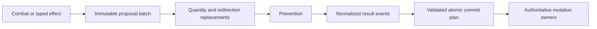

# Damage transaction

All represented combat and noncombat damage uses one prepare-and-commit
transaction. Producers submit immutable source, recipient, amount, and event
identity values. `damage.py` coordinates preparation, delegating modifier and
immediate prevention-result preparation to `damage_aftermath_preparation.py`.
`counter_prevention.py` aggregates fixed static counter-removal results across
simultaneous sources, projects counter state for nested preparation, and
delegates all live removal to the canonical counter owner. `damage_results.py` owns
normalized CR 120.3 result materialization, commit planning, and authoritative
result mutation.

`rules/damage_snapshots.py` seals public source and recipient facts before
replacement. Closed prevention facts include creature token status, attacking
and unblocked roles, enchantment, absence of +1/+1 counters and logical combat
partners. Recipient color and supertype facts accompany them. Redirection
replaces these facts with the destination snapshot; it recomputes block-pair
and shared-color relations instead of inheriting the former recipient's scope.
Empty source and redirection extensions preserve their legacy serialized form.

Newly compiled battlefield-static damage components require their own current
layer-6 ability component. Amount replacements, fixed prevention and
redirection stop while that ability is removed and return when it is restored.
Their existing damage mathematics and affected-player ordering remain intact.
Persisted programs without the current-component coverage declaration retain
their existing replay contract.

Fixed source damage retains its physical and logical source identity in the
creating stack frame. While that incarnation remains in its expected zone,
damage uses current effective source facts. Immediately before departure, the
zone owner pins the complete damage-source snapshot into matching stack and
waiting-trigger frames. Resolution uses those last-known facts after departure
and never reads a returned incarnation. This includes source controller and
keywords such as lifelink; the resolving ability keeps its own controller.
Current facts are read at the individual damage instruction after any paid
prefix. Once a damage proposal is sealed, replacement-choice resumption retains
that proposal's source facts.

Closed event-player damage instructions retain that source contract while
addressing the sealed occurrence player. A draw or cast participant is not
replaced with the trigger controller. The instruction creates no target
choice and enters the same damage transaction, including prevention and life
consequences. Source departure preserves the queued instruction's normal
source-information handling.
Single-recipient, opponent-set and fixed affected-set damage feed the same
validated snapshot into the canonical transaction. A source-excluding affected
set excludes the original incarnation, so a returned creature is another object.
The fixed-set intent canonical-thaws internal immutable source facts before
applying the strict wire snapshot decoder, then freezes the validated facts
again. Optional-choice resumption therefore preserves source arrays and
identity; the wire decoder still rejects malformed collections and identities.
Face-down source snapshots withhold hidden Oracle identity. Legacy frames
without a represented physical source retain their existing compatibility path.

Creature-power damage retains a separate numeric source-power snapshot. The
same rollback-safe, pre-mutation departure boundary refreshes matching stack
and waiting-trigger frames before any member of a simultaneous batch moves.
Resolution reads current information for that incarnation while present, then
its immediate last-known power and damage characteristics. A trigger-creation
value cannot replace a later departure value, and a returned incarnation cannot
replace the original source. A represented battlefield noncreature has no
power and contributes numeric zero under CR 208.3 and 107.2. Fight still requires
both current creatures; it never substitutes a departed participant's power.

Prepared one-way damage uses ordinary fixed characteristic or counter effects
before reading the targeted creature's current effective power. Counter
replacement and prohibition therefore affect the later amount. Both target
roles retain independent resolution revalidation: a legal source still receives
its preparation if only the recipient becomes illegal, while an illegal source
cannot supply damage through last-known information. The creature remains the
damage source, including its lifelink and deathtouch; a trample grant does not
redirect excess noncombat damage to a player. These compositions add no second
damage or mutation owner.

## Proposal and preparation

Combat snapshots freeze the relevant public relationships and effective
characteristics before a pilot decision is issued. Assignment validation owns
legal recipients, totals, canonical source and recipient order, lethal
thresholds, and trample spill. Client JSON order is never authoritative.
Current ordinary Banding changes the assignment actor under CR 702.22j/k.
A blocker with Banding lets the defending player assign its attacker's damage;
an attacker with Banding lets the active player assign damage from its blockers.
This applies without a declared attack band. Each damage step derives that
actor from the current typed participant graph. An explicit chooser override
preserves the damage source's actual controller for lifelink and other damage
consequences. The APNAP sequence collects proposals from these assignment
actors, and Trample still requires lethal assignment before spill. Empty
chooser and band extensions preserve historical proposal identities and wire.
Typed as-unblocked permission adds one optional all-recipient assignment to
that same proposal. Ordinary assignment remains legal, and Trample retains
its lethal-before-spill route. Choosing the permission changes assignment
only: the attacker remains blocked and blockers still assign damage. Current
permission and attacked-recipient identity are recomputed for each damage
step. When every blocker has left, a non-Trample creature may assign either
zero normally or all damage to its attacked legal recipient. The projected
allowed totals keep the client choice form aligned with this server verdict.
Noncombat producers use the same immutable damage values and stable physical
or logical source identities.

Toughness-based combat assignment is a separate source-local rule. The combat
snapshot retains the creature's real power and toughness and selects current
toughness only for its assignment quantity, for attackers and blockers alike.
External rules use current controller, attachment, keyword and fixed
stat-comparison predicates; removing the source ability ends its rule, while
removing a recipient's abilities does not erase a rule supplied by another
source. Printed stat bonuses remain ordinary characteristic components.
Temporary targeted instructions create incarnation-locked rules in the same
duration journal, survive ability removal and expire at end of turn. Trample
still uses ordinary blocker toughness and marked damage for lethal thresholds.
Noncombat damage and other power-based effects continue to read actual power.

Fixed simultaneous affected-set instructions compile to an immutable ordered
group descriptor. `fixed_damage_set_model.py` owns its closed player and
permanent vocabulary; `fixed_damage_set.py` materializes current public
effective-characteristic and public-state rows through the shared object-query
port. Direct damage targets and affected sets project the same typed target
predicate boundary for represented controller, characteristic, combat-state,
and source-exclusion forms. The snapshot uses APNAP controller order plus
stable logical object identity, excludes phased-out objects, and deduplicates
overlapping groups before creating proposals. Every recipient then enters one
`resolve_damage_batch` call, so replacement, prevention, result, trigger,
rollback, and replay behavior cannot diverge from single-target or combat
damage.

The affected-set owner accepts a nonnegative resolved integer. A zero amount
delegates to the same canonical no-damage boundary: it produces no replacement
or prevention choice, damage result, or damage-trigger history. Literal compiler
grammar remains independently bounded; declared amounts require their own
capability rather than broadening that grammar.

Preparation discovers applicable runtime components against the current
event, validates the affected player or permanent controller, records any
replacement choices, and rediscoveries after each transformation. Redirection
substitutes a complete recipient value before the loop continues. Prevention
then consumes the resulting event through the separate
[prevention transaction](prevention.md).

## Results and commit

Only positive final damage produces result events. The result planner derives
the typed consequences for life, marked damage, defense, loyalty, commander
damage, lifelink, deathtouch, infect, wither, toxic, and other represented
families. It validates all recipients and source snapshots before any state
changes. Resolved Infect, Wither, and Toxic leaves delegate their final
placement plan to `counter_placement.py` without rediscovering replacement
effects already exhausted by the containing damage-result tree. Planeswalker
loyalty and Battle defense delegate exact removals to `counter_removal.py`;
life changes remain with `life_state.py`. `damage_results.py` coordinates those
typed plans with marked-damage and deathtouch state, but no longer owns a
parallel generic counter-state commit. Every owner validates before the first
write, so a malformed event or stale logical incarnation leaves the complete
life, placement, removal, and permanent-result batch unchanged.

The life and damage planners share an immutable gain-permission snapshot.
Current trusted battlefield abilities supply global or opponent prohibitions,
including their current controller and layer-6 applicability. Prohibited gains
are excluded before life-gain replacement processing; lifelink cannot create a
gain result for a prohibited player. Ordinary life changes retain a zero
resolved audit result without dispatching a gain occurrence. Life loss and
life payments retain their separate rules. Each damage step collects its own
current snapshot, while simultaneous damage results use the same precommit
permission facts.

Static unpreventability uses the existing authoritative damage flag. Current
ambient rules are collected when damage is prepared; a source's own rule is
sealed into its existing source-scope facts, including last-known snapshots.
Typed component markers determine current applicability and ability loss.
Prevention still applies once to flagged damage, preserving fixed additional
consequences while preventing zero damage and retaining shield amounts.

State-based actions consume temporal damage markers according to their own
owner. Damage code does not perform unrelated state-based checks or bypass
focused life, counter, or permanent-state mutation boundaries.

Each positive final damage result also appends one typed current-turn history
fact after the containing result plan commits. The fact preserves the source
logical incarnation and, for a permanent recipient, the recipient logical
incarnation. Player and permanent results share this one damage transaction;
zero and fully prevented damage append nothing. Current target predicates may
query these public facts, while a zone change invalidates the old incarnation
without deleting replay history.

Each committed damage transaction also carries one stable batch identity
derived from its replacement-event identities. Represented “one or more”
combat-damage triggers aggregate by that simultaneous batch and damaged player:
several qualifying creatures damaging one player create one occurrence, while
damage to different players creates one occurrence per player. Separate damage
transactions and combat-damage steps remain separate, fully prevented results
create none, and the ordinary trigger owner retains APNAP placement and trigger
multiplier behavior.

Receiving abilities consume a distinct immutable recipient occurrence, rather
than one trigger per dealer packet. `damage_received_events.py` groups positive
committed results by the recipient's physical and logical incarnation within
one transaction, in canonical recipient order. `damage.received` exposes the
actual received total; `combat.damage.received` separately exposes the positive
combat portion. Zero and fully prevented packets produce neither occurrence.
The same recipient in a later transaction or damage step remains a new event.

New compiler subscriptions require the receiving-event capability independently
of coverage. Lethal damage still queues receiving abilities before state-based
departure; their source, targets and current/LKI handling remain ordinary
trigger and damage-source contracts. No mutation owner, dealer identity or
persistent grouping state is replaced. Saved `damage.dealt` subscriptions keep
their packet behavior. See
[ADR 0133](../adr/0133-committed-damage-received-occurrences.md).

Untargeted destruction on a receiving creature seals that event's recipient,
not the giver's attachment when the queued ability later resolves. The existing
event-object reference checks its logical incarnation; departure or reentry
does not redirect the result. Ordinary regeneration, an exact prohibition of
regeneration, and indestructibility retain the canonical destruction owner.
Attached tap-or-damage subscriptions independently seal the same reference
from each represented event transport. Unknown recipient predicates remain
compiler residuals.

## Replay, privacy, and extension

Event IDs derive from stable damage-step, source-incarnation, recipient, and
amount values rather than submission order. Continuations persist the option
set, chooser, selections, and projected modifier state. A seat sees only
authorized option labels and public facts; immutable event payloads remain in
the authoritative continuation. Replay rebuilds the transaction and must reach
the same state hash.

Add a damage family by defining a typed descriptor and immutable operation,
registering exact capability dependencies, integrating it at one transaction
stage, and adding multiplayer ordering, rollback, privacy, replay, and mutation
witnesses. Card-name or Oracle-ID branches are not permitted in the generic
transaction.

The fixed-set grammar covers positive fixed damage to closed player and
damageable-permanent sets with represented type, subtype, color, keyword
presence or absence, token, controller, tap, combat-state, source-exclusion,
and target-player controller predicates. Divided or variable damage, chosen,
linked-result, history-derived, dynamic-characteristic, or additive
non-deduplicable predicates, multiple independent damage instructions,
unpreventable wording, and linked life/draw/scry/conditional riders remain
compiler residuals. Do not widen the runtime query to approximate them.

See [ADR 0012](../adr/0012-damage-transaction-and-static-prevention.md),
[ADR 0013](../adr/0013-damage-result-event-ownership.md),
[ADR 0015](../adr/0015-durable-damage-modifier-ownership.md), and
[ADR 0017](../adr/0017-prevention-continuations-and-aftermath.md).
