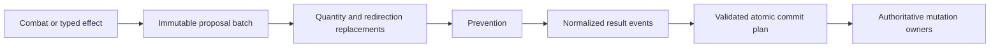

# Damage transaction

All represented combat and noncombat damage uses one prepare-and-commit
transaction. Producers submit immutable source, recipient, amount, and event
identity values. `damage.py` coordinates preparation, delegating modifier and
immediate prevention-result preparation to `damage_aftermath_preparation.py`.
The transaction boundary in `damage_transaction.py` validates both replacement
journals against their prepared snapshots before commit.
Fixed-remainder prevention reads the damaged player's or permanent's current
scope and prevents the excess in each damage event. The existing replacement
order determines the result when other effects modify the amount.
A compiled emblem can supply the controller-and-planeswalker prevention
component from the command zone after its creator leaves.
`counter_prevention.py` aggregates fixed static counter-removal results across
simultaneous sources, projects counter state for nested preparation, and
delegates all live removal to the canonical counter owner. `damage_results.py` owns
normalized CR 120.3 result materialization, commit planning, and authoritative
result mutation.

A controlled-subtype damage trigger can read one complete final batch. It
retains the qualifying source-recipient rows and counts distinct opposing
players when the trigger is placed. Combat steps and separately committed
noncombat damage produce separate occurrences. Ordinary per-recipient
triggers continue to receive each positive damage result.

A receiving trigger can have the damaged permanent deal the actual amount it
received. A single recipient gets one occurrence for simultaneous damage from
multiple sources, after redirection and prevention. A fully prevented
assignment creates no occurrence. The effect uses the damaged object's
current or last-known source information, and its chosen target is checked
again on resolution. A source-relative restriction excludes the original
incarnation. A controlled-subtype subscription reads the recipient's subtype
and controller from the occurrence, while a target subtype exclusion reads
current characteristics. A controlled-permanent receiving trigger can also
assign the outgoing damage to the ability's own source. Each damaged
permanent retains its own amount, including a planeswalker or battle, and
the outgoing source retains its normal current or last-known information.

A received-damage result can prohibit life gain for its final player
recipients after dealing damage. The follow-up takes only positive player
rows from the committed primary damage batch. A redirected player can
receive the prohibition. Damage redirected to a permanent, fully prevented
damage, and separate prevention aftermath create no player prohibition.
The existing life permission owner records the affected seats until the
end of the game and applies the normal rule to future gains.

`rules/damage_snapshots.py` seals public source and recipient facts before
replacement. Closed prevention facts include creature token status, attacking
and unblocked roles, enchantment, absence of +1/+1 counters and logical combat
partners. Recipient color and supertype facts accompany them. Redirection
replaces these facts with the destination snapshot; it recomputes block-pair
and shared-color relations instead of inheriting the former recipient's scope.
Empty source and redirection extensions preserve their legacy serialized form.

A paid target-creature activation can choose a damage source during
resolution. Its replacement uses the first complete damage event from the
chosen source to the original target this turn. The original activating
permanent receives the damage. The existing chosen-source snapshot retains
permanent-spell continuity and rejects a returned incarnation. The
replacement keeps the amount, source and combat facts and is consumed on
application or expires at cleanup. The chosen-source scope requires both
permanents to be phased in when the damage would occur. Replacement
preparation discovers protection at reachable destinations of this scope
using the original damage source's qualities.

A one-point redirection keeps the remaining damage on its original recipient.
The redirected point keeps the same source and combat facts and uses the new
recipient's current replacement and prevention eligibility. The affected
controller chooses the order when several simultaneous assignments compete for
that point. Each effect applies once and expires at cleanup if unused. It
cannot affect a returned incarnation of either permanent. When damage from one
occurrence reconverges, result processing deals it together.

A resolved controller-wide redirection matches damage to that player and
permanents they currently control. It binds a battlefield incarnation chosen
without targeting or found through the resolving Aura's attachment information.
The destination must still have a permitted card type and be phased in. It keeps
that destination if the permanent changes controller, and expires at cleanup.
An Aura's departure after resolution leaves the created effect in place.

Competing controller-wide redirections use one chosen destination for a
simultaneous damage occurrence. The replacement journal carries the choice to
the other assignments for that controller. Subsequent occurrences are
independent. Redirected damage preserves the original source and combat facts
and encounters protection and other replacements for the updated recipient.

A targeted variant protects its controller and the creatures they currently
control. Its spell revalidates the chosen creature through ordinary targeting.
The resolving spell binds that battlefield incarnation as the damage
destination and schedules a separate delayed trigger through the zone event
owner. A committed graveyard departure that turn captures the original
permanent's last-known counters and puts the trigger into the ordinary APNAP
batch. Its controller can announce up to one controlled creature. The
counter placement precedes the draw, and a trigger announced with zero
targets still draws. Loss of the single announced target counters the trigger
under the ordinary revalidation rule.

One temporary grant keeps the resolving spell controller as the only player
who can activate its added redirection ability. The current Layer 6 catalog
offers and validates the grant even when another player controls the
permanent. Its zero-cost activation can protect a target player, creature, or
planeswalker. It redirects one point to the original battlefield creature.
Losing creature type or phasing out makes that destination unavailable while
the change lasts. A zone change leaves the original destination unavailable.

The cast-announced greatest-damage amount reads the largest committed
current-turn result for one source and one recipient. It includes players
and permanents and reads the positive amount after replacement and
prevention. Other occurrences and direct life loss never add to it.
The casting pipeline seals the resulting total and the selected creature
shares before payment. A current journal without damage permits a
zero-target cast. Missing or stale history is unavailable. Later damage
does not change the total. A target that becomes illegal loses only its
own share, and copies retain the original share slots.

Current execution also seals typed public permanent state from the canonical
object query. Singular source-qualified damage subscriptions distinguish
enchanted, equipped, modified, tapped and combat state without reading the
object again after replacement. Under CR 700.9, Equipment and any counters
qualify as modifications; an Aura qualifies only when its controller matches
the permanent's controller. The optional versioned snapshot survives damage
proposal serialization, replacement choices and final semantic dispatch.
Historical records omit unknown facts; partial or coerced facts reject.

A trusted counter-qualified draw subscriber requests one additional public
source fact for creature combat damage. The sealed boolean records whether
that source had a +1/+1 counter when damage was dealt. The resulting triggers
remain independent per source and occurrence. Counter changes after damage
leave those triggers in place. Saved registries without the subscriber keep
the former source and event encodings. A bounded Goad chapter watches the
selected incarnations until the chapter controller’s next turn. Only positive
committed combat damage to a player creates its private draw trigger. Each
watch remains independent after its originating Saga leaves the battlefield.

A power-qualified combat damage subscriber captures whether a creature's
effective power is above its base power. The characteristic evaluator reads
base power after layers 7a and 7b. The ordinary effective-power query includes
modifiers, counters and power/toughness switches. A qualifying positive
combat result to a player can place one draw per observer, recipient and
simultaneous damage batch. The occurrence keeps its sealed comparison
through replacement and resolution.

Newly compiled battlefield-static damage components require their own current
layer-6 ability component. Amount replacements, fixed prevention and
redirection stop while that ability is removed and return when it is restored.
Their existing damage mathematics and affected-player ordering remain intact.
Persisted programs without the current-component coverage declaration retain
their existing replay contract.

Fixed source damage retains its physical and logical source identity in the
creating stack frame. While that incarnation remains in its expected zone,
damage uses current effective source facts. Immediately before departure, the
zone owner pins the complete damage-source snapshot into matching stack and
waiting-trigger frames. Resolution uses those last-known facts after departure
and never reads a returned incarnation. This includes source controller and
keywords such as lifelink; the resolving ability keeps its own controller.
Current facts are read at the individual damage instruction after any paid
prefix. Once a damage proposal is sealed, replacement-choice resumption retains
that proposal's source facts.

One creature-power spell selects a creature its caster controls as the damage
source. Resolution revalidates that sole target and reads its current power
and source characteristics. Its batch contains every other creature and
every active opponent. Protection and life results use the creature as the
damage source. An illegal target or nonpositive power yields no damage.

A controlled subtype entry can make the entering permanent deal damage to
one legal target. The stack retains the original entrant as dealer, while
the amount counts current permanents of the matching subtype controlled by
the ability's controller. A separate flying-entry haste result follows only
the current incarnation of its original entrant. An occurrence can qualify
for both abilities and the ordinary trigger-order owner places them
independently.

Fixed damage to a creature that attacks or blocks uses the original
incarnation sealed by the corresponding combat transition. The existing
trigger owner produces one block occurrence for a creature that blocks
multiple attackers. Each result uses the creating ability's current or
last-known damage source and the original public recipient.

Marked source-specific Cycling damage binds the card in its committed
post-discard zone under CR 702.29c. The original hand snapshot still selects the
eligible printed ability, while its new stack frame retains the resulting
incarnation and source facts. A later move pins that frame's immediate last
known information through the ordinary zone owner. Unmarked historical frames
retain their prior interpretation. This does not change the separately queued
Cycling draw or the timing of target announcement and optional acceptance.

Closed event-player damage instructions retain that source contract while
addressing the sealed occurrence player. A draw or cast participant is not
replaced with the trigger controller. The instruction creates no target
choice and enters the same damage transaction, including prevention and life
consequences. Source departure preserves the queued instruction's normal
source-information handling.
Single-recipient, opponent-set and fixed affected-set damage feed the same
validated snapshot into the canonical transaction. A source-excluding affected
set excludes the original incarnation, so a returned creature is another object.
The fixed-set intent canonical-thaws internal immutable source facts before
applying the strict wire snapshot decoder, then freezes the validated facts
again. Optional-choice resumption therefore preserves source arrays and
identity; the wire decoder still rejects malformed collections and identities.
Face-down source snapshots withhold hidden Oracle identity. Legacy frames
without a represented physical source retain their existing compatibility path.

`compiler/fixed_damage_roles.py` lowers fixed printed amounts for separate target
roles into one simultaneous instruction. Its immutable descriptor records each
role's amount and cardinality; the ordinary target plan owns legal choices and
explicit distinctness. Optional later roles may select zero, one, or two targets
only when represented by that descriptor. Resolution retains each legal role's
share without reallocating damage from illegal targets. Permitted repeated
recipients receive the combined amount. `rules/fixed_damage_roles.py` binds these
shares to the existing allocated damage batch after revalidation, preserving
replacement choices, source snapshots, privacy, and replay. Printed damage shares
are independent of player-chosen damage allocations.

Creature-power damage retains a separate numeric source-power snapshot. The
same rollback-safe, pre-mutation departure boundary refreshes matching stack
and waiting-trigger frames before any member of a simultaneous batch moves.
Resolution reads current information for that incarnation while present, then
its immediate last-known power and damage characteristics. A trigger-creation
value cannot replace a later departure value, and a returned incarnation cannot
replace the original source. A represented battlefield noncreature has no
power and contributes numeric zero under CR 208.3 and 107.2. Fight still requires
both current creatures; it never substitutes a departed participant's power.

An entry or creature-death trigger can bind the occurrence object as its damage
source. Target legality uses the ability source, while damage prevention and
lifelink use the occurrence source. A live entrant supplies its current power
and characteristics. A departure refreshes its snapshot before any member of
the batch moves, and a dies trigger starts with that predeparture information.
The snapshot follows the original incarnation through target choices,
optional payments, and replay.

Prepared one-way damage uses ordinary fixed characteristic or counter effects
before reading the targeted creature's current effective power. Counter
replacement and prohibition therefore affect the later amount. Both target
roles retain independent resolution revalidation: a legal source still receives
its preparation if only the recipient becomes illegal, while an illegal source
cannot supply damage through last-known information. The creature remains the
damage source, including its lifelink and deathtouch; a trample grant does not
redirect excess noncombat damage to a player. These compositions add no second
damage or mutation owner.

Version-two creature-power damage instructions add an explicit fixed multiplier
of two for direct one-way damage. The source's current power is multiplied
once before the ordinary damage proposal enters replacement and prevention.
Damage attribution and result materialization still use the creature source.
Legacy instructions omit both multiplier fields and retain their original
meaning. Unknown versions, incomplete fields, other coefficients and Fight
combinations fail closed. Runtime admission derives the multiplier capability
from the instruction payload independently of program annotations.

An admitted turn-scoped creature combat multiplier enters the existing
replacement ordering with current source and recipient creature facts. The
accompanying keyword removal locks the resolving set of creature
incarnations. Later entrants qualify for creature combat damage while
retaining their own keywords. Cleanup expires both effects.

## Proposal and preparation

Combat snapshots freeze the relevant public relationships and effective
characteristics before a pilot decision is issued. Assignment validation owns
legal recipients, totals, canonical source and recipient order, lethal
thresholds, and trample spill. Client JSON order is never authoritative.
Current ordinary Banding changes the assignment actor under CR 702.22j/k.
A blocker with Banding lets the defending player assign its attacker's damage;
an attacker with Banding lets the active player assign damage from its blockers.
This applies without a declared attack band. Each damage step derives that
actor from the current typed participant graph. An explicit chooser override
preserves the damage source's actual controller for lifelink and other damage
consequences. The APNAP sequence collects proposals from these assignment
actors, and Trample still requires lethal assignment before spill. Empty
chooser and band extensions preserve historical proposal identities and wire.
Typed as-unblocked permission adds one optional all-recipient assignment to
that same proposal. Ordinary assignment remains legal, and Trample retains
its lethal-before-spill route. Choosing the permission changes assignment
only: the attacker remains blocked and blockers still assign damage. Current
permission and attacked-recipient identity are recomputed for each damage
step. When every blocker has left, a non-Trample creature may assign either
zero normally or all damage to its attacked legal recipient. The projected
allowed totals keep the client choice form aligned with this server verdict.
Noncombat producers use the same immutable damage values and stable physical
or logical source identities.

Toughness-based combat assignment is a separate source-local rule. The combat
snapshot retains the creature's real power and toughness and selects current
toughness only for its assignment quantity, for attackers and blockers alike.
External rules use current controller, attachment, keyword and fixed
stat-comparison predicates; removing the source ability ends its rule, while
removing a recipient's abilities does not erase a rule supplied by another
source. Printed stat bonuses remain ordinary characteristic components.
Temporary targeted instructions create incarnation-locked rules in the same
duration journal, survive ability removal and expire at end of turn. Trample
still uses ordinary blocker toughness and marked damage for lethal thresholds.
Noncombat damage and other power-based effects continue to read actual power.

Fixed simultaneous affected-set instructions compile to an immutable ordered
group descriptor. `fixed_damage_set_model.py` owns its closed player and
permanent vocabulary; `fixed_damage_set.py` materializes current public
effective-characteristic and public-state rows through the shared object-query
port. Direct damage targets and affected sets project the same typed target
predicate boundary for represented controller, characteristic, combat-state,
and source-exclusion forms. The snapshot uses APNAP controller order plus
stable logical object identity, excludes phased-out objects, and deduplicates
overlapping groups before creating proposals. Every recipient then enters one
`resolve_damage_batch` call, so replacement, prevention, result, trigger,
rollback, and replay behavior cannot diverge from single-target or combat
damage.

Death-exile followups can seal an announced creature, an announced creature
or planeswalker, or creatures that actually received positive damage. A
followup that names the announced target still seals that incarnation when
damage is prevented. The end-of-turn journal applies the battlefield-to-
graveyard replacement before state-based actions. A returning permanent has
a new incarnation and leaves the prior rule behind.

The affected-set owner accepts a nonnegative resolved integer. A zero amount
delegates to the same canonical no-damage boundary: it produces no replacement
or prevention choice, damage result, or damage-trigger history. Literal compiler
grammar remains independently bounded; declared amounts require their own
capability rather than broadening that grammar.

Announced-X simultaneous sets use the existing cast-X amount and fixed-set
payloads. Damage shape dispatch materializes mechanic iterables before its
delegating recognizers inspect them, so a declined reference shape cannot
consume the fixed-set owner's authority. Runtime binding independently decodes
the announced amount and public recipient groups and requires their quantity,
source, result, query, and batch capabilities. Neither printed names nor trust
annotations select the damage behavior. Existing fixed and declared-X wire
fields and the canonical stack-X, recipient snapshot, and batch executor retain
their interpretation.

Preparation discovers applicable runtime components against the current
event, validates the affected player or permanent controller, records any
replacement choices, and rediscoveries after each transformation. Redirection
substitutes a complete recipient value before the loop continues. Prevention
then consumes the resulting event through the separate
[prevention transaction](prevention.md).

An ordinary static source can triple damage from a source its controller
controls. The canonical source value supplies the live controller or the
last-known controller after departure. The same replacement applies to
player, creature, planeswalker, and battle damage after any division or
combat assignment. The affected player chooses its order with applicable
prevention and other replacements.

A linked battlefield entry choice can bind any active player for the
source's current damage quantity ability. The choice follows the original
incarnation and effective copy form. The doubler rechecks the damage
recipient's controller at application, including after redirection, and
keeps the original dealer and its combat status.

Another linked consumer can seal the chosen player when its source
receives damage. The ordinary damage operation uses that received amount
and the original source snapshot, even if the permanent has reentered
with a different choice. One source-bound tap activation can also deal
one damage to the original live incarnation. Missing recipients supply
no damage result.

## Results and commit

A current battlefield ability can cap its controller's damage-derived life
loss at a final total of one. The version-two descriptor requires a starting
life total of at least one and uses the same result batch as other life
changes. Full damage still occurs, including unpreventable damage. The
source must have its current printed ability when the damage batch begins,
so a face-down source contributes no floor. A source that leaves during
the same batch still contributes its effect to that batch.

Only positive final damage produces result events. The result planner derives
the typed consequences for life, marked damage, defense, loyalty, commander
damage, lifelink, deathtouch, infect, wither, toxic, and other represented
families. It validates all recipients and source snapshots before any state
changes. Resolved Infect, Wither, and Toxic leaves delegate their final
placement plan to `counter_placement.py` without rediscovering replacement
effects already exhausted by the containing damage-result tree. Planeswalker
loyalty and Battle defense delegate exact removals to `counter_removal.py`;
life changes remain with `life_state.py`. `damage_results.py` coordinates those
typed plans with marked-damage and deathtouch state, but no longer owns a
parallel generic counter-state commit. Every owner validates before the first
write, so a malformed event or stale logical incarnation leaves the complete
life, placement, removal, and permanent-result batch unchanged.

Damage results preserve each committed life gain and loss as a distinct turn
history fact, including simultaneous changes that cancel in the final total.
The life state owner validates the entire plan and writes each player's final
total once. The inherent speed trigger examines the same committed losses.

The life and damage planners share an immutable gain-permission snapshot.
Current trusted battlefield abilities supply global or opponent prohibitions,
including their current controller and layer-6 applicability. Prohibited gains
are excluded before life-gain replacement processing; lifelink cannot create a
gain result for a prohibited player. Ordinary life changes retain a zero
resolved audit result without dispatching a gain occurrence. Life loss and
life payments retain their separate rules. Each damage step collects its own
current snapshot, while simultaneous damage results use the same precommit
permission facts. The controller's low-life doubler uses the same pre-event
life total for the entire replacement sequence. A positive life-total setting
enters that sequence as a gain equal to the difference from the current
total.

Static unpreventability uses the existing authoritative damage flag. Current
ambient rules are collected when damage is prepared; a source's own rule is
sealed into its existing source-scope facts, including last-known snapshots.
Typed component markers determine current applicability and ability loss.
Prevention still applies once to flagged damage, preserving fixed additional
consequences while preventing zero damage and retaining shield amounts.

State-based actions consume temporal damage markers according to their own
owner. Damage code does not perform unrelated state-based checks or bypass
focused life, counter, or permanent-state mutation boundaries.

Each positive final damage result also appends one typed current-turn history
fact after the containing result plan commits. The fact preserves the source
logical incarnation and, for a permanent recipient, the recipient logical
incarnation. Player and permanent results share this one damage transaction;
zero and fully prevented damage append nothing. Current target predicates may
query these public facts, while a zone change invalidates the old incarnation
without deleting replay history.

An ordered spell can use the sum of final damage received by its controller
this turn for a life gain and a separate damage instruction to a controlled
creature. The sum uses the final player recipient and committed amount.
Direct life loss, damage redirected to another recipient, prevented damage,
and previous-turn results contribute no amount. The normal targeting owner
revalidates the sole target before either instruction. The damage transaction
uses the resolving spell's source and applies its current replacement and
prevention effects.

Each committed damage transaction also carries one stable batch identity
derived from its replacement-event identities. Represented “one or more”
combat-damage triggers aggregate by that simultaneous batch and damaged player:
several qualifying creatures damaging one player create one occurrence, while
damage to different players creates one occurrence per player. Separate damage
transactions and combat-damage steps remain separate, fully prevented results
create none, and the ordinary trigger owner retains APNAP placement and trigger
multiplier behavior.

Receiving abilities consume a distinct immutable recipient occurrence, rather
than one trigger per dealer packet. `damage_received_events.py` groups positive
committed results by the recipient's physical and logical incarnation within
one transaction, in canonical recipient order. `damage.received` exposes the
actual received total; `combat.damage.received` separately exposes the positive
combat portion. Zero and fully prevented packets produce neither occurrence.
The same recipient in a later transaction or damage step remains a new event.

A resolving spell can watch one required creature's current incarnation for
repeated damage receipts through cleanup. Each positive grouped receipt queues
one independent delayed ability for the spell's controller. The creature's
current or last-known source facts supply one simultaneous noncombat damage
batch to the other current creatures and all active players. Control and
ability changes leave the watch with its original controller. A new
incarnation ends eligibility for the old watch and can receive damage from
an already queued result.

Automatic draw adjudication admits a closed reciprocal case under CR 104.4b
and 732.4. The two exact current watches alternate on passive indestructible
creatures. One unconditional fixed prevention component per active player
covers the full amount of each player result without being consumed. Empty
hands and mana pools, inactive off-board programs, and the ordinary priority
catalog establish a closed decision surface. Finite shields or a meaningful
offer keep the regular priority path. Only after those checks can the existing loop
owner compare recurring positions while excluding the marks and journal
entries that none of the admitted rules can read.

A combat receiving ability can gain life for its resolving controller and
then cause the original attacking player to lose life. Each instruction uses
the same grouped committed combat amount. The ability retains the attacking
seat from the damage occurrence, including when a defending blocker dealt
the damage or the receiving creature left the battlefield. The life loss
still resolves under a gain prohibition. The represented single active seat
applies to the supported Commander profiles. Two-Headed Giant team turns and
the choice of a member of the attacking team remain outside this boundary.

New compiler subscriptions require the receiving-event capability independently
of coverage. Lethal damage still queues receiving abilities before state-based
departure; their source, targets and current/LKI handling remain ordinary
trigger and damage-source contracts. No mutation owner, dealer identity or
persistent grouping state is replaced. Saved `damage.dealt` subscriptions keep
their packet behavior. See
[ADR 0133](../adr/0133-committed-damage-received-occurrences.md).

Untargeted destruction on a receiving creature seals that event's recipient,
not the giver's attachment when the queued ability later resolves. The existing
event-object reference checks its logical incarnation; departure or reentry
does not redirect the result. Ordinary regeneration, an exact prohibition of
regeneration, and indestructibility retain the canonical destruction owner.
Attached tap-or-damage subscriptions independently seal the same reference
from each represented event transport. Unknown recipient predicates remain
compiler residuals.

A subtype-qualified damage trigger uses the committed occurrence. The
ability belongs to its provider's controller. The result belongs to the
original dealer's current controller or its last known controller after
departure. A combat-to-player trigger may offer that controller a token.
A general damage trigger can instead use the actual dealt amount for a
separate life change, including damage dealt to a permanent.

A receiving trigger can match the original source or its current Soulbond
partner. Each matched recipient supplies its own committed damage amount.
The outgoing damage uses the source of the triggered ability, with last
known information when that source has left the battlefield.

## Replay, privacy, and extension

Event IDs derive from stable damage-step, source-incarnation, recipient, and
amount values rather than submission order. Continuations persist the option
set, chooser, selections, and projected modifier state. A seat sees only
authorized option labels and public facts; immutable event payloads remain in
the authoritative continuation. Replay rebuilds the transaction and must reach
the same state hash.

Add a damage family by defining a typed descriptor and immutable operation,
registering exact capability dependencies, integrating it at one transaction
stage, and adding multiplayer ordering, rollback, privacy, replay, and mutation
witnesses. Card-name or Oracle-ID branches are not permitted in the generic
transaction.

The fixed-set grammar covers positive fixed damage to closed player and
damageable-permanent sets with represented type, subtype, color, keyword
presence or absence, token, controller, tap, combat-state, source-exclusion,
and target-player controller predicates. Divided or variable damage, chosen,
linked-result, history-derived, dynamic-characteristic, or additive
non-deduplicable predicates, multiple independent damage instructions,
unpreventable wording, and linked life/draw/scry/conditional riders remain
compiler residuals. Do not widen the runtime query to approximate them.

See [ADR 0012](../adr/0012-damage-transaction-and-static-prevention.md),
[ADR 0013](../adr/0013-damage-result-event-ownership.md),
[ADR 0015](../adr/0015-durable-damage-modifier-ownership.md), and
[ADR 0017](../adr/0017-prevention-continuations-and-aftermath.md).

## Optional source damage

For a sorcery-speed tap activation with a temporary receiving trigger, the
revalidated creature gains its independently compiled ability first. Its
controller then chooses whether the source deals damage to that creature.
Declining preserves the grant. Each damage occurrence supplies the amount
for the creature's controller to draw and then lose life.

A targeted player may choose to let the resolving source deal printed
damage to them. The choice resolves the damage branch through the ordinary
damage owner. A refusal resolves the printed alternate instruction.
Prevention or replacement changes the damage without changing the choice
that was recorded. The continuation checks the original spell and target
again when the actor answers.

Collective optional damage gives each eligible player a choice in active
player, nonactive player order. A completed round deals one simultaneous
damage batch to the players who accepted. All declines can trigger the
printed draw or mill for the original target. For source-entry abilities,
an acceptance can require sacrifice of the original creature even if
replacement or prevention leaves the accepting player's life unchanged.

## Combat point counters

A point-counter artifact's removal trigger sees actual creature combat damage
to its controller. Its placement trigger sees actual creature combat damage
from a creature that controller controls to an opponent. Each qualifying
damage event keeps its own recipient, even when two attackers hit the same
player together. Fully prevented damage produces no occurrence.

The placement trigger places the counter before testing the original
artifact's point count. A departed source supplies its final public point
count. Meeting the threshold removes only its point counters and applies loss
to the actual damaged player. The tapped mana ability uses the same ordinary
counter replacement owner, with no threshold check.

## Source power damage to opponents

One battlefield trigger can subscribe to its source attacking, blocking, or
becoming the target of a spell. All three subscriptions identify the same
source, and the target occurrence accepts spells and spell copies. The
resolving ability uses its original controller's active opponents. Each
opponent receives the source's effective power in one noncombat damage batch.
The damage owner keeps the source power and characteristics together when
the original permanent leaves or phases out. Nonpositive power produces no
damage.

## Committed excess damage

A resolving spell can request the excess from its direct damage batch. The
damage owner groups actual post-prevention damage by final recipient and uses
that permanent's lethal threshold before the damage results commit. Existing
marked damage, the final source's deathtouch, and current defense or loyalty
belong to this calculation. Nested aftermath damage resolves separately.

The power and trample follow-up uses the resulting excess for its power-only
modifier. The creatures controlled by the resolving player still gain trample
when prevention or the recipient's threshold makes the excess zero.

A fight's red mana follow-up reads the excess dealt to its original opponent
creature. The separate current-turn red retention instruction applies if the
spell resolves even when the fight cannot happen. Mana provenance retains only
red from otherwise expiring lots and preserves each retained spending restriction.
The ordinary cleanup removes the retention before clearing the pool.
