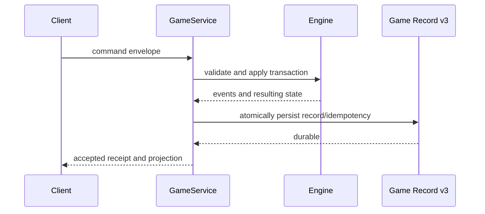

# Replay architecture

Game Record v3 is the durable command/evidence boundary. A manifest pins the
engine, profile, decks, card database, semantic registry, seed, trace policy,
CardProgram V2 fingerprints/trust closures, capability registry/evidence,
semantic-handler registry, runtime-component inventory, and lifecycle. Each
accepted command additionally pins the card programs and compact runtime
bindings actually used. Checkpoints accelerate recovery;
commands remain the authority for deterministic verification.

The card-play event fact marker enables physical-card observations in new
records. A normalized spell-cast event uses version eight with a required
boolean recording whether the cast object is a physical card. The land-play event carries
the same fact on actual land play. When the marker is absent, replay emits the
previous spell-cast and land-play shapes. Card-copy casts still participate in
ordinary spell-cast abilities, while a physical-card play trigger filters those
casts at event collection.

A command-local capture observes the resolver's actual stack objects and
physical spell sources. It includes spells created and completed within one
command while preserving the separate initial-stack snapshot used by ordered
plans. The capture belongs to one engine and is discarded on exit, including
rejection or failure; it adds no public event fields or persistent game state.
Runtime-trust schema two binds current records to this capture contract.
Replay matches completion order and repeated occurrences before verifying each
source's registered or implicit binding. Missing, extra, reordered or unobserved
resolutions reject. Older records retain the existing historical-absence path;
declared runtime provenance must still match exactly.

Replay rebuilds from the initial checkpoint and applies the canonical accepted
commands under matching fingerprints. It compares authoritative state hashes
and fails on version, semantics, CardProgram trust, runtime binding, database,
command, or result divergence. Historical v3 records without the additive
trust/runtime fields keep their existing semantic-registry verification.
Projected delivery packets are transport evidence, not alternative authority.

A second-resolution draw uses the current turn's typed ability journal
after ordinary target checks. The journal keys each occurrence by source
incarnation and ability program. Ability copies share that key. The
ordinal travels with the resolving instruction through choices and
replacements. The ordinary life, damage, or stat instruction runs before
the second occurrence can produce the private draw.

Version 21 uses the same journal for the closed third-resolution activated
results. The original source key survives a controller change. An activation
reaches the journal only after normal stack and target checks. The sealed
third ordinal can grant first strike, add four red mana, or offer an optional
eight red mana after the ordinary prefix. That optional decision uses the
existing saved continuation.

Version 22 binds the other-spell draw to the resolving spell incarnation
after ordinary target checks. It uses only the resolving controller’s
committed casts in the current turn. The exact self-cast copy checks
its prior cast at trigger creation and rechecks against the retained
cast incarnation at resolution. An ordinary spell copy contributes
no new cast entry.

The exact combat dealer entry condition retains the normalized damage
dealer’s incarnation separately from the trigger source. It checks that
dealer’s current-turn battlefield entry at creation and rechecks the
same recorded identity after a departure or change of control.

The exact counter of another controller’s stack ability uses the shared
target plan at selection and resolution. Cycling places its independent
draw below the counter trigger. A missing or departed eligible target
leaves the ordinary cycling draw to resolve.

The fixed counter and keyword sequence uses one recorded optional
Creature or Vehicle target set for both instructions. An empty set
keeps both results empty. An invalidated selected object uses ordinary
target resolution, with cycling’s independent private draw below it.

The exact cycled Goblin damage trigger uses the current public battlefield
subtype count during resolution. Its retained source is the discarded
incarnation. The optional result and ordinary cycling draw resume
through their separate existing owners.

The exact instant-speed loyalty permission uses the current static ability
and physical source incarnation. The entered-this-turn form reads its
existing entry sequence. Ordinary priority, loyalty payment, and the
per-turn usage record still govern both forms.

The typed counter halving operation floors the current placement amount
when applied. A placement reduced to zero carries the additive
rounded-to-zero marker and closes its replacement selection. Positive
placements retain the ordinary affected-player order and history.

Additional combat phases use an additive pending count on the current turn.
Each new combat begins through the ordinary step owner with a fresh combat
identity. Combat skips consume the affected occurrence and retain later
queued combats. Ending the turn clears the queue. Empty and historical
records omit the field and retain their existing authoritative hashes.

A version-four casting grant from an emblem retains the command source
and the selected paid option. The departure replacement remains tied to
the cast spell’s stack incarnation. Earlier casting grant versions retain
their original serialized scope and usage journal.

The exact equipped-combat destruction result excludes the retained
battlefield incarnation before selecting the current permanents. A returned
object is a new eligible permanent. The ordinary simultaneous destruction
continues if the original source has left.

The one-shot next end-step destruction stores its original death source
and controller through the existing delayed trigger record. Its fixed
instruction selects the battlefield when the delayed ability resolves.

A resolving creature-type destruction uses the existing scalar continuation
with a versioned scope. The accepted choice is recorded as a canonical
subtype. On resume, the same resolving controller applies one ordinary
simultaneous destruction over the matching or nonmatching creatures.

Version two of the committed destruction follow-up records each destroyed
permanent’s controller before departure. The result carries those counts
into one simultaneous token entry. A token replacement resumes that
continuation after destruction with the recorded creator counts.

Version five of the creature-power instruction uses each current creature
as both source and recipient. Its effective power supplies the amount.
Every positive proposal joins one simultaneous damage batch. Replay
resumes the existing affected-player replacement decisions for that batch.

The target-relative destruction descriptor records one creature reference
and a signed power comparison. The ordinary target check precedes the
power snapshot. The selected set then resolves through the existing
simultaneous destruction and replacement continuation.

The version-four public graveyard set captures its power ceiling and
the owner-relative candidate list before moving any cards. The return
uses current graveyard power and the existing simultaneous owner-hand
transition. Split-face and Aftermath authority apply to the source.

The own-graveyard permanent-type choice keeps six typed return branches
in the existing scalar continuation. Its accepted option selects one
simultaneous owner-hand move. The cast source follows the ordinary
Flashback lifecycle when that cost was paid.

The creature-type battlefield result records the canonical choice through
the existing scalar continuation. The stat result retains the creatures
selected at resolution. The draw result counts the controller’s matching
permanents once before the ordinary private draws.

The shared-type attacking amount uses the original attack occurrence’s
creature reference. At resolution each other current attacking creature
with an overlapping type contributes once. The resulting modifier lasts
through the ordinary cleanup and replays with the attack occurrence.

The chosen-type source-counter anthem reads the current source’s retained
designation and named counter. The existing static layer applies the
scaled result to the source controller’s matching creatures. Replay
uses the same entry designation and counter events.

The chosen-type library activation records the original source’s creature
designation before costs. The private continuation validates the looked-at
identities and the resolving controller’s selection. The selected creature
is revealed and the remainder uses the ordinary seeded random bottom order.

Version two of battlefield public activation permission pins an upkeep
or activating player's draw-step window. Offers and submitted commands
recheck that window before payment. The paid stack ability retains the
activator and the original source incarnation. Version one keeps its
priority and sorcery timing with the same recorded payload.

The version-four creature-type entry replacement keeps the chosen
designation and its counter child in one replacement choice. The counter
child uses the entering controller's captured battlefield membership and
the earlier departures recorded in the replacement batch. Copy-as-entry
uses the incoming object's own choice and controller. The plain entry
choice and existing counter children keep their prior forms.

A linked creature-type target records the source's designation at
activation or trigger creation in the existing version-one designation
information. That choice belongs to the original source incarnation.
The ordinary target plan uses it with the target's current type, owner
or controller through announcement and resolution.

Version six of the fixed library instruction privately looks at one card.
Its retained source type determines the optional revealed hand choice.
The untaken card may stay on top. The exact artifact entry-and-upkeep
form also permits moving it to the controller's graveyard. The journal
seals the looked-at incarnation and revalidates the private choice.

Version five of the linked entry choice adds the selected subtype to
the prospective creature during replacement processing. The live layer-four
effect then reads the retained designation for the same incarnation.
Earlier entry choice versions keep their serialized forms and ordinary
entry-counter effects see the resulting prospective type.

The controlled chosen-subtype modifier applies in layer four to the
source controller's creatures. Entry preparations use the resolved
controller and the prospective face or selected copy. The modifier
reads the retained source designation through the same live layer owner
and records the resulting types for ordinary entry replacements.

The version-two external entry-counter provider captures the current
source controller and its retained creature type. The incoming
creature's prospective types determine whether it receives the one
ordinary additional counter. The source belongs to the pre-entry
battlefield snapshot, which also governs simultaneous entries.

Version two of public quantity mana binds the retained source subtype
to the current activating controller's creature count. The exact priced
tap uses one ordinary color in direct activation and during payment.
An announced payment plan recomputes the quantity after its input
and tap costs. The first version retains its earlier output shape.

Version two of optional effect binds the original enter-or-attack source.
The version-five public amount counts each other controlled creature with
an overlapping type, using current source types or the types captured just
before it left the battlefield or phased out. The optional continuation retains
the resolved count, checks draw
permission again on acceptance, then draws privately and resumes the ordinary
mandatory discard. An accepted count of zero starts at the discard. Existing
unversioned optional continuations keep their original shape and choice behavior.

A version-one permanent control exchange retains both ordinary target
positions or an original source incarnation and one target. Each complete
pair with different current controllers produces its two layer-two effects
together at one timestamp. The normal target resolver preserves empty
slots, including independently resolved paid modes and Splice text.

A version-one library-bottom instruction commits the ordinary single-card
move before checking the resulting public incarnation. The printed token
uses the actual creature-card result. The creature entry compares signed
power after the move and retains the original source's current or last
known power. An entry replacement continues from the recorded public
incarnation after the first move.

A version-one shared permanent type plan retains two distinct announced
groups and the printed type scope. Offers, commands, and copy selections
check the same current public comparison. Resolution invalidates the
appropriate slots before the existing atomic control exchange.

Version one of the temporary creature-set copy captures a single
copiable snapshot and each current recipient before applying any copy.
The source target keeps its original state. The selected creatures
retain their physical identity, control, counters, and token status.
The controlled form removes the legendary supertype in the copiable
values. The common temporary copy journal restores earlier values at
cleanup.

The resolving copy subject uses a public untargeted creature choice
after ordinary target revalidation. The saved choice retains offered
model incarnations and the surviving recipients. Completion captures
one copiable snapshot and applies it with the existing temporary copy
cleanup owner. Strive binds its payment to the original target count.

Version one of the optional occurrence copy binds the other controlled
creature's incarnation when the entry trigger is created. Resolution uses
its current copiable values or the snapshot taken immediately before its
departure or phase out. The controller's saved apply choice retains those
values and the original receiver. Applying it uses the ordinary temporary
copy state and cleanup owner.

The bound return-and-copy spell uses one announced creature target.
The ordinary return runs first. The typed copy recipe follows that
incarnation's current or immediately retained copiable values for
the token result.

The fixed Kicker copy results share one announced creature slot. The selected
branch creates its fixed quantity in one token creation batch. A spell copy
inherits the original Kicker fact and resolves using the copy's controller
and choice of target.

The mandatory fixed token copy uses its announced target through ordinary
resolution. Its controller-turn result follows creation and opens private
scry for the resolving controller. Pending scry replay resumes after the
completed copy.

Current battlefield copy batches capture the selected models at resolution.
The captured copiable values feed one replacement-aware token creation
batch. A copied Aura's saved attachment choice resumes that batch before
any copy enters.

The controller of the optional entry-copy trigger makes its payment decision.
The original entrant's current or immediately retained controller creates
the token using its corresponding copiable values after payment. Token
replacement and attachment choices belong to the creator.

The fixed permanent spell copy applies its characteristic exception before
placing the copy on the stack. Its targets and paid cast choices follow
the original spell. Normal permanent spell resolution makes the resolving
copy a token and applies ordinary entry handling. Token creation replacements
apply to creation events.

The announced opponent copy batch keeps the original controller slots
through ordinary target revalidation. The surviving announced models
supply their current copiable values to one creation batch. An empty
legal announcement resolves with zero tokens created.

The artifact-creature copy pair retains one controlled target in the normal
cast. Its overloaded program uses the resolving controller's current artifact
creatures in one token batch. A copied overloaded spell carries that program
onto the stack under the copy's controller.

Version two selects one controlled creature model for all other current
creatures. Its printed nonlegendary exception applies to the copied values.
The shared temporary copy journal retains each recipient's prior values
for ordinary cleanup.

The version-one same-name stat instruction retains one ordinary creature
target. After target revalidation it reads the current public names and
locks the target and each other creature with a common name. A nameless
target alone receives the modifier. One ordinary power and toughness
journal entry applies to the locked incarnations through cleanup.

Version six of the public zone-move descriptor retains one ordinary
target. Current public names select the matching creatures, cards in the
resolving player’s graveyard, or permanents before one simultaneous
transition. A nonland target can return alongside a same-name land to
their owners’ hands. The versioned departure reveal applies to a
face-down anchor. A paid Flashback uses its recorded stack departure rule.

A source-excluding graveyard return uses the ordinary target plan. The
self-dies or entry-and-leave occurrence supplies the original source
reference at target announcement and revalidation. The selected card
returns through the existing owned-graveyard transition. A fixed activation
uses the same target plan before paying mana and moving its source. The
stack ability retains the original source and target through resolution.
For an optional resolution payment on the source death trigger, the ordinary
target check precedes the private payment choice. The existing continuation
retains the chosen card incarnation and returns it after accepted payment.
The ordered death-source exile uses the captured public arrival identities.
A surviving target resolves its owned return after that exile, including when
the source arrival no longer exists. Ordinary target loss stops the sequence.

Version five of the source-departure exile descriptor retains one opposing
nonland target. Its common-name set uses the current nonland permanents of
the opponents or the target’s controller. The ordinary duration binding
retains the actual exiled incarnations and returns them when the original
source leaves.

Version six of the source-departure exile descriptor retains distinct
opponent target slots. One nonland permanent may be chosen for each
opponent. Resolution verifies the originally announced controllers and
exiles the surviving choices until the original source leaves.

The defending-player damage group retains the player from the source attack.
When the damage instruction applies, one ordinary simultaneous noncombat
batch uses that player’s current creatures. The ordinary stack damage source
retains the original incarnation and its last known facts on departure.

The version-one defending hand observation uses the optional effect
continuation with the blocked attacker's retained defending seat. An accepted
choice reads that seat's hand in the ordinary private inspection handler.
If the seat has left, resolution skips the choice. Existing targeted hand
inspection retains its original descriptor and continuation.

The version-three whole-hand discard result retains one defending player
from the source's blocked occurrence or one player actually damaged by the
source. Its ordinary private discard snapshot and committed result supply
that player's draw count. A departed player is skipped. Earlier controller
and group discard instructions keep their original encodings.

The version-eleven keyword removal can seal the current opposing permanent
incarnations for a layer-six hexproof and indestructible removal. The normal
journal records the resolution timestamp and the current turn's expiration.

The version-sixteen scalar reads the current power of the one revalidated
creature target from the ordinary target incarnation. The stack effect uses
that amount for the controller's draw or life gain. Negatives yield zero.
The targeted optional form announces its target before the apply-or-decline
continuation.

The version-one targeted sacrifice retains the sole creature target through
revalidation. The following token instruction uses the target controller and
power from the ordinary current or departure snapshots. Destination replacement
uses the existing sacrifice continuation before the token instruction runs.

A version-one targeted next-damage sequence reads the revalidated creature's
power for the controller's life gain. Its following prevention instruction
records that creature's source identity in the standard shield. The ordinary
damage transaction consumes the shield after its next prevented instance.

An activated sacrifice can retain the paid creature's battlefield
characteristics under a version-two reference. The continuation verifies
its ability, original source incarnation, and paid object before checking
the printed creature subtype. The source effects use the original
battlefield incarnation.

The targeted paid legendary result retains the same version-two paid
creature facts. Normal target revalidation precedes the life loss and
the conditional Amass instruction. The paid costs remain recorded
when a sole target becomes illegal.

The paid Thrull counter result retains the same version-two
characteristics and the existing once-per-turn activation journal.
It removes one available -2/-2 counter and independently applies
the matching paid subtype's +1/+0 counter to the original source.

A version-one fixed dealt-damage life instruction uses the original
damage batch and ordinary replacement continuation. Once the batch commits,
its dealt amount supplies a separate controller life gain. The source
scope uses the noncontroller player set in the supported free-for-all
profiles.

A version-three paid suspected reference uses a version-two
activation fact with the paid creature's last battlefield designation.
The ordinary conditional result chooses one private draw quantity
after matching the activation and paid object.

Capabilities are never persisted in raw form. Private record artifacts remain
ignored local data and must not be committed. See the [Game Record contract](../reference/game-record.md)
and the [replay testing guide](../testing/replay.md).
