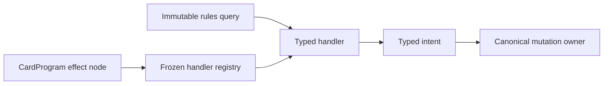

# Typed semantic handlers

A token replacement that adds one token for each pending token uses the current
creation recipes after earlier replacements. Added tokens retain the individual
creation instructions for status and attack assignment and have their own token
characteristics. An activation can bind X to an announced exact sacrifice of
one permanent subtype. The shared selected-object payment commits the public
group before the existing temporary characteristic result reads that X.

Half-life Recover prices use a separate version-two Recover descriptor inside
the existing version-twelve lifecycle instruction. The price quotes the locked
payer's current signed life and rounds its nonnegative half upward through the
shared quantity owner. Acceptance rejects a changed quote and emits the ordinary
life-payment intent. A zero payment remains a paid cost, so the original
graveyard incarnation follows the return branch. Decline follows the existing
exile branch. Resolved prices use an explicit version-thirteen cost kind;
positive fixed-life and fixed-mana Recover encodings keep their meanings.
Unscoped resolved prices, other rounding and unrepresented riders fail closed.

A controller-first mana contribution gives each remaining player a resolution
choice in turn order. Each player can activate represented mana abilities,
contribute zero, or select the exact eligible units from their own pool. The
payment owner rechecks the current quote and the selected units on submission.
Once every contribution is committed, the draw owner uses the combined amount
for each player’s private draws in active-player order. Saved continuations
preserve the next payer, the amount already paid, and pending mana replacement
choices. The compiler admits the complete draw instruction. Other printed
contribution results remain unresolved.

Death-controller optional draws use version two of the event optional-draw
instruction. The complete all-creature death occurrence retains the creature's
last battlefield controller as both chooser and drawer, independently from the
source controller who owns the triggered ability. Tokens qualify. The existing
draw-permission and private choice owners preserve that recipient through saved
continuations and canonical drawing. The version-one defending-player attack
instruction retains its original scope. Damage-source controller references and
unrepresented result riders remain outside the death-controller form.

Resolution-selected creature-stat results use an explicit version-thirteen
optional-payment wrapper and a separate versioned stat descriptor. The closed
controller end-step instruction offers one controlled nontoken creature through
the existing fixed-cost owner. Acceptance seals that incarnation's current
public power and toughness before its canonical sacrifice movement, then binds
the selected nonnegative stat into one independently validated fixed token
definition. A zero result still pays the sacrifice. Replacement redirection
preserves the paid cost; death triggers wait until the resolving instruction
finishes. Cast-price and activation-price stat descriptors retain their existing
meanings. Mandatory prices, reflexive results and unrepresented riders remain
outside this family.

Next-spell cost reductions use the existing duration journal and public total-
cost provider. A pending rule retains its resolving controller, spell predicate
and resolved generic amount independently from its source's later state. Cost
previews and preparatory mana choices do not consume it. Successful casting
consumes every matching rule, including a rule that reduces no generic mana;
other casters and nonmatching spells leave it pending. The canonical journal
owner handles consumption and cleanup expiry. Historical next-spell flags keep
their existing prepare-versus-commit behavior through the casting lifecycle.

Closed two-clause effects also accept top-level comma-then and period-Then
wording. The compiler retains each independently owned instruction and the
complete target schema. Quoted and parenthetical rules stay nested; linked
references, intrinsic search/shuffle and ambiguous optional scope remain with
their dedicated owners. An omitted third-person player subject keeps its
explicit first-clause player relation. Resolution order, later choices and
target legality use the existing sequence and instruction owners.

A whole-hand counter payment belongs to the targeted spell's current controller.
The private choice seals every card in that hand and checks the same identities
before moving the complete paid batch. An empty hand can pay the cost. Decline
uses the ordinary spell counter and its existing restrictions.

A targeted-player graveyard-exile instruction gives that player a required
choice of one current card from their own graveyard. The card is not a target;
the public-zone query filters physical cards and seals their incarnations.
An empty graveyard continues without a choice. Acceptance checks the same
candidate set and sends the card through the canonical replacement-aware zone
transaction. The source controller and graveyard owner keep separate roles.
Other counts, predicates and result-dependent riders require represented
instructions of their own.

Optional graveyard returns use an actor-scoped non-target choice. Candidates
come from the current owned graveyard through the shared public-zone query,
with a closed card-type predicate. A subtype-qualified selection may exclude
one creature subtype while allowing all planeswalkers. It uses current
graveyard characteristics, including characteristic-defining abilities.
The choice seals incarnations and rechecks
the current candidate set before emitting the existing identity-bound return
intent. In a mill/return sequence, milling and its replacements finish before
the optional choice; previously present cards remain eligible. Declining the
return leaves the preceding instructions committed. The resolving controller
owns the choice even if control of its permanent source later changes.

A fixed hand-source land activation uses the stack-scoped reveal ledger for
its original physical card. The ordinary entry owner moves that card if its
hand incarnation survives until resolution. An optional creature phase-out
on entry uses the normal trigger target choice and phasing transaction.

Explore completion uses the canonical reveal, counter and movement transaction.
Its qualified creature event reads the same incarnation's current types or
the existing ability-source LKI snapshot. A returned physical card cannot
replace the departed explorer's identity or controller. The legacy permanent
completion and qualified creature completion join one ordinary APNAP batch;
the type facts remain transient choice and intent data.

Ordinary artifact departure can produce one counter batch for the original source and a current controlled subtype set. The query retains the trigger controller, and both contributions to an overlapping recipient are combined before replacements. A departed or newer source incarnation receives only independently applicable subtype counters.

The fixed creature counter result reads the original recipient's current or departure controller at each written instruction. It consumes one confirmed grouped placement and delegates to the existing draw and life owners.

A trigger that names an artifact an opponent controls reads its battlefield controller immediately before departure. Its fixed counter result queries the trigger controller's current creatures for either printed subtype. A creature with both subtypes receives one placement.

A temporary combat prevention ability binds the creature that currently has the grant and the player receiving the damage event. Its additional draws use the damage amount at application, including when prevention is prohibited. The ordinary ordered draw coordinator retains both participants, replacement choices, and private cards. [Assassin’s Creed release notes](https://magic.wizards.com/en/news/feature/assassins-creed-release-notes)

A fixed stackless payment adds its selected mana, then resolves positive life gain for the original payer through current life replacements. A pending replacement choice retains the same payment identity and resumes that action.

Public source-counter results reuse the counter compiler's self-reference
vocabulary and closed counter/controller sequence owner. Source growth followed
by a temporary declaration rule composes the existing leaves, each pinned to
the source incarnation. Losing a source prevents its counter or modifier while
independent controller instructions continue in their printed order.

An all-or-none creature-subtype result changes layer 4 while preserving
the object’s card types, other subtypes and abilities. Any associated
flying, base statistics or modifiers use their own layers with one
resolution timestamp. The result locks its affected objects through the
end of the turn.

Player turn rules use the continuous-effect journal and expire at cleanup.
Hexproof grants can apply to every player or to the resolving spell's
controller. Both use the normal opposing-source check. Life-loss prohibition
blocks positive life payments and preserves life gain and other results of
dealt damage. Match outcome prohibition applies to explicit and state-based
wins and losses. Players can still concede, and the last remaining player
wins. The resolved rules remain in force after their caster leaves the game.

A two-player life exchange snapshots the two valid participants and their
current totals. The life owner checks whether both requests can proceed,
then prepares their replacements and commits the pair in one transaction.
For an optional upkeep trigger, targets are chosen when it is put on the
stack and the controller chooses whether to exchange on resolution.

A paired exchange can precede token creation within one resolving spell.
The token instruction reads the two legal players’ current totals after
the exchange and its replacement choices. It can create a zero-size token
and lets normal state-based actions handle the result. A token replacement
choice resumes that instruction while retaining the completed exchange.

An untargeted pair of token instructions can use the announced X for
the first token's power and toughness and the second token's quantity.
The resolving controller chooses a current opponent separately for each
instruction, even when X is zero. Each instruction prepares token
replacements for the controller and the chosen opponent before committing
both players' tokens simultaneously. State-based actions wait until
the spell finishes resolving.

The draw-step exception reads the existing count of completed draws.
Only the first completed draw in the affected player’s own draw step is
exempt. A replaced draw leaves that count unchanged. Other draws use the
same generated-draw pipeline and lifetime for consumed replacements.

A characteristic and life-total exchange captures both original values at
resolution. The life owner prepares replacements before either value changes.
The resolved life change and the new layer-7b base value commit together.
The affected player keeps control of life replacement choices, and the
characteristic setting applies to the original battlefield incarnation.

The chosen-color destruction activation uses the source’s linked entry
designation and its retained copy form to offer targets. Its stack frame
keeps the original choice through source departure or replay. A newly
copied pair can use only a choice made for that pair. Resolution checks
the target’s current colors before applying ordinary destruction.

A targeted upkeep trigger can copy its own permanent from another creature.
The copy lasts for the receiving incarnation and includes the resolving
trigger as an added ability. Separate instances still trigger separately
when the copied creature has the same ability. The existing copy owner
preserves the receiver's counters and status.

An attachment-qualified destruction effect targets the Aura itself.
The shared target matcher also checks the type and, when specified,
controller of its current attached permanent. Both must match at
announcement and when the ability resolves.

A paid nonmana activation copy observes the committed stack ability after its costs.
The trigger controller may pay once, then use the ordinary stack-copy target choice.
If the original departs, its recorded state preserves X, modes, target identities
and source information without activating the copy or charging its costs again.

A fixed-receiver spell-copy trigger observes a cast with one distinct
creature target other than its source. The optional copy uses the retained
spell's modes, paid choices, and ordered target groups. The copy validator
checks the original source incarnation against every target slot before
offering the choice and again when the player accepts. A legal Aura spell
copy enters as a token attached to that receiver.

The creature-set spell-copy trigger observes an instant or sorcery cast
whose only distinct target is its original source. The ability controller
or the player who cast that spell receives a copy for every other creature
they control that can legally occupy all slots. Checks use the original spell
and the resulting copy's targeting facts. The copying player orders fixed
receivers when multiple copies are created. The continuation records their
battlefield incarnations and checks the same set before committing the copies.

Chosen-color cast triggers compare canonical event-time spell colors with the
source incarnation's existing public color designation. Current controller
and any-caster subscriptions remain distinct. Multicolored membership yields
one trigger per cast; an absent designation, colorless spell or uncast copy
does not qualify. The runtime independently infers the designation-reader
dependency. Ordinary result owners retain source-counter identity, optional
choice authority and the caster referenced by "that player."

Crime is recorded at authoritative initial cast, activation and targeted
trigger completion. The typed classifier reads sealed initial target roles
across players, permanents, stack objects and graveyard cards. One qualifying
action creates one history fact and actor-relative event, independently from
how many targets qualify or whether the action resolves. An uncast spell copy
is not a cast, an activated-ability copy is not activated, and a triggered
ability copy put on the stack can qualify. Retargeting neither creates nor
erases the original crime. Current-turn conditions read complete versioned
history; source trigger-use limits remain independent. Public condition and
event descriptors infer the crime capability through the ordinary compiler
and runtime requirement owners. Unrepresented result bodies remain residual.

Targeted face-up instructions use the existing domain-effect handler family.
Their closed schema rejects forged runtime context, extra fields and noninteger
versions before lowering. The existing target owner revalidates face-down status
and controller relation; the effect delegates to `ZoneTransitionOwner.turn_face_up`.
Successful attempts publish one face-up occurrence after the canonical status
change. Physical spell-card refusals publish a brief reveal through the same
owner and retain face-down status without firing face-up triggers. Morph prices
are relevant to special actions, not this resolving instruction.

Fixed opponent loss followed by gain equal to the actual life lost uses
`ActualLifeTransferHandler` in the existing semantic-choice registry. The
existing life-loss batch commits each active opponent's replacement-aware
loss, then its resolved total becomes a separate typed life-gain intent.
Gain replacement choices preserve that total across load and resume without
repeating opponent losses. Fixed printed gains remain their own life effect;
this result never substitutes damage or a presumed multiplayer total.

Created-token counter followups use two automatic instructions in the existing
semantic-choice registry. The first commits one canonical creation intent;
`IntentResultObjects` binds its actual returned references to the next
instruction. This includes replacement-created additional tokens. The second
reads its numeric producer after creation and commits ordinary counter intents.
It exposes no target or recipient choice. Entry observers see the printed
creation definition before these counters, and SBA stays deferred through the
resolving instruction and its replacement choices. Pending creation and counter
choices retain their separate canonical intent identities and replay owners.
The automatic result binding adds no record field or mutable gameplay cache.

Intrinsic Exploit uses a public zero-or-one creature choice issued to the
locked entry-trigger controller. The typed sacrifice intent retains both
incarnations and delegates to the canonical replacement-aware zone owner.
Its committed sacrifice history distinguishes a completed sacrifice from an
ordinary departure. The host captures the current trigger-source snapshot
before sacrifice, so sacrificing the exploiting creature itself can produce
its separate Exploit result trigger. A source that departed before this
instruction cannot supply that result ability. Replacement redirection
preserves the sacrifice occurrence even when the selected creature does not
die. Saved replacement choices retain the exact intent identity.
Qualified external observers and linked exploited-characteristic results
remain residuals.

Fixed single-object Connive lowers to a versioned instruction under CR 701.50.
Its current controller draws, then privately chooses the mandatory number of
discards. A departing source retains its last controller and incarnation;
returning the physical card creates a separate object. Fixed Connive N uses the
same ordered phases. Zero performs no action and publishes no Connive event.
The canonical discard journal determines which selected incarnations actually
committed, including public replacement redirection. CR 701.9c excludes
unrevealed hidden redirected cards from characteristic-dependent nonland
counting. Counter placement uses the existing replacement-aware owner and
requires the retained permanent incarnation. Completion publishes only after
draw, discard and counter continuations finish, including impossible actions.
Private candidate ordering is deterministic across checkpoint serialization.
Variable counts, simultaneous connivers, Connive replacements and unrepresented
listeners or reflexive results remain residuals.

Explore uses one retained permanent and its current or last-known controller.
In the current action mode, an empty library still prepares the ordinary
replacement-aware counter before completion. Stale, phased or returned
incarnations do not receive it. The same owner handles compiled instructions
and Map builtins, including suspension and exact resumption of counter
replacement. Historical absence of the mode retains the earlier empty result.
Source departure capture follows independently owned optional-effect and
payment wrappers in the current mode. See
[the action-mode decision](../adr/0134-versioned-explore-action-semantics.md).

The existing optional-effect choice also represents fixed controller draw
followed by “If you do, discard” instructions. Decline performs neither action.
Acceptance resumes the draw and then the mandatory private discard through
the same resolution cursor. Acceptance still requires discarding if a draw
replacement changes or prevents the actual draw. The discard choice is issued
after the draw, includes the resulting hand, and remains private to its chooser.
Arbitrary linked conditions, random counts, and unrepresented player variants
remain residuals.

A source can offer fixed opponent life loss after a controller cast on an
opponent's turn. Each qualifying cast independently uses the retained
turn and caster facts. The optional chooser can decline or commit one
opponent-only life batch.

Optional-result validation receives the existing immutable resolving-source
snapshot from the owning stack item, both when preparing a choice and when
validating its continuation. Source-dependent handlers retain their ordinary
provenance checks inside optional effects and fixed payments. This snapshot
contains public identity and duration facts; it carries no mutable game state
or hidden-zone data. Missing or malformed required provenance still rejects
the instruction before payment or mutation.

The existing characteristic operation accepts a closed version-six target-set
instruction. Canonical target revalidation supplies each surviving original
reference, and the continuous-effect state owner applies identical represented
stat and keyword components to that set before stabilization. Printed up-to
selection permits zero; exact count selection requires distinct references.
Effects remain locked to those incarnations and expire through the ordinary
duration owner. Base-setting, mixed roles, and unrepresented result semantics
retain their residual boundaries.

Bounded ordered effect programs can compose independently closed public-query
and source-scalar result amounts. Each instruction reads its quantity at its
printed resolution position: an earlier draw, counter placement, or token
creation affects a later count. A declaration retains its own binding and
continuation cache; the program never evaluates all quantities in advance.
Explicit live battlefield quantities use the same applied-instruction boundary
for current combat state and currently applicable keywords. Their independent
producer capability and closed codec keep these reads separate from static
layer-5 quantities. Mana production calls the same read-only count owner.
Pending replacement choices resume at the same cursor without repeating prior
mutations. Linked-result, conditional, ambiguous shared subjects, and multiple
independent target groups retain their unsupported boundaries.

A distinct versioned scalar reads the sealed opponent-upkeep participant
current hand count at damage resolution. Its two fixed differences become zero
when negative, and zero produces no damage event. The instruction has no player
target and never inspects private card identities. Source control changes and
departure preserve the original upkeep subject and canonical damage source;
departed participants use the existing scheduled-result skip. Old targeted-hand
quantities retain their own target and wire contracts.

Typed semantic handlers execute one immediate CardProgram instruction. They
translate a validated typed node and bounded immutable rules query into typed
intents. Canonical engine or focused mutation owners commit those intents.
The single-object, public-graveyard exile and public-set movement intent models
live in `semantic_runtime/zone_move_intent.py`, alongside frozen replacement
selections and per-Aura entry selections. The public intent catalog reexports
the same types. The single-object intent's explicit transition kind is data for the canonical zone
transaction, including sacrifice provenance and ordinary default movement.
Handlers never receive mutable `GameState`, private projections, persistence
objects, or unrestricted engine access.

Every registration declares a stable handler ID, schema version, exact
operation family, rule references, and bounded capability dependencies.
Duplicate ownership and unknown capabilities are rejected. Malformed input to
a registered operation is a rules error and cannot fall back to permissive
string dispatch. Strict preflight fingerprints the registry and recomputes its
capability closure.

Family modules own lowering; the aggregate registry owns only discovery and a
stable inventory. A handler may request a narrowly defined continuation for a
choice or replacement-aware transaction, but it may not retain mutable state
or commit around the canonical owner. Rollback must leave no partial mutation.

Casting offers and accepted commands use the same prospective selected-face
view for printed costs and cost predicates. Face values enter before current
characteristic layers, so an intrinsic Devoid definition still affects the
cost query. Current split spells expose only
the chosen half's mana value and colors; other zones retain combined split-card
values. Aftermath uses the existing fixed lifecycle descriptor and canonical
stack-departure self-replacement, including when countered. Pending private
results preserve that lifecycle through save/load without replaying prior
instructions.

Implicit ordinary permanent-spell provenance binds the exact selected face
name and its permanent type. Another face's permanent type cannot authorize an
unsupported spell half under the trusted-only policy; offers and proposals
share that same trust predicate.

Player speed starts through the canonical state-based owner. It checks for a
registered Start Your Engines handler before reading current battlefield
ability fragments. A player's speed persists after
its starter leaves. Committed opponent life losses queue one source-free
inherent trigger during the speed owner's turn, recording usage at creation.
The closed `increase_speed` instruction checks its intervening limit and
commits through the player speed owner. Current Max Speed abilities use the
same source applicability model in battlefield and graveyard contexts, with
exact equality to four rather than a minimum threshold.

Prototype uses a current trusted complete-card marker in the existing ability
registry. The cast owner creates an immutable prospective characteristic view,
then pays and commits through ordinary casting. Its canonical annotation
survives stack-to-battlefield resolution, participates in copiable snapshots,
and is removed by other zone transitions. Costs and card abilities remain
independent of the selected size and color.

Printed self-transform activations use the existing `transform` instruction
and source-pinned transform owner. The activation context captures the current
transform count, while source-zone-object substitution rechecks incarnation.
Shared current-face keyword queries consume trusted compiled keyword programs,
so transforming removes old-face keywords while retaining costs and independent
new-face abilities. For a qualified Landwalk label omitted by the provider's
keyword index, only an exact current printed-keyword declaration supplies the
missing base characteristic. Conditional, stale or wrong-face declarations do
not supply it. Copyable values capture that printed fact before later ability
removal; copied and token values retain their own captured keyword data.
Whole-card command admission remains a separate authority.

One fixed printed Casualty declaration adds an optional schema-four sacrifice
price to ordinary casting. Its typed predicate requires one currently controlled
creature with effective power at least the declared threshold. Tapped,
summoning-sick and token creatures remain eligible. In new games, price offers
use the existing prospective source-placement reader, so power depending on the
hand or another origin zone agrees with actual payment after the source reaches
the stack. Earlier zone-cost schemas retain their prior representation.

The canonical zone-cost owner pays the price and retains the selected logical
incarnation. The spell's declared context carries that sealed fact during
preparation; cast-trigger construction validates it against committed cost
objects after payment. This preserves the existing source-before-cost sequence.
Destination redirection still pays sacrifice. The ordinary spell-copy trigger
owner then creates one independent copy with retained X and optional fresh
targets. It survives removal of the original spell, and the copy is not cast.
Private choices in copied bodies retain ordinary projection and replay. Variable
permanent-copy exceptions, multiple or granted instances, mixed consuming costs
and unknown companion bodies remain residual. See
[ADR 0136](../adr/0136-power-qualified-casualty-costs.md).

Printed Bargain uses the same zone-cost selection and payment path with a
schema-five disjunction of controlled-permanent predicates. An artifact,
enchantment or token can pay; the predicates are alternatives. Current type,
control and phase state govern eligibility, while tapping and summoning
sickness do not restrict sacrifice. Destination replacement retains the
ordinary sealed cost continuation.

The existing option-expansion owner assembles optional resource prices in a
fixed order. Each price owner retains its own selection, affordability and
composition guards; the assembly adds no registry or payment path.

`DeclaredCastCostFacts` records source-local optional-cost choices separately
from existing Kicker and other historical fields. Bargain records the declared
intention under CR 702.166b. Linked fixed spell results use version twelve of
the existing public-condition instruction, with both branches independently
closed and the same target contract. Entry results consume immutable original
entry facts; a later departure or unpaid reentry cannot replace that occurrence.
Spell copies retain declarations, while ordinary permanent copies do not
inherit another object's casting history. No global flag or game-state mode is
introduced. `DeclaredCostReductionSpec` qualifies a fixed generic discount with
the same source-local declaration. Its component belongs to the existing cast
registry and requires complete card admission. The shared total-cost planner
applies the server-generated option's facts before sacrifice payment; colored
requirements and printed mana value remain unchanged. Conditional announcement
targets, variable or colored Bargain discounts and other unrepresented linked
bodies remain residual. See
[ADR 0137](../adr/0137-linked-optional-casting-declarations.md).

Forecast is an optional marker in the existing activated-ability descriptor.
It requires a hand source, owner-upkeep condition and once-per-turn usage limit;
older descriptors omit the marker. Ordinary activation legality and payment
remain authoritative. The source reveal delegates to the canonical scoped hand
reveal owner. A typed frame retains the original hand incarnation and prior
disclosure state until actual hand departure or entry into a non-upkeep step.
Consecutive upkeep steps retain the disclosure. Ending it preserves learned
identity and independent public-hand permissions. A later hand incarnation
gets independent usage and reveal state.

Announced activation X can compose with a fixed sacrifice of its own source,
with or without a printed tap cost. The catalog keeps both the X symbol count
and the existing sacrifice flag, validated against the entire printed cost.
The combination requires its own capability as well as the ordinary X owner.
The canonical activation transaction pays all costs atomically; its stack
object retains the announced X and source information after sacrifice. Older
ordinary X and fixed self-sacrifice descriptors keep their encoded forms.

Fixed card-discard costs also compose with announced activation X. They retain
the existing exact owned-hand query, a count of at most ten, and the canonical
selected-cost transaction. The discard count is independent of X, including
zero. The combination rejects random discard, restricted card predicates,
variable counts and simultaneous source-sacrifice costs. Existing movement,
replacement, disclosure and rollback owners remain authoritative.

Selected-tap schema two adds fixed ordinary color alternatives to the existing
controlled untapped permanent query. Its plan retains the ability source's
allowed zone and logical identity; Forecast can use an owned hand source while
the selected payment objects remain battlefield permanents. Battlefield source
checks remain the default for earlier callers. Creature summoning sickness
does not restrict a cost written as a selected-object tap. No new activation
interpreter or game-state mode is introduced. See
[ADR 0138](../adr/0138-forecast-hand-source-disclosure.md).

Enlist's optional declaration taps and linked reflexive program use the
existing tap, scalar, APNAP and continuous-effect owners. The trigger context
pins the original attacker and donor, preserves paid taps across pending
save/load, and reads current donor power or immediate departure LKI at
resolution. Declining creates no tap or trigger, and unsupported sibling
instructions remain closed independently.

Fixed Graft uses the existing semantic-choice registry for its optional,
non-targeted move. Its immutable movement intent pins both incarnations and
retains the trigger controller. The counter coordinator resolves recipient
replacement choices before the canonical counter owner commits source removal
and replaced placement together. Saved replacement continuations preserve
that movement identity and cannot repeat or redirect the removal.

The existing generic direct-control operations share the authoritative control
and acquisition-history owner. An indefinite control instruction invalidates
an older end-of-turn restoration even when it names the current controller.
Temporary control captures the previous restoration before that shared commit
and reinstates only its own explicit duration afterward. Cleanup therefore
restores the latest indefinite boundary, not an obsolete controller. This
bounded legacy-operation correction adds no printed control grammar or general
layer-2/attachment-control capability. Current command replay is separate from
historical execution; records declaring incompatible runtime trust are rejected
instead of being reinterpreted under the corrected cleanup behavior.

The fixed optional-effect choice handler accepts one already represented atomic
instruction or one validated linked exile/return phase pair for the resolving
controller. It exposes only apply or
decline, commits nothing before the response, and on acceptance prepends the
unchanged typed instruction so its existing semantic or choice owner performs
all validation and mutation. The wrapper rejects unknown operations, changed
chooser identity, extra fields, and nested optional wrappers. Specialized
optional choices such as fixed counter placement retain their historical
operation and replay identity rather than being rewritten through this owner.

The public resolution-condition handler receives one immutable result from the
canonical public-state query at the current instruction boundary. A known false
condition skips its result; an unavailable fact rejects instead of becoming
false. A known true condition prepends the unchanged typed result to the normal
continuation, so private choices and replacements resume after the committed
prefix without rerunning it or rechecking the condition at arbitrary later
state. It creates no decision, mutation owner, or independent query engine.

The linked exile/return coordinator delegates both simultaneous movements to
the existing zone owner. Exile commits and records only resulting exiled card
incarnations on the resolving stack item. Return or delayed-trigger creation
is a separate instruction, so a prospective-entry replacement choice resumes
only the uncommitted return. Delayed return uses one ordinary controller-locked
trigger with the exact exiled identities; departure and reentry invalidate
those identities. Entry counters use the canonical nested replacement tree,
and immediate keyword riders use the ordinary incarnation-locked layer journal.
The graveyard exchange uses three ordered instructions. It exiles each player’s
creature cards in one batch and retains only their committed exile incarnations.
It then prepares the sacrifices of all current creatures in a separate batch.
Replacement choices determine the actual destinations. Each receiving owner
chooses the order of their arriving physical cards before the batch moves them.
The return uses the retained incarnations and each card’s original exiling
player. A pending replacement or order resumes the uncommitted instruction.

No state-based action runs between an immediate exile and return. In particular,
Commander exile-to-command choice happens after immediate blink finishes, but
may remove a delayed-return card from exile. Old records retain their pinned
trust provenance; this new grammar does not reinterpret historical records.

A fixed immediate owner return can carry a separate post-return counter.
The linked journal pins the actual new battlefield incarnation. The later
phase uses its effective Spirit subtype and ordinary counter placement.
Replacement choices in that phase resume the counter without repeating the
already completed exile and return.

A life-paid library-top activation uses the normal activation cost and zone
owners. Each resolution retains the resulting face-down exile incarnation
and schedules one independent trigger for the controller's next end step.
The delayed return puts the retained object in that player's hand. An empty
library or redirected move leaves the delayed trigger with no object to return.

Schema four adds the separately gated immediate transformed-source return.
The linked owner derives an eligible back face from the physical card and gives
that face to the zone owner before entry processing. It retains the resolving
controller, clears the old zone object's counters, and does not enter a front-
face Saga before transforming it. Single-faced copies and tokens cannot use
copied Saga text to acquire a returnable physical back face. Schemas one through
three retain their exact descriptor fields and timing policies.

Linked target cardinality is independent of source exclusion. The compiler
captures an up-to bound and an other-object qualifier before canonicalizing
the subject. Selecting zero targets remains legal with or without eligible
objects and is not a later optional-effect decline. Mandatory another-target
instructions still require their target, and offers and commands share the
same typed target schema.

The existing optional-payment choice also accepts a closed v2 fixed-cost
descriptor. Fixed positive energy payments read the locked actor's current
energy, then commit exactly that cost through the canonical counter transaction
before continuing the represented result. Decline retains energy; insufficient
energy rejects atomically. Counter-placement replacements do not apply to this
cost. The descriptor uses the ordinary private/public object choice and resource
affordability snapshot, pins selected zone incarnations, and returns only
canonical full-payment intents before prepending independently represented
consequences. A redirected discard or sacrifice still pays the chosen cost;
optional object costs publish disjoint permitted cardinalities, so decline and
full payment are the only executable alternatives rather than an inclusive
selection range. Omitted cardinality metadata retains existing range choices.
checkpoint replacement resumption reconstructs the same intent and runs the
result once. Decline changes no cost/result state, and a mandatory sibling
outside the descriptor remains outside its choice. Historical v1 payment
payloads keep their prior preparation/completion path. Current candidate lists
use stable public-reference ordering before continuation storage so checkpoint
hydration cannot change command hashes. Historical payload execution is separate
from historical record replay: records with incompatible runtime trust provenance
are rejected explicitly before loading, rather than recompiled under current
semantics.

A fixed life alternative for one targeted player uses the resolving stack
object to authorize the payer and the source controller. Payment uses the
canonical life cost. Decline passes the same player's hand to the whole-hand
discard owner. The choice packet carries the fixed price and affordability,
while the canonical discard owner reads hand membership on resolution.

An opponent-caused discard trigger observes the actual face-up card in
the public zone it reached. The committed occurrence pins the discarding
player, the resolving effect's controller and the discarded incarnation.
The original controller owns the trigger. Its return result checks that the
same incarnation still occupies the committed destination, and its life and
token results use the established action owners. A compound life and delayed
return result grants life as the discard trigger resolves. The next end step
can return the original incarnation from its owner's graveyard. A token
result with an intervening Plains condition queries the original trigger
controller's current lands at trigger creation and resolution. A delayed
battlefield return with a fixed counter uses the same incarnation check.
The entry transaction places the counter and applies replacements before
publishing the battlefield entry.

The controlled nonflying creature death result uses the last battlefield
controller and effective flying. Its trigger retains every physical card that
reached the graveyard from the same death, including the parts of a merged
permanent. Resolution revalidates each incarnation and returns the eligible
cards together under their owners. The entry transaction places the flying
counters before publishing entry events. An arriving Aura uses its owner's
ordinary nonspell attachment choice before movement.

The same payment registration accepts a closed v3 source-maintenance payload.
Its fixed cost uses the shared v2 cost preparation and completion helpers.
Decline sacrifices only the original source incarnation while the trigger's
locked controller still controls it; the canonical simultaneous-zone intent
owns sacrifice events and destination replacements. A mandatory source sacrifice
auto-continues without a payment decision. Optional payment remains available
when the source has left, returned or changed controller, because the printed
unless instruction has no intervening source-presence condition. A successful
cost payment suppresses the default even when a replacement redirects its cards.

A mandatory self-entry land sacrifice can create a separate reflexive search
trigger after the original controlled incarnation departs. The zone owner
settles destination replacements before the reflexive trigger is queued.
The child uses the resolving controller's private search over the three
displayed Basic land subtypes, then the ordinary shuffle and one-life
instruction. Failing to find preserves the shuffle and life gain.

An explicit source-tap default uses the same source-maintenance choice for a
positive fixed life price at its controller's upkeep. The trigger's controller
keeps the choice after a change of control. Decline taps the original source
incarnation through the ordinary tap owner. A returned source has its own
incarnation and stays outside the original default result.

Each-player upkeep life alternatives keep the original upkeep participant in
the sealed step occurrence. That participant may pay the fixed price. Decline
opens the ordinary controlled-permanent choice, and its selected object moves
to its owner's hand. A departed upkeep participant's result is skipped by the
scheduled-player owner.

Chance for Glory first applies one layer-six Indestructible grant to the
resolving controller's current creature set. The grant retains the original
battlefield incarnations across control changes and ordinary turn boundaries.
A creature entering later starts outside that set. The same resolution then
schedules the existing turn-specific delayed loss.

An extra-turn instruction with a version-one end-step loss creates one ordinary
extra turn. Its delayed trigger retains the scheduled turn ID, original source,
and resolving controller. An earlier extra turn for that player leaves the trigger
pending. At the bound end step, normal trigger placement gives players priority
to respond before the loss can resolve. The next step boundary retires a loss
whose turn was skipped or otherwise removed from the turn queue. Historical
unmarked extra-turn instructions replay through their stored scheduling path.

A spell can watch a targeted creature for combat damage during the current
turn. The delayed ability retains the creating spell as its source and that
spell's resolving controller as its draw recipient. It watches the chosen
creature's original incarnation. Each positive committed combat damage
occurrence to a player or planeswalker contributes its replacement-adjusted
amount through the normal trigger queue. The watch stays available for later
combat damage steps that turn. A new turn retires it.

Normalized opponent life-loss triggers use positive committed loss records
from ordinary life effects, life payments, and the damage transaction. Damage
retains loss and lifelink as separate results even when their effect on the
same life total cancels out. The sealed occurrence supplies its original
player and amount to the existing gain-life or mill owner. These additional
occurrences enter trigger placement only when the registry contains the
reviewed loss subscription. Earlier records retain their existing action
and trigger behavior.

A resolving life effect ignores a known recipient who has left the game and
continues independent instructions. Such a recipient creates no life-change
record or gain/loss event. Unknown recipients still fail validation; life
payments and the low-level state owner continue requiring active players.

A fixed semantic-choice life gain uses `LifeChangeIntent` rather than writing a
life total directly. The intent host prepares the canonical life-change batch;
its life-intent delegate also accepts one immutable simultaneous loss batch.
Extort pays one chosen white or black vector, commits distinct opponent losses
as one batch, and derives its later gain from the actual instruction result.
Replacement suspension preserves the stage and committed loss amount through the
existing preparation journal. No client can submit those internal stages.
When multiple replacements apply, the ordinary private replacement task stores
a closed life-intent identity and resumes only that uncommitted intent. The
continuation decoder rejects unknown intent kinds and changed identity, and
exact replay reissues the same semantic response and replacement selection.

Life-total setting uses a closed `LifeTotalValueSpec` and one immutable
resolution snapshot. The existing domain-effect handler supplies authenticated
source context; programs cannot supply that context themselves. Fixed,
starting-life, extreme-life and represented board/library count values produce
the ordinary signed gain or loss required by CR 119.5. The existing life batch
then applies gain permission, replacements and source-attributed result events.
It never assigns the requested final total directly. All-player instructions
freeze every value before any replacement choice or mutation, so later players
do not read earlier replacement-adjusted totals. A zero difference produces no
life event. Exchange, team and unrepresented quantity or rider semantics remain
outside this producer. Existing effects and record state fields keep their
current representations.
Board counts exclude phased-out permanents under their current status.

Backup commits canonical target counters before a version-seven temporary
ability bundle. Its shared target decision permits any legal creature; a self
target gets only the counters. A different target gains fixed keywords and
typed ability fragments through the existing continuous-effect journal until
end of turn. The compiled printed bundle is locked at trigger placement,
survives source departure, and binds donated abilities to their recipient.
Counter replacements may suspend before the following grant, preserving the
cursor through save/load. Target incarnation revalidation remains shared.

Explicit temporary quoted activations and triggers use the same ability-bundle
owner.
Version seven carries one revalidated creature; version eight snapshots a
closed public battlefield query through the canonical resolution selector.
Version nine couples one child fragment to fixed signed stats through the
canonical multi-layer transaction and its shared timestamp. These forms
add typed fragments at layer six, pin recipient incarnations, require a
trusted child program and expire at cleanup. Recipient control changes retain
the grant while later activations use the current controller. Later entrants
and departed recipients do not inherit the earlier effect. A departure event
uses the canonical predeparture fragment snapshot to publish its already
triggered ability with the departing recipient as source.

An activated ability can grant one quoted combat-damage trigger and prevent
the same revalidated creature from being blocked that turn. When the
creature deals combat damage to a player, its controller at trigger time
draws one card per counter kind present on that source at resolution. The
draw amount uses last-known counters for a departed source. Cleanup ends
the temporary ability and block restriction.

The event-bound battlefield-return instruction emits the existing typed zone
move with its exact graveyard incarnation, owner controller, tapped entry and
optional fixed entry counter. Replacement preparation receives the same
requested tapped state as commit, so the prepared identity remains valid when
entry counters and tapped entry occur together. The existing Persist/Undying
owner follows the same entering-controller counter attribution.

A source-bound delayed graveyard return retains the original battlefield
source and the physical cards from the qualifying departure. The one-shot
scheduler checks the source at the next end step. Resolution checks it
again before offering the return to the delayed trigger's controller. The
existing zone owner returns eligible graveyard incarnations simultaneously
and collects any Aura attachment choices before movement.

An opposing-death return records the physical graveyard arrivals and the
resolving trigger's controller. It uses the next actual end step and returns
only the retained incarnations that still qualify. The zone move carries
the extra entry counter through the normal replacement path. It commits
the additive characteristics on the new battlefield incarnation before
publishing its entry occurrence. Prospective replacement decisions continue
to use their existing inputs.

Reanimation instruction version seven represents an Aura returning after its
enchanted creature dies. The occurrence captures the Aura's battlefield
zone-change counter; CR 400.7f permits following exactly the next graveyard
incarnation, including an Aura moved there by a state-based action. An explicit
controller-graveyard restriction remains distinct from an unqualified return.
The existing zone owner performs entry under the resolving controller, and the
Aura owner supplies a legal non-target attachment choice. Delayed returns use
the existing next-end-step scheduler with the same retained incarnation.
Transformed entry consults the physical card's faces; an ineligible single-face
copy stays in its graveyard. Token Auras retain their triggered occurrence but
cannot return after leaving the battlefield. Earlier reanimation versions keep
their existing schemas and meanings.

Optional payment wrapper eleven represents grouped graveyard-to-library upkeep
costs. The payer proposes a complete fixed-size group from one public graveyard
for each age counter, and each library owner privately orders that owner's
individual groups. Proposals retain the selected incarnations and perform no
movement. One typed cost batch delegates each group to the existing zone owner
inside the existing transaction boundary. Later replacement preparation sees
earlier group results; a replacement pause or fault restores every group before
returning control. Saved replacement choices carry their exact event identities
so replay can repeat earlier groups without applying a later group's choice to
them. Older payment wrappers and simultaneous-movement payloads retain their
existing meanings.

The existing counter-unless-payment choice additionally accepts a closed v2
controller-payment descriptor. It locks the current target's controller for
the private choice, validates the complete mana vector and current target at
completion, and keeps the countering source controller separate from the
payer. Canonical mana intents perform payment; canonical counter intents
perform decline consequences. Announced X is resolved by the existing scalar
owner before preparing the choice, including zero. Current save/load and
exact replay preserve the choice and remaining instructions. Historical v1
payload execution remains separate; incompatible archived records are
rejected by the existing runtime-trust provenance boundary.

Scalar effect quantities reuse the value resolver before their unchanged
operation handlers run. Referenced characteristics use current information for
the same logical object in its expected public zone, otherwise its immediate
departure LKI. The canonical zone batch's existing characteristic checkpoint
pins relevant pending references before any member moves; source activation costs and
departure triggers seed the same stack-context snapshots. Committed trigger
amounts retain the normalized result event, not a later total or replacement
request. Public-history quantities read the current canonical journal for the
stack object's locked controller. Explicit declarations cache one value across
sibling results and resumption; independent instructions still read separately.
Malformed continuations, unavailable characteristics, and unrepresented history
fail closed. No new mutation owner, zone event, history registry, or runtime
Oracle interpretation participates in this path.

The typed `discard_whole_hands` instruction selects every current hand member
for its represented affected players and delegates one simultaneous batch to
the canonical zone owner. It preserves the discard transition cause and
resolves all destination replacements before following draw instructions.
Empty hands require no subset choice and do not skip an independent draw.
Replacement continuations seal private membership, including logical object
identity, and reject a changed hand before resuming. This snapshot is not
published to another principal.

Linked whole-hand discard and draw instructions use a separate typed result
from that same discard owner. Authoritative hand membership is materialized
without adding opponents' cards to the actor-visible object query. The result
counts only new committed discard occurrences of those sealed incarnations,
including redirected destinations. `IntentResultPlayerDraws` binds either each
player's own count or the greatest affected count, with an explicit optional
plus one, to ordinary draw instructions in APNAP order. Empty hands contribute
zero. Casting-cost discards and earlier turn-history events cannot enter the
result. Replacement suspension retains the intent identity; conditional return
suspension retains the already bound draws through the existing completed-choice
continuation. No new game-state cache or mutation owner is introduced.

Counted Ward lets the original targeting stack object's controller pay with
two distinct permanents that player controls. The shared object-payment owner
validates and moves both as one cost. Declining attempts to counter that stack
object. Variable Annihilator uses the defending player from the original attack
and counts the attacking incarnation's +1/+1 counters at resolution, with last
known information after departure. It reuses the fixed Annihilator sacrifice
instruction with the resolved count.

A declared attack batch can place a counter on its original source and then
create tapped attacking tokens according to that source's actual counter
count. The scalar query runs after placement replacements. If the original
source has left, the retained last known counters supply the count. A zero
count skips token creation. The fixed attacking-token owner assigns each
actual token a defending recipient and commits the replacement-aware batch.

Mandatory “sacrifice a permanent” instructions for the resolving controller
reuse the same `choose_cards_apnap` owner as fixed player-targeted sacrifices.
The controller chooses only current eligible permanents they control, including
the ability source when the instruction permits it. Fixed creature subtype
predicates inspect current creature types at choice preparation and again at
commit. Empty sets perform no sacrifice, short sets sacrifice their available
members, and destination replacements retain the sealed choice before the
remaining instructions resume. Sacrifice uses its own transition cause and
does not consume destruction or regeneration effects.

The controller-end-step shared-type payment first offers the resolving
controller a single optional sacrifice. A chosen payment retains the full
effective battlefield card-type set and completes through the ordinary zone
owner before the opponent stage. Opponents choose in APNAP order using any
shared type. After replacement choices, an owner with multiple arriving
physical cards orders those arrivals. The sacrifices commit simultaneously.
Nonpayers then lose life and the controller privately draws one card for each
nonpayer.

The controlled land-entry counter-and-keyword mode uses the immutable
battlefield incarnations of creatures its controller controls at resolution.
The counter owner attempts all placements in one batch. The continuous-effect
owner grants vigilance to the retained creatures until end of turn, including
creatures whose placement was prohibited. Later entrants are outside the
captured set. Copies keep the announced mode and sample their own controller's
creatures at resolution.

The mandatory all-colored instruction queries live colors for every active
controller. It submits one sacrifice batch without a permanent selection
decision. Destination replacements resolve before the owner order choices, so
a borrowed permanent belongs to its owner's group and a redirected card
leaves that group. Tokens share the movement without becoming order choices.

An ordered fixed opponent sacrifice collects ordinary affected-player
selections before proposing the batch. Each player with fewer legal
creatures selects all they can. Actual physical receiving owners order
their replacement-adjusted graveyard groups before movement.

The targeted upkeep return may add one creature subtype to the actual
battlefield incarnation. The same addition informs prospective entry
replacements and the committed entry event. It remains attached to that
incarnation through the layer journal.

Keep-three instructions use the public affected-player choice. The ability
limits the original battlefield set to the lands each player controls. The
sorcery uses all their permanents. Players with more than three eligible
permanents choose in active-player-first turn order and see prior public
choices. Smaller and exact-size sets automatically keep all their members.
The continuation checks the saved permanent identities, then submits the
unselected permanents in one simultaneous sacrifice. Replacement ordering
and replay use the ordinary sacrifice owner.

Alternative-quality hand discards use a typed `alternative_discard_count`
inside the same APNAP instruction. The affected player can discard one card
matching the closed quality predicates or the available fallback subset.
Having a matching card does not remove the fallback option. The private form
offers separate matching and fallback branches, and command validation uses
the same legal subsets. Draws printed before the discard finish before its
hand is inspected; the discard still applies when those draws are prevented.
Each player's selected cards stay hidden from other principals and remain in
hand until the existing simultaneous discard commit. Ordinary fixed and
fractional choice payloads retain their previous form and validation.

A spell that draws for cards discarded by each other player uses the same
private APNAP hand choices and simultaneous discard. Empty hands contribute
no choice. The draw receipt matches the original selected hand incarnations
against committed discard occurrences after replacements. A discarded card
sent to exile still counts. The controller draws privately for the committed
total. No additional public log exposes cards selected for an uncommitted
discard.

Fixed hand exile uses the same APNAP choice owner. The targeted player or
each affected player chooses the required available cards privately from
their own hand. The transaction waits for the final choice and commits one
simultaneous face-up exile batch through the existing destination owner.
The movement has the ordinary zone-change cause. Later instructions resume
through the existing stack continuation.

The separate `discard_random_cards` instruction samples a fixed one-to-four
card subset of each represented current hand without a client selection choice.
Each player's complete hand is validated before sampling; empty and short hands
discard only their available cards. The seed, stack identity, instruction cursor
and affected seat define a deterministic uniform sample. One simultaneous
discard transaction owns destinations and events. Replacement continuations
seal every hand incarnation and reject changed membership before sampling the
same subset again. Controller apply-or-decline wrappers retain their ordinary
private choice, and damage-player results require a player-only event binding.
Random costs, filtered and variable counts, and linked discard consequences
remain outside this family.

Fixed controller and each-player draw tails reuse ordinary draw effects;
independent controller quantities read the public collection or current-turn
history after the discard. The scalar history vocabulary includes cards
discarded this turn from the existing normalized journal, including redirected
discards. Optional wrappers keep their existing controller choice. Team-wide
choices, filtered entire hands and unrepresented linked tails remain residual.
Only complete represented discard-and-draw bodies gain the committed-count
binding; token, characteristic-dependent and selected-subset results require
their own contracts.

The fixed controller subset-and-draw compiler route uses the existing private
`discard_draw_up_to` handler and simultaneous discard/draw ports. Its closed
schema-two instruction carries a positive fixed maximum and canonicalizes the
private hand reference order before recording the pending choice. Marker-free
legacy instructions retain their existing payload and ordering. Selecting zero,
including an empty hand, draws zero. Other-player selections and unrepresented
result riders remain material.

Schema three separately represents an any-number controller hand subset with a
printed zero-or-one draw offset. Its bound is the materialized current hand,
not a fixed ceiling; a zero selection or empty hand still receives the printed
extra card. It reuses the same selection, discard and draw ports and keeps
schema two and marker-free behavior unchanged.

Exact resolving day/night instructions enter the existing designation and
batch-transform owner. The designation and applicable bound faces settle before
the next printed instruction. An unchanged designation creates no new change
event. This direct instruction does not replace the ordinary untap-step rule.

Departure relevance is determined from object identity, expected incarnation,
and public zone before a pending characteristic is evaluated. Empty departure
groups and unrelated references neither read values nor initialize continuation
caches. A pending reference's own availability check remains authoritative when
its instruction resolves; unavailable phasing interactions do not reject an
unrelated earlier movement. Relevant failures still restore all stack contexts
through the canonical zone owner's transaction boundary.

Public collection amounts retain the existing fixed draw, life, damage, token
and characteristic result owners. Closed current quantities use the same
cycle-safe characteristic boundary as static modifiers and definitions. A
fixed token instruction "for each" lowers its quantity without widening the
token definition or inferring a linked-result set. Declared values keep one
instruction-scoped value across suspension; independent instructions still
read separately. Unsupported quantities and unavailable matched values fail
closed before mutation.

Token-copy creation replacements inspect the source's copiable types and
subtypes, or the explicit copiable snapshot already supplied by its producer.
The replacement subject therefore describes the token that will enter, not
ordinary animation or type-changing effects currently applied to the source.
The existing token transaction still owns replacement ordering, copied-value
materialization, entry preparation and commit. Fixed copy recipes bind source,
target or normalized event-object identity before current-or-immediate-LKI
reads; unrelated departures never inspect pending copy instructions. Fixed
exceptions become copiable values, while separately granted Haste uses the
existing incarnation-pinned continuous-effect owner with its stated duration.
Embalm and Eternalize reuse a source snapshot captured before the activation's
self-exile cost. Their fixed color, Zombie subtype, no-mana-cost and Eternalize
base-stat exceptions become copiable token values through that same owner.
Their keyword marker requires complete-card admission before activation.
Independent next-end-step cleanup records actual created incarnations and uses
one filtered simultaneous sacrifice or exile through the zone transaction.
The token owner seals entry facts for the actual replacement-adjusted group,
records every member's entry history, and only then discovers creation and entry
triggers. Copy exceptions, intrinsic entry modifications and applicable static
effects contribute to entry facts; a separately instructed keyword grant does
not retroactively change those facts. Subsequent grants run after discovery
without priority or a state-based checkpoint, and trigger placement remains
deferred through the existing APNAP batch owner. Independent creation
instructions remain sequential, including zero actual creations. Printed
Haste-qualified entry observers remain residual; event-data diagnostics do not
expand that grammar.

Creation triggers use individual `token.created` facts or one complete
`tokens.created` instruction fact. The latter retains the actual creator,
replacement-adjusted creature count and whether that player had an earlier
creation event this turn. First-event qualification is independent of when an
observer arrived or last used its ability. Create-or-sacrifice wording retains
separate subscription predicates; token death alone is not a sacrifice.
Existing event contexts and historical state shapes remain unchanged.

Copied recurring abilities remain ordinary typed granted triggers. Populate
chooses only a currently controlled creature token, including the known-empty
case, through the existing choice and token owners. Historical descriptor
readability does not establish historical execution compatibility.

Tap-state occurrences are emitted only for actual committed state changes.
The canonical tap owner seals object incarnation, controller, characteristics,
and attack-declaration cause. Explicit simultaneous instructions and costs
commit their complete group before discovery; the ordinary APNAP owner places
the resulting abilities. Untap-step triggers remain held until upkeep priority.
Fixed controller land phasing checks the source controller's upkeep at
trigger discovery. Resolution selects the retained controller's current
land set through the public battlefield query and submits the incarnations
together to the ordinary phasing owner. Indirect attachment phasing and
the next untap phase-in use the same status transaction.

Delayed controlled-attacker phasing records the declared attacker's
incarnation in the existing delayed-object action. The end-of-combat
trigger phases out that incarnation after combat damage and state-based
actions. An earlier combat removal can leave the original permanent
eligible. Phasing changes its status and carries its incarnation to the
ordinary phase-in boundary.

Targeted combat removal uses the same attacker query for offers, commands,
and resolution. The opposing-attacker instruction first untaps the legal
target, then removes that same incarnation from combat. The attack declaration
remains in turn history. Spires of Orazca uses this instruction on its land
face after the existing transformation.

The next-controller-untap instruction emits a typed prohibition intent through
the canonical tap-state owner. It pins the resolved incarnation and stores one
object-local marker consumed at its current controller's next represented
physical untap step. Its fine-grained capability closes the represented
instruction's tap-state coverage independently. Repeated markers expire
together; the skipped untap does not remove a stun counter. Fixed-player timing,
Exert, multiple future steps,
and unsupported phasing or skipped-step compositions remain residual.

A source tap can queue an untargeted life-loss trigger. The resolving trigger checks each opponent's current poison count and prepares one canonical life batch for the qualifying seats. Mana from the tap resolves through the separate mana owner.

No-op changes, entering in a tap state, stun-replaced untaps, and rollback do not
trigger. A real untap cost is distinct from rollback. Fixed event-controller
life, damage, and Mill results are nontargeted and retain the occurrence's
controller; they never create a target selection. First-time, once-per-turn,
and independently unsupported bodies remain residual.

Behavior that participates in later events—replacements, prevention, static
effects, and other persistent descriptors—belongs to
[runtime components](runtime-components.md), not this boundary. Family-specific
mutation and ordering contracts belong in subsystem documents such as
[drawing](drawing.md), [damage](damage.md), [prevention](prevention.md), and
[counter placement](counter-placement.md). Direct permanent destruction,
permanent exile, battlefield return-to-owner-hand, and closed own-graveyard
card-return instructions lower through strict handlers into identity-pinned
transactions; none reparses Oracle text or owns the underlying counter or zone
mutation. Broad legacy exile and return operations remain separate because they
represent other origins, destinations, quantities, choices, or hidden-zone
movement outside these closed direct-target grammars.
Creature-power damage keeps its source and recipient as separate target roles.
An omitted optional recipient produces no damage while legal preparation of
the source still applies. Player-only and creature/planeswalker/battle domains
retain their exact restrictions, and an explicit other recipient excludes the
source creature. Target revalidation precedes the existing power reader and
damage transaction; an illegal targeted source cannot supply departure LKI.
Affected-permanent sets can additionally carry a closed `mana_value_filter`
with a fixed equality or inequality. Stored instructions may use the existing
announced-X or named source-counter amount at its value field. The amount
owner materializes that value before selection; unresolved predicates cannot
select even an empty set. The ordinary destruction transaction freezes the
resulting membership and retains replacement and regeneration policy. Legacy
sets omit the optional field and keep their encoded form; explicit null,
malformed flags, unknown comparisons and unrepresented operands reject.

Closed activated instructions to exile the enchanted creature use the same
permanent-exile handler after resolving a version-two attachment reference.
They introduce no target selection. The reference follows the original source
incarnation's current attachment, or its actual-departure information after the
source leaves, including sacrifice as an activation cost. The printed creature
description identifies that object; a later type change does not add a new
creature test. A departed and returned recipient is a new object and produces
the ordinary skipped-instruction result. Historical version-one references
retain their existing contract.

The `effect.public-zone-move` family closes a broader but still typed boundary.
One handler accepts exactly one public graveyard-card reference; the other
accepts an immutable fixed affected-set descriptor with public origin,
destination, owner/controller relation, source exclusion, and closed
`ObjectQuerySpec`. Both lower to intents and delegate stale-identity checks,
replacement ordering, simultaneous movement, new incarnations, normalized
events, Commander choices, projection, and journaling to existing owners.
Dynamic characteristic counts and linked or delayed movement never enter this
handler family.

Fixed regeneration lowers through one strict versioned handler. It preserves a
logical-object pin for the source form and accepts only an already-resolved
public direct-target or current/LKI attachment reference for the other forms.
The regeneration owner creates public until-cleanup shield state; the
destruction transaction consumes it for represented effect or damage
state-based destruction and coordinates tapping, damage removal, and combat
removal. Exact cannot-be-regenerated destruction carries a boolean on that same
transaction, making regeneration inapplicable without consuming its shield or
changing Indestructible and shield-counter behavior. An ordinary simultaneous
shield-counter choice still fails before mutation until the affected-player
ordering continuation is represented.

State-based graveyard moves preflight the complete zone-replacement batch
before destruction, damage clearing, companion movement or counter removal
commits. Competing destinations suspend through the existing authenticated
replacement-choice owner. The immutable prepared zone plans then reach the
canonical simultaneous zone owner, retaining replacement sources that leave
in that same batch. Umbra armor choices and subsequent destination choices
retain separate selection histories; choosing a destination does not repeat
or forget the earlier destruction replacement.

The direct-target compiler families share structural builders for their one
effect, closed target schema, and mechanics tuple, while each family retains
its own grammar and capability owner. Their runtime handlers likewise share
strict operation, reference, reason, and immutable replacement-selection field
validation. This shared code does not choose a target, infer a card family, or
create a generic move operation.

A fixed token result on a creature exile uses the controllers of the targeted
creatures immediately before movement. The simultaneous zone owner reports the
objects that reached exile, and the token owner uses those results to compute
each creator's quantity. It then applies token replacements and commits one
simultaneous token batch. Revalidation excludes stale targets, and a movement
redirected away from exile contributes no tokens.

The commander identity mana component reads the activating player's designated
commanders through the existing identity query. It offers one mana of a color
in their combined identity. A colorless or absent commander produces an empty
mana result. The ordinary color-set component retains its public object query
for represented battlefield and graveyard cases.

The fixed homogeneous target-set handlers receive only the already selected
and resolution-revalidated public references. Destruction delegates the whole
surviving set to the canonical destruction transaction; exile and return use
one simultaneous replacement-aware zone-move intent; tap and untap use one
typed set intent over the canonical tap-state owner. Empty up-to selections are
valid no-ops, while duplicate references, excess references, unknown fields,
and replacement selections on tap-state operations fail before mutation.
Battlefield return leaves accept the shared closed direct-permanent predicate;
own-graveyard return leaves accept fixed type, subtype, supertype, color, and
color-cardinality fields on the existing owner-scoped card target. A versioned
single-card return from any public graveyard uses the same commit and retains
the announced incarnation. Sequence and modal consumers independently bind
their return targets, including when a copied spell selects a new one.

Fixed controlled characteristic effects do not register a new family-specific
static component. Resolution snapshots one closed query through the canonical
effective-characteristic boundary, commits supported keyword additions as
ordinary layer-6 operations, and commits any fixed power/toughness delta as an
ordinary layer-7c operation over the identical locked identities. Static
ability addition and removal therefore retain the shared applicability and
timestamp ordering rules; the duration owner does not special-case whether an
ability came from a static or resolving source.

An exact spell-only owner-hand return uses the revalidated stack target
and the ordinary replacement-aware zone owner. The move can return an
uncounterable spell. When present, the following controller draw runs after
destination settlement. An illegal sole target causes the whole spell to
fail at resolution, including the draw.

Mandatory direct stack counters lower through a separate strict handler to one
typed intent. The focused stack owner performs counterability, stack removal,
replacement-aware physical spell movement, normalized pre-counter and
post-graveyard event dispatch, and journaling; target legality and source exclusion
come from the same closed schema used by action offers. The exact intrinsic
sentence “This spell can't be countered” is compiled once as a trusted
stack-active declaration and pinned during cast commit. Conditional counter
clauses, countered ability and spell-copy look-back triggers, and broader
prohibitions remain residual rather than falling back to runtime Oracle parsing.

To migrate an instruction, characterize existing output and replay, define the
smallest typed node/query/intent surface, register one stable handler, add
success and malformed-input rollback tests, and remove every parallel dispatch
path. Registration does not itself raise the trust level of any CardProgram.

See [ADR 0135](../adr/0135-cipher-linked-grants-and-copy-casting.md) for Cipher's
physical-card encoding choice, linked exile grant and existing copy-cast path.
Its immutable choice facts distinguish a physical resolving card from a
noncard copy. The encoding intent delegates movement to the canonical zone
owner; continuous evaluation reads the typed link without mutation.

See [ADR 0006](../adr/0006-typed-semantic-handler-boundary.md),
[ADR 0009](../adr/0009-typed-tap-state-mutation-owner.md), and
[ADR 0014](../adr/0014-typed-semantic-choice-and-effect-ownership.md),
[ADR 0027](../adr/0027-typed-permanent-destruction.md),
[ADR 0028](../adr/0028-typed-return-to-owner-hand.md),
[ADR 0029](../adr/0029-typed-permanent-exile.md),
[ADR 0030](../adr/0030-typed-stack-counter.md), and
[ADR 0053](../adr/0053-typed-own-graveyard-return-to-hand.md).

Fixed attacking-token effects whose controller is not an attacking player
commit their ordinary token-creation preparation intent before automatic
continuation. The tokens retain their printed tapped state and receive no
combat assignments. The legacy manual-completion shape remains available;
existing effect versions and cleanup ownership retain their contracts.

Affected-player graveyard exile keeps its version-one choice encoding. Version
two adds a closed selected-card type and fixed life-gain result. Its intent
pins the chosen incarnation and delegates movement to the existing zone owner.
After movement commits, the result reads current public characteristics, using
the saved public facts for a hidden destination. It then emits an ordinary life
instruction through the committed-followup owner and the original semantic
frame. The graveyard owner remains the chooser; the resolving ability's
controller remains the life recipient. Only an exact final typed result parent
may append this follow-up. Replacement and remaining-choice encodings retain
the nested result without changing historical version-one records.

The direct-card counterpart uses the ordinary public-graveyard exile owner.
The result uses the current public card types or the saved last-known types
after the movement. A creature-card result adds one source counter and gives
the ability controller one life. A permanent-card result adds one source
counter and includes noncreature permanent cards such as lands. A vanished,
phased, or new source incarnation receives no counter. The creature-card
recipe's independent life instruction still resolves. The one-card graveyard
target remains unrestricted by type. Target revalidation stops the ability
when that target becomes illegal.

Targeted graveyard exile can also carry a typed outcome for fixed life drain,
counted life gain, or one predefined Clue or Food. The existing target-set
authority owns required and optional counts, same-graveyard selection, and
resolution revalidation. The zone transaction moves surviving targets
simultaneously. The outcome counts their new face-up creature-card incarnations
in exile and sends the ordinary life or token instruction to the committed
follow-up consumer. An announced empty set and a move redirected away from
exile supply no qualifying card. The recipe preserves the canonical Food and
Clue definitions and the original public exile descriptor.

An exclusive graveyard exile recipe has one announced card target. Its
optional form uses the existing resolution choice after target revalidation
and produces an outcome only after the exile commits. Its mandatory form
selects one branch using current public type or the saved last-known type.
The ordinary movement receipt preserves the exile journal. The existing
follow-up consumer applies life, private draw, or a temporary stat change
to the original source incarnation.

A fixed creature token result carries one announced graveyard card target and
an ordinary compiler-pinned token definition. Its predicate distinguishes a
creature card identified by public or last-known facts from a creature card
that actually reached exile. The committed follow-up owner executes token
creation after the movement and retains any compiler-verified intrinsic token
ability.

A creature-and-land exile outcome keeps one announced card target and the
ordinary movement receipt. The current or last-known public types govern
the two independent token clauses. A land creature supplies both tokens in
printed order. The remaining type combination supplies the ordinary life
effect.

A resolved protected-defender payment enters the duration journal with
the resolving player as its expiry anchor. The ordinary declaration
solver collects that fixed mana requirement for each chosen attack
against the player or a planeswalker they control. The source can leave
while the payment remains active. The player's next turn ends the rule.

## Public opponent choices and temporary control

Fame and Fortune choices are public and proceed in turn order from the
active player, skipping the spell controller. The spell controller
chooses a current creature for each Fame player who controls one. The
control owner applies the full set together, then untaps the creatures
and gives them haste through cleanup. Each Fortune result keeps the
ordinary private draw and public Treasure creation. An opponent who
concedes on their choice leaves the remaining decisions intact.

An actual creature death can return its original physical card from the
graveyard under its owner as an enchantment. The requested entry preview
has only the enchantment card type before entry replacements are checked.
The layer-four setting applies to the resulting incarnation before entry
events are published. It does not change the card's copiable values.
A later noncreature departure makes no creature-death return trigger.

The other-controlled-creature entry result seals the entering incarnation
without targeting it. Only that permanent receives the temporary power and
haste changes. Later zone changes and the turn boundary end those changes.

A tapped-entry untap trigger reads the permanent's committed entry state.
A source can observe its own tapped entry. Simultaneous arrivals each have
their own sealed incarnation and ordinary trigger placement. The result
untaps only the original entrant. Tapping it after an untapped entry does
not create a trigger.

A resolving spell can offer its targeted discard recipient a separate choice to copy
the spell. The ordinary private discard finishes first, even with an empty hand.
The existing stack-copy owner retains the current spell's copiable values and
gives the affected player control and the standard target assignment choice.

For a targeted nonland return, the ordinary bounce puts the permanent into
its owner's hand. The target-controller information owner retains the prior
controller for the optional land sacrifice. A committed sacrifice opens a
separate optional copy choice. The copy retains the original target by
default, including an illegal target, or chooses a new legal one through the
same stack-copy owner. The copy resolves with its own target and can repeat
the procedure for that target's controller. Raw arbiter validation rejects
these internal payment and copy stages.
